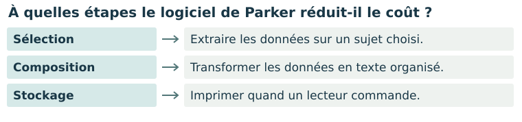
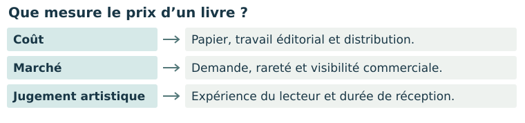

# ENS · MP-PC · Italien (LV1) 2008 — Corrigé brut

*Corrigé rédigé par IA, non officiel. Signalez toute erreur.*

**Rédaction** · GPT-6.2 Astra Ultra · vitesse non renseignée

Le cahier commun aux ENS de Paris, de Lyon et de Cachan dure deux heures. Dictionnaire et calculatrice interdits pour l’italien. Les deux questions demandent 200 mots au total.

## V. Version française

**Un logiciel ingénieux**

Il y a ceux qui mettent toute une vie à écrire un livre pour ensuite le laisser dans un tiroir, et ceux qui auraient besoin d’une bibliothèque entière pour y faire tenir tous les volumes publiés au cours de leur carrière. Philip M. Parker, professeur de marketing, est probablement l’écrivain le plus rapide du monde. En un peu plus de cinq ans, il a publié au moins 85 000 titres, soit environ 46 par jour. Son secret ? Un logiciel capable de composer des livres automatiquement et à très bas coût.

L’idée, explique cet Américain de quarante-sept ans au quotidien britannique The Guardian, lui est venue en 1999 à la lecture d’un article de The Economist qui affirmait que le marché de l’édition avait peu changé depuis Gutenberg. « Il faut un système automatisé qui supprime ou réduise sensiblement les coûts liés au travail humain », estime Parker.

En quelques années, il a ainsi mis au point une « machine à écrire des livres ». Le principe de fonctionnement, du moins en théorie, est assez simple. Il suffit d’un vaste fonds de données et d’un programme capable d’y faire une sélection et de transformer ces données en livre. Le logiciel de son invention puise dans une base de données des informations sur un sujet choisi, puis, au moyen d’une série d’opérations, produit directement le texte. Parker estime le coût final de l’opération à environ 0,12 livre sterling, soit seize centimes d’euro. Les frais d’entreposage sont eux aussi quasi inexistants. Le volume n’est imprimé que lorsque quelqu’un en fait la demande.

## 1. Fino a che punto è possibile affidare la creatività artistica ai computer?

Un programma può produrre combinazioni che sorprendono perfino chi lo ha progettato. Un musicista può ascoltarle, scartarne alcune e svilupparne una che non gli sarebbe venuta in mente. Il computer partecipa allora alla ricerca artistica. Tuttavia raccogliere tutti i dati disponibili su una città non basta per decidere se raccontarla attraverso gli occhi di un pendolare o di qualcuno che sta per lasciarla. La scelta cambia il ritmo, le immagini e il significato del testo. Affiderei volentieri alla macchina certe operazioni ripetitive, lasciando aperta la domanda su chi risponde della prospettiva proposta al lettore e sa spiegare perché meriti attenzione.

*100 mots.*

## 2. L’arte si deve valutare come una merce?

Un libro si vende e chi lo scrive deve poter vivere del proprio lavoro. Il prezzo informa sui costi, sulla domanda e sulla rarità di un esemplare. Dice meno su ciò che una pagina permette di capire. Una poesia stampata in pochi fogli può accompagnare un lettore per anni, mentre un volume costoso può essere comprato per arredare uno scaffale. Considererei perciò le condizioni economiche della produzione senza far coincidere il successo commerciale con il giudizio estetico. Biblioteche e prestiti consentono di incontrare opere che il mercato rende poco visibili e di discuterne il valore anche quando nessuno le acquista.

*100 mots.*

Le passage de La Repubblica.it date de février 2008. Les deux réponses italiennes totalisent 200 mots, comme l’exige la page 5 du cahier. Le rapport de cette option n’a pas été retrouvé.

[Version et consignes](https://banques-ecoles.fr/cms/wp-content/data/filiere-pc/annales-de-la-banque-pc/session-2008/sujet-ecrit-2008_mppc_sujet_langue_vivante_1.pdf#page=5)
