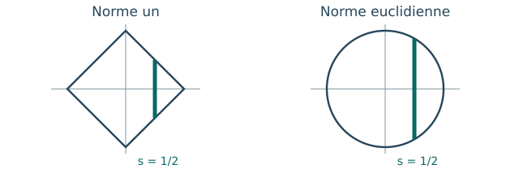
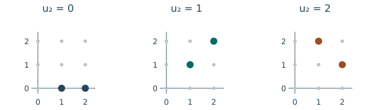
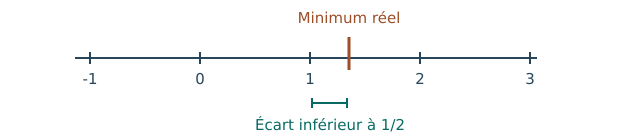

# ENS · MP-PC · Mathématiques-informatique 2008 — corrigé brut

*Corrigé rédigé par IA, non officiel. Signalez toute erreur.*

**Rédaction** · GPT-6.2 Astra Ultra · vitesse non renseignée · 25 novembre 2026

**Révision** · GPT-6.2 Astra Ultra · vitesse non renseignée · 26 novembre 2026

On écrit les vecteurs en colonnes et les inégalités composante par composante. Le rapport corrige la borne de 2.11. La symétrie centrale nécessaire aux estimations de la dernière partie est explicitée en 4.2.

## Partie 1 · Cônes et programmation linéaire

### Question 1.1 · Décrire un cône

Si $Cx,Cy\le0$, alors $C(\lambda x+\mu y)\le0$ pour $\lambda,\mu\ge0$. Pour $x=Au,y=Av$ avec $u,v\ge0$, le nouveau vecteur de coefficients est $\lambda u+\mu v\ge0$. Un cône est convexe et stable par dilatations positives ou nulles. Réciproquement, pour $s=\lambda+\mu>0$, écrire la somme comme $s((\lambda/s)x+(\mu/s)y)$. Si $s=0$, utiliser la dilatation nulle. Une ligne $c^T$ de $C$ impose le demi-espace $c^Tx\le0$. On prend leur intersection.

### Question 1.2 · Calcul du polaire

(a) Le polaire est l’intersection des demi-espaces $z^Tx\le1$ indexés par $x\in K$. (b) Tout $x\in K$ satisfait précisément toutes les contraintes imposées par $z\in K^*$. (c) Si $x$ et tous ses multiples positifs sont dans $K$, alors $z^Tx\le0$ pour $z\in K^*$, et cette condition suffit. Elle est stable par combinaisons positives. (d) Pour $K=A\mathbb R_+^m$, il suffit et il faut que $A^Tz\le0$, en testant les colonnes puis leurs combinaisons positives. (e) Pour $K=\{x:Cx\le0\}$, chaque ligne de $C$ est dans $K^*$. D’après (c), un point du bipolaire satisfait donc toutes les lignes, d’où l’égalité par (b).

### Question 1.3 · Pivots, terminaison et alternative de Farkas

La base $D$ fournit des coordonnées uniques $p$ de $b$. Soit $z$ la forme coordonnée d’indice sortant $h$. Alors $z^Tb=p_h<0$. Une colonne entrante $a_k$ vérifie $z^Ta_k<0$, elle est hors de l’hyperplan des $n-1$ colonnes conservées, donc la nouvelle famille est une base. Au premier arrêt, $p\ge0$ donne la représentation demandée. Au second, $A^Tz\ge0$ et $-z\in K^*$.

Supposons un cycle et choisissons le plus grand indice $r$ qui change d’appartenance. En lisant le cycle circulairement, prenons une sortie de $r$ en $P$ puis son entrée en $Q$. La forme $z_Q$ vérifie $z_Q^Ta_r<0$, et $z_Q^Ta_i\ge0$ pour $i<r$ par minimalité de l’entrant. Toute colonne d’indice supérieur à $r$ présente en $P$ reste en $Q$ et y a coordonnée duale nulle, puisque le sortant en $Q$ change d’appartenance. Dans la base de $P$, $p_r<0$ et $p_i\ge0$ pour $i<r$ par minimalité du sortant. Donc $z_Q^Tb=\sum p_i z_Q^Ta_i>0$, alors que cette quantité est négative en $Q$. Les bases étant en nombre fini, l’arrêt est certain.

À l’arrêt dual, $z$ annule les $n-1$ colonnes conservées. Les deux issues sont exclusives car $b=Ay$, $y\ge0$ entraînerait $z^Tb=(A^Tz)^Ty\ge0$.

### Question 1.4 · Deux représentations finies

Pour $K=A\mathbb R_+^m$, Farkas donne $x\in K$ si et seulement si $z^Tx\le0$ pour tout $A^Tz\le0$. Cela donne $K=K^{**}$. Restreignons-nous à l’espace $E$ des colonnes, de dimension $r$. Pour $x\in E\setminus K$, le certificat peut être choisi normal à $r-1$ colonnes indépendantes. Chaque tel sous-ensemble détermine dans $E$ une droite de normales. Retenons parmi ses deux orientations celles qui sont non positives sur toutes les colonnes. Il n’y a qu’un nombre fini de tests. Ajouter les équations de $E$, chacune sous forme de deux inégalités. Si $r=0$, $K=\{0\}$ directement.

Réciproquement, si $K=\{x:Cx\le0\}$, formons le cône $J$ engendré par les lignes de $C$. Alors $K=J^*$ et $K^*=J^{**}=J$. Comme $J$ est polyédral d’après ce qui précède, écrivons $J=\{z:Hz\le0\}=L^*$ avec $L$ engendré par les lignes de $H$. Il suit $K=J^*=L^{**}=L$.

### Question 1.5 · Dualité forte

Écrire $Ax\le b$ comme $Au-Av+s=b$ avec $u,v,s\ge0$. L’alternative pour $(A,-A,I)$ dit exactement que tout $y\ge0$ tel que $A^Ty=0$ satisfait $b^Ty\ge0$. Si $x,y$ sont réalisables pour les problèmes primal et dual, $c^Tx=y^TAx\le b^Ty$.

Ajoutons aux contraintes $Ax\le b$, $A^Ty=c$, $y\ge0$ l’inégalité $-c^Tx+b^Ty\le0$. Les multiplicateurs non négatifs pour les cinq blocs sont $u,s,t,v,\lambda$, où l’égalité est dédoublée. Posons $h=s-t$. L’annulation des coefficients impose $A^Tu=\lambda c$ et $Ah-v+\lambda b=0$. Il faut prouver $b^Tu+c^Th\ge0$. Si $\lambda>0$, appliquer la dualité faible aux réalisables $-h/\lambda$ et $u/\lambda$. Si $\lambda=0$, choisir des réalisables $x_0,y_0$ des problèmes initiaux. Alors $b^Tu\ge x_0^TA^Tu=0$ et $c^Th=y_0^TAh=y_0^Tv\ge0$. L’alternative établit la réalisabilité du système entier. L’égalité obtenue atteint les deux extrema.

## Partie 2 · Jauges et premier théorème de Minkowski

### Question 2.1 · Intégrales gamma et bêta

Pour $x>0$, $t^{x-1}$ est intégrable près de zéro et $e^{-t}t^{x-1}$ décroît assez vite à l’infini, par comparaison à $e^{-t/2}$. Une intégration par parties, avec $[e^{-t}t^x]_0^\infty=0$, donne $\Gamma(x+1)=x\Gamma(x)$. Pour $p,q>0$, intégrer $e^{-s-t}s^{p-1}t^{q-1}$ sur le quadrant positif. Le changement $u=s+t$, $v=s/(s+t)$ donne $u>0$, $0<v<1$, avec jacobien inverse $u$. La séparation des facteurs donne $\Gamma(p)\Gamma(q)=\Gamma(p+q)\int_0^1 v^{p-1}(1-v)^{q-1}\,dv$.

### Question 2.2 · Volume des boules

Par homothétie $V_{r,n}(R)=R^nV_{r,n}(1)$. En coupant suivant la dernière coordonnée $s$ et en posant $u=s^r$ sur la moitié positive,
$$
V_{r,n}(1)=\frac{2}{r}V_{r,n-1}(1)\,B(1/r,1+(n-1)/r).
$$
Avec $V_{r,1}(1)=2$, les quotients de gamma se simplifient en
$$
V_{r,n}(1)=\frac{(2\Gamma(1+1/r))^n}{\Gamma(1+n/r)}.
$$
Pour $r=1$, on a $2^n/n!$. Pour $r=2$, $\Gamma(1/2)=\sqrt\pi$ donne $\pi^{n/2}/\Gamma(1+n/2)$.

### Question 2.3 · Intérieur et adhérence

La combinaison de deux suites convergentes de points de $K$ prouve la convexité de $\overline K$. Si $B(x,r),B(y,r)\subset K$, toute combinaison convexe de $x,y$ peut être perturbée du même vecteur de norme $<r$ dans les deux boules. Elle est intérieure. Supposons $B(0,r)\subset K$. Pour $z\in\overline K$ et $0<t<1$, prenons $z_m\in K$ tendant vers $z$. Chaque boule $B(tz_m,(1-t)r)$ appartient à $K$ par convexité. Pour $m$ grand elle contient $B(tz,(1-t)r/2)$. Ainsi $t\overline K\subset K^\circ$, aussi pour $t=0$. Avec $t=1/\lambda$ on obtient $\overline K\subset\lambda K^\circ$ si $\lambda>1$.

### Question 2.4 · Propriétés de la jauge

Choisir $B(0,r)\subset K\subset B(0,R)$. Les dilatations admissibles existent et $\|x\|/R\le f(x)\le\|x\|/r$. Pour $a>0$, la substitution $\lambda=a\mu$ donne $f(ax)=af(x)$. Des dilatations décroissant vers l’infimum donnent $x/f(x)\in\overline K$ si $x\ne0$. Ainsi $f(x)<1$ entraîne $x\in K^\circ$ par 2.3, et un point intérieur peut être légèrement agrandi dans $K$, donc $f(x)<1$. De même $f(x)\le1$ implique $x\in\overline K$. Inversement $x\in\overline K$ appartient à $\lambda K$ pour tout $\lambda>1$, donc $f(x)\le1$. Enfin $(x+y)/(f(x)+f(y))$ est combinaison convexe des deux points normalisés de $\overline K$. On en déduit la sous-additivité. Un vecteur nul se traite directement.

### Question 2.5 · Reconstruire un corps convexe

L’homogénéité impose $f(0)=0$. Posons $M=\max_i\{f(e_i),f(-e_i)\}$. La décomposition suivant les axes donne $f(x)\le M\|x\|_1$. En appliquant la sous-additivité dans les deux sens, $|f(x)-f(y)|\le M\|x-y\|_1$. Sur la sphère unité de cette norme, le minimum $m$ de $f$ existe et est strictement positif. Ainsi $m\|x\|_1\le f(x)$. Le sous-niveau $K=\{f\le1\}$ est convexe, contient une boule autour de zéro et est borné. Enfin $x\in\lambda K$ équivaut à $f(x)\le\lambda$ pour $\lambda>0$, donc sa jauge est $f$.

### Question 2.6 · Polaire d’une boule

Soit $h(z)=\sup_{x\in K}z^Tx$. Le corps contient une boule et est borné, donc $0<h(z)<\infty$ pour $z\ne0$. Pour tout $t>0$, $z\in tK^*$ équivaut à $h(z)\le t$. L’infimum sur $t$ vaut $h(z)$, également à l’origine.

### Question 2.7 · Deux représentants d’une même classe

Dans le cube fondamental semi-ouvert $C$, translatons les morceaux $K\cap(z+C)$ par $-z$. La somme de leurs volumes vaut $\operatorname{Vol}(K)>1$. Deux morceaux d’indices distincts se recouvrent donc en un point $u$. Alors $u+z_1,u+z_2\in K$, et leur différence $z_1-z_2$ est entière et non nulle.

### Question 2.8 · Premier théorème de Minkowski

Si $\operatorname{Vol}(K)>2^n$, appliquer 2.7 à $K/2$. On trouve $u-v\in\mathbb Z^n\setminus\{0\}$ avec $2u,-2v\in K$. Leur milieu est dans $K$. Si $K$ est fermé et de volume $2^n$, chaque $(1+1/j)K$ contient un entier non nul. Tous sont dans un borné et une sous-suite est constante, de valeur $z$. Alors $z/(1+1/j)\in K$ le long de cette sous-suite, donc $z\in K$.

### Question 2.9 · Premier minimum d’un réseau

Les entiers de jauge inférieure à une constante sont en nombre fini, puisque la jauge domine un multiple de la norme. Ainsi $m=\min_{z\ne0} f(z)$ existe sur le réseau entier. Si $t<m$, $tK$ exclut tout entier non nul. Si $t>m$, il contient un minimiseur dans son intérieur. L’infimum demandé est $m$, même pour un corps ouvert. Minkowski appliqué à chaque $tK$ de volume $>2^n$ donne $m\le2\operatorname{Vol}(K)^{-1/n}$. Appliquer cette formule à $A^{-1}K$, de jauge $y\mapsto f(Ay)$ et de volume $\operatorname{Vol}(K)/|\det A|$, donne le facteur supplémentaire $|\det A|^{1/n}$.

### Question 2.10 · Cube et boule en norme un

Le cube unité de la norme infinie a volume $2^n$. Par 2.9 il existe $0\ne y\in\mathbb Z^n$ tel que $x=Ay$ vérifie $\max|x_i|\le|\det A|^{1/n}$, d’où $|\prod x_i|\le|\det A|$. La boule de la jauge $f(x)=\|x\|_1/n$ a volume $2^nn^n/n!$. Pour le nouveau point fourni par 2.9, l’inégalité arithmético-géométrique donne
$$
\left|\prod_i x_i\right|\le f(x)^n\le |\det A|\,n!/n^n.
$$

### Question 2.11 · Approximation simultanée

La première assertion imprimée suppose seulement $\prod c_i=1$. Avec $A=I_2$ et $c_1=c_2=-1$, même le vecteur nul échoue aux deux inégalités. Prenons donc des demi-largeurs $c_i>0$ de produit $1$. La matrice $\operatorname{diag}(1/c_i)A$ a déterminant de valeur absolue $1$. Appliquer 2.10 donne $|(Ay)_i|\le c_i$. En dimension $n+1$, appliquer le résultat à la transformation entière de paramètres $(p,q)\mapsto(qa_1-p_1,\ldots,qa_n-p_n,q)$, c’est-à-dire une application linéaire réelle de déterminant $\pm1$ évaluée sur des paramètres entiers. Choisir les demi-largeurs $N^{-1/n},\ldots,N^{-1/n},N$, avec $N>1$. Si $q=0$, tous les $p_i$ seraient nuls. Changer le signe au besoin donne $1\le q\le N$ et
$$
|a_i-p_i/q|\le 1/(qN^{1/n})\le q^{-1-1/n}.
$$
Le jury corrige la borne imprimée $N^{-1-1/n}$. Pour $n=1$, $N=3$, $a=1/6$, les fractions de dénominateur au plus trois sont à distance au moins $1/6>1/9$ de $a$.

## Partie 3 · Minima successifs et réseaux admissibles

### Question 3.1 · Choix des vecteurs minimaux

Construire $z_i$ en minimisant $f$ sur les entiers hors de l’espace $E_{i-1}$ des précédents. Cet ensemble rencontre la base canonique tant que $i\le n$. Le minimum existe par finitude dans les sous-niveaux bornés. Les valeurs obtenues croissent. Si $t<f(z_i)$, tous les entiers de $tK$ sont dans $E_{i-1}$. Si $t>f(z_i)$, les $i$ premiers vecteurs sont dans $tK$. Les deux comparaisons donnent $\lambda_i=f(z_i)$.

### Question 3.2 · Déterminant intrinsèque

Les colonnes de $B$ ont des coordonnées entières dans $A$, soit $B=AQ$. De même $A=BR$ avec $R$ entière. L’inversibilité donne $QR=RQ=I$. Les entiers $\det Q,\det R$ ont produit un et valent donc $\pm1$, d’où $|\det B|=|\det A|$.

### Question 3.3 · Seuil d’admissibilité

Si $\Lambda=A\mathbb Z^n$ est admissible, $A^{-1}K$ ne contient aucun entier non nul. Minkowski impose $\operatorname{Vol}(K)/\det\Lambda\le2^n$. L’infimum donne $2^n\Delta(K)\ge\operatorname{Vol}(K)$. Réciproquement, si $\operatorname{Vol}(K)>2^n$, cette inégalité exclut l’admissibilité de $\mathbb Z^n$, de déterminant un. Le cas d’égalité pour un corps fermé se retrouve par passage à la limite comme en 2.8.

### Question 3.4 · Une partition modulo un premier

Un point $v$ de $\Lambda(p,u)$ vérifie $v_j\equiv v_1u_j\pmod p$ pour $j\ge2$, car la première coordonnée impose le coefficient de $u$. Ces conditions suffisent. Si $p\nmid v_1$, elles fixent $u_j\equiv v_jv_1^{-1}\pmod p$ avec un unique représentant entre zéro et $p-1$. D’où une partition par les $p^{n-1}$ choix de $u$.

### Question 3.5 · Comptage moyen

Posons $s=p^{-(n-1)/n}$. Les points de $s\mathbb Z^n$ appartenant à $K$ ont chacun un cube rencontrant $K$. Par la limite admise et $\operatorname{Vol}(K)<1$, leur nombre est strictement inférieur à $p^{n-1}$ pour $p$ assez grand. Parmi les $p^{n-1}$ classes de 3.4, au moins une ne contribue aucun point de $K\cap sY$. Dans le réseau correspondant, un point hors de $Y$ a toutes ses coordonnées multiples de $p$. Supposons aussi $|x_j|<p^{1/n}$ pour $x\in K$, possible par bornitude. Un tel multiple dans $s^{-1}K$ a toutes ses coordonnées de valeur absolue $<p$, donc est nul. Ainsi $s\Lambda(p,u)$ est admissible. Son déterminant est $s^np^{n-1}=1$.

### Question 3.6 · Borne de Hlawka

Pour tout $t>0$ tel que $t^n\operatorname{Vol}(K)<1$, la question précédente donne un réseau $L$ de déterminant un admissible pour $tK$. Alors $t^{-1}L$ est admissible pour $K$ et de déterminant $t^{-n}$. Faire croître $t$ vers $\operatorname{Vol}(K)^{-1/n}$ donne $\Delta(K)\le\operatorname{Vol}(K)$.

## Partie 4 · Réduction d’une base de réseau

### Question 4.1 · Jauge quotient

Posons $E_{i-1}=\operatorname{Vect}(b_1,\ldots,b_{i-1})$. La fibre au-dessus de $\pi_i(x)$ est $x+E_{i-1}$. Pour $t>0$, elle rencontre $tK$ exactement lorsque $\pi_i(x)\in t\pi_i(K)$. En prenant l’infimum des facteurs, $f_i(x)=g_i(\pi_i(x))$. L’image est convexe, bornée et contient un voisinage relatif de zéro. On peut aussi travailler sur la fermeture, qui donne la même jauge.

### Question 4.2 · Dernière coordonnée non nulle

Les estimations qui suivent utilisent la symétrie centrale comme dans la partie 3. Avec $a_i=f_i(b_i)$, soit $x=\sum m_jb_j\ne0$ entier et $k$ le plus grand indice non nul. Alors $f(x)\ge f_k(x)=|m_k|a_k\ge a_k$. Si les $a_i$ croissent, $f(x)\ge a_1=f(b_1)$, borne atteinte. Si l’on lit le début de la partie 4 sans hypothèse de symétrie, cette affirmation échoue déjà pour $n=1$, $b_1=1$ et $K=[-2,1]$, où $f(-1)=1/2<f(1)$.

### Question 4.3 · Terminaison et correction de la réduction

Le minimum entier de $m\mapsto f_i(b_{i+1}+mb_i)$ existe par coercivité sur la droite projetée. Addition de colonne et transposition préservent la base entière. Avant l’examen d’indice $i$, les couples d’indices strictement inférieurs à $i$ sont réduits. Un succès valide le couple courant. Après échange, seuls les tests à partir de $i-1$ peuvent devoir être repris, les préfixes antérieurs étant conservés. Ainsi la sortie à $n$ certifie tous les couples.

Il y a un nombre fini d’échanges à chaque indice. En effet, après le dernier échange à un indice $<i$ (récurrence, vide pour $i=1$), le sous-espace $E_{i-1}$ est fixe. Les images du réseau dans le quotient forment un réseau discret, puisque les projections des dernières colonnes d’une base adaptée en forment une base. Les jauges non nulles y sont minorées par un nombre positif. Les modifications par les colonnes antérieures ne changent pas $a_i=f_i(b_i)$ et chaque échange à $i$ le multiplie par un facteur strictement inférieur à $1-\varepsilon$. Il ne peut y en avoir une infinité. Après le dernier échange, l’indice avance jusqu’à $n$.

### Question 4.4 · Du minimum réel au minimum entier

Posons $d=1/2-\varepsilon$ et $a_i=f_i(b_i)$. Le minimum réel de $f_i(b_{i+1}+tb_i)$ existe et vaut $a_{i+1}$ par 4.1. Arrondissons un minimiseur réel à un entier $m$ à distance au plus $1/2$. Par réduction de taille puis inégalité triangulaire, $f_i(b_{i+1})\le f_i(b_{i+1}+mb_i)\le a_{i+1}+a_i/2$. Le deuxième test de réduction entraîne $a_{i+1}\ge d a_i$. Si $x$ réalise $\lambda_1$ avec dernier indice $k$, 4.2 donne $\lambda_1\ge a_k\ge d^{k-1}a_1\ge d^{n-1}a_1$. Finalement $\lambda_1\le f(b_1)\le d^{1-n}\lambda_1$.

### Question 4.5 · Rendre la base propre

La transformation triangulaire unipotente entière des colonnes est inversible sur $\mathbb Z$ et conserve chaque espace préfixe. Les $f_j$ sont donc identiques. Pour chaque $i$, les $c_j$ antérieurs étant fixés, modifier la colonne courante successivement par un multiple entier de $c_{i-1},\ldots,c_1$. Au rang $j$, choisir ce multiple pour minimiser $f_j$ sur les translatés entiers. Les corrections ultérieures par des indices $<j$ sont invisibles à $f_j$, donc la propriété acquise persiste. Les colonnes obtenues ont la forme exigée en développant les $c_j$ suivant les $b_j$. Dans une base déjà réduite, les $a_j$ sont inchangés et le minimum entier du couple adjacent avait déjà été atteint. La nouvelle valeur $f_j(c_{j+1})$ égale donc l’ancienne, ce qui conserve aussi le second test.

### Question 4.6 · Majoration des minima successifs

Pour $j<i$, l’arrondi d’un minimiseur réel de $f_j(b_i+t b_j)$ et la propreté donnent $f_j(b_i)\le f_{j+1}(b_i)+a_j/2$. En sommant,
$$
f_j(b_i)\le a_i+\tfrac12\sum_{k=j}^{i-1}a_k.
$$
Comme $a_{k+1}\ge d a_k$, on a $f(b_i)\le a_i(1+\tfrac12\sum_{t=1}^{i-1}d^{-t})\le a_i d^{1-i}$. Pour la dernière inégalité, multiplier par $d^{i-1}$ et utiliser $1/2\le1-d$ dans la somme géométrique. Pour $k\le i$, $a_kd^{1-k}\le a_i d^{1-i}$. Les $i$ premières colonnes indépendantes donnent ainsi $\lambda_i\le a_i d^{1-i}$. Pour une base réduite quelconque, 4.5 la rend propre en conservant les $a_i$ et le réseau, donc la dernière borne.

### Question 4.7 · Minoration des minima successifs

Écrivons $x_j=\sum_k m_{jk}b_k$ avec $f(x_j)=\lambda_j$. Parmi $x_1,\ldots,x_i$, l’un possède un coefficient non nul à un indice $k\ge i$, sinon leur espace aurait dimension au plus $i-1$. Prendre $k$ maximal parmi tous ces indices et un $j\le i$ correspondant. Alors $f(x_j)\ge f_k(x_j)=|m_{jk}|a_k\ge a_k$. Ainsi
$$
\lambda_i\ge\lambda_j\ge a_k\ge d^{k-i}a_i\ge d^{n-i}a_i.
$$
Avec 4.6, les valeurs calculables $a_i$ encadrent chaque minimum par $d^{n-i}a_i\le\lambda_i\le d^{1-i}a_i$.
