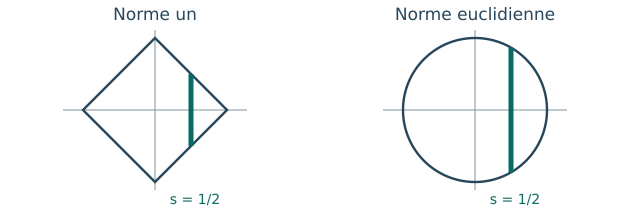
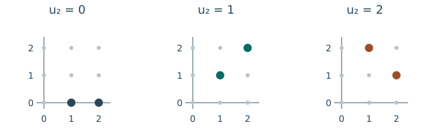
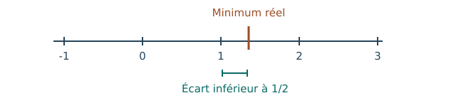

# ENS · MP-PC · Mathématiques-informatique 2008 — corrigé guidé

*Corrigé rédigé par IA, non officiel. Signalez toute erreur.*

**Rédaction** · GPT-6.2 Astra Ultra · vitesse non renseignée · 25 novembre 2026

**Révision** · GPT-6.2 Astra Ultra · vitesse non renseignée · 26 novembre 2026

Comment passer d’inégalités sur un continu à l’existence d’un point entier ? Le certificat de Farkas sépare un point d’un cône. Le volume donne ensuite des points du réseau et les projections permettent d’estimer leurs longueurs.

## Partie 1 · Cônes et programmation linéaire

### Question 1.1 · Décrire un cône

Pour la description par inégalités, additionner les deux systèmes après multiplication par des facteurs positifs. Pour la description par colonnes, faire la même opération sur les coefficients des générateurs. Pour passer de la convexité à une combinaison positive quelconque, normaliser la somme des deux poids à un, puis dilater du facteur ôté. Le cas des deux poids nuls fournit l’origine. Chaque ligne de la matrice décrit une seule des contraintes.

### Question 1.2 · Calcul du polaire

Tracer mentalement une contrainte par point $x$. Leur intersection est convexe. En échangeant les rôles dans le produit scalaire, on obtient $K\subset K^{**}$. Pour un cône, agrandir $x$ arbitrairement transforme la borne $1$ en borne $0$ sur $z^Tx$. On obtient encore un cône. Il suffit alors de vérifier le signe sur chaque générateur puisque les coefficients des sommes sont positifs. Enfin, si un point viole une ligne de $Cx\le0$, la normale de cette ligne est dans le polaire et a un produit strictement positif avec ce point. Le point est exclu du bipolaire.

### Question 1.3 · Pivots, terminaison et alternative de Farkas

La forme $z$ lit le coefficient de la colonne qui va sortir. Si sa lecture sur la nouvelle colonne est négative, celle-ci peut la remplacer car les autres ont lecture nulle. Si aucune coordonnée de $b$ n’est négative, la base donne un certificat primal. Si aucune colonne n’a une lecture négative, $z$ donne un certificat dual, nul sur les autres colonnes de la base.

Pour exclure un cycle, trier les indices une fois pour toutes. Suivre le plus grand indice mobile $r$ entre sa sortie et son entrée suivante. Au moment de l’entrée, prendre la forme coordonnée du sortant. Évaluer cette forme sur la décomposition de $b$ au moment de la sortie de $r$. Les indices fixes plus grands donnent zéro. Les indices plus petits donnent des produits positifs ou nuls par les deux choix minimaux. L’indice $r$ donne un terme strictement positif, produit de deux nombres négatifs. Or la forme était choisie pour lire une coordonnée négative de $b$. Ainsi aucune base ne se répète. Au terme des pivots, vérifier directement qu’une combinaison positive des colonnes ne peut avoir une lecture négative par un certificat dual.

### Question 1.4 · Deux représentations finies

Farkas assure qu’un point extérieur au cône engendré viole une inégalité du polaire, ce qui prouve la bipolarité. Pour obtenir une liste finie, travailler dans l’espace engendré par les colonnes. Un certificat y est perpendiculaire à un hyperplan porté par des colonnes. Lister les familles indépendantes de taille $r-1$, tester les deux sens de la normale et imposer les tests valables pour tous les générateurs. Hors de l’espace engendré, ses équations suffisent à exclure le point. L’espace réduit à zéro se traite immédiatement.

Pour remonter des contraintes aux générateurs, prendre d’abord comme générateurs les normales des contraintes. Leurs combinaisons forment $J$ et le cône de départ vaut $J^*$. La première moitié fournit des contraintes finies pour $J$. Les normales de cette seconde description engendrent à leur tour un cône dont le bipolaire est précisément $J^*$.

### Question 1.5 · Dualité forte

Une variable libre est différence de deux variables positives. Une inégalité reçoit une variable d’écart positive. Farkas appliqué aux trois blocs fournit $A^Ty=0$, $y\ge0$ et le critère $b^Ty\ge0$.

Tout couple admissible vérifie déjà $c^Tx\le b^Ty$. Cherchons donc un couple qui vérifie aussi l’autre sens. Dans le test de réalisabilité de ce système augmenté, appelons $u$ le poids de $Ax\le b$, $h$ le poids signé de $A^Ty=c$, $v$ le poids de $-y\le0$ et $t$ celui de l’inégalité ajoutée. Les poids non signés sont positifs ou nuls. L’annulation donne $A^Tu=tc$ et $Ah+tb=v$. Si $t>0$, les vecteurs $-h/t$ et $u/t$ sont admissibles et leur inégalité faible donne $b^Tu+c^Th\ge0$. Si $t=0$, tester $u$ sur une solution primale et $Ah=v$ sur une solution duale donne séparément la positivité des deux termes. Le système augmenté a ainsi une solution. La valeur commune y est simultanément un maximum et un minimum.

## Partie 2 · Jauges et premier théorème de Minkowski

### Question 2.1 · Intégrales gamma et bêta

Séparer l’intégrale à $1$. Le seul risque à gauche est une puissance d’exposant au plus $-1$, écarté par $x>0$. À droite, l’exponentielle domine la puissance. En dérivant $t^x$ dans l’intégration par parties, on récupère le facteur $x$. Pour le produit de deux intégrales, Tonelli s’applique car tout est positif. À somme $u$ fixée, écrire $s=uv$ et $t=u(1-v)$. L’élément d’aire devient $u\,du\,dv$. L’intégrale en $u$ est alors $\Gamma(p+q)$, celle en $v$ est le facteur demandé.

### Question 2.2 · Volume des boules

À l’altitude $s$, le rayon disponible pour les $n-1$ autres coordonnées est $(1-|s|^r)^{1/r}$. Le volume de cette tranche est proportionnel à sa puissance $n-1$. Intégrer pour $s$ de $0$ à $1$ et doubler par symétrie. La substitution $u=s^r$ amène le facteur $2B(1/r,1+(n-1)/r)/r$. La récurrence part du segment de longueur deux. Le facteur $\Gamma(1+(n-1)/r)$ annule le dénominateur de l’étape précédente, ce qui laisse $(2\Gamma(1+1/r))^n/\Gamma(1+n/r)$. Pour le rayon $R$, multiplier par $R^n$. Les boules unité de normes $1$ et $2$ ont respectivement pour volumes $2^n/n!$ et $\pi^{n/2}/\Gamma(1+n/2)$.

### Question 2.3 · Intérieur et adhérence

Entre deux points limites, approcher chaque extrémité par des points du convexe. Entre deux points intérieurs, déplacer les deux extrémités ensemble dans une petite boule. Ces deux constructions prouvent la convexité de l’adhérence et de l’intérieur. Pour la dilatation, joindre une boule de rayon $r$ autour de zéro à un point $z_m$ approchant $z$ depuis $K$. À la fraction $t<1$ du trajet, il reste une boule de rayon $(1-t)r$. Lorsque $z_m$ est assez proche de $z$, une demi-boule de ce rayon autour de $tz$ est donc dans $K$. Dilater de $1/t$ livre l’autre inclusion.

### Question 2.4 · Propriétés de la jauge

Pour voir qu’une direction rencontre toujours une dilatation du corps, utiliser la petite boule qu’il contient. La grande boule qui contient le corps empêche la jauge d’un point non nul d’être zéro. Un changement d’échelle conserve le quotient $x/\lambda$, ce qui donne l’homogénéité positive. À la valeur limite, le point normalisé est dans l’adhérence. Une jauge inférieure à un le ramène à l’intérieur par contraction. Réciproquement on peut pousser un point intérieur un peu plus loin sur son rayon. Pour l’adhérence, appliquer la dilatation externe de 2.3 et faire tendre son facteur vers un. Les niveaux ouverts et fermés sont donc $f<1$ et $f\le1$. La somme normalisée de deux vecteurs non nuls est sur le segment de leurs deux normalisés, avec poids proportionnels aux jauges. Sa jauge vaut au plus un, d’où l’inégalité triangulaire.

### Question 2.5 · Reconstruire un corps convexe

Un coefficient négatif de $x$ se traite avec $-e_i$. Prendre le maximum de $f$ sur les $2n$ directions signées donne le contrôle à l’origine. Comparer ensuite $f(x)$ à $f(y)+f(x-y)$, puis échanger $x$ et $y$, pour obtenir la continuité sur tout l’espace. Le minimum sur une sphère compacte ne peut être nul puisque la sphère exclut zéro. Par homogénéité, ce minimum borne le rayon de $\{f\le1\}$. La majoration donne au contraire une petite boule intérieure. Sous-additivité et homogénéité donnent la convexité. La condition $x/\lambda\in K$ relit alors directement la valeur de $f(x)$.

### Question 2.6 · Polaire d’une boule

Écrire la définition du polaire pour $z/t$. Toutes les inégalités $z^Tx/t\le1$ se résument à la comparaison du supremum avec $t$. Le plus petit facteur d’admission est ce supremum, bien fini puisque $K$ est borné.

### Question 2.7 · Deux représentants d’une même classe

Ramener chaque morceau du convexe dans le cube unité conserve son volume. Des morceaux disjoints y occuperaient ensemble au plus un. Deux points du corps ont donc les mêmes coordonnées modulo le réseau et proviennent de cubes distincts. Leur différence est un entier non nul, précision indiquée par le jury.

### Question 2.8 · Premier théorème de Minkowski

Le volume est divisé par $2^n$ lorsque l’on divise toutes les longueurs par deux. La différence fournie par les deux morceaux se réécrit comme moyenne de deux points de $K$ grâce à la symétrie centrale. Pour traiter l’égalité de volume, gonfler un peu le corps. Les points entiers obtenus n’ont qu’un nombre fini de valeurs possibles. Reprendre une valeur qui revient infiniment souvent et utiliser la fermeture à la limite.

### Question 2.9 · Premier minimum d’un réseau

Partir d’un entier test, puis examiner les points de jauge au plus celle du test. Leur ensemble fini contient un minimiseur. Toute dilatation un peu plus grande que sa jauge l’admet, et aucune dilatation plus petite ne convient. Pour borner la valeur, choisir le facteur qui donne exactement le volume $2^n$ puis l’approcher par valeurs supérieures. Si les points cherchés ont la forme $Ay$, ramener le corps dans les coordonnées entières avec $A^{-1}$ avant d’appliquer la même preuve.

### Question 2.10 · Cube et boule en norme un

Le cube traite d’un seul coup la plus grande coordonnée. En multipliant les $n$ bornes identiques on obtient le déterminant. Pour gagner le facteur $n!/n^n$, borner directement la moyenne arithmétique des valeurs absolues. Sa boule unité est une boule de norme un dilatée par $n$, donc de volume $n^n2^n/n!$. La moyenne géométrique étant inférieure à la moyenne arithmétique, la puissance $n$ de la borne de Minkowski contrôle le produit.

### Question 2.11 · Approximation simultanée

Pour interpréter les $c_i$ comme des demi-largeurs, prendre $c_i>0$. Le produit égal à un ne suffit pas à le garantir. Ainsi $A=I_2$ et $c_1=c_2=-1$ rendent les contraintes impossibles. Diviser ensuite chaque coordonnée par sa demi-largeur. Pour approcher les réels, faire entrer les erreurs $qa_i-p_i$ et le dénominateur $q$ dans un même pavé de dimension $n+1$. Le changement de variables a une matrice triangulaire par blocs de déterminant $\pm1$. Une largeur $N$ dans la dernière direction autorise une largeur $N^{-1/n}$ dans chacune des autres. Un vecteur non nul du pavé ne peut avoir $q=0$, car alors les $p_i$ entiers auraient valeur absolue strictement inférieure à un. Choisir $q$ positif puis diviser les erreurs par $q$. On obtient $1/(qN^{1/n})$, selon le rectificatif du rapport. Par exemple $a=1/6$, $N=3$ exclut la borne imprimée $1/9$.

## Partie 3 · Minima successifs et réseaux admissibles

### Question 3.1 · Choix des vecteurs minimaux

À chaque tour, écarter l’espace déjà obtenu et retenir un entier de plus petite jauge en dehors. Un vecteur canonique fournit toujours un témoin avant d’avoir atteint la dimension $n$. Une boule bornée ne contient qu’un nombre fini de candidats. Pour retrouver le seuil du sujet, tester un facteur un peu inférieur à la valeur choisie, puis un facteur un peu supérieur. Le rang du premier ensemble est au plus $i-1$, celui du second au moins $i$. Cela traite aussi les égalités de minima successifs.

### Question 3.2 · Déterminant intrinsèque

Changer de base dans un même réseau donne une matrice entière dans chacun des deux sens. Ces matrices étant inverses, leurs déterminants sont des entiers inversibles, donc de valeur absolue un. Le volume du parallélépipède fondamental est donc indépendant de la base.

### Question 3.3 · Seuil d’admissibilité

Mesurer le corps dans une base du réseau divise son volume par le déterminant. L’absence de point entier non nul y impose donc un volume au plus $2^n$. Cette contrainte sur tous les réseaux admissibles porte aussi sur l’infimum de leurs déterminants. Dans l’autre sens, prendre le réseau entier standard montre que tout corps de volume strictement supérieur à $2^n$ doit le rencontrer hors de zéro.

### Question 3.4 · Une partition modulo un premier

Réduire les coordonnées modulo $p$ fait disparaître les colonnes $pe_2,\ldots,pe_n$. Tout point du réseau est alors un multiple de $(1,u_2,\ldots,u_n)$. Si sa première coordonnée est inversible, on peut normaliser ce point en divisant toutes ses coordonnées par la première. Le résultat détermine un unique $u$ et l’écart est absorbé par les colonnes multiples de $p$. Chaque point considéré est donc classé une fois exactement.

### Question 3.5 · Comptage moyen

Comparer le nombre de points de la grille dans le corps au nombre de classes possibles. La somme de Riemann admise donne, pour un grand premier, moins de points que de classes. Choisir une classe vide parmi les points de première coordonnée inversible. Que reste-t-il dans le réseau choisi ? Lorsque la première coordonnée est multiple de $p$, les congruences imposent la même divisibilité partout. Après remise à l’échelle, tout point non nul de cette sorte aurait une coordonnée au moins $sp=p^{1/n}$, trop grande pour $K$. Le facteur $s^n$ appliqué au déterminant triangulaire $p^{n-1}$ donne un.

### Question 3.6 · Borne de Hlawka

Réduire le volume juste en dessous de un pour employer la construction précédente, puis agrandir le réseau et le corps du même facteur. Plus le volume intermédiaire approche un, plus le déterminant final approche le volume initial. La définition par infimum permet de passer à cette limite sans avoir à choisir un réseau limite.

## Partie 4 · Réduction d’une base de réseau

### Question 4.1 · Jauge quotient

Deux représentants qui diffèrent par une combinaison réelle des premiers vecteurs ont la même projection. Minimiser leur jauge revient donc à demander à quelle échelle le corps projeté atteint cette projection. Cela donne la jauge de $\pi_i(K)$ dans le sous-espace restant.

### Question 4.2 · Dernière coordonnée non nulle

Décomposer un entier non nul dans la base puis effacer toutes les coordonnées avant la dernière coordonnée non nulle. La projection ne peut accroître la jauge. Le coefficient restant est entier de valeur absolue au moins un et la jauge projetée est une norme quand $K=-K$. On obtient donc une valeur au moins $a_k$, elle-même au moins $f(b_1)$ selon l’hypothèse. La symétrie est nécessaire pour traiter un coefficient négatif. Le segment de bornes $-2$ et $1$ fournit un contre-exemple à la lecture asymétrique de l’énoncé.

### Question 4.3 · Terminaison et correction de la réduction

L’étape de taille minimise une fonction qui tend vers l’infini dans les deux sens de la droite. Elle conserve le réseau. Une paire validée reste valable tant que l’on ne touche plus à ses colonnes ni à l’espace qui les précède. C’est pourquoi un échange ne demande de reculer que d’un rang et pourquoi atteindre le dernier indice certifie la réduction.

Au premier rang, chaque échange réduit la longueur de $b_1$ d’un facteur inférieur à $1-\varepsilon$. Or les vecteurs entiers non nuls ont une longueur minimale positive. Une fois ces échanges épuisés, appliquer le raisonnement au deuxième rang dans le quotient par le premier. Plus généralement, une fois les échanges antérieurs épuisés, le quotient par le préfixe fixe contient un réseau discret, engendré librement par les images des autres colonnes. La longueur projetée du vecteur courant y est bornée inférieurement et ne change pas quand on lui ajoute une colonne antérieure. Une suite infinie d’échanges à ce rang est donc impossible. Une suite sans échange ne fait qu’avancer.

### Question 4.4 · Du minimum réel au minimum entier

Un représentant optimal autorise un coefficient réel sur $b_i$. Passer à l’entier le plus proche coûte au plus une demi-longueur projetée de $b_i$. Le représentant entier initial a déjà la longueur minimale parmi les choix entiers. Sa longueur est donc comprise entre $(1-\varepsilon)a_i$ et $a_{i+1}+a_i/2$. Soustraire donne $a_{i+1}\ge(1/2-\varepsilon)a_i$. Appliquer cette inégalité de proche en proche jusqu’au dernier coefficient d’un vecteur réalisant le premier minimum. Cela borne $f(b_1)$ par $\lambda_1(1/2-\varepsilon)^{1-n}$. L’autre sens découle du fait que $b_1$ est un entier non nul.

### Question 4.5 · Rendre la base propre

Ajouter une colonne antérieure laisse inchangés tous les espaces de projection et le déterminant. Pour traiter une colonne, commencer avec sa voisine de gauche, choisir le meilleur multiple entier, puis reculer. Une correction à gauche disparaît dans toutes les projections déjà traitées. Le résultat vérifie donc la minimalité vis-à-vis de chacune des colonnes précédentes. Pour le couple adjacent d’une base réduite, le choix précédent atteignait déjà le minimum. L’opération conserve cette valeur comme elle conserve les longueurs projetées diagonales. Les deux conditions de réduction subsistent.

### Question 4.6 · Majoration des minima successifs

Au rang $j$, la propreté permet de comparer la colonne au meilleur décalage entier, même si elle n’est pas voisine de $b_j$. Le meilleur décalage réel donne la longueur au rang suivant. Le passage de l’un à l’autre coûte au plus $a_j/2$. Remonter de $i$ à $1$ additionne ces coûts, avec terme final $a_i$. Chaque $a_{i-t}$ est au plus $d^{-t}a_i$. La somme majorante, multipliée par $d^{i-1}$, vaut $d^{i-1}+\frac12(1+d+\cdots+d^{i-2})\le1$. La même borne $a_i d^{1-i}$ domine les longueurs des $i$ premières colonnes, d’où une famille indépendante admissible au seuil. Une base réduite peut au préalable être rendue propre sans modifier les $a_i$.

### Question 4.7 · Minoration des minima successifs

Les $i$ vecteurs minimaux indépendants ne tiennent pas dans l’espace des $i-1$ premières colonnes. Repérer donc le dernier indice utilisé par l’un d’eux et projeter sur le quotient qui commence à cet indice. Il reste un multiple entier non nul de la colonne correspondante. Sa longueur projetée est au moins $a_k$. Entre $i$ et $k$, la réduction ne fait perdre qu’un facteur $d=1/2-\varepsilon$ par pas, et il y a au plus $n-i$ pas. La longueur de ce vecteur minimal est donc au moins $d^{n-i}a_i$, ce qui minore aussi $\lambda_i$.
