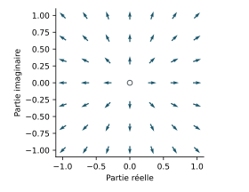
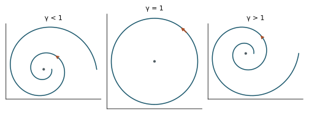
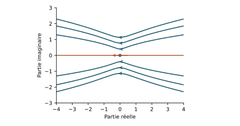
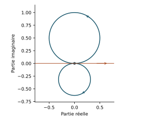
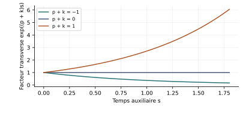

# ENS — Mathématiques MPI 2, 2008 · Corrigé guidé

*Corrigé rédigé par IA, non officiel. Signalez toute erreur.*

**Rédaction** · GPT-6.2 Astra Ultra · vitesse non renseignée

**Révision** · GPT-6.2 Astra Ultra · vitesse non renseignée

La garde 80.03M porte une durée de quatre heures. L’épreuve est commune aux ENS de Paris, Lyon et Cachan pour les groupes MP/MPI et I de la filière MP. Pour le groupe I des filières MP et PC, elle est aussi proposée en option commune à Paris et Lyon. Une calculatrice de poche autonome, non imprimante et sans document d’accompagnement est autorisée. [Sujet officiel](https://www.ens.psl.eu/IMG/file/concours/2008/MP/mp_sujet_maths_mpi2.pdf). La rubrique MPI 2 de l’index ENS-PSL ne fournit aucun lien vers un rapport de cet écrit. [Index de la session](https://www.ens.psl.eu/rapports-et-sujets-2008-mpi).

Les trajectoires du champ homogène sont étudiées en deux temps. On note $t$ le temps physique et $s$ le temps auxiliaire. Le sens 1 autorise un nombre fini de zéros isolés, le sens 2 autorise aussi des attentes à l’origine.

## I. Deux notions de solution et changement de temps

### Question I.1

> [!INDICATION]
> Au raccord non nul, exploiter la continuité du champ.

#### Solution

Hors des instants exceptionnels, l’équation est acquise. Si $x(t_i)\ne0$, le champ est continu près de ce point et $x'(s)=\phi(x(s))\to\phi(x(t_i))$ des deux côtés. En intégrant sur chacun des morceaux jusqu’au raccord, les quotients de différences à gauche et à droite tendent à cette même valeur. Ainsi $x$ est dérivable en tout temps où il est non nul, ce qui donne le sens 2.

Pour détailler le raccord, la continuité de $x$ et la non-nullité de $x(t_i)$ donnent un voisinage où le champ reste défini et borné. En y intégrant $x'=\phi(x)$ jusqu’à $t_i$ depuis la gauche ou la droite, les deux quotients différentiels sont des moyennes de $\phi(x(s))$ qui tendent vers $\phi(x(t_i))$. Aucun quotient à travers un passage en zéro n’est requis au sens 2.

### Question I.2

> [!INDICATION]
> Exprimer le vecteur dans la base orthonormée formée par la direction radiale et sa rotation d’un quart de tour.

#### Solution

Pour $x=re^{i\theta}$, le complexe $e^{-i\theta}\phi(x)$ a pour partie réelle sa composante radiale $\psi_0(x)$ et pour partie imaginaire sa composante tangentielle orientée $\chi_0(x)$. Pour $k>0$, la direction et le vecteur $\phi(kx)=\phi(x)$ sont inchangés : les deux composantes sont homogènes de degré zéro.

### Question I.3

> [!INDICATION]
> Restituer la rotation qui transporte la base fixe vers la base polaire.

#### Solution

On obtient $\phi(re^{i\theta})=e^{i\theta}(\psi(\theta)+i\chi(\theta))$. Les deux fonctions réelles sont lisses et $2\pi$-périodiques.

### Question I.4

> [!INDICATION]
> Dériver le produit polaire et identifier partie réelle et partie imaginaire.

#### Solution

L’égalité $e^{-i\theta}x'=\rho'+i\rho\theta'=\psi(\theta)+i\chi(\theta)$ donne $\rho'=\psi(\theta)$ et $\theta'=\chi(\theta)/\rho$ sur tout morceau où $\rho>0$.

### Question I.5

> [!INDICATION]
> Appliquer la règle de la chaîne à la composition par le changement de temps.

#### Solution

Notons $s$ le temps auxiliaire, $t=\tau(s)$ le temps physique, $R=\rho\circ\tau$ et $\Theta=\theta\circ\tau$. Comme $\tau'=R$, on trouve $\Theta'=\chi(\Theta)$ et $R'=\psi(\Theta)R$.

### Question I.6

> [!INDICATION]
> Résoudre d’abord l’équation angulaire, puis l’équation radiale devenue linéaire.

#### Solution

La fonction $\chi$ a une dérivée bornée par périodicité. L’équation scalaire $\Theta'=\chi(\Theta)$ a donc une unique solution globale de condition initiale $\theta_0$ (existence locale, prolongement grâce à $|\Theta'|\le\|\chi\|_\infty$). Une fois cette solution connue,
$$R(s)=\rho_0\exp\!\left(\int_0^s\psi(\Theta(v))\,dv\right)$$
est l’unique solution radiale. Elle est strictement positive et finie pour tout temps réel car $\psi$ est bornée.

### Question I.7.a

> [!INDICATION]
> Comparer les vecteurs associés à deux points d’une même demi-droite.

#### Solution

Pour $k>0$, $kx/|kx|=x/|x|$. Le vecteur a longueur un et pointe radialement vers l’extérieur. Ici $\psi=1$, $\chi=0$.

### Question I.7.b

> [!INDICATION]
> Sur un morceau positif, l’angle est fixe et le rayon croît à vitesse un.

#### Solution

Si $x(t_i)\ne0$, poser $u=x(t_i)/|x(t_i)|$ : $x(t)=x(t_i)+(t-t_i)u$. Si $x(t_i)=0$, la continuité et les équations sur le morceau suivant donnent $x(t)=(t-t_i)u$ avec un vecteur unitaire $u$ libre. Un morceau de rayon strictement croissant ne peut atteindre zéro à son extrémité droite : un tel départ de zéro constitue nécessairement la borne gauche du domaine au sens 1.

### Question I.7.c

> [!INDICATION]
> Chercher si une branche peut arriver à l’origine dans le sens du temps.

#### Solution

Les solutions maximales au sens 1 sont $x(t)=(t-a)u$ sur $(a,+\infty)$, $a\in\mathbb R$, $|u|=1$. Elles ne peuvent être prolongées à travers $a$ car il n’existe aucune branche entrante et un intervalle à l’arrêt est interdit au sens 1. Toute restriction plus courte peut être prolongée le long du même rayon.

### Question I.7.d

> [!INDICATION]
> Le sens 2 permet de rester à zéro avant un départ.

#### Solution

En prenant l’équation différentielle (1), à laquelle renvoient les questions précédentes, les maximales au sens 2 sont définies sur $\mathbb R$. Il y a la trajectoire nulle et, pour chaque $a,u$ précédents, $x(t)=0$ pour $t\le a$, $x(t)=(t-a)u$ ensuite. Après un départ, le rayon augmente indéfiniment, donc aucun autre raccord n’est possible. La mention « (2) » du feuillet désigne dans l’introduction la relation d’homogénéité.

### Question I.8.a

> [!INDICATION]
> Classer les rayons selon le signe de leur vitesse, puis raccorder une branche entrante et une sortante.

#### Solution

Sur un rayon d’angle $\alpha$, la vitesse radiale est $v(\alpha)=\sin(\cos\alpha)$, de même signe que $\cos\alpha$, et l’angle demeure constant. Les points non nuls de l’axe imaginaire sont des solutions constantes maximales. Les autres maximales sont définies sur $\mathbb R$ et passent par zéro à un instant $a$. Avant cet instant, $x(t)=(t-a)v(\alpha_-)e^{i\alpha_-}$ avec $v(\alpha_-)<0$. Après lui, la même formule vaut avec un angle $\alpha_+$ choisi indépendamment, $v(\alpha_+)>0$. On pose $x(a)=0$. Une demi-branche seule est prolongeable par l’autre.

### Question I.8.b

> [!INDICATION]
> Insérer un intervalle d’attente, éventuellement illimité à une extrémité.

#### Solution

Aux constantes non nulles de I.8.a s’ajoutent toutes les trajectoires nulles sur un intervalle fermé $[a,b]$ (éventuellement non borné). Si $a$ est fini, une branche entrante de I.8.a, d’instant terminal $a$, précède l’attente. Si $b$ est fini, une branche sortante d’instant initial $b$ lui succède. Cela inclut la solution nulle sur $\mathbb R$ et le raccord immédiat $a=b$. Il ne peut y avoir deux attentes disjointes car toute branche sortante garde un rayon croissant.

### Question I.9

> [!INDICATION]
> La dérivation compense exactement les deux facteurs d’échelle.

#### Solution

Pour $y(t)=\lambda x(t/\lambda)$, les temps exceptionnels deviennent $\lambda t_i$. Sur les autres morceaux $y'(t)=x'(t/\lambda)=\phi(x(t/\lambda))=\phi(y(t))$ par homogénéité positive. Le domaine est $\lambda(a,b)$ et la courbe subit l’homothétie de rapport $\lambda$ ; les durées de parcours sont multipliées par ce même rapport.

## II. Rotation sans direction stationnaire

### Question II.1.a

> [!INDICATION]
> Une fonction continue périodique qui ne s’annule pas garde un signe strict.

#### Solution

La fonction $\chi$ garde un signe $\sigma\in\{-1,1\}$ et $|\chi|$ possède un minimum strictement positif. Donc $\Theta'=\chi(\Theta)$ garde ce signe. L’angle est strictement monotone et parcourt $\mathbb R$.

### Question II.1.b

> [!INDICATION]
> Mesurer le temps auxiliaire mis pour effectuer un tour complet.

#### Solution

Le temps d’un tour est $T_0=\int_0^{2\pi} d\alpha/|\chi(\alpha)|>0$ par séparation des variables et périodicité. Pour tout $s$, $\Theta(s+T_0)=\Theta(s)+2\pi\sigma$, donc $e^{i\Theta}$ est périodique.

### Question II.1.c

> [!INDICATION]
> Intégrer la dérivée logarithmique sur une période.

#### Solution

On a $R>0$ par I.6, à partir du temps où le rayon est positif. Alors $R(s+T_0)/R(s)=\exp(\int_s^{s+T_0}\psi(\Theta(v))\,dv)=\gamma$, indépendant de $s$ par périodicité. Équivalemment, $\log\gamma=\int_0^{2\pi}\psi(\alpha)/|\chi(\alpha)|\,d\alpha$.

### Question II.2.a

> [!INDICATION]
> Inverser l’intégrale du rayon réciproque.

#### Solution

Sur le morceau non nul, fixons $t_0$ et posons $s(t)=\int_{t_0}^t du/\rho(u)$. Cette fonction est strictement croissante et $C^1$, à dérivée partout positive. Son inverse satisfait $\tau'(s)=\rho(\tau(s))$. Inversement on reconstruit le morceau maximal avec $\tau(s)=t_0+\int_0^sR(v)\,dv$, pour $s\in\mathbb R$.

### Question II.2.b

> [!INDICATION]
> Additionner les durées de tours successifs en temps physique.

#### Solution

Sur le tour d’indice $k\in\mathbb Z$, la durée physique vaut $A\gamma^k$ avec $A=\int_0^{T_0}R(s)\,ds>0$. Si $\gamma>1$, la somme converge vers le passé et diverge vers l’avenir : le domaine maximal est $(a,+\infty)$ et $x(t)\to0$ en $a$. Si $\gamma<1$, il est $(-\infty,b)$ et $x(t)\to0$ en $b$. Au bout fini, aucun raccord au sens 1 n’est possible : les autres branches ont toutes la même orientation temporelle près de zéro. Si $\gamma=1$, le rayon positif est périodique, le domaine est $\mathbb R$ et la trajectoire se répète après une durée physique $A$.

### Question II.2.c

> [!INDICATION]
> Identifier les points de deux tours qui ont la même direction.

#### Solution

La trajectoire d’un tour suivant est homothétique du précédent de rapport $\gamma$. Pour $\gamma<1$, les tours s’accumulent à l’origine dans l’avenir ; pour $\gamma>1$, dans le passé. Pour $\gamma=1$, on obtient une courbe fermée rencontrant chaque demi-droite une fois par tour. À l’intérieur d’un tour le rayon peut varier dans les deux sens si $\psi$ change de signe.

### Question II.2.d

> [!INDICATION]
> Relever tous les passages dans le temps auxiliaire et examiner leur indexation.

#### Solution

Choisissons un passage $s_0$. Tous les autres sont exactement $s_0+jT_0$, $j\in\mathbb Z$. Leurs temps $t_j=\tau(s_0+jT_0)$ sont strictement croissants et $\rho(t_{j+1})/\rho(t_j)=\gamma$. Les durées consécutives sont aussi dans le rapport $\gamma$, en intégrant $R(s+T_0)=\gamma R(s)$. Dans le cas $\gamma>1$, elles forment vers le passé une série géométrique convergente, et $t_j\downarrow a$ quand $j\to-\infty$. Sur le domaine maximal, l’ensemble n’a pas de premier passage : l’indexation croissante de **tous** les passages est par $\mathbb Z$. Celle par $\mathbb N$ imprimée convient aux passages postérieurs à un instant de départ fixé.

Si $h_0=t_1-t_0$ et $\gamma>1$, la somme des durées antérieures à $t_0$ vaut $h_0\sum_{j=1}^\infty\gamma^{-j}=h_0/(\gamma-1)$. Par conséquent $a=t_0-h_0/(\gamma-1)$ et $t_j=a+(t_0-a)\gamma^j$. Ces dates donnent les deux rapports géométriques et vérifient l’absence de premier passage sur le domaine maximal.

## III. Deux directions stationnaires

### Question III.1.a

> [!INDICATION]
> Utiliser l’unicité aux équilibres angulaires et le signe de la vitesse entre eux.

#### Solution

Choisissons le relèvement avec $\theta_1<\Theta(s_0)<\theta_2$. Par unicité, une solution ne rencontre aucune solution constante $\theta_i$ en temps auxiliaire fini. Dans cet intervalle $\chi>0$, donc $\Theta$ croît. Ses limites sont les zéros voisins $\theta_1$ en $-\infty$ et $\theta_2$ en $+\infty$, car une limite intérieure donnerait une vitesse minorée par une constante positive. Posons $p_i=\psi(\theta_i)$. Par intégration de $(\log R)'=\psi(\Theta)$ on a $\log R(s)=p_1s+o(|s|)$ dans le passé, $p_2s+o(s)$ dans l’avenir. Le rayon tend à zéro dans le passé pour $p_1>0$, à l’infini pour $p_1<0$. Dans l’avenir, il tend à zéro pour $p_2<0$, à l’infini pour $p_2>0$.

### Question III.1.b

> [!INDICATION]
> Sur les directions d’équilibre, intégrer directement. Dans l’autre secteur, relever les angles de façon continue.

#### Solution

Si $\Theta(0)=\theta_i$ modulo $2\pi$, l’angle est constant et $R(s)=R(0)e^{p_i s}$ : les limites sont données par cette exponentielle. Si $\theta_2<\Theta(0)<\theta_1+2\pi$, alors $\chi<0$, donc $\Theta$ décroît de $\theta_1+2\pi$ à $\theta_2$. Les limites de $R$ sont exactement celles de III.1.a, par périodicité. Cela couvre les trois cas supplémentaires demandés.

### Question III.2

> [!INDICATION]
> Passer du rayon au temps physique en intégrant, puis vérifier si la direction limite suffit à définir une droite asymptote.

#### Solution

Ici $p_1<0<p_2$. Toute branche hors des deux rayons fixes a $R\to\infty$ aux deux bouts, donc $\int R(s)ds$ diverge dans les deux sens et le temps physique parcourt $\mathbb R$. Son angle tend vers $\theta_1$ dans le passé et vers $\theta_2$ dans l’avenir. De plus, $x'(t)=\phi(e^{i\theta(t)})\to p_i e^{i\theta_i}$, d’où $x(t)/t\to p_i e^{i\theta_i}$ à l’infini correspondant, par intégration et moyenne.

Sur le rayon $\theta_1$, le mouvement radial de vitesse $p_1<0$ atteint zéro dans l’avenir. Son unique prolongement au sens 1 repart sur le rayon $\theta_2$, de vitesse $p_2>0$. Réciproquement, une condition initiale sur $\theta_2$ est sur ce même mouvement brisé et a rencontré zéro dans le passé. Pour un mouvement futur seul, le rayon exceptionnel est donc $\theta_1$ ; pour la solution entière, les deux rayons sont concernés.

Les hypothèses donnent des **directions asymptotiques**. Si l’on exige une distance tendant vers zéro à une droite affine, l’affirmation imprimée est trop forte. Par exemple $\chi(\theta)=\sin\theta$, $\psi(\theta)=-2\cos\theta$ donnent sur $0<\theta<\pi$ l’équation $d\log\rho/d\theta=-2\cot\theta$, donc $\rho=C/\sin^2\theta$. L’ordonnée $C/\sin\theta$ diverge aux deux bouts, alors que la direction limite est horizontale. Aucune droite affine n’est asymptote à cette branche.

La distinction peut aussi se mesurer par projection orthogonale. Dans l’exemple explicite, la distance à une horizontale de hauteur $d$ vaut $|C/\sin\theta-d|$ et tend à l’infini. Toute éventuelle droite asymptote devrait être horizontale puisque $x(t)/|x(t)|$ tend vers une direction horizontale. Le dessin rend visibles ces deux propriétés compatibles.

### Question III.3.a

> [!INDICATION]
> Décider s’il existe une branche entrante pour prolonger un départ de zéro.

#### Solution

Si $p_1,p_2>0$, toute branche non radiale part de zéro à un temps fini $a$ dans la direction $\theta_1$ et s’échappe à l’infini dans la direction $\theta_2$. En effet $R(s)$ décroît exponentiellement en remontant vers $-\infty$, donc est intégrable à gauche, et diverge vers $+\infty$. Les deux rayons fixes sont sortants. Il n’existe donc aucune arrivée à zéro. Chaque branche, radiale ou non, est maximale sur $(a,+\infty)$.

### Question III.3.b

> [!INDICATION]
> Distinguer les arcs dont les deux extrémités sont à zéro de leurs prolongements maximaux.

#### Solution

Si $p_1>0>p_2$, tout arc non radial a un temps physique fini à chaque extrémité, avec rayon tendant vers zéro aux deux bouts par III.1. Il quitte zéro dans la direction $\theta_1$ et y revient dans la direction $\theta_2$. Au sens 1, on peut coller un nombre fini de tels arcs, avec secteurs et échelles indépendants. Pour être maximal il faut prolonger dans le passé par le rayon entrant $\theta_2$ et dans l’avenir par le rayon sortant $\theta_1$. En effet, une extrémité finie à zéro peut toujours être prolongée par le rayon approprié. Les maximales sont donc sur $\mathbb R$, avec éventuellement zéro arc intermédiaire ; c’est la seule possibilité puisque le sens 1 impose un nombre fini de zéros.

### Question III.3.c

> [!INDICATION]
> Inverser le rôle du départ et de l’arrivée par rapport à III.3.a.

#### Solution

Si $p_1,p_2<0$, les branches non radiales viennent de l’infini dans la direction $\theta_1$ et atteignent zéro en temps fini dans la direction $\theta_2$. Les deux rayons fixes sont entrants. Aucune branche ne peut repartir de zéro ; les maximales au sens 1 sont toutes définies sur $(-\infty,b)$.

### Question III.4.a

> [!INDICATION]
> Choisir des fonctions trigonométriques dont les zéros et les signes sont explicites.

#### Solution

Prenons $\phi(x)=(x/|x|)^2$. Comme $e^{-i\theta}\phi(e^{i\theta})=e^{i\theta}$, on a $\chi=\sin\theta$, $\psi=\cos\theta$. Les deux zéros sont $0,\pi$, les dérivées de $\chi$ valent $1,-1$ et les vitesses radiales $1,-1$, comme en III.3.b.

### Question III.4.b

> [!INDICATION]
> Éliminer le temps entre les deux équations polaires, puis le rétablir pour paramétrer la boucle.

#### Solution

Sur une branche non radiale, $d\log\rho/d\theta=\cot\theta$. Avec $K>0$ et $\varepsilon\in\{-1,1\}$, écrivons $\theta=\varepsilon a$ et $\rho=K\sin a$ pour $0<a<\pi$. En temps physique, $da/dt=1/K$ ; chaque boucle est donc
$$x(t)=K\sin((t-t_0)/K)\exp(i\varepsilon(t-t_0)/K),\qquad t_0<t<t_0+\pi K.$$
C’est le cercle de centre $i\varepsilon K/2$ et de rayon $K/2$ parcouru entre deux passages par l’origine. Les maximales sont les concaténations d’une demi-droite réelle négative entrante, d’un nombre fini de ces boucles et d’une demi-droite réelle positive sortante, les deux mouvements axiaux ayant vitesse complexe $1$. Les autres solutions au sens 1 sont leurs restrictions.

Pour vérifier le paramétrage, la vitesse complexe est $e^{2i\varepsilon a}$ puisque $a=(t-t_0)/K$ et $\cos a+i\varepsilon\sin a=e^{i\varepsilon a}$. C’est bien $\phi(x)$ sur la boucle. À ses deux extrémités la vitesse tend vers $1$, comme sur les deux demi-droites réelles. L’échelle $K$ fixe à la fois le diamètre et la durée $\pi K$ de la boucle.

### Question III.4.c

> [!INDICATION]
> Tester d’abord la solution qui reste à l’origine.

#### Solution

La fonction identiquement nulle est solution au sens 2, car il n’existe aucun temps où sa valeur est non nulle, tandis qu’elle viole la condition de non-nullité en dehors d’un ensemble fini au sens 1. On peut aussi introduire une attente entre deux boucles au sens 2.

## IV. Vitesse d’approche de la direction finale

### Question IV.1

> [!INDICATION]
> Employer Taylor avec reste intégral pour supprimer la singularité.

#### Solution

Hors de $0$, $f$ est lisse. Comme $\chi(\theta_2)=0$, le reste intégral donne
$$f(\alpha)=\int_0^1(1-v)\chi''(\theta_2+v\alpha)\,dv.$$
Cette expression prolonge $f$ en une fonction lisse sur $\mathbb R$ avec $f(0)=\chi''(\theta_2)/2$, $f'(0)=\chi'''(\theta_2)/6$. La formule initiale demande ce prolongement pour parler de continuité en zéro.

### Question IV.2

> [!INDICATION]
> Choisir le relèvement convergeant vers le zéro attractif.

#### Solution

Pour une branche non stationnaire, III.1 donne $\Theta(s)\to\theta_2$ après choix du relèvement, sans franchissement de cette valeur. D’où $u=\Theta-\theta_2$ de signe constant et de limite nulle. Avec $k=\chi'(\theta_2)<0$, on obtient $u'=ku+u^2f(u)$. Sur le rayon stationnaire $\theta_2$, $u$ est identiquement nul.

Le second rayon stationnaire doit être traité séparément. Pour la solution de l’équation auxiliaire qui démarre en $\theta_1$, l’angle reste égal à $\theta_1$ et $u=\theta_1-\theta_2$ ne tend pas vers zéro. L’affirmation de la question concerne les branches attirées par $\theta_2$, comme en III.1.a. Les expansions qui suivent portent sur ces branches ; le rayon $\theta_2$ correspond à l’écart nul.

### Question IV.3

> [!INDICATION]
> Comparer la dérivée logarithmique à une constante négative.

#### Solution

Pour $u>0$, $u'/u=k+uf(u)\to k<3k/4$. Ainsi, dès un certain $S$, $u'<(3k/4)u$. L’intégration donne $0<u(s)\le u(S)e^{3k(s-S)/4}$. En particulier $u$ est intégrable au voisinage de $+\infty$.

### Question IV.4

> [!INDICATION]
> Intégrer le terme restant dans la dérivée logarithmique.

#### Solution

Comme $(\log u-ks)'=uf(u)$ est absolument intégrable par IV.3, $\log u(s)-ks$ a une limite réelle. Ainsi $u(s)e^{-ks}\to C_0$ avec $0<C_0<\infty$. Pour une branche située de l’autre côté, le même raisonnement sur $|u|$ donne une limite signée négative.

### Question IV.5

> [!INDICATION]
> Réinjecter le premier équivalent dans la dérivée du produit renormalisé.

#### Solution

On a déjà $u=O(e^{ks})$. Pour $w=e^{-ks}u$, $w'=e^{-ks}u^2f(u)=O(e^{ks})$. En intégrant de $s$ à l’infini, $w(s)-C_0=O(e^{ks})$. Par suite $\Theta(s)=\theta_2+C_0e^{ks}+O(e^{2ks})$.

### Question IV.6.a

> [!INDICATION]
> Comparer la dérivée logarithmique du rayon à sa limite en contrôlant l’intégrale de la différence.

#### Solution

Avec $p=\psi(\theta_2)>0$, la régularité de $\psi$ donne $\psi(\Theta(s))-p=O(e^{ks})$. Cette erreur est intégrable, donc $\log R(s)-ps$ tend vers une constante réelle. Il existe $D>0$ tel que $R(s)\sim De^{ps}$.

### Question IV.6.b

> [!INDICATION]
> Intégrer l’équivalent d’une exponentielle croissante.

#### Solution

Puisque $\tau'=R$ et $p>0$, on obtient $\tau(s)\sim (D/p)e^{ps}$. En effet, après un temps fixé, la dérivée est comprise entre $(1-\varepsilon)De^{ps}$ et $(1+\varepsilon)De^{ps}$ ; l’intégrale antérieure est une constante négligeable.

### Question IV.6.c

> [!INDICATION]
> Diviser les deux équivalents au même temps auxiliaire, puis regarder la vitesse en temps physique.

#### Solution

Au temps physique $t=\tau(s)$, $x(t)=R(s)e^{i\Theta(s)}$ et $R(s)/\tau(s)\to p$. Ainsi $x(t)\sim pte^{i\theta_2}$. Directement, $x'(t)\to\phi(e^{i\theta_2})=pe^{i\theta_2}$ et l’intégration suivie d’une division par $t$ donne la même limite. Cet équivalent précise la direction et la vitesse asymptotiques.

Les estimations précédentes donnent également la distance transverse à la droite de direction finale passant par l’origine. En écrivant $s=\tau^{-1}(t)$, sa valeur signée est $R(s)\sin(\Theta(s)-\theta_2)\sim DC_0e^{(p+k)s}$ sur une branche non stationnaire. Elle tend vers zéro si $p+k<0$, vers $DC_0$ si $p+k=0$, et son module diverge si $p+k>0$. Cela relie l’équivalent vectoriel à la réserve géométrique de III.2.

