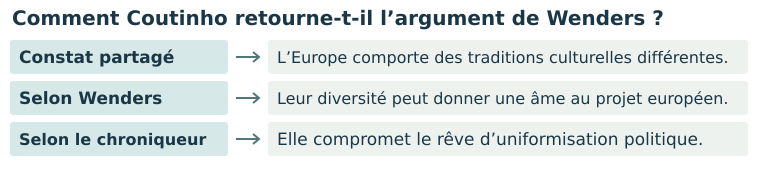
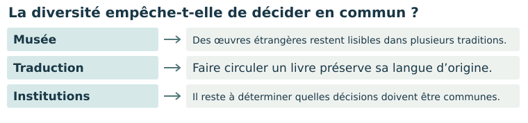

# ENS · MP-PC · Portugais (LE2) 2008 — Corrigé brut

*Corrigé rédigé par IA, non officiel. Signalez toute erreur.*

**Rédaction** · GPT-6.2 Astra Ultra · vitesse non renseignée

Le cahier commun aux ENS de Paris et de Cachan dure deux heures, sans dictionnaire ni calculatrice pour le portugais. La garde prévoit une version française sur 15 et une question en portugais sur 5. La page de portugais ne fixe pas de longueur chiffrée.

## V. Version française

**L’union défait la force**

Le réalisateur Wim Wenders, qui, assez curieusement, n’arrive plus à faire un film convenable depuis 1984 (oui, je parle de *Paris, Texas*), a trouvé la clé de la crise en Europe. À en croire Wenders lui-même, dans un article pour le supplément *Mais !*, la solution ne passe plus par la politique, car les Européens en ont assez des hommes politiques. Pour Wenders, seule la culture peut donner une âme à l’Europe. La culture européenne, ajoute le cinéaste allemand, porte la marque d’une glorieuse diversité d’expression. Et c’est cette diversité qui finira par sauver l’unité du « projet européen ».

L’idée de Wenders est sympathique. Mais, sauf le respect que je dois aux extravagances du bonhomme, je ne vois pas comment renforcer l’unité de l’Europe quand, précisément, la culture européenne est l’image même de sa diversité. Tel est d’ailleurs le problème récurrent du « projet européen ». On croit que la diversité historique, culturelle et artistique peut être ramenée à l’uniformité dans un texte constitutionnel commun, comme si les Européens et les États européens ne formaient pas autant de petits univers distincts, avec leurs identités propres et des siècles d’histoire derrière eux.

Wenders propose d’accentuer encore ces différences culturelles pour montrer ce qui nous unit. Chose curieuse, il ne vient pas à l’esprit du réalisateur que le résultat pourrait bien être l’inverse. On montrerait ce qui nous désunit, comme en témoigne sans grand effort n’importe quel manuel d’histoire de l’art.

La proposition de Wenders touche au fond du problème, mais elle le prend à l’envers. L’Europe présente une diversité culturelle séculaire, et c’est précisément cette diversité qui fait obstacle aux rêves récurrents d’une unité politique « fédérale ». Croire que la réalité sauve la chimère, c’est au fond ne rien comprendre ni à l’une ni à l’autre.

*João Pereira Coutinho, chronique publiée dans la Folha de São Paulo, 23 juillet 2007.*

## 1. Leia esta crónica atentamente e analise a posição do cronista J. P. Coutinho. Qual é a sua opinião sobre este assunto?

Coutinho aceita de Wenders o ponto de partida. Um manual de história da arte basta para mostrar a variedade das experiências europeias. Divergem quanto à consequência política. Para o realizador, a consciência dessa riqueza pode aproximar os cidadãos. Para o cronista, quanto mais olharmos para as diferenças, menos plausível parecerá a ambição de as reunir sob uma constituição federal. A observação sarcástica acerca dos filmes de Wenders dá graça à crónica, embora diga pouco sobre a validade do argumento.

Concordo com a reserva de Coutinho perante a ideia de uma mesma alma europeia. Já não o acompanho quando trata a diversidade como prova suficiente contra qualquer forma de união política. Um programa comum de apoio à tradução permite que uma leitora portuguesa descubra um romance finlandês sem exigir que nenhum dos dois povos abdique da sua língua. Seria absurdo concluir daí que ambos desejam o mesmo sistema fiscal. Mas seria igualmente precipitado dizer que não podem decidir em conjunto como financiar as traduções.

A questão decisiva parece-me ser a escala de cada escolha. Há diferenças que justificam manter uma decisão no plano nacional e há problemas partilhados que justificam criar instituições comuns, mesmo entre pessoas com memórias e gostos diferentes.

*200 mots.*

Le chroniqueur João Pereira Coutinho, qui vit au Portugal, écrit ici pour le quotidien brésilien Folha de São Paulo le 23 juillet 2007. Le rapport d’Ilda Mendes dos Santos attire l’attention sur l’ironie, la maîtrise des modes et les risques d’une rédaction trop proche de l’oral. La réponse personnelle adopte le portugais européen.

[Version et consignes](https://banques-ecoles.fr/cms/wp-content/data/filiere-pc/annales-de-la-banque-pc/session-2008/sujet-ecrit-2008_mp-pc_sujet_langue_etrangere_2.pdf#page=9) · [Rapport du jury](https://www.ens.psl.eu/IMG/file/concours/2008/MP/mp_ecrit_portugais_le2.pdf)
