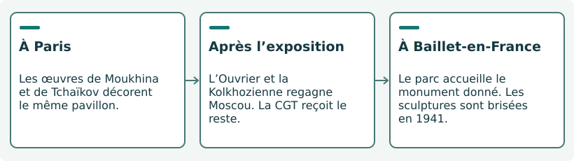

# ENS · MP-PC · Russe (LV1) 2008 — Corrigé guidé

*Corrigé rédigé par IA, non officiel. Signalez toute erreur.*

**Rédaction** · GPT-6.2 Astra Ultra · vitesse non renseignée

L’article des Izvestia est daté du 4 février 2008. La réponse de 200 mots traite les relations franco-russes dans l’histoire et au présent de l’épreuve. Le registre fournit le cahier de LV1. La réponse russe compte 200 mots.

## I. Version française

Identifier les deux œuvres avant de traduire leurs déplacements. L’œuvre de Vera Moukhina regagne Moscou, tandis que le don à la CGT concerne le reste du monument. Les archéologues attribuent cet ensemble à Tchaïkov. Dans la phrase finale, le pavillon qui faisait face à celui de l’Allemagne est le pavillon soviétique.

### Proposition rédigée

**Des archéologues français découvrent dans un château médiéval des vestiges de l’empire soviétique**

Iouri Kovalenko (Paris)

Dans le château médiéval de la petite ville de Baillet-en-France, des archéologues français ont découvert des statues brisées de combattants et de travailleurs soviétiques, des bas-reliefs, des représentations sculptées de la faucille et du marteau et d’autres symboles communistes. Toutes ces pièces formaient un seul ensemble architectural et sculpté, *Les Peuples de l’URSS*, qui, avec *L’Ouvrier et la Kolkhozienne* de Vera Moukhina, ornait le pavillon soviétique à l’Exposition universelle de Paris en 1937.

Après la fermeture de l’exposition, *L’Ouvrier et la Kolkhozienne* regagna Moscou. Quant au reste du monument gigantesque, les autorités soviétiques en firent don à un syndicat communiste français, la Confédération générale du travail (CGT). Les syndicats envoyèrent l’ensemble sculpté à Baillet-en-France, à vingt kilomètres au nord de Paris. Le château abritait alors une maison de repos pour métallurgistes. Le monument grandiose devait symboliser les liens fraternels entre les prolétariats français et soviétique. C’était l’époque du Front populaire, où la gauche était au pouvoir en France, sous la conduite du président du Conseil Léon Blum.

L’ensemble ne resta pourtant que deux ans dans le parc. [...] En 1941, toutes les sculptures furent brisées. Puis on les oublia pour de bon.

Les archéologues ne doutent pas que l’auteur de l’ensemble soit le célèbre sculpteur soviétique Iossif Moïsseïevitch Tchaïkov (1888-1979), qui avait d’ailleurs étudié à Paris dans les années 1910. Il exposa au Salon d’automne, sur les bords de la Seine, et regagna la Russie en 1914. Parmi ses œuvres connues figurent *Les Footballeurs* et *Lénine orateur*, conservées à la galerie Tretiakov. En 1937, il participa avec d’autres sculpteurs et architectes à la décoration du pavillon soviétique, qui se dressait face à celui de l’Allemagne nazie.

*Izvestia*, rubrique « Sciences », 4 février 2008.

## II. Question en russe

La consigne porte à la fois sur plusieurs siècles et sur le présent de 2008. Distinguer culture, alliances et conflits évite un bilan uniforme. La trajectoire des sculptures offre un exemple suivi, de l’exposition à la maison de repos puis aux fouilles, avant une appréciation personnelle du rôle des échanges.

### Proposition rédigée

Отношения России и Франции вряд ли можно представить как непрерывное сближение. В восемнадцатом веке французский язык вошёл в быт русского дворянства, но культурная близость не помешала войне 1812 года. В конце девятнадцатого века государства стали союзниками, а Париж привлекал русских художников, которые приезжали учиться и выставляли свои работы. Эти связи переживали смену правительств, хотя для каждого поколения смысл поездки во Францию был иным.

У скульптур из статьи поучительная судьба. Парижская выставка представила их как достижение советского государства. Переданные французским профсоюзам, они получили новое значение в доме отдыха рабочих. Разбитые во время войны, они снова стали предметом интереса уже для археологов. Один памятник рассказывает, таким образом, и о сотрудничестве, и о разрыве памяти.

Если говорить о положении в 2008 году, торговля, изучение языков и университетские обмены дают немало возможностей для встреч. Однако было бы ошибкой принимать интерес к русскому искусству за поддержку любого решения Москвы или любовь к французской литературе за согласие с политикой Парижа. Хорошие отношения, на мой взгляд, обнаруживаются там, где люди могут обсуждать разногласия, не разрывая совместной работы. Было бы интересно устроить выставку, на которой французские и российские исследователи вместе объяснили бы судьбу находки в Байе. Разговор о конкретной вещи подчас сообщает больше, чем официальная формула о дружбе.

[Sujet](https://banques-ecoles.fr/cms/wp-content/data/filiere-pc/annales-de-la-banque-pc/session-2008/sujet-ecrit-2008_mppc_sujet_langue_vivante_1.pdf#page=6)
