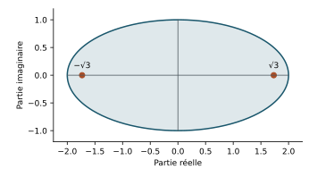
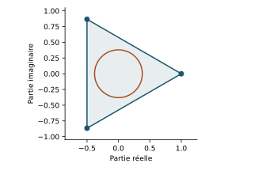

# ENS Paris, Lyon et Cachan — Mathématiques MPI 1, 2008 · Corrigé brut

*Corrigé rédigé par IA, non officiel. Signalez toute erreur.*

**Rédaction** · GPT-6.2 Astra Ultra · vitesse non renseignée

**Révision** · GPT-6.2 Astra Ultra · vitesse non renseignée

Le produit scalaire est antilinéaire à gauche. On note $H(f)$ l’ensemble des valeurs $\langle x,fx\rangle$ pour les vecteurs unitaires. Les quatre premières parties décrivent sa géométrie, puis la dernière majore les polynômes d’une contraction.

## 1. Premiers calculs

### Question 1.1

Si $fv=\lambda v$ avec $v\ne0$, poser $x=v/\|v\|$. Alors $\langle x,fx\rangle=\lambda\langle x,x\rangle=\lambda$. Le produit scalaire est linéaire dans sa deuxième variable.

### Question 1.2

En faisant parcourir la sphère unité à $x$, l’égalité $\langle x,(\lambda f+\mu I)x\rangle=\lambda\langle x,fx\rangle+\mu$ donne exactement $H(\lambda f+\mu I)=\lambda H(f)+\mu$. Cela inclut $\lambda=0$.

### Question 1.3

Le projecteur de matrice $\operatorname{diag}(1,0)$ donne $|x_1|^2$ pour $|x_1|^2+|x_2|^2=1$. Ce nombre appartient à $[0,1]$ et tout $t$ de ce segment est obtenu avec $(\sqrt t,\sqrt{1-t})$.

### Question 1.4

La forme du bloc nilpotent est $\bar x_1x_2$. Son module est au plus $(|x_1|^2+|x_2|^2)/2=1/2$. Inversement $x=(\cos t,e^{i\phi}\sin t)$ produit $e^{i\phi}\sin(2t)/2$. Lorsque $t$ parcourt $[0,\pi/4]$ et $\phi$ un tour complet, on obtient tout le disque fermé.

### Question 1.5

La fonction $x\mapsto\langle x,fx\rangle$ est continue en dimension finie. La sphère unité est fermée bornée dans l’espace réel sous-jacent de dimension $2d$, donc compacte. Son image $H(f)$ est compacte.

### Question 1.6

Le décalage à gauche vérifie $\|fx\|^2=\|x\|^2-|x_1|^2$. Pour $\|x\|=1$, Cauchy–Schwarz donne $|\langle x,fx\rangle|\le\|fx\|\le1$. L’égalité en module imposerait $x_1=0$ et $fx=\lambda x$. La relation $x_{j+1}=\lambda x_j$ rendrait alors toute la suite nulle. Inversement, pour $|\lambda|<1$, le vecteur $x=\sqrt{1-|\lambda|^2}(1,\lambda,\lambda^2,\ldots)$ est unitaire et vérifie $fx=\lambda x$. L’image numérique est le disque ouvert.

## 2. Réductions unitaires

### Question 2.1

L’endomorphisme $T=f-\lambda I$ est normal car $f$ commute avec $f^*$. Comme $T^*T=TT^*$, on a $\|T^*v\|^2=\|Tv\|^2$. Pour $fv=\lambda v$, le terme de droite est nul. Ainsi $f^*v=\bar\lambda v$.

### Question 2.2

Pour $x\perp v$, $\langle v,fx\rangle=\langle f^*v,x\rangle=\lambda\langle v,x\rangle=0$. L’orthogonal de $v$ est donc stable par $f$. Il est aussi stable par $f^*$ puisque $fv=\lambda v$.

### Question 2.3

En dimension positive, le polynôme caractéristique complexe possède une racine. Choisissons un vecteur propre unitaire $v$. L’orthogonal est stable par $f$ et $f^*$ ; l’adjoint de la restriction y est la restriction de $f^*$. Elle est donc normale. La récurrence en dimension fournit une base propre orthonormée de cet orthogonal, à laquelle on adjoint $v$. La réciproque suit car une matrice diagonale commute avec sa diagonale conjuguée.

### Question 2.4

Dans cette base $f^*$ a pour diagonale les $\bar\lambda_j$. L’égalité $f^*=f$ équivaut à $\bar\lambda_j=\lambda_j$ pour tout $j$. De même $ff^*=I$ équivaut à $|\lambda_j|^2=1$ pour tout $j$, soit $\lambda_j=e^{i\theta_j}$ avec $\theta_j$ réel.

### Question 2.5

Prenons un premier vecteur propre unitaire $v$ et triangulons par récurrence la compression de $f$ à $v^\perp$. En accolant $v$ au début de la base obtenue, le premier bloc sous la diagonale est nul et le bloc inférieur droit est triangulaire supérieur. Si $f$ est normal, dans toute telle base $v$ est aussi propre pour $f^*$ par 2.1. La première ligne hors diagonale est donc nulle. Le bloc restant est normal et triangulaire, et la récurrence annule tous les coefficients hors diagonale. La réciproque est immédiate par 2.3.

## 3. Le disque elliptique en dimension deux

### Question 3.1

Dans une base propre orthonormée $\langle x,fx\rangle=|x_1|^2\lambda_1+|x_2|^2\lambda_2$. Les poids parcourent $(t,1-t)$ pour $0\le t\le1$. Ainsi $H(f)=[\lambda_1,\lambda_2]$, réduit à un point si les deux valeurs coïncident.

### Question 3.2

Écrivons $a=Ae^{i\alpha}$ et $b=Be^{i\beta}$ avec $A,B\ge0$, en fixant arbitrairement la phase d’un terme nul. Si $x_j=r_je^{i\phi_j}$, on a $r_1^2+r_2^2=1$. La forme vaut $a\bar x_1x_2+b\bar x_2x_1$. Posons $t=\phi_2-\phi_1+(\alpha-\beta)/2$. Elle devient
$$r_1r_2e^{i(\alpha+\beta)/2}\big((A+B)\cos t+i(A-B)\sin t\big).$$
La phase $t$ est libre et le produit $r_1r_2$ parcourt $[0,1/2]$. On remplit donc l’ellipse, son bord compris. Ses axes entiers ont longueurs $A+B$ et $|A-B|$ ; elle peut se réduire à un segment ou à un point.

Pour les paramètres de la figure, le vecteur unitaire $x=2^{-1/2}(1,e^{it})$ donne $\langle x,fx\rangle=(3e^{it}+e^{-it})/2=2\cos t+i\sin t$. Ce calcul parcourt le bord entier. Des composantes de modules différents conservent la phase et multiplient les deux coordonnées par $2r_1r_2\in[0,1]$, ce qui remplit aussi l’intérieur.

### Question 3.3

Les valeurs propres sont $\lambda$ et $-\lambda$. Si elles coïncident, elles sont nulles et la base de 2.5 convient. Si elles sont distinctes, choisissons des vecteurs propres unitaires $v,w$ tels que $fv=\lambda v$ et $fw=-\lambda w$. Prenons $|c|=1$ tel que $c\langle v,w\rangle$ soit réel, ce qui est possible même si $v\perp w$. Alors
$$\langle v+cw,f(v+cw)\rangle=\lambda(1-|c|^2+\overline{c\langle v,w\rangle}-c\langle v,w\rangle)=0.$$
Les vecteurs propres sont indépendants, donc $v+cw\ne0$. On le normalise et on complète en base orthonormée. Le premier coefficient diagonal est nul, le second aussi par la trace.

### Question 3.4

Soit $m=\operatorname{Tr}(f)/2$. Par 3.3, $f-mI$ a une matrice à diagonale nulle, de coefficients hors diagonale $a,b$. L’image de $f$ est le disque de 3.2 translaté de $m$. Il est dégénéré exactement si $|a|=|b|$. Or les matrices des deux produits avec l’adjoint sont diagonales de termes $|a|^2,|b|^2$ dans les deux ordres. Leur égalité équivaut précisément à la normalité, conservée par translation. Les axes sont égaux exactement si $ab=0$, c’est-à-dire si $f$ a une valeur propre double puisque le polynôme centré est $X^2-ab$. Le disque a alors un rayon strictement positif si et seulement si $f\ne mI$.

### Question 3.5

Les carrés des demi-axes diffèrent de $((A+B)^2-(A-B)^2)/4=AB$. La distance du centre à un foyer est donc $\sqrt{AB}$. La rotation de 3.2 leur donne les affixes $m\pm e^{i(\alpha+\beta)/2}\sqrt{AB}=m\pm\sqrt{ab}$, racines du polynôme caractéristique. La formule comprend le segment et le disque circulaire.

## 4. Convexité et sommets

### Question 4.1

Pour $x\in F$ unitaire, $\langle x,\pi_Ffx\rangle=\langle\pi_F x,fx\rangle=\langle x,fx\rangle$. Chaque point de l’image numérique de la compression appartient donc à celle de $f$.

### Question 4.2

Soient $z_i=\langle x_i,fx_i\rangle$ et $F=\operatorname{Vect}(x_1,x_2)$. Les $z_i$ appartiennent à l’image numérique de $\pi_F f_{|F}$. Si $\dim F=1$, ils coïncident. Sinon cette image est un disque elliptique par 3.4, donc contient leur segment, car elle est image affine du disque unité convexe. L’inclusion de 4.1 achève la preuve.

### Question 4.3

Pour $x=(x_1,x_2)$ unitaire, la forme est $t z_1+(1-t)z_2$ avec $t=\|x_1\|^2$ et $z_j\in H(f_j)$ obtenus en normalisant les composantes. Une composante nulle a poids nul. Inversement, on réalise tous ces points avec $(\sqrt t\,u_1,\sqrt{1-t}\,u_2)$ pour des $u_j$ unitaires. Comme chaque $H(f_j)$ est convexe, toute combinaison convexe de points de leur union se regroupe sous cette forme. Un opérateur normal est somme orthogonale de blocs propres de dimension un : son image numérique est l’enveloppe convexe de son spectre. Le bloc de 1.4 a spectre $\{0\}$ et image un disque de rayon $1/2$.

### Question 4.4

Si le polygone a un intérieur, ses deux droites d’appui issues du sommet $s$ ont des directions distinctes. Un disque elliptique contenu dans le polygone et contenant $s$ aurait ces deux mêmes droites d’appui en $s$. Une ellipse non dégénérée n’a qu’une tangente en chaque point de son bord. Ainsi le disque est dégénéré. Si le polygone est déjà contenu dans une droite, la conclusion est immédiate.

### Question 4.5 (1)

Son image est un disque elliptique contenu dans le polygone et passant par $\lambda$, donc un segment par 4.4. La compression $T$ est normale par 3.4. Le sommet $\lambda$ est nécessairement extrémité du segment. Dans une base propre orthonormée de $T$, une combinaison convexe de deux valeurs propres distinctes ne peut en donner une extrémité qu’avec poids un sur cette valeur. Donc $Tx=\lambda x$. Si les deux valeurs sont égales, $T=\lambda I$ et c’est encore vrai.

### Question 4.5 (2)

Pour tout $y\perp x$ unitaire, la première partie donne $\langle y,fx\rangle=\langle y,Tx\rangle=0$. Ainsi $fx\in\mathbb C x$ et $fx=\lambda x$. De plus $T^*x=\bar\lambda x$ par 2.1 et $T^*$ est la compression de $f^*$. Le même raisonnement donne $f^*x=\bar\lambda x$. La droite obtenue et son orthogonal sont stables par les deux opérateurs. En dimension un la conclusion est directe.

### Question 4.6

Le premier bloc permute cycliquement trois vecteurs orthonormés. Il est unitaire et a pour valeurs propres $1,j,j^2$ où $j=e^{2\pi i/3}$, car son polynôme caractéristique est $X^3-1$. Son image est leur triangle équilatéral. La distance de l’origine à chacun des côtés vaut $\cos(\pi/3)=1/2$. Le dernier bloc a pour image le disque de rayon $\varepsilon/2<1/2$ par 1.4. Ce disque et la valeur propre $0$ sont contenus dans le triangle. L’égalité de 4.3 donne bien l’enveloppe convexe du spectre pour la matrice entière. Le bloc nilpotent non nul ne commute pas avec son adjoint et la matrice entière n’est pas normale.

On peut voir le défaut de normalité sur le seul bloc $B=\left(\begin{smallmatrix}0&\varepsilon\\0&0\end{smallmatrix}\right)$, à permutation des deux vecteurs près. Les matrices $BB^*$ et $B^*B$ ont diagonales $(\varepsilon^2,0)$ et $(0,\varepsilon^2)$. Le cercle inscrit dans le triangle a rayon $1/2$ et le rayon du disque de ce bloc est $\varepsilon/2$. Pour $\varepsilon=0{,}76$ comme sur la figure, la marge jusqu’à chacun des trois côtés vaut $0{,}12$.

### Question 4.7

Si l’enveloppe est contenue dans une droite, une rotation et une translation donnent $T$ dont l’image numérique est réelle. L’hermitien $B=(T-T^*)/(2i)$ vérifie $\langle x,Bx\rangle=0$ pour tout unitaire $x$. En prenant une base propre de $B$, on voit que toutes ses valeurs propres sont nulles, donc $T=T^*$ et $f$ est normal.

Sinon le polygone a au moins trois sommets distincts. Le cas 4.5 fournit à chacun une droite propre stable aussi par $f^*$. Si $fv=\lambda v$, $f^*v=\bar\lambda v$ et $fw=\mu w$, l’identité $\langle f^*v,w\rangle=\langle v,fw\rangle$ entraîne $(\lambda-\mu)\langle v,w\rangle=0$. Les droites ainsi trouvées sont orthogonales. Leur orthogonal commun est stable et de dimension au plus un puisque $d\le4$. En complétant par une base de cet orthogonal, on diagonalise $f$ en base orthonormée.

### Question 4.8

Les valeurs propres comptées avec multiplicité appartiennent à $H(f)$ et ont pour moyenne $\operatorname{Tr}(f)/d=0$. Par convexité, il existe un vecteur unitaire $x$ tel que $\langle x,fx\rangle=0$. Dans une base commençant par $x$, la compression à $x^\perp$ a trace nulle car la trace totale et le premier coefficient diagonal sont nuls. Par récurrence, on choisit dans cet orthogonal une base orthonormée dans laquelle tous ses coefficients diagonaux sont nuls. Par 4.1, ces coefficients sont ceux de $f$. Le cas initial en dimension un est immédiat.

## 5. L’inégalité de von Neumann

### Question 5.1

Dans cette base, $\|fx\|^2=\sum_j|\lambda_j|^2|x_j|^2$. On a $\|f\|=\max_j|\lambda_j|$ en prenant un vecteur de base réalisant le maximum. La contraction équivaut ainsi à $|\lambda_j|\le1$ pour tout $j$. La matrice de $P(f)$ est diagonale de termes $P(\lambda_j)$, donc $\|P(f)x\|\le\sup_{|z|\le1}|P(z)|\,\|x\|$.

### Question 5.2

L’endomorphisme $A=f^*f$ est hermitien et sa forme vaut $\|fx\|^2>0$ pour $x\ne0$. Sur chaque espace propre de valeur $a>0$, posons $h=\sqrt a I$. Alors $h=h^*>0$ et $h^2=A$. Toute racine positive $k$ de $A$ commute avec $A=k^2$ et stabilise chacun de ses espaces propres. Sur l’espace associé à $a$, les valeurs propres de l’hermitien $k$ sont positives et ont pour carré $a$, donc $k=\sqrt a I$. Ainsi $h$ est unique. Posons $u=fh^{-1}$. On obtient $u^*u=h^{-1}Ah^{-1}=I$, donc $u$ est unitaire en dimension finie et $f=uh$. Dans toute telle factorisation $f^*f=h^2$, de sorte que $h$, puis $u$, sont imposés.

### Question 5.3

La même construction spectrale donne $h\ge0$ avec $h^2=f^*f$, incluant l’espace propre de valeur zéro. L’égalité $\|hx\|^2=\|fx\|^2$ donne $\ker h=\ker f$. L’application $hx\mapsto fx$ de $\operatorname{Im}h$ sur $\operatorname{Im}f$ est donc bien définie et isométrique. Les orthogonaux des deux images ont même dimension ; on complète des bases orthonormées pour prolonger cette isométrie en un unitaire $u$ sur $E$. Alors $uh=f$. Le choix de $u$ sur le complément peut varier.

### Question 5.4

Pour tout $x$, $\|fx\|=\|uhx\|=\|hx\|$. Ainsi $f$ est contractant si et seulement si $h$ l’est. Par 5.1 et la positivité de $h$, cela équivaut à $0\le\mu_j\le1$ pour toutes ses valeurs propres.

### Question 5.5

Écrivons $Q(z_0+w)=\sum_{k=0}^n a_kw^k$, avec $a_0=Q(z_0)$. Pour $w=re^{i\theta}$, chaque terme non constant a une moyenne nulle sur $[0,2\pi]$. La moyenne de $Q(z_0+re^{i\theta})$ est donc $Q(z_0)$.

### Question 5.6

Si $Q_j(z_0+w)=\sum_k a_{jk}w^k$, développons le carré du module et intégrons : seuls les termes $k=\ell$ subsistent. On obtient
$$\frac1{2\pi}\int_0^{2\pi}\sum_j |Q_j(z_0+re^{i\theta})|^2\,d\theta
=\sum_j|Q_j(z_0)|^2+\sum_{j,k\ge1}|a_{jk}|^2r^{2k}.$$
Si un polynôme est non constant, le dernier terme est strictement positif pour tout centre et tout $r>0$. Un maximum de la somme sur le disque fermé existe par compacité et ne peut se situer à l’intérieur, car un petit cercle entièrement contenu dans le disque aurait alors une moyenne strictement plus grande. Pour des constantes l’égalité des maxima est immédiate. En plusieurs variables, fixer toutes les variables sauf une et appliquer ce résultat, puis passer successivement au bord pour chaque coordonnée. On obtient l’égalité des suprema sur le polydisque et sur le tore distingué $|z_1|=\cdots=|z_d|=1$.

### Question 5.7

Les coefficients de $f_\mu=uw\operatorname{diag}(\mu_1,\dots,\mu_d)w^*$ sont des formes linéaires complexes en les $\mu_j$ puisque $u,w$ sont fixés. Les produits matriciels, les sommes et l’application à $x$ préservent la dépendance polynomiale. Les coordonnées de $P(f_\mu)x$ sont donc des polynômes $Q_j(\mu)$ et sa norme carrée vaut $\sum_j |Q_j(\mu)|^2$. La dernière conclusion de 5.6 et la monotonie de la racine carrée donnent l’égalité des suprema de ces normes sur le polydisque et sur le tore, pour chaque $x$ fixé.

### Question 5.8

Écrivons $f=uh$ et $h=w\operatorname{diag}(\mu)w^*$ avec $u,w$ unitaires. Par 5.4, $\mu$ appartient au polydisque unité. Sur le tore, $\operatorname{diag}(\zeta)$ et donc $f_\zeta=uw\operatorname{diag}(\zeta)w^*$ sont unitaires. Ce sont des contractions normales, auxquelles 5.1 s’applique. Pour tout $x$, la question précédente entraîne
$$\|P(f)x\|\le\sup_{|\zeta_j|=1}\|P(f_\zeta)x\|\le\sup_{|z|\le1}|P(z)|\,\|x\|.$$
C’est l’inégalité de von Neumann pour toute contraction de l’espace donné.
