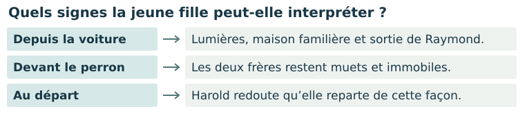
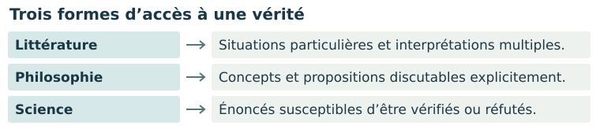

# X · MP-PC · Anglais 2008 — Corrigé brut

*Corrigé rédigé par IA, non officiel. Signalez toute erreur.*

**Rédaction** · GPT-6.2 Astra Ultra · vitesse non renseignée

Les deux cahiers durent chacun une heure trente, sans dictionnaire. La version se rédige en français. Les deux réponses au texte français se rédigent en anglais. Les questions imprimées ne fixent pas de longueur chiffrée.

## V. Version française

**De retour à la maison**

Une fois encore, comme cet autre dimanche à l’automne, elle la conduisit en pleine campagne, à dix-sept miles au sud de Holt, et la jeune fille eut peur de nouveau comme elle avait eu peur ce jour-là, pourtant cette fois elle regardait tout attentivement tandis qu’elles avançaient sur la route parce que les lieux lui étaient devenus familiers, et au bout de vingt minutes elles prirent le chemin menant à la vieille maison de campagne à l’écart de la route du comté et la voiture s’arrêta devant la barrière en fil de fer. La jeune fille resta longtemps assise à regarder la maison burinée par les intempéries. À l’intérieur, la lumière de la cuisine s’alluma. Puis celle de la galerie, au-dessus de la porte, et Raymond sortit sur la petite galerie fermée d’une moustiquaire.

Vas-y, dit Maggie Jones. Autant en avoir le cœur net.

J’ai peur de ce qu’ils vont dire, dit la jeune fille.

Ils ne diront rien si tu restes assise là dans la voiture.

Elle ouvrit la portière et descendit sans quitter des yeux la maison et le vieil homme debout sur la galerie. Puis Harold apparut à côté de son frère. Ils restèrent tous deux immobiles à la regarder. Elle s’avança vers la galerie à pas lents et lourds, le buste un peu penché en arrière pour garder l’équilibre. Dans la fraîcheur du soir qui tombait, elle s’arrêta au pied des marches pour lever les yeux vers eux. Une rafale se leva. Son manteau d’hiver était trop étroit maintenant, il était déboutonné sur son ventre et les pans battaient contre ses hanches et ses cuisses.

C’est moi, dit-elle. Je suis revenue.

Ils la regardèrent. On voit ça, dit l’un d’eux.

Elle leva les yeux vers eux. Je suis revenue pour vous demander, dit-elle… Je voulais vous demander si vous me laisseriez revenir vivre ici avec vous.

Ils la regardaient, les deux vieux frères dans leurs vêtements de travail, les cheveux gris fer, courts et raides sur leurs têtes mal peignées, leurs pantalons déformés aux genoux. Ils ne disaient rien.

Elle regarda autour d’elle. Tout a l’air pareil, dit-elle. Ça me fait plaisir. Une fois de plus elle se tourna vers eux. Elle attendit puis reprit. En tout cas je voulais vous remercier. Pour ce que vous avez fait pour moi. Et je voulais vous dire que je suis désolée de vous avoir causé des soucis. Vous avez été bons pour moi.

Les vieux frères restaient debout à la regarder sans parler, sans bouger. Comme s’ils ne la connaissaient pas ou ne voulaient pas se rappeler ce qu’ils savaient d’elle. Elle n’aurait su dire ce qu’ils pensaient. J’espère que vous allez bien tous les deux, dit-elle. Je ne vous dérangerai plus. Elle fit demi-tour pour retourner à la voiture.

Elle était à mi-chemin de la barrière quand Harold prit la parole. On pourrait pas te voir repartir comme ça une deuxième fois, dit-il.

Elle s’arrêta. Elle se retourna pour leur faire face. Je sais, dit-elle. Je ne le ferai pas.

On voudrait pas revoir ça. Plus jamais.

## 1. What distinguishes literature, according to Todorov?

For Todorov, literature approaches the world through the particular. A reader experiences an encounter, follows an individual story or responds to an image before formulating a general idea. Philosophy works more directly with concepts and can state its propositions with greater precision, though fewer readers may find them accessible. A novel invites people from different backgrounds to interpret what it presents. Its suggestive power can continue to change a person's understanding long after the book is closed. That freedom comes with uncertainty. Admiring an author's language is no guarantee that the work tells the truth. A literary insight gains authority through the judgement of many readers over time, whereas a scientific proposition invites comparatively immediate testing and possible refutation. Literature can thus alter how people live without promising a single conclusion to everyone who reads it.

*136 mots.*

## 2. Does your experience as a reader confirm the power of literature?

When I first read Pride and Prejudice, I trusted Elizabeth Bennet largely because she made me laugh. Her observations seemed quicker and more generous than the solemn judgements of the people around her. When Darcy's letter forced her to reconsider what she had heard about Wickham, I discovered that I had accepted much the same evidence for much the same reasons. Nobody had lectured me about prejudice. I had rehearsed the error and felt the inconvenience of having to give it up.

On rereading the early chapters, I could see how carefully Jane Austen had left room for another interpretation. The change was in the attention I brought to the scenes. It also made me more willing, outside the novel, to ask why a speaker's charm counted as evidence in his favour. I cannot claim that one book permanently cured me of hasty judgement. Indeed a reader can enjoy the comedy and come away with a different lesson. That seems to me part of its power. A proposition about bias would have been easy to agree with immediately. The novel gave me a remembered experience against which to test that easy agreement.

*192 mots.*

Le fac-similé AlloSchool réunit les sujets de l’X et de l’ESPCI, avec Todorov aux pages 1 et 2 et Haruf à la page 4 du PDF. Le rapport officiel archivé porte sur la version. Un rapport distinct sur l’expression anglaise n’a pas été retrouvé dans les pièces consultées.

[Cahier de version](https://www.alloschool.com/assets/documents/course-286/x-ens-mp-pc-2008-langues-vivantes.pdf#page=4) · [Cahier d’expression](https://www.alloschool.com/assets/documents/course-286/x-ens-mp-pc-2008-langues-vivantes.pdf#page=1) · [Rapport du jury](https://web.archive.org/web/20090428220503id_/http://gargantua.polytechnique.fr:80/siatel-web/linkto/?objectId=DOCF0009000003C600000000000004C900000000)
