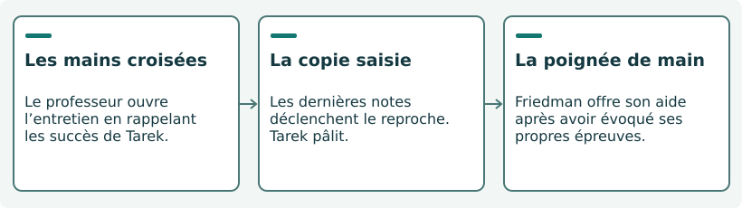

# X · MP-PC · Arabe 2008 — Corrigé guidé

*Corrigé rédigé par IA, non officiel. Signalez toute erreur.*

**Rédaction** · GPT-6.2 Astra Ultra · vitesse non renseignée

La version tirée de Chicago et les deux questions sur le texte de Tzvetan Todorov sont publiées dans deux cahiers du même concours. Le cahier d’expression de 2008 ne fixe pas de longueur aux réponses. Les réponses arabes comptent 132 et 182 mots séparés par des espaces.

## I. Version française

Suivre les regards et les couleurs avant de choisir les verbes de parole. Friedman rougit au moment de prendre la parole, tandis que Tarek pâlit sous le reproche. Les félicitations, la copie d’examen et la poignée de main donnent à la scène trois inflexions. Distinguer la mention « excellent » de la note maximale obtenue jusque-là.

### Proposition rédigée

**Dans le bureau du professeur Friedman**

Le docteur Friedman s’assit derrière son bureau et invita Tarek à s’asseoir. Il baissa la tête et regarda ses mains croisées devant lui. Puis son visage se colora légèrement, comme cela lui arrivait toujours quand il prenait la parole.

« Depuis que je dirige le département, j’ai toujours été très favorable à l’admission d’étudiants égyptiens, parce qu’ils sont intelligents et travailleurs. Bien sûr, de temps en temps, on tombe sur un mauvais Égyptien comme Ahmed Danana, mais c’est l’exception, pas la règle. Toi, par exemple, tu es un étudiant remarquable. Tu as obtenu de bons résultats, et prometteurs, dans tes recherches, et tu as conservé la mention “excellent” dans toutes les matières que tu as étudiées.

— Merci », murmura Tarek avec reconnaissance.

Le docteur Friedman se racla la gorge, ouvrit le tiroir de son bureau, en sortit quelques papiers et les étala devant lui. Puis il poursuivit sans cesser d’éviter le regard de Tarek.

« La qualité de ton travail scientifique me fait un devoir de te parler franchement. Ton niveau a sérieusement baissé ces derniers mois. C’est la quatrième épreuve où tu obtiens une mauvaise note, toi qui avais toujours la note maximale ! »

Tarek restait à le regarder, le visage blême, comme s’il avait perdu la parole. Friedman, lui, saisit la copie d’examen et dit sur un ton irrité :

« J’ai été stupéfait en revoyant tes derniers résultats. Tu fais des erreurs de débutant qu’on ne saurait attendre de toi. Cela ne te donne-t-il pas un peu à réfléchir aux raisons d’une telle dégringolade ? »

Tarek gardait le silence et pâlissait encore. Friedman sourit et reprit d’une voix compatissante :

« Écoute, Tarek. Tu as devant toi une belle occasion de construire ton avenir. La vie en Amérique a ses défauts, mais son grand mérite est de donner sa chance à chacun. Ce que tu peux accomplir ici, tu ne l’accompliras nulle part ailleurs au monde. Mon conseil, c’est de ne pas laisser ta vie privée te distraire de ton travail.

— Mais...

— Je ne voudrais pas me mêler de ta vie. J’essaie seulement de te faire profiter de mon expérience. Je pense que tu me comprends bien. Moi aussi, autrefois, j’ai été jeune comme toi. Au cours de ma carrière scientifique, j’ai connu des secousses sentimentales, des relations heureuses et malheureuses qui ont souvent nui à mon travail. Mais j’ai appris à maîtriser mes sentiments et je me suis remis au travail. Rien dans la vie n’est plus dur à supporter que le travail, mais c’est la seule valeur qui demeure. »

Friedman se leva et serra chaleureusement la main de Tarek.

« Applique-toi à ton travail, Tarek, et considère-moi comme un père. Si tu as besoin d’une aide quelconque, n’hésite pas à me la demander. Même si tu veux simplement me parler de tes problèmes, je trouverai toujours le temps de t’écouter.

— Merci, docteur. »

Alaa El Aswany, *Chicago*, huitième édition, Dar el-Chorouk, Le Caire, 2007.

## II.1. Analyse du texte commun

Chercher successivement l’objet commun de connaissance, le mode de représentation, l’activité du lecteur et le critère de vérité. L’opposition entre particulier et général ne suffit pas à expliquer la nécessité du jugement de plusieurs générations de lecteurs. La réponse distingue la vérification immédiate d’une affirmation scientifique de cette reconnaissance progressive.

### Proposition rédigée

يشترك الأدب والفلسفة والعلوم الإنسانية في محاولة فهم التجربة البشرية، غير أن الأدب يسلك إلى هذه المعرفة طريق الفردي والمحسوس. فبدل أن يضع تعريفا عاما للعزلة مثلا، يجعلنا نعيش عزلة شخص في حادثة لا تتكرر. وهكذا يحتفظ بتنوع الحياة، ويستطيع قارئ بعيد عن ثقافة الكاتب أن يدخل عالم الرواية من غير أن يحيط بجهاز من المفاهيم. وفي مقابل هذا اليسر لا يقود المجاز أو الحدث إلى معنى وحيد. فالكلمات توقظ في القارئ صورا وصلات يستخرج منها بنفسه ما لم يفرضه النص عليه، وقد يستمر أثرها بعد الفراغ من القراءة. وتختلف حقيقة العمل الأدبي أيضا عن حقيقة القضية العلمية. فهذه تقبل الفحص والدحض، أما الانتقال من إعجابي الخاص بعمل إلى القول إنه يكشف شيئا صادقا عن البشر فيحتاج إلى موافقة قراء كثيرين عبر الأزمنة والثقافات. لذلك يملك الأدب أن يغير فهمنا لأنفسنا وللآخرين.

## II.2. Réflexion personnelle

Voici une expérience de lecture proposée comme exemple de rédaction. Au lieu d’invoquer vaguement l’empathie, elle nomme la première réaction à *La Parure* de Maupassant, puis le détail relu et le jugement concret qui en est modifié. La fin de la nouvelle garde tout son sens lorsque l’analyse en déplace le centre.

### Proposition rédigée

حين قرأت قصة «العقد» لموباسان للمرة الأولى، كنت أظن أن قيمتها كلها في المفاجأة الأخيرة. تستعير ماتيلد عقدا لتتزين به في حفلة، ثم تفقده وتشتري هي وزوجها بديلا باهظ الثمن. وبعد عشر سنوات من العمل لسداد الدين تعلم أن العقد الذي استعارته كان مقلدا. أغلقت الكتاب يومها وأنا أقول لنفسي إن اعترافا بسيطا كان كفيلا بتجنيبها كل ذلك العناء. لكنني عدت إلى القصة بعد أن هان علي في حديث مع أصدقاء أن ألوم أحدهم على إخفاء ضائقة مالية. وعندئذ لفتني وصف تردد ماتيلد قبل الحفلة. لم تكن المسافة بينها وبين المدعوين تقاس بثمن الحلية وحده، بل بنظرة تخاف أن تقع عليها إن دخلت القاعة كما هي.

لم تقدم لي القراءة الثانية قاعدة أصلح بها علاقة صديقي بالمال. غير أنها غيرت السؤال الذي كنت على وشك أن أطرحه عليه. فبدل أن أقول لماذا لم تخبرنا من البداية، صرت أريد أن أعرف ما الذي جعل الكلام صعبا. وهذا تحول صغير أستطيع أن أسميه أثرا للأدب في حياتي. ومع ذلك لم يحدث التحول عند القراءة الأولى، ولم يكن مضمونا في الثانية. احتجت إلى ظرف جديد وإلى مراجعة حكمي كي تتحول دهشة النهاية إلى استعداد للإصغاء.

[Sujet](https://www.alloschool.com/assets/documents/course-286/x-ens-mp-pc-2008-langues-vivantes.pdf#page=5) · [Sujet complémentaire](https://www.alloschool.com/assets/documents/course-286/x-ens-mp-pc-2008-langues-vivantes.pdf#page=1)
