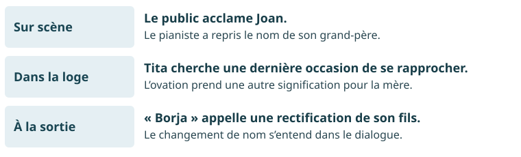

# X–ESPCI · MP-PC · Espagnol 2008 — corrigé guidé

*Corrigé rédigé par IA, non officiel. Signalez toute erreur.*

**Rédaction** · GPT-6.2 Astra Ultra · vitesse non renseignée · 25 novembre 2026

Version et expression de 1 h 30 chacune, sans dictionnaire. Réponses en espagnol. Le rapport rappelle une longueur de 120 à 150 mots pour la première réponse.

## 1. Version française

**Premier concert**

### Avant de traduire

Repérer d’abord les changements de point de vue. La reprise du nom familial précède l’apparition de *Borja* dans le récit. *Los focos lo encandilaban* désigne l’éblouissement provoqué par les projecteurs. *Se alzó* a ici pour sujet le morceau de Chopin. Les impératifs à la fin opposent la demande de pardon de la mère au geste qu’il lui renvoie.

### Proposition de traduction

Les applaudissements et les fleurs pleuvaient sur le jeune pianiste. La salle de concert était pleine à craquer. Tout le théâtre, debout, saluait la virtuosité de Joan par une ovation unanime.

Au premier rang, Andreu, Aurora et Mar le regardaient avec ferveur et fierté.

Pour la première fois, il se produisait devant le grand public et, qui plus est, sous un prénom et un nom qu’il portait pour la première fois et dont il était profondément fier : ceux de son grand-père. Toutes ces années, il s’était senti mal à l’aise avec les siens, mais il n’en avait pris conscience que le jour où il avait commencé à préparer ses débuts.

Ce soir-là, les sonates de son grand-père avaient brillé comme jamais. Depuis la scène, Borja cherchait désespérément le regard de Mar, mais les projecteurs l’éblouissaient. Les applaudissements demandaient, exigeaient, suppliaient…

Il disparut et, quelques minutes plus tard, reparut, une partition à la main. Le public se tut.

*Tristesse*, de Chopin, s’éleva, solennelle, au-dessus de l’assistance. Andreu et Aurora se serrèrent la main. Soledad et Joan étaient là.

Au fond, dans la loge des Sardá, Tita, accompagnée de son père, observait son fils de loin… Elle semblait surprise, déçue, heureuse et triste, tout et rien à la fois. Depuis l’abandon, Tita avait essayé de mille façons de se rapprocher de son fils, en vain. Dans ce concert, elle voyait sa dernière chance.

Lorsque tout fut terminé, elle l’attendit à la sortie.

— Borja…

— Joan… Je m’appelle Joan… Dolgut. Au cas où tu ne le saurais pas, insista son fils. Mon père, lui, avait un nom de famille.

— Mon fils…

— Je suis désolé, je dois y aller.

— Pardonne-moi.

— Pardonne-toi à toi-même, maman. D’abord, pardonne-toi à toi-même.

— Tu as été merveilleux.

— Au revoir, maman.

En rentrant à l’appartement, Aurora et Mar trouvèrent une enveloppe par terre. On l’avait glissée sous la porte pendant qu’elles étaient au concert. Aurora la ramassa. Une carte l’accompagnait.

*Ángela Becerra, El penúltimo sueño, 2005.*

## 2. Expression en espagnol

Tzvetan Todorov, *La littérature en péril* (2007), « Le pouvoir de la littérature ». Les deux consignes sont imprimées à la page 2 du cahier d’expression.

### 1. ¿Cuáles son, según Todorov, las características propias de la literatura?

Partir de ce que la littérature partage avec les sciences humaines, puis examiner la singularité de ce qu’elle fait vivre, la liberté du lecteur et la manière dont se discute sa vérité.

Para Todorov, la literatura comparte con la filosofía y las ciencias humanas el deseo de conocer la experiencia de los seres humanos. Su particularidad consiste en hacer vivir situaciones singulares mediante voces, imágenes y relatos. En lugar de formular de entrada una ley general, conserva detalles y contradicciones que una explicación abstracta puede dejar fuera. El lector participa activamente al relacionarlos y darles sentido. Por eso una novela puede llegar a personas de épocas y culturas muy distintas y suscitar interpretaciones diferentes. Su verdad tampoco se verifica mediante una prueba inmediata como una afirmación científica. Se discute entre muchos lectores y a lo largo del tiempo. Ese conocimiento puede acercarnos a los demás y transformar nuestra manera de vivir sin que el escritor nos imponga una tesis.

*127 mots.*

### 2. ¿Confirma su experiencia como lector que la literatura tiene poder?

Le rapport de 2008 regrette la rareté des lectures hispaniques dans les copies. Un exemple précis d’une œuvre suffit si l’on décrit comment la première interprétation s’est transformée.

Al leer el episodio de los molinos de viento en el Quijote, creía saber de antemano lo que iba a encontrar. Conocía la imagen de un hombre que se lanza contra un enemigo imaginario y esperaba reírme de su error. Sin embargo, me sorprendió más la conversación con Sancho. Para el escudero, reconocer una máquina parece suficiente para terminar la discusión. Para don Quijote, hasta el fracaso puede integrarse en una explicación que conserva intacta su aventura. Descubrí que conocer la respuesta correcta no equivale a entender por qué otra persona se aferra a una historia.

Esa diferencia me acompaña cuando dos personas discuten a partir de una misma fotografía y cada una cree que basta con señalar lo que se ve. La novela no me ha dado una técnica infalible para convencer a nadie. Me ha enseñado a fijarme en lo que alguien tendría que perder si aceptara mi explicación. Otro lector puede quedarse sobre todo con la comicidad de la escena, y precisamente por eso vale la pena hablar de ella. Su poder, para mí, está en haber complicado una certeza que parecía no necesitar ninguna revisión.

*189 mots.*

## Sources

École polytechnique et École supérieure de physique et de chimie industrielles. La garde et les deux questions sont réunies dans le fac-similé. Le rapport commun aux MP et PC, p. 2–3, demande de distinguer les noms du pianiste et rappelle une longueur de 120 à 150 mots pour la première réponse. Le cahier de cette session n’imprime pas de fourchette à côté des questions.

[Sujet, p. 6](https://www.alloschool.com/assets/documents/course-286/x-ens-mp-pc-2008-langues-vivantes.pdf#page=6) · [Sujet complémentaire, p. 1–2](https://www.alloschool.com/assets/documents/course-286/x-ens-mp-pc-2008-langues-vivantes.pdf#page=1) · [Rapport, p. 1–3](https://web.archive.org/web/20090415233110id_/http://gargantua.polytechnique.fr:80/siatel-web/linkto/?objectId=DOCF0009000003C600000000000004B900000000)
