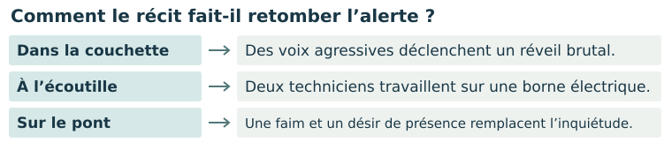
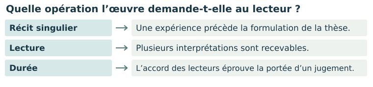
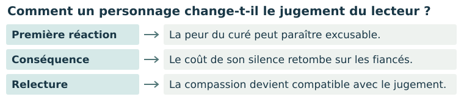

# X · MP-PC · Italien 2008 — Corrigé brut

*Corrigé rédigé par IA, non officiel. Signalez toute erreur.*

**Rédaction** · GPT-6.2 Astra Ultra · vitesse non renseignée

Les deux cahiers durent chacun une heure trente, sans dictionnaire. La version se rédige en français. Les deux réponses au texte français se rédigent en italien. Les questions imprimées ne fixent pas de longueur chiffrée.

## V. Version française

**Réveil dans le port**

J’ai entendu des voix agressives. J’ai rejeté la couverture de côté, je me suis cogné la tête contre une étagère et j’ai dégringolé de la couchette avant de parvenir à me rappeler où j’étais et pourquoi. Mette aussi s’est réveillée. Elle m’a regardé, appuyée sur un coude. Je lui ai dit « Attends, je vais voir », mais déjà elle se glissait à son tour hors de la mince couverture.

J’ai traversé le petit bateau d’un pas mal assuré et j’ai ouvert l’écoutille très lentement, avec une infinie prudence. La lumière m’a ébloui. Il n’y avait que deux techniciens, quelques postes d’amarrage plus loin. Ils parlaient en s’affairant autour d’une borne électrique. Le port de plaisance et le port de commerce avec ses grands navires sur ma droite, les rues et les maisons de la ville juste derrière, tout apparaissait bien plus net et riche en détails qu’à notre arrivée. Mais c’était un spectacle trop vaste, trop concret pour mon état d’esprit. Il me semblait que je ne pourrais m’y faire que peu à peu.

Mette a passé la tête sur le pont, méfiante, les cheveux en désordre.

Je lui ai souri, pris d’une émotion soudaine. J’ai dit « Hé ».

« Hé », a-t-elle dit, encore sur ses gardes.

« Ce n’était rien. » J’entendais à peine mes propres paroles, encore trop étourdi par les bruits de la traversée et par notre tentative pour dormir. Elle regardait les deux techniciens à la borne. Elle a dit « De toute façon, je n’arrive pas à dormir.

— Moi non plus.

— Alors, qu’est-ce qu’on fait ?

— Allons manger quelque chose. » Il me semblait avoir faim en permanence. La sensation n’était pas désagréable et elle allait de pair avec un besoin tout aussi intense de ses regards, de ses gestes et de ses paroles.

« Mmm, oui », a-t-elle dit.

Les deux techniciens à la borne nous regardaient, perplexes à l’idée que deux navigateurs aient pu arriver autant en dehors de la saison. Je leur ai adressé un salut de la main. Ils m’ont répondu d’un signe de tête.

*Andrea De Carlo, La Mer des vérités, 2006.*

## 1. Quali sono, secondo Todorov, le caratteristiche specifiche della letteratura?

Per Todorov la letteratura permette di conoscere il mondo facendo vivere un’esperienza particolare prima di proporre una conclusione. Il romanziere racconta un incontro e il poeta evoca un’immagine: il lettore deve formulare da sé ciò che quella scena gli fa comprendere. La filosofia, invece, lavora con concetti che possono essere più difficili da avvicinare, ma consentono di enunciare una tesi con minore ambiguità. Un racconto può attraversare secoli e culture proprio perché lascia spazio a interpretazioni diverse. Questa libertà rende necessario distinguere il piacere di una lettura dal giudizio sulla sua verità. Mentre un’affermazione scientifica si espone subito alla confutazione, la verità di un’opera si misura nel tempo attraverso il confronto tra moltissimi lettori. Le sue immagini possono così continuare ad agire su di noi molto dopo che abbiamo chiuso il libro.

*132 mots.*

## 2. La Sua esperienza di lettore conferma l’idea di un potere della letteratura?

Quando ho letto I promessi sposi, all’inizio don Abbondio mi è sembrato quasi innocente. Davanti ai bravi che gli vietano di celebrare un matrimonio, la sua paura appare così concreta che avrei trovato facile perdonargli qualunque esitazione. Manzoni mi aveva fatto sentire il peso di una minaccia attraverso il passo incerto di un uomo che tornava a casa. Solo più avanti mi sono chiesto chi avrebbe pagato il prezzo di quella prudenza. Renzo e Lucia subiscono una decisione che nessuno ha avuto il coraggio di spiegare loro apertamente.

Rileggendo le prime pagine, mi sono accorto che capire una paura non obbliga ad assolvere ogni atto che ne deriva. Una frase astratta sulla responsabilità mi avrebbe probabilmente trovato subito d’accordo. Il romanzo mi ha costretto a correggere un giudizio che avevo già fatto mio. È un cambiamento piccolo, ma mi torna in mente quando qualcuno presenta il silenzio come una scelta senza conseguenze.

Non direi che leggere renda automaticamente più giusti. Si può attraversare la stessa storia seguendo soprattutto l’intreccio amoroso. Proprio la libertà di soffermarsi su un episodio, tornarci e discuterne con altri dà però al libro un potere che una lezione morale impartita dall’alto difficilmente avrebbe.

*197 mots.*

La version de Mare delle verità (2006) se trouve à la page 7 du fac-similé, l’expression française aux pages 1 et 2. Le rapport de Laura Fournier Finocchiaro traite les deux exercices et demande de traduire également le titre du roman.

[Cahier de version](https://www.alloschool.com/assets/documents/course-286/x-ens-mp-pc-2008-langues-vivantes.pdf#page=7) · [Cahier d’expression](https://www.alloschool.com/assets/documents/course-286/x-ens-mp-pc-2008-langues-vivantes.pdf#page=1) · [Rapport du jury](https://web.archive.org/web/20090415233018id_/http://gargantua.polytechnique.fr:80/siatel-web/linkto/?objectId=DOCF0009000003C600000000000004B800000000)
