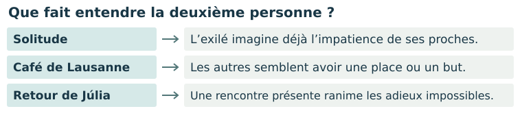
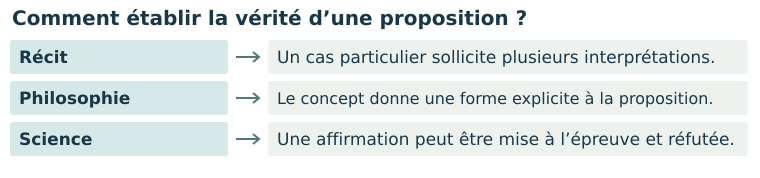
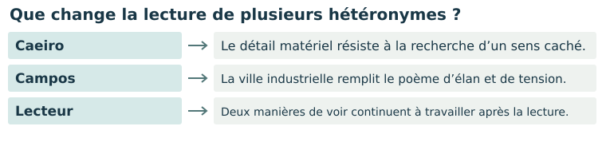

# X · MP-PC · Portugais 2008 — Corrigé guidé

*Corrigé rédigé par IA, non officiel. Signalez toute erreur.*

**Rédaction** · GPT-6.2 Astra Ultra · vitesse non renseignée

Les deux cahiers durent chacun une heure trente, sans dictionnaire. La version se rédige en français. Les deux réponses au texte français se rédigent en portugais. Les questions imprimées ne fixent pas de longueur chiffrée.

## V. Version française

*Salto*, puis *a salto*, renvoient ici au franchissement clandestin d’une frontière. *Sem eira nem beira* évoque la pauvreté et l’absence d’attaches. *Poiso certo* est un lieu fixe où se poser. Garder le « tu », les énumérations et le passage au présent de la petite place de Lausanne. *Também eles* associe Júlia et son mari dans la fuite.

**Clandestinité**

Cette part de ta vie n’appartient qu’à toi. Personne ne voudra en entendre parler. Plus tard, quand tu voudras raconter, on changera de sujet. Même les tiens. Il ne te reste qu’à écrire comme si c’était à toi-même que tu racontais tout cela. La guerre, la prison, le passage clandestin de la frontière, l’exil. Aller d’un endroit à l’autre, aujourd’hui dans un hôtel, demain dans un autre, à la recherche d’un contact, sans maison, sans abri, sans lieu fixe où te poser. Qui comprendra le renoncement, la rupture avec presque tout, le pays, la famille, les amours ? Qui aura la patience d’écouter cette histoire sans horaires, sans quotidien, sans même de cap ? Et comment espérer faire comprendre qu’au nom d’une révolution plus qu’hypothétique on ait laissé au fond de l’encrier ce qui aurait pu être une carrière, brillante peut-être, qui sait ?

Non, cette histoire n’est qu’à toi et à quelques autres, camarades du refus, camarades des rêves, partout clandestins, résistants sans feu ni lieu, tantôt à Paris, tantôt à Alger, tantôt à Genève, tantôt à Lausanne où tu te trouves à présent, à la Cité Vieux Bourg, dans un café où tous semblent poursuivre un but, ceux qui étudient, ceux qui flirtent, ceux qui attendent quelqu’un. Tous sont d’ici, même ceux qui n’en sont pas. Il y a aussi des étrangers, des réfugiés politiques, quelques Portugais.

Tu es assis au café de la Cité Vieux Bourg à Lausanne, Rodrigo Romarigues est avec toi. Lui aussi, dans une certaine mesure, il est déjà d’ici sans avoir cessé d’être un combattant. Il termine ses études, il songe à faire un doctorat. Il a ce but-là, en plus de celui d’une révolution encore informe dans un pays qui n’existe peut-être que dans ton imagination.

Et voilà que soudain, tu n’oses y croire, elle traverse la petite place, elle vient vers le café, Júlia, celle que tu n’as pas réussi à voir, cet après-midi-là à Coimbra, quand tu as appris que tu devais fuir et que tu l’as cherchée par toute la ville […] jusqu’à ce qu’on te dise qu’elle était partie dans le Nord. Tu n’as même pas pu lui dire au revoir. Plus tard, tu as appris qu’elle s’était mariée, qu’elle avait quitté le pays avec son mari, eux aussi clandestinement. Ils ont passé quelque temps en Union soviétique et, depuis, ils se sont séparés.

*Manuel Alegre, Rafael, 2004.*

## 1. Segundo Todorov, quais são as especificidades da literatura?

Distinguer les modes de connaissance associés à trois types de texte. Ne pas faire du plaisir individuel une preuve de vérité. Le consensus conçu par Todorov suppose une pluralité de lecteurs dans le temps. *Dar a conhecer*, *pôr à prova* et *suscitar* traduisent trois actions différentes.

Para Todorov, a literatura dá a conhecer o mundo humano e pode modificar por dentro quem lê. Partilha com a filosofia o interesse pela experiência social e pela vida interior, mas chega a elas por personagens, acontecimentos e imagens particulares. Uma história pode atravessar épocas e culturas sem exigir a preparação conceptual de um tratado. Em contrapartida, admite leituras diversas. O escritor sugere associações e deixa ao leitor o trabalho de formular uma ideia que o filósofo poderia apresentar directamente. Também difere da ciência quanto ao modo de reconhecer a verdade. Uma afirmação científica pode ser posta à prova e receber uma confirmação provisória ou ser refutada. Já a passagem do prazer de um leitor à convicção de que a obra diz algo verdadeiro depende de um encontro continuado entre muitos leitores, incluindo os que ainda hão-de vir.

*138 mots.*

## 2. A sua experiência de leitura confirma a ideia de que a literatura tem poder?

Un exemple précis se prête à une description de l’événement de lecture. Ici le deuxième hétéronyme change la manière de relire le premier. En portugais européen *dei por mim a…* marque une prise de conscience et *pôr-me no lugar de* une tentative pour changer de perspective.

Ao ler pela primeira vez poemas de Alberto Caeiro, fiquei impaciente com a insistência em olhar para as coisas sem lhes procurar um significado escondido. Parecia-me uma regra demasiado simples para sustentar tantos versos. A leitura de Álvaro de Campos alterou retrospectivamente essa impressão. Perante a cidade industrial, Campos acumula sensações, ruídos, entusiasmo e cansaço. Quando voltei a Caeiro, consegui ouvir o esforço que era necessário para deixar uma árvore ser apenas aquela árvore. Duas vozes inventadas por Fernando Pessoa tinham mudado a maneira como eu escutava cada uma delas.

Dias depois, à espera de um comboio, dei por mim a reparar no ruído da estação e depois na luz que entrava por uma janela. Não retirei dos poemas uma decisão sobre como se deve viver. Ganhei a possibilidade de experimentar mais do que uma atenção no mesmo lugar. É nesse intervalo entre uma leitura e um gesto banal que reconheço algum poder à literatura.

Esse poder depende também da disponibilidade de quem lê. Se tivesse ficado pelo primeiro encontro com Caeiro, recordaria talvez apenas a minha impaciência. A segunda voz não apagou a primeira. Deu-me uma razão concreta para voltar a ouvi-la.

*193 mots.*

La version est extraite de Rafael de Manuel Alegre (2004) et le texte d’expression de La Littérature en péril de Tzvetan Todorov (2007). Les deux réponses suivent l’usage du Portugal. Le cahier d’expression de 2008 ne chiffre pas leur longueur. Aucun rapport spécifique à cette composition portugaise n’a été retrouvé.

[Cahier de version](https://www.alloschool.com/assets/documents/course-286/x-ens-mp-pc-2008-langues-vivantes.pdf#page=8) · [Cahier d’expression](https://www.alloschool.com/assets/documents/course-286/x-ens-mp-pc-2008-langues-vivantes.pdf#page=1)
