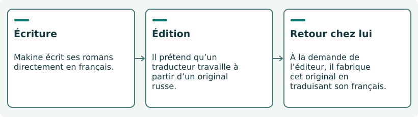

# X · MP-PC · Russe 2008 — Corrigé brut

*Corrigé rédigé par IA, non officiel. Signalez toute erreur.*

**Rédaction** · GPT-6.2 Astra Ultra · vitesse non renseignée

Le portrait d’Andreï Makine par Tatiana Tolstaïa est suivi de deux questions sur « Le pouvoir de la littérature » de Tzvetan Todorov. Le rapport d’Anastasia Forquenot traite la version et l’expression. Le cahier commun de 2008 ne fixe pas de longueur aux réponses. Les deux réponses russes comptent 128 et 191 mots.

## I. Version française

**Un écrivain russe à Paris**

Il est arrivé une histoire heureuse et extraordinaire à un Russe, Andreï Makine. Pareille chose, dit-on, n’était encore jamais arrivée à personne. Pour son roman écrit en français, il a obtenu le prix Goncourt, la plus haute récompense littéraire française, que les Français ne décernent pas aux étrangers. Puisque Makine écrivait en français et qu’il vit en France, il n’est en quelque sorte pas un étranger. Mais, la main sur le cœur, il n’est bien sûr pas français non plus. Bien plus, Makine a reçu pour ce même roman le prix Médicis et le Goncourt des lycéens, ce qui, à en croire ce qu’on nous dit, n’était jamais arrivé à aucun écrivain français depuis que ces prix existent.

Le roman est autobiographique. Nous savons que Makine est arrivé en France à l’âge adulte, qu’il voulait devenir écrivain français, qu’il a écrit quatre livres et vécu dans le besoin. Tant qu’il disait honnêtement qu’il écrivait directement en français, personne ne voulait le publier. Il s’est donc mis à mentir, prétendant que quelqu’un traduisait ses textes à partir d’un original russe. Un jour, un éditeur a fait remarquer qu’une phrase ne sonnait pas très bien en français et lui a demandé de revoir le texte original. Il n’y en avait pas, et Makine a couru chez lui traduire du français en russe. Personne n’a remarqué ses trois premiers romans, mais le quatrième a retenu l’attention de Simone Gallimard, à la tête de la plus prestigieuse maison d’édition française. Ce fut le début du succès. Il s’en est fallu de peu que Simone Gallimard vive assez longtemps pour voir ce jour-là. Mais Makine, qui vivait pauvrement, est devenu riche du jour au lendemain. Ses livres ont été publiés avec un tirage inouï de sept cent mille exemplaires et l’on a commencé à le traduire dans d’autres langues.

Makine est un Russe, mais ce n’est pas un écrivain russe. Là est ce qu’il y a de plus étrange et de plus intéressant dans cette histoire. Son roman montre clairement qu’il veut être russe. D’un autre côté, il veut être français, il vit à Paris, il veut écrire en français. Les deux parts de lui-même, la russe et la française, forment à la fois un tout et luttent l’une contre l’autre.

Tatiana Tolstaïa, *Un Russe au rendez-vous*, Moscou, 2006.

## II.1. Analyse du texte commun

По Тодорову, литература даёт знание о человеке, но приходит к нему своим путём. Философ формулирует общее положение, а писатель даёт читателю прожить частный случай со всеми его подробностями. Поэтому роман может быть понятен людям, не знакомым со специальными понятиями, даже если их эпохи и культуры очень далеки друг от друга. Вместе с тем ни образ, ни сюжет не сводятся к одному утверждению. Читателю приходится самому соединять детали и искать смысл. Его работа продолжается и после чтения, когда слово или ситуация вдруг вызывают в памяти знакомую сцену. Иначе складывается и признание истины. Научное утверждение можно проверить и опровергнуть, тогда как правда стихотворения постепенно обнаруживается в отклике многих поколений. Личное восхищение здесь лишь отправная точка. Писатель не навязывает готового ответа и именно поэтому может изменить наш взгляд на других людей.

## II.2. Réflexion personnelle

Когда я впервые прочитал рассказ Чехова «Тоска», меня поразила прежде всего его концовка. Извозчик Иона хочет рассказать пассажирам о смерти сына, но никто не готов его слушать. В конце дня он обращается к своей лошади. Тогда мне показалось, что Чехов просто противопоставляет равнодушию людей терпение животного. Через некоторое время я перечитал рассказ и заметил, как по-разному люди не слышат Иону. Один торопится, другие заняты собственной беседой. Для них поездка давно закончилась, а для него каждое неудавшееся начало разговора продолжает предыдущую неудачу.

Эта разница во времени стала для меня важнее первоначального вывода. В обычной жизни я тоже мог считать разговор законченным лишь потому, что ответил на вопрос. После чтения я вспомнил знакомого, который несколько раз возвращался к одной теме. Мне казалось, что я уже предложил ему подходящее решение. Возможно, он ждал совсем другого: хотел договорить историю до конца. Я не могу утверждать, что книга научила меня безошибочно понимать людей. Она дала мне повод усомниться в собственной догадке и задать второй вопрос. В этом скромном изменении привычки я и вижу силу литературы: никто не приказывал мне вести себя иначе, но чужой голос из давнего рассказа вдруг изменил то, как я слушаю живого собеседника.

[Sujet](https://www.alloschool.com/assets/documents/course-286/x-ens-mp-pc-2008-langues-vivantes.pdf#page=9) · [Sujet complémentaire](https://www.alloschool.com/assets/documents/course-286/x-ens-mp-pc-2008-langues-vivantes.pdf#page=1) · [Rapport](https://web.archive.org/web/20090415233115id_/http://gargantua.polytechnique.fr:80/siatel-web/linkto/?objectId=DOCF0009000003C600000000000004CA00000000)
