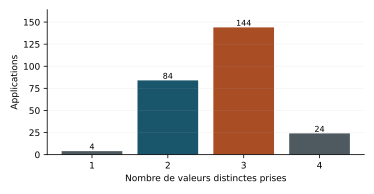

# École polytechnique MP — Deuxième composition de mathématiques 2008 · Corrigé guidé

*Corrigé rédigé par IA, non officiel. Signalez toute erreur.*

**Rédaction** · GPT-6.2 Astra Ultra · vitesse non renseignée

**Révision (tour 1)** · GPT-6.2 Astra Ultra · vitesse non renseignée · 26 novembre 2026

Le fil directeur est le dénombrement des surjections. On les retrouve dans une inversion binomiale, un changement de base polynomiale, la formule du multinôme et les coefficients d’une composition de séries entières.

## Première partie. Dénombrer par l’image

### Question 1

> [!INDICATION]
> Caractériser injections et surjections lorsque départ et arrivée ont même taille.

#### Solution

Pour deux ensembles de même cardinal fini $n$, une injection est surjective et réciproquement. Les deux nombres demandés comptent les permutations de $n$ éléments, donc $j_{n,n}=s_{n,n}=n!$.

### Question 2

> [!INDICATION]
> Fixer l’image avant de choisir la bijection vers celle-ci.

#### Solution

Une injection de $k$ éléments dans $n$ a une image de taille $k$, choisie de $\binom nk$ manières. Pour une image fixée, ses images ordonnées forment une bijection, choisie de $k!$ manières. Ces classes sont disjointes et exhaustives, donc $j_{k,n}=k!\binom nk$ pour $k\le n$.

### Question 3.a

> [!INDICATION]
> Séparer le choix du sous-ensemble image et la surjection sur cet ensemble.

#### Solution

Les $n^k$ applications ont toutes une image non vide, de cardinal $q\le n$. Pour chaque $q$ il y a $p_{q,n}$ sous-ensembles images possibles et, pour chacun, $s_{k,q}$ surjections depuis le domaine. Chaque application est comptée une seule fois, d’où $n^k=\sum_{q=1}^n s_{k,q}p_{q,n}$.

### Question 3.b

> [!INDICATION]
> Factoriser en une matrice triangulaire inférieure et une triangulaire supérieure.

#### Solution

Le produit matriciel de 3.a donne $A(r)=S(r)P(r)$. La matrice $S$ est triangulaire inférieure car $s_{k,n}=0$ si $k<n$, avec diagonale $k!$. La matrice $P$ est triangulaire supérieure car $p_{k,n}=0$ si $k>n$, avec diagonale un. Donc $\det A(r)=\prod_{k=1}^r k!$.

Le déterminant se contrôle aussi directement. En sortant $n$ de la colonne $n$ de $A(r)$, on obtient la matrice de Vandermonde de termes $n^{k-1}$. Son déterminant est $\prod_{1\le i<j\le r}(j-i)=\prod_{j=2}^r(j-1)!$. Le facteur extrait est $r!$, qui redonne $\prod_{k=1}^r k!$ avec le signe positif.

## Deuxième partie. Translation et inversion binomiale

### Question 4.a

> [!INDICATION]
> Lire la colonne n dans le développement du monôme translaté.

#### Solution

$T(X^n)=(X+1)^n=\sum_{k=0}^n\binom nk X^k$. Ainsi $T_{k,n}=\binom nk$ pour $k\le n$ et zéro sinon.

### Question 4.b

> [!INDICATION]
> Translater d’une unité dans l’autre sens.

#### Solution

L’opérateur $U(P)(X)=P(X-1)$ préserve le degré et satisfait $TU=UT=I$. Par développement de $(X-1)^n$, $(T^{-1})_{k,n}=(-1)^{n-k}\binom nk$ si $k\le n$, zéro sinon.

### Question 4.c

> [!INDICATION]
> Multiplier le vecteur ligne par la matrice inverse à droite.

#### Solution

Les relations, y compris $a_0=b_0$, disent $a=bT$. Donc $b=aT^{-1}$, soit $b_q=\sum_{n=0}^q(-1)^{q-n}\binom qn a_n$.

### Question 4.d

> [!INDICATION]
> Compléter les deux suites au rang zéro avant l’inversion.

#### Solution

Fixons $k>0$. Prenons $a_q=q^k$ et $b_q=s_{k,q}$ pour $q>0$, et $a_0=b_0=0$. La relation de 3.a est exactement 4.c. Ainsi $s_{k,n}=\sum_{q=1}^n(-1)^{n-q}\binom nq q^k$. Les coefficients demandés sont $\lambda_{n,q}=(-1)^{n-q}$.

### Question 5

> [!INDICATION]
> Comparer les termes de plus haut degré.

#### Solution

$N_k$ a degré exactement $k$ et coefficient dominant $1/k!$, y compris $N_0=1$. Dans toute relation linéaire non triviale, le terme de degré maximal ne pourrait disparaître. Les $d+1$ polynômes sont donc indépendants et forment une base de l’espace de dimension $d+1$.

### Question 6

> [!INDICATION]
> Soustraire les deux produits décalés avant de simplifier.

#### Solution

Pour $k\ge1$, $N_k(X+1)-N_k(X)$ égale $(X+1)\cdots(X+k-1)[(X+k)-X]/k!=(X+1)\cdots(X+k-1)/(k-1)!=N_{k-1}(X+1)$. Pour $k=1$ le produit vide vaut un. Ainsi $T(N_k)=N_k+T(N_{k-1})$.

### Question 7.a

> [!INDICATION]
> Dérouler la relation précédente jusqu’au polynôme constant.

#### Solution

Comme $T(N_0)=N_0$, la récurrence de 6 donne $T(N_q)=N_q+\cdots+N_0$. Sa matrice a donc coefficient $\widetilde T_{k,q}=1$ pour $0\le k\le q$ et zéro sinon.

### Question 7.b

> [!INDICATION]
> Appliquer directement la translation inverse à la relation de 6.

#### Solution

On trouve $T^{-1}N_q=N_q-N_{q-1}$ pour $q\ge1$ et $T^{-1}N_0=N_0$. La matrice inverse a des un sur la diagonale, des $-1$ immédiatement au-dessus et des zéros ailleurs.

### Question 8

> [!INDICATION]
> Prolonger l’identité de comptage en une identité polynomiale, puis changer le signe de la variable.

#### Solution

Pour tout entier $m\ge k\ge1$, 3.a donne $m^k=\sum_{q=1}^k s_{k,q}\binom mq$. Les deux côtés étant polynomiaux en $m$ et égaux en une infinité d’entiers, ils coïncident pour toute variable complexe. En $m=-X$ on a $\binom{-X}{q}=(-1)^qN_q(X)$. D’où $X^k=\sum_{q=1}^k(-1)^{k-q}s_{k,q}N_q(X)$ et, pour $k=0$, $X^0=N_0$.

Pour $k=3$, on a $s_{3,1}=1$, $s_{3,2}=6$ et $s_{3,3}=6$. La formule donne $X^3=N_1-6N_2+6N_3$. En développant on obtient $X-3X(X+1)+X(X+1)(X+2)=X^3$. Le signe alterné provient du choix de factorielles croissantes.

## Troisième partie. Multinôme et fibres des surjections

### Question 9

> [!INDICATION]
> Compter les façons de choisir les termes dans les facteurs du produit.

#### Solution

Dans le développement de $k$ facteurs $x_1+\cdots+x_n$, le monôme de profil $f$ est obtenu en choisissant $f(1)$ places pour $x_1$, puis $f(2)$ parmi ce qui reste, et ainsi de suite. Le produit des binomiaux se simplifie en $k!/\prod_i f(i)!$. Les profils sont exactement les $f\in C_{k,n}$. Leur somme pondérée donne la formule du multinôme. Pour $k=0$, le profil nul contribue un.

### Question 10

> [!INDICATION]
> Indexer chaque choix dans le développement par une application.

#### Solution

Le choix dans le facteur $j$ d’une variable $x_{\varphi(j)}$ détermine une application $\varphi:\{1,\dots,k\}\to\{1,\dots,n\}$ et toute application détermine un unique choix. La distributivité donne donc $(x_1+\cdots+x_n)^k=\sum_{\varphi\in A_{k,n}}\prod_{j=1}^k x_{\varphi(j)}$.

### Question 11

> [!INDICATION]
> Caractériser la surjectivité par les effectifs des fibres.

#### Solution

Le profil de $\varphi$ est $f(i)=|\varphi^{-1}(i)|$. L’application est surjective exactement lorsque chacun de ces effectifs est positif, c’est-à-dire lorsque $f\in D_{k,n}$. Par le même choix de places qu’en 9, $k!/\prod_i f(i)!$ applications ont ce profil. Les classes disjointes donnent la somme demandée pour $s_{k,n}$.

## Quatrième partie. Composition de séries entières

### Question 12

> [!INDICATION]
> Identifier les produits de Cauchy avec leur domaine de convergence absolue.

#### Solution

Pour $|x|<R_1$, la série $\sum |a_j||x|^j$ converge. Son produit de Cauchy à $n$ facteurs converge aussi absolument. Dans $\varphi(x)^n$, le coefficient de $x^k$ est $\sum_{j_1+\cdots+j_n=k}a_{j_1}\cdots a_{j_n}$. Comme $a_0=0$, seuls les indices positifs subsistent, d’où $\alpha_{n,k}$, nul si $k<n$. Le rayon est donc au moins $R_1$ et la somme vaut $\varphi(x)^n$. Pour $n=0$, la série vaut identiquement un par convention. Si $R_1=\infty$, tout rayon fini convient comme minorant.

### Question 13

> [!INDICATION]
> Utiliser la série des valeurs absolues de la fonction intérieure.

#### Solution

Posons $A_*(t)=\sum_{j\ge1}|a_j|t^j$. Elle tend vers zéro quand $t\downarrow0$ car son rayon est $R_1>0$ et son terme constant nul. Choisir $0<r<R_1$ avec $A_*(r)<R_2$. Pour $|x|\le r$, le produit de Cauchy positif donne $\sum_k|\alpha_{n,k}||x|^k\le A_*(r)^n$. Ainsi $\sum_n|b_n|\sum_k|\alpha_{n,k}||x|^k\le\sum_n|b_n|A_*(r)^n<\infty$. On peut donc permuter les deux sommes et obtenir $\sum_k(\sum_n b_n\alpha_{n,k})x^k=\sum_n b_n\varphi(x)^n=\psi(\varphi(x))$. Le rayon est au moins $r>0$.

### Question 14

> [!INDICATION]
> Composer l’exponentielle avec son développement privé du terme constant.

#### Solution

Ici $\varphi(x)=e^x-1$ a $a_j=1/j!$ pour $j\ge1$, et $\psi(z)=e^z$ a $b_n=1/n!$. Pour $k\ge n\ge1$, la question 11 donne $\alpha_{n,k}=\sum_{f\in D_{k,n}}1/\prod_i f(i)!=s_{k,n}/k!$. Ainsi le terme constant de $\theta$ est un et son coefficient de degré $k\ge1$ vaut $\frac1{k!}\sum_{n=1}^k s_{k,n}/n!$. En particulier $\theta^{(k)}(0)=\sum_{n=1}^k s_{k,n}/n!$. La convergence vaut pour tout $x$, car dans la preuve de 13 on peut choisir $r$ arbitrairement grand.

À l’ordre trois, la somme pondérée vaut $1+6/2!+6/3!=5$. Ainsi $\theta^{(3)}(0)=5$, mais le coefficient de $x^3$ vaut $5/6$. La même distinction donne les premiers termes $1+x+x^2+5x^3/6$, en accord avec la composition directe des deux exponentielles.
