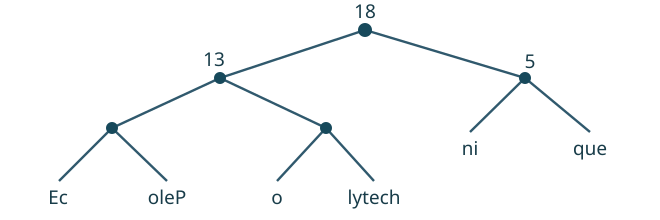

# X · MP · Informatique (option) 2008 — corrigé brut

*Corrigé rédigé par IA, non officiel. Signalez toute erreur.*

**Rédaction** · GPT-6.2 Astra Ultra · vitesse non renseignée · 25 novembre 2026

Langage choisi : OCaml. Un mot est une liste de codes de caractères. Une corde mémorise le nombre de caractères de chaque sous-arbre. Les indices commencent à zéro et les intervalles de caractères sont ouverts à droite.

## I. Listes de caractères

### Question 1 · Longueur d’un mot

La longueur augmente de un pour chaque cellule visitée.

```ocaml
type mot = int list
let longueurMot m =
  let rec compte n = function [] -> n | _ :: t -> compte (n + 1) t in
  compte 0 m
```

Le temps est linéaire et l’appel récursif est terminal.

### Question 2 · Accès à un caractère

Franchir $i$ cellules puis lire la tête. L’hypothèse sur l’indice garantit son existence.

```ocaml
let rec iemeCar i = function
  | [] -> invalid_arg "indice"
  | h :: t -> if i = 0 then h else iemeCar (i - 1) t
```

### Question 3 · Préfixe de longueur donnée

Copier les $k$ premières cellules, puis terminer le préfixe par la liste vide.

```ocaml
let rec prefixe k x =
  if k = 0 then []
  else match x with
    | h :: t -> h :: prefixe (k - 1) t
    | [] -> invalid_arg "prefixe"
```

### Question 4 · Suffixe après suppression

Avancer de $k$ cellules et renvoyer la queue elle-même. Temps $O(k+1)$, aucune cellule à copier.

```ocaml
let rec suffixe k x =
  if k = 0 then x
  else match x with
    | _ :: t -> suffixe (k - 1) t
    | [] -> invalid_arg "suffixe"
```

## II. Cordes et partage de structure

### Question 5 · Longueur mémorisée

L’invariant donne la longueur directement à la racine en $O(1)$.

```ocaml
type corde = Vide | Feuille of int * mot | Noeud of int * corde * corde
let longueur = function
  | Vide -> 0
  | Feuille (n, _) | Noeud (n, _, _) -> n
```

### Question 6 · Créer une feuille

Le mot vide donne la corde vide. Une liste non vide donne une feuille dont la longueur est calculée une fois.

```ocaml
let nouvelleCorde = function
  | [] -> Vide
  | x -> Feuille (longueurMot x, x)
```

### Question 7 · Concaténer

Éliminer l’élément neutre, sinon construire un nœud contenant la somme des longueurs. Temps et espace supplémentaires constants.

```ocaml
let concat g d = match g, d with
  | Vide, x | x, Vide -> x
  | _ -> Noeud (longueur g + longueur d, g, d)
```

### Question 8 · Descendre vers un indice

Au nœud, les indices strictement inférieurs à la longueur du fils gauche lui appartiennent. Les autres sont translatés de cette longueur vers le fils droit.

```ocaml
let rec caractere i = function
  | Vide -> invalid_arg "indice"
  | Feuille (_, x) -> iemeCar i x
  | Noeud (_, g, d) ->
      let k = longueur g in
      if i < k then caractere i g else caractere (i - k) d
```

### Question 9 · Extraire une sous-corde

Renvoyer directement tout sous-arbre couvert en entier. Un intervalle qui traverse le point de coupure prend $k-i$ lettres à gauche et les $m-(k-i)$ lettres suivantes à droite.

```ocaml
let rec sousCorde i m c =
  if i = 0 && m = longueur c then c
  else match c with
    | Vide -> invalid_arg "sous-corde"
    | Feuille (n, x) ->
        let t = suffixe i x in
        Feuille (m, if i + m = n then t else prefixe m t)
    | Noeud (_, g, d) ->
        let k = longueur g in
        if i + m <= k then sousCorde i m g
        else if i >= k then sousCorde (i - k) m d
        else concat (sousCorde i (k - i) g) (sousCorde 0 (m - k + i) d)
```

Les branches internes du résultat qui existaient déjà et sont entièrement sélectionnées sont conservées. Les parcours de l’arbre se limitent aux chemins de bord et aux racines de leurs sous-arbres adjacents.

## III. Équilibrage par classes de Fibonacci

### Question 10 · Exécution sur les six feuilles

Notons $A,B,C,D,E,F$ les feuilles « Ec », « oleP », « o », « lytech », « ni », « que », de longueurs $2,4,1,6,2,3$. Les parenthèses décrivent un nœud et le tableau ne montre que les cases occupées.

| Après | Cases occupées, dans le sens croissant |
|---|---|
| $A$ | $3:A$ |
| $B$ | $5:(AB)$ |
| $C$ | $2:C$, $5:(AB)$ |
| $D$ | $7:((AB)(CD))$ |
| $E$ | $3:E$, $7:((AB)(CD))$ |
| $F$ | $5:(EF)$, $7:((AB)(CD))$ |



La racine est $(((AB)(CD))(EF))$. Le coût passe de $2+12+3+24+8+9=58$ à $3(2+4+1+6)+2(2+3)=49$.

### Question 11 · Préparer les seuils

Calculer chaque terme à partir des deux précédents, jusqu’au seuil supérieur $F_{44}$ inclus.

```ocaml
let tailleMax = 44
let fib = Array.make (tailleMax + 1) 0
let initialiserFib () =
  fib.(0) <- 0; fib.(1) <- 1;
  for i = 2 to tailleMax do fib.(i) <- fib.(i - 1) + fib.(i - 2) done
```

### Question 12 · Propager une retenue

Après concaténation, la borne inférieure est déjà satisfaite. Tester seulement la borne supérieure et vider la case avant tout report.

```ocaml
let file = Array.make tailleMax Vide
let rec inserer c i =
  if i >= tailleMax then invalid_arg "capacite de la file";
  let u = concat file.(i) c in
  if longueur u < fib.(i + 1) then file.(i) <- u
  else begin file.(i) <- Vide; inserer u (i + 1) end
```

### Question 13 · Hauteurs pendant l’insertion

À l’entrée en case $i$, le report a longueur au moins $F_i$ et hauteur au plus $i-2$. Si la case est vide, ces bornes restent vraies. Si elle est occupée, la longueur obtenue est au moins $2F_i\ge F_{i+1}$, et sa hauteur au plus $i-1$. Il y a alors nécessairement report.

En cas de report, la longueur atteint $F_{i+1}$ et la hauteur est au plus $(i+1)-2$. En cas d’arrêt, la case était vide, et la longueur est strictement inférieure à $F_{i+1}$. Cela prouve l’invariant par récurrence sur les cases visitées. Les autres cases gardent leur état.

### Question 14 · Construire la corde équilibrée

Visiter les feuilles de gauche à droite. Puis, en parcourant les cases dans le sens croissant, placer chaque bloc à gauche du résultat partiel.

```ocaml
let equilibrer c =
  initialiserFib (); Array.fill file 0 tailleMax Vide;
  let rec visite = function
    | Vide -> ()
    | Feuille _ as x -> inserer x 2
    | Noeud (_, g, d) -> visite g; visite d
  in
  visite c;
  let resultat = ref Vide in
  for i = 2 to tailleMax - 1 do resultat := concat file.(i) !resultat done;
  !resultat
```

### Question 15 · Borne sur le coût

Après la case $i$, l’accumulateur a hauteur au plus $i-1$. En effet l’ancien accumulateur a hauteur au plus $i-2$ par récurrence et la case $i$ au plus $i-2$. Leur concaténation a hauteur au plus $i-1$, avec la même borne si un opérande est vide.

Ainsi $h\le j-1$ et $n\ge F_j\ge F_{h+1}$. L’inégalité admise donne $n\ge\varphi^h/\sqrt5$, donc $h\le\log_\varphi n+\log_\varphi\sqrt5$. Chaque caractère est compté à une profondeur au plus $h$. On peut prendre $K=\log_\varphi\sqrt5$ dans la borne demandée.

## IV. Équilibrage optimal de Garsia–Wachs

### Question 16 · Ranger les feuilles dans l’ordre initial

Un parcours infixe des feuilles écrit chaque occurrence dans la prochaine case. La dernière case écrite porte l’indice $k$.

```ocaml
let maxf = 1000
let q = Array.make maxf Vide
let initialiserQ c =
  let suivant = ref 0 in
  let rec visite = function
    | Vide -> ()
    | Feuille _ as x ->
        if !suivant = maxf then invalid_arg "trop de feuilles";
        q.(!suivant) <- x; incr suivant
    | Noeud (_, g, d) -> visite g; visite d
  in visite c; !suivant - 1
```

### Question 17 · Attribuer la profondeur à chaque occurrence

Lorsque les feuilles sont distinctes, indexer les feuilles d’origine, puis parcourir $c_1$ avec la profondeur. Pour couvrir aussi les occurrences égales ou partagées, on peut rejouer la première phase avec des étiquettes d’indices. Les décisions de cette phase ne dépendent que des longueurs.

```ocaml
let prof = Array.make maxf 0
let initialiserProf c c1 =
  let prochain = ref 0 in
  let rec etiqueter = function
    | Vide -> Vide
    | Feuille (n, _ :: t) ->
        let i = !prochain in incr prochain; Feuille (n, i :: t)
    | Feuille (_, []) -> invalid_arg "feuille vide"
    | Noeud (_, g, d) ->
        let a = etiqueter g in let b = etiqueter d in concat a b
  in
  let marques = phase1 (etiqueter c) in
  let rec visite h a b = match a, b with
    | Feuille _, Feuille (_, i :: _) -> prof.(i) <- h
    | Noeud (_, g, d), Noeud (_, u, v) -> visite (h+1) g u; visite (h+1) d v
    | _ -> invalid_arg "arbres incompatibles"
  in
  ignore (initialiserQ c);
  visite 0 c1 marques
```

La tête de chaque mot de travail contient un entier privé. La phase de fusion ne lit aucun caractère. Les deux arbres ont donc exactement la même forme et les mêmes occurrences aux positions correspondantes. La phase admise peut utiliser le tableau global $q$, que l’on recharge ensuite. Hors rejeu de cette phase, les parcours sont linéaires en nombre de feuilles.

### Question 18 · Reconstruire à partir des profondeurs

Garder un curseur sur la première feuille non consommée. Un appel à profondeur $h$ renvoie cette feuille si sa profondeur est exactement $h$. Sinon la racine locale est interne et il faut lire successivement ses deux fils à profondeur $h+1$.

```ocaml
let reconstruire () =
  let i = ref 0 in
  let rec lire h =
    if prof.(!i) = h then begin
      let feuille = q.(!i) in incr i; feuille
    end else begin
      let g = lire (h+1) in
      let d = lire (h+1) in concat g d
    end
  in lire 0
```

Par induction sur un sous-arbre de la réalisation admise, l’appel lancé à sa profondeur en consomme exactement les feuilles, dans leur ordre. S’il est interne, sa première feuille est strictement plus profonde. Les deux appels reconstruisent ainsi le sous-arbre unique. Chaque nœud est visité une fois.

### Question 19 · Algorithme complet

Garder le cas vide à part. Pour la corde non vide, composer la première phase, le transfert des profondeurs et la reconstruction.

```ocaml
let equilibrerOpt = function
  | Vide -> Vide
  | c -> let c1 = phase1 c in initialiserProf c c1; reconstruire ()
```

[Sujet](https://www.wikiprepa.fr/concours/data/x_option-info_mp_2008.pdf) · [Rapport](https://www.doc-solus.fr/prepa/sci/adc/pdf/rapports.pdf/2008/MP_INFO_X_1_2008.rapport.pdf) · [Autre exemplaire](https://www.doc-solus.fr/prepa/sci/adc/pdf/enonces.pdf/2008/MP_INFO_X_1_2008.enonce.pdf)
