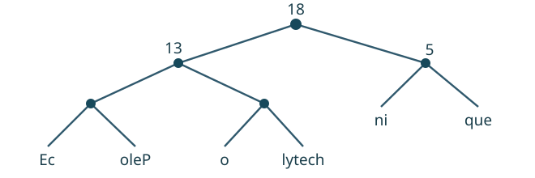

# X · MP · Informatique (option) 2008 — corrigé guidé

*Corrigé rédigé par IA, non officiel. Signalez toute erreur.*

**Rédaction** · GPT-6.2 Astra Ultra · vitesse non renseignée · 25 novembre 2026

Langage choisi : OCaml. Un mot est une liste de codes de caractères. Une corde mémorise le nombre de caractères de chaque sous-arbre. Les indices commencent à zéro et les intervalles de caractères sont ouverts à droite.

## I. Listes de caractères

### Question 1 · Longueur d’un mot

Utiliser un compteur initialement nul. À chaque appel, le compteur ajouté à la longueur restante vaut la longueur cherchée. La liste vide donne le résultat immédiat.

```ocaml
type mot = int list
let longueurMot m =
  let rec compte n = function [] -> n | _ :: t -> compte (n + 1) t in
  compte 0 m
```

Le temps est linéaire et l’appel récursif est terminal.

### Question 2 · Accès à un caractère

Le caractère d’indice zéro est le premier. Après avoir sauté la première cellule, l’indice du même caractère diminue de un. On lit $i+1$ cellules.

```ocaml
let rec iemeCar i = function
  | [] -> invalid_arg "indice"
  | h :: t -> if i = 0 then h else iemeCar (i - 1) t
```

### Question 3 · Préfixe de longueur donnée

Pour $k=0$, la réponse est vide même si le mot contient encore des lettres. Pour $k>0$, sauvegarder la tête et demander seulement $k-1$ lettres à la queue.

```ocaml
let rec prefixe k x =
  if k = 0 then []
  else match x with
    | h :: t -> h :: prefixe (k - 1) t
    | [] -> invalid_arg "prefixe"
```

### Question 4 · Suffixe après suppression

Avec $k=0$, toutes les lettres restent. Avec $k=n$, on atteint la fin. Le nombre $k$ compte ici les lettres supprimées, ce qui explique la différence avec la question précédente.

```ocaml
let rec suffixe k x =
  if k = 0 then x
  else match x with
    | _ :: t -> suffixe (k - 1) t
    | [] -> invalid_arg "suffixe"
```

## II. Cordes et partage de structure

### Question 5 · Longueur mémorisée

Le constructeur vide est le seul sans champ de longueur. Pour un nœud, le calcul a déjà été effectué lors de sa création.

```ocaml
type corde = Vide | Feuille of int * mot | Noeud of int * corde * corde
let longueur = function
  | Vide -> 0
  | Feuille (n, _) | Noeud (n, _, _) -> n
```

### Question 6 · Créer une feuille

Une feuille de longueur zéro violerait l’invariant du sujet. Pour une autre feuille, on peut partager la liste d’origine puisque les mots sont immuables.

```ocaml
let nouvelleCorde = function
  | [] -> Vide
  | x -> Feuille (longueurMot x, x)
```

### Question 7 · Concaténer

La concaténation doit garder l’ordre de lecture. Dans le cas général, la première corde devient le fils gauche et la seconde le fils droit. Un fils vide créerait un nœud interdit, d’où les deux cas immédiats.

```ocaml
let concat g d = match g, d with
  | Vide, x | x, Vide -> x
  | _ -> Noeud (longueur g + longueur d, g, d)
```

### Question 8 · Descendre vers un indice

À la première lettre du fils droit, l’indice global vaut exactement la longueur de gauche. L’indice local attendu est zéro. Un seul chemin est suivi, puis le préfixe de la feuille jusqu’à la lettre.

```ocaml
let rec caractere i = function
  | Vide -> invalid_arg "indice"
  | Feuille (_, x) -> iemeCar i x
  | Noeud (_, g, d) ->
      let k = longueur g in
      if i < k then caractere i g else caractere (i - k) d
```

### Question 9 · Extraire une sous-corde

Dessiner les bornes $i$ et $i+m$ sur la ligne coupée en $k$. Si la borne droite tombe exactement sur $k$, aucune lettre de droite n’est demandée. Si seule la feuille terminale est partiellement sélectionnée et que son suffixe entier convient, partager aussi ce suffixe.

```ocaml
let rec sousCorde i m c =
  if i = 0 && m = longueur c then c
  else match c with
    | Vide -> invalid_arg "sous-corde"
    | Feuille (n, x) ->
        let t = suffixe i x in
        Feuille (m, if i + m = n then t else prefixe m t)
    | Noeud (_, g, d) ->
        let k = longueur g in
        if i + m <= k then sousCorde i m g
        else if i >= k then sousCorde (i - k) m d
        else concat (sousCorde i (k - i) g) (sousCorde 0 (m - k + i) d)
```

Les branches internes du résultat qui existaient déjà et sont entièrement sélectionnées sont conservées. Les parcours de l’arbre se limitent aux chemins de bord et aux racines de leurs sous-arbres adjacents.

## III. Équilibrage par classes de Fibonacci

### Question 10 · Exécution sur les six feuilles

Numéroter les six feuilles de gauche à droite par $A,B,C,D,E,F$. Leurs longueurs respectives sont $2,4,1,6,2,3$. Une longueur 2 va en case 3, une longueur 6 en case 5. Un mot déjà en case s’ajoute toujours à gauche du nouveau. Par exemple le passage de la quatrième feuille transporte d’abord $(CD)$ puis forme $((AB)(CD))$.

| Après | Cases occupées, dans le sens croissant |
|---|---|
| $A$ | $3:A$ |
| $B$ | $5:(AB)$ |
| $C$ | $2:C$, $5:(AB)$ |
| $D$ | $7:((AB)(CD))$ |
| $E$ | $3:E$, $7:((AB)(CD))$ |
| $F$ | $5:(EF)$, $7:((AB)(CD))$ |



La racine est $(((AB)(CD))(EF))$. Le coût passe de $2+12+3+24+8+9=58$ à $3(2+4+1+6)+2(2+3)=49$.

### Question 11 · Préparer les seuils

Une case d’indice 43 a besoin de $F_{44}$ pour sa borne exclue. Le tableau des seuils a donc une entrée de plus que la file.

```ocaml
let tailleMax = 44
let fib = Array.make (tailleMax + 1) 0
let initialiserFib () =
  fib.(0) <- 0; fib.(1) <- 1;
  for i = 2 to tailleMax do fib.(i) <- fib.(i - 1) + fib.(i - 2) done
```

### Question 12 · Propager une retenue

Ne pas confondre les rôles des deux cordes. L’ancienne case contient un morceau antérieur dans le mot. Si la nouvelle longueur vaut exactement $F_{i+1}$, il faut avancer. La case 44 est hors du tableau et doit être signalée.

```ocaml
let file = Array.make tailleMax Vide
let rec inserer c i =
  if i >= tailleMax then invalid_arg "capacite de la file";
  let u = concat file.(i) c in
  if longueur u < fib.(i + 1) then file.(i) <- u
  else begin file.(i) <- Vide; inserer u (i + 1) end
```

### Question 13 · Hauteurs pendant l’insertion

Une fusion augmente la hauteur de un, ce qui paraît incompatible avec une conservation dans la même case. Mais deux éléments de cette classe pèsent chacun au moins $F_i$. Comme $F_{i+1}=F_i+F_{i-1}\le2F_i$, la fusion poursuit obligatoirement sa route.

En cas de report, la longueur atteint $F_{i+1}$ et la hauteur est au plus $(i+1)-2$. En cas d’arrêt, la case était vide, et la longueur est strictement inférieure à $F_{i+1}$. Cela prouve l’invariant par récurrence sur les cases visitées. Les autres cases gardent leur état.

### Question 14 · Construire la corde équilibrée

Les cases de grands indices portent les plus anciens morceaux. Le résultat doit les lire en premier. Construire depuis la petite extrémité de la file permet de conserver le bon ordre et de raccrocher les grands sous-arbres près de la racine.

```ocaml
let equilibrer c =
  initialiserFib (); Array.fill file 0 tailleMax Vide;
  let rec visite = function
    | Vide -> ()
    | Feuille _ as x -> inserer x 2
    | Noeud (_, g, d) -> visite g; visite d
  in
  visite c;
  let resultat = ref Vide in
  for i = 2 to tailleMax - 1 do resultat := concat file.(i) !resultat done;
  !resultat
```

### Question 15 · Borne sur le coût

Regarder le plus grand indice occupé $j$. Sa case fournit déjà $F_j$ caractères. Il reste à majorer la hauteur de l’arbre final par $j-1$. Après la case 2 elle est au plus 1. En passant de $i-1$ à $i$, l’arbre précédent et le bloc ajouté ont chacun hauteur au plus $i-2$. Un nœud supplémentaire ajoute au plus un niveau.

Ainsi $h\le j-1$ et $n\ge F_j\ge F_{h+1}$. L’inégalité admise donne $n\ge\varphi^h/\sqrt5$, donc $h\le\log_\varphi n+\log_\varphi\sqrt5$. Chaque caractère est compté à une profondeur au plus $h$. On peut prendre $K=\log_\varphi\sqrt5$ dans la borne demandée.

## IV. Équilibrage optimal de Garsia–Wachs

### Question 16 · Ranger les feuilles dans l’ordre initial

Distinguer le nombre de feuilles de leur dernier indice. Une corde réduite à une feuille remplit la case zéro et renvoie zéro. Le parcours coûte $O(k+1)$, sans concaténer de listes auxiliaires.

```ocaml
let maxf = 1000
let q = Array.make maxf Vide
let initialiserQ c =
  let suivant = ref 0 in
  let rec visite = function
    | Vide -> ()
    | Feuille _ as x ->
        if !suivant = maxf then invalid_arg "trop de feuilles";
        q.(!suivant) <- x; incr suivant
    | Noeud (_, g, d) -> visite g; visite d
  in visite c; !suivant - 1
```

### Question 17 · Attribuer la profondeur à chaque occurrence

Deux apparitions du même mot peuvent être à des profondeurs différentes. Une recherche de la première feuille égale associerait alors deux profondeurs à la même case. Donner à chaque occurrence son numéro dans une copie de travail, conserver sa longueur, puis rejouer les mêmes fusions. On lit le numéro sur la copie et la profondeur en parcourant l’arbre reçu en parallèle. Les mots originaux restent dans $q$ pour la reconstruction.

```ocaml
let prof = Array.make maxf 0
let initialiserProf c c1 =
  let prochain = ref 0 in
  let rec etiqueter = function
    | Vide -> Vide
    | Feuille (n, _ :: t) ->
        let i = !prochain in incr prochain; Feuille (n, i :: t)
    | Feuille (_, []) -> invalid_arg "feuille vide"
    | Noeud (_, g, d) ->
        let a = etiqueter g in let b = etiqueter d in concat a b
  in
  let marques = phase1 (etiqueter c) in
  let rec visite h a b = match a, b with
    | Feuille _, Feuille (_, i :: _) -> prof.(i) <- h
    | Noeud (_, g, d), Noeud (_, u, v) -> visite (h+1) g u; visite (h+1) d v
    | _ -> invalid_arg "arbres incompatibles"
  in
  ignore (initialiserQ c);
  visite 0 c1 marques
```

La tête de chaque mot de travail contient un entier privé. La phase de fusion ne lit aucun caractère. Les deux arbres ont donc exactement la même forme et les mêmes occurrences aux positions correspondantes. La phase admise peut utiliser le tableau global $q$, que l’on recharge ensuite. Hors rejeu de cette phase, les parcours sont linéaires en nombre de feuilles.

### Question 18 · Reconstruire à partir des profondeurs

Supposer que les profondeurs sont $(2,2,1)$. À profondeur 0, puis 1, la première feuille est encore trop profonde. Les deux appels à profondeur 2 consomment les deux premières feuilles. Le second fils de la racine consomme alors la troisième, à profondeur 1.

```ocaml
let reconstruire () =
  let i = ref 0 in
  let rec lire h =
    if prof.(!i) = h then begin
      let feuille = q.(!i) in incr i; feuille
    end else begin
      let g = lire (h+1) in
      let d = lire (h+1) in concat g d
    end
  in lire 0
```

Par induction sur un sous-arbre de la réalisation admise, l’appel lancé à sa profondeur en consomme exactement les feuilles, dans leur ordre. S’il est interne, sa première feuille est strictement plus profonde. Les deux appels reconstruisent ainsi le sous-arbre unique. Chaque nœud est visité une fois.

### Question 19 · Algorithme complet

Le coût est la somme des longueurs pondérées par les profondeurs. Chaque occurrence retrouve sa profondeur dans un arbre qui respecte désormais l’ordre initial. Les deux arbres ont donc le même coût, minimal selon le résultat admis.

```ocaml
let equilibrerOpt = function
  | Vide -> Vide
  | c -> let c1 = phase1 c in initialiserProf c c1; reconstruire ()
```

[Sujet](https://www.wikiprepa.fr/concours/data/x_option-info_mp_2008.pdf) · [Rapport](https://www.doc-solus.fr/prepa/sci/adc/pdf/rapports.pdf/2008/MP_INFO_X_1_2008.rapport.pdf) · [Autre exemplaire](https://www.doc-solus.fr/prepa/sci/adc/pdf/enonces.pdf/2008/MP_INFO_X_1_2008.enonce.pdf)
