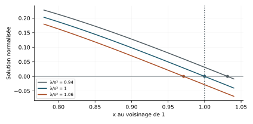

# École polytechnique MP — Première composition de mathématiques 2008 · Corrigé guidé

*Corrigé rédigé par IA, non officiel. Signalez toute erreur.*

**Rédaction** · GPT-6.2 Astra Ultra · vitesse non renseignée

**Révision** · GPT-6.2 Astra Ultra · vitesse non renseignée

L’épreuve établit la séparation des zéros et compte ceux de la solution de Sturm–Liouville normalisée à gauche. Le rapport attire l’attention sur la compacité, les choix uniformes de voisinages et le saut du compteur à une valeur propre.

## Première partie. Zéros, wronskien et comparaison

### Question 1.a

> [!INDICATION]
> Appliquer l’unicité d’une solution pour deux données initiales imposées au même point.

#### Solution

L’équation est linéaire d’ordre deux à coefficients continus. Si $y(c)=y'(c)=0$, le problème de Cauchy en $c$ a pour solution unique la fonction nulle sur tout $[0,1]$. Cela contredit l’hypothèse. Chaque zéro de $y$ a donc une dérivée non nulle.

### Question 1.b

> [!INDICATION]
> Chercher un point d’accumulation dans le segment compact.

#### Solution

Une infinité de zéros distincts donnerait une suite $c_j\to c\in[0,1]$, avec $c_j\ne c$. Par continuité $y(c)=0$, puis $y'(c)=\lim (y(c_j)-y(c))/(c_j-c)=0$, même avec une limite unilatérale au bord. Cela contredit 1.a. Les zéros sont donc en nombre fini.

### Question 2.a

> [!INDICATION]
> Comparer les signes du wronskien aux deux zéros consécutifs.

#### Solution

Posons $W=y_1y'_2-y'_1y_2$. Il ne s’annule jamais, sinon les données des deux solutions seraient dépendantes en un point et l’unicité de Cauchy donnerait leur dépendance. En particulier $y_2(a)$ et $y_2(b)$ sont non nuls. Les zéros simples de $y_1$ bordent un intervalle de signe constant, donc $y'_1(a)$ et $y'_1(b)$ sont de signes opposés. Or $W(a)=-y'_1(a)y_2(a)$ et $W(b)=-y'_1(b)y_2(b)$ ont même signe. Ainsi $y_2(a),y_2(b)$ sont de signes contraires et $y_2$ s’annule entre eux.

### Question 2.b

> [!INDICATION]
> Échanger les deux rôles sur un intervalle plus petit.

#### Solution

Si $y_2$ avait au moins deux zéros dans $]a,b[$, on pourrait y en choisir deux consécutifs par 1.b. Par 2.a appliquée en échangeant les solutions, $y_1$ s’annulerait strictement entre eux. Cela contredit la consécutivité de $a,b$. Il y a exactement un zéro de $y_2$.

### Question 3.a

> [!INDICATION]
> Développer la différence avant de remplacer les dérivées secondes.

#### Solution

Dans $y_1B_{u,v}(y_2)-y_2B_{u,v}(y_1)$, le terme en $v$ s’annule. Restent $u'W+u(y_1y''_2-y_2y''_1)$. Comme $y''_i=-py'_i-qy_i$, la parenthèse vaut $-pW$. On obtient $(u'-up)W$.

### Question 3.b

> [!INDICATION]
> Utiliser une base de solutions pour montrer la nécessité des deux relations.

#### Solution

Si les noyaux coïncident, appliquer 3.a à une base de solutions donne $(u'-up)W=0$ partout, donc $u'=pu$. Sur toute solution $y$ on a alors $B_{u,v}(y)=(v-uq)y$. À chaque point il existe une solution valant un (données de Cauchy), ce qui impose $v=uq$ partout. Ainsi $u(x)=C\exp(\int_0^xp(t)dt)$ avec $C\ne0$, et $v=qu$. Réciproquement ces choix donnent $B_{u,v}=uA_{p,q}$, donc les noyaux sont identiques.

### Question 4.a

> [!INDICATION]
> Soustraire les identités et utiliser la règle du produit.

#### Solution

On a $[u(y_1y'_2-y_2y'_1)]'=y_1(uy'_2)'-y_2(uy'_1)'=(v_1-v_2)y_1y_2$. En intégrant de $a$ à $b$, les valeurs de $y_2$ aux bornes sont nulles. Ainsi $[uy_1y'_2]_a^b=\int_a^b(v_1-v_2)y_1y_2$.

### Question 4.b

> [!INDICATION]
> Comparer le signe de l’intégrale à celui du terme de bord.

#### Solution

Si $y_1$ ne s’annulait pas sur $]a,b[$, on pourrait changer indépendamment les signes des deux solutions pour les rendre positives à l’intérieur. Alors $y_1(a),y_1(b)\ge0$ et la simplicité des zéros donne $y'_2(a)>0$, $y'_2(b)<0$. Le crochet de 4.a est au plus zéro, tandis que l’intégrale est strictement positive puisque $v_1>v_2$. Contradiction.

## Deuxième partie. Conditions de Dirichlet

### Question 5.a

> [!INDICATION]
> Imposer la condition de gauche avant celle de droite.

#### Solution

Les solutions vérifiant $y(0)=0$ sont exactement $cy_\lambda$ pour $c=y'(0)$, par unicité. La condition $y(1)=0$ laisse cette droite entière ou seulement zéro. Les deux dimensions possibles sont un et zéro.

### Question 5.b

> [!INDICATION]
> Tester la seconde condition sur le générateur non nul.

#### Solution

Comme $y'_\lambda(0)=1$, $y_\lambda$ est non nulle. Si $y_\lambda(1)=0$, elle appartient à $E_\lambda$. Réciproquement tout élément non nul de $E_\lambda$ est $cy_\lambda$ avec $c\ne0$ par 5.a, donc $c y_\lambda(1)=0$ impose $y_\lambda(1)=0$.

### Question 6.a

> [!INDICATION]
> Multiplier l’équation par une fonction propre et intégrer.

#### Solution

Pour $0\ne y\in E_\lambda$, l’intégration par parties, avec $y(0)=y(1)=0$, donne $\lambda\int_0^1y^2=\int_0^1(y')^2+\int_0^1r y^2$. Comme $\int y^2>0$ et $r\ge\min r$, $\lambda\ge\min r$. Le terme de dérivée est même strictement positif car une constante vérifiant ces bords serait nulle.

### Question 6.b

> [!INDICATION]
> Soustraire les deux équations multipliées par l’autre fonction.

#### Solution

L’intégration de $y_1y''_2-y_2y''_1=(\lambda_1-\lambda_2)y_1y_2$ donne le crochet $[y_1y'_2-y_2y'_1]_0^1=0$ par les conditions aux bords. Comme $\lambda_1\ne\lambda_2$, l’intégrale du produit est nulle.

## Troisième partie. Comptage des zéros

### Question 7.a

> [!INDICATION]
> Normaliser la solution sinusoïdale à l’origine.

#### Solution

Pour $r=0$ et $\lambda>0$, $y''+\lambda y=0$ et les deux conditions initiales donnent $y_\lambda(x)=\sin(\sqrt\lambda\,x)/\sqrt\lambda$.

### Question 7.b

> [!INDICATION]
> Compter aussi le zéro d’abscisse zéro.

#### Solution

Les zéros sont $k\pi/\sqrt\lambda$, $k=0,\ldots,\lfloor\sqrt\lambda/\pi\rfloor$. Donc $N(\lambda)=1+\lfloor\sqrt\lambda/\pi\rfloor$, y compris quand le dernier zéro est au bord droit.

### Question 7.c

> [!INDICATION]
> Distinguer le passage par un carré d’entier multiplié par π².

#### Solution

Si $\sqrt{\lambda_0}/\pi$ n’est pas entier, cette quantité demeure entre les mêmes entiers près de $\lambda_0$ et $N$ reste constant. En $\lambda_0=k^2\pi^2$, $k\ge1$, $N$ passe de $k$ à $k+1$ et prend déjà cette dernière valeur en $\lambda_0$. Il est localement constant de chaque côté et continu à droite.

### Question 8.a

> [!INDICATION]
> Isoler chaque zéro dans un intervalle de stricte monotonie.

#### Solution

$y'_{\lambda_0}(0)=1$ et tous les zéros sont simples. Le signe de $y_{\lambda_0}$ alterne à partir du signe positif juste à droite de zéro. En conséquence $y'_{\lambda_0}(c_j)$ a signe $(-1)^{j-1}$. Par continuité on peut entourer chaque $c_j$ d’un petit intervalle fermé de ce signe de dérivée, les intervalles étant disjoints et séparés (tronqué à gauche en zéro pour $j=1$). Nommons-les $[\xi_{2j-2},\xi_{2j-1}]$, en prenant $\xi_0=0$ et le dernier bord intérieur strictement avant 1. Sur chaque intervalle complémentaire $[\xi_{2j-1},\xi_{2j}]$, avec $\xi_{2n}=1$, la solution a signe $(-1)^{j+1}$ puisque ses bornes ne sont pas des zéros. Cela donne (i), (ii), (iii), y compris pour $n=1$.

### Question 8.b

> [!INDICATION]
> Borner la dérivée partielle en la première variable sur le rectangle.

#### Solution

Posons $M=\max_{I\times J}|\partial_1F|<\infty$. Le théorème des accroissements finis à $t$ fixé donne $|F(s_1,t)-F(s_2,t)|\le M|s_1-s_2|$ pour tous les $t\in J$. Il suffit de choisir $\delta=\varepsilon/(1+M)$, indépendant de $t$.

### Question 8.c

> [!INDICATION]
> Conserver tous les signes à l’aide d’un seul voisinage du paramètre.

#### Solution

Sur chacun des intervalles de signe strict de 8.a, le module de la fonction concernée ($y$ ou $y_x$) a un minimum positif. Prendre le plus petit de ces minima puis appliquer 8.b à $y$ et $y_x$ pour que leurs variations soient inférieures à sa moitié, avec le même voisinage en $\lambda$. Les intervalles complémentaires gardent leur signe et ne contiennent aucun zéro. Sur les intervalles des zéros intérieurs, $y_\lambda$ est strictement monotone, ses valeurs aux bornes ayant des signes opposés conservés. Il y a donc un unique zéro. Sur le premier intervalle le zéro permanent en zéro est unique par stricte monotonie. Ainsi $N(\lambda)=n$.

### Question 9

> [!INDICATION]
> Comparer avec un sinus de coefficient strictement inférieur et traiter le seuil entier.

#### Solution

Si $\lambda=\rho$, la borne demandée vaut zéro. Si $\lambda>\rho$ et $0<\mu<\lambda-\rho$, alors $\lambda-r(x)>\mu$. Par 4.b, entre deux zéros successifs de $\sin(\sqrt\mu\,x)$ sur $[0,1]$ se trouve un zéro de $y_\lambda$. Il y a $\lfloor\sqrt\mu/\pi\rfloor$ tels intervalles et zéro est de plus un zéro de $y_\lambda$ distinct de ceux-là. Ainsi $N(\lambda)\ge1+\lfloor\sqrt\mu/\pi\rfloor$. Quand $\mu$ approche $\lambda-\rho$ par-dessous, le plancher prend soit la valeur cible soit, au seuil entier, cette valeur diminuée de un. Dans les deux cas $N(\lambda)\ge\lfloor\sqrt{\lambda-\rho}/\pi\rfloor$.

Au cas limite $\sqrt{\lambda-\rho}/\pi=m$ entier strictement positif, les valeurs de $\mu$ immédiatement inférieures donnent exactement $m-1$ intervalles complets. Le zéro initial, extérieur à tous les intervalles ouverts de comparaison, fournit le $m$-ième zéro exigé. Ce décompte explique pourquoi on peut faire tendre $\mu$ vers la borne malgré la discontinuité du plancher.

### Question 10.a

> [!INDICATION]
> Utiliser la connexité de l’intervalle des paramètres.

#### Solution

Par 8.c, $N$ est localement constante en tout point où $y_\lambda(1)\ne0$. Sur un intervalle $I$ composé de tels points, le niveau de chaque valeur est relativement ouvert et son complément aussi. Comme $I$ est connexe, $N$ y est constante.

### Question 10.b

> [!INDICATION]
> Comparer la dernière zone sans valeur propre à la croissance du nombre de zéros.

#### Solution

S’il y avait seulement un nombre fini de valeurs propres, éventuellement zéro, un intervalle $]L,+\infty[$ n’en contiendrait aucune. Par 5.b et 10.a $N$ y serait constante, ce qui contredit la divergence du minorant de 9. Les valeurs propres sont donc en nombre infini.

## Quatrième partie. Passage d’une valeur propre

### Question 11

> [!INDICATION]
> Éliminer le coefficient de potentiel, puis intégrer une dérivée de wronskien.

#### Solution

Écrivons $z=\partial_\lambda y$. En dérivant l’équation lisse en $\lambda$ on a $z_{xx}+(\lambda-r)z+y=0$, relation (ii). Multiplier l’équation de $y$ par $z$, celle de $z$ par $y$, puis soustraire donne $y_{xx}z-z_{xx}y-y^2=0$, relation (iii). Ainsi $(y_xz-z_xy)_x=y^2$. À gauche $y(\lambda,0)=0$ pour tout $\lambda$ entraîne $z(\lambda,0)=0$. À droite $y(\lambda_0,1)=0$. L’intégration en $x$ à $\lambda=\lambda_0$ donne $y_x(\lambda_0,1)z(\lambda_0,1)=\int_0^1 y(\lambda_0,x)^2dx>0$ car $y_x(\lambda_0,0)=1$.

### Question 12

> [!INDICATION]
> Étudier séparément les zéros intérieurs et le signe à l’extrémité droite.

#### Solution

Posons $s=\operatorname{sgn} y_x(\lambda_0,1)$. Choisissons $b<1$ assez proche de 1 pour que $s y_x(\lambda_0,x)>0$ sur $[b,1]$. Alors $s y(\lambda_0,b)<0$. Par continuité uniforme ces deux propriétés persistent pour $\lambda$ proche. Sur $[0,b]$, l’argument de 8.a–c conserve tous les zéros au nombre de $N(\lambda_0)-1$. Par 11, $s\,\partial_\lambda y(\lambda_0,1)>0$. Ainsi $s y(\lambda,1)$ est négatif juste avant $\lambda_0$, nul en ce point, positif juste après, par stricte monotonie locale en $\lambda$. Sur $[b,1]$, $s y(\lambda,\cdot)$ est strictement croissante et commence à une valeur négative. Elle n’a donc aucun zéro dans le premier cas et exactement un dans les deux autres, au bord compris. Un $\varepsilon>0$ réduit si nécessaire donne les deux intervalles fermés aux extrémités demandées.

Dans le cas représenté $r=0$, le premier zéro mobile a pour abscisse $x_1(\lambda)=\pi/\sqrt\lambda$. En $\lambda=\pi^2$ on a $x_1=1$ et $x_1'(\pi^2)=-1/(2\pi^2)$. Il entre donc dans le segment par son bord droit lorsque $\lambda$ augmente, avec le sens du saut démontré ci-dessus.

### Question 13

> [!INDICATION]
> Établir l’absence d’accumulation finie et fixer la valeur initiale du compteur.

#### Solution

Les valeurs propres sont les zéros de la fonction continue $\lambda\mapsto y(\lambda,1)$, donc forment un fermé. Par 11 sa dérivée y est non nulle, et chaque zéro est isolé. Un compact ne peut contenir une infinité de ces zéros, sinon une sous-suite convergerait vers un zéro non isolé. Comme ils sont minorés par 6.a et en nombre infini par 10.b, on peut les énumérer en ordre strictement croissant $\lambda_1<\lambda_2<\cdots$ avec $\lambda_n\to+\infty$.

Pour $\lambda<\min r$, $y_\lambda$ ne peut s’annuler en un point $c>0$ : l’identité d’énergie de 6.a sur $[0,c]$ imposerait $\lambda\ge\min_{[0,c]}r$. Ainsi $N=1$ avant la première valeur propre, par 10.a. La question 12 ajoute exactement un zéro à chaque valeur propre et 10.a conserve le nombre entre deux passages. Par récurrence $N(\lambda_n)=n+1$, en comptant les deux extrémités du segment.

Pour passer de l’hypothèse de récurrence au rang suivant, $N$ reste égal à $n+1$ sur $[\lambda_n,\lambda_{n+1}[$. La valeur au bord droit est $n+2$ par 12. En particulier la première fonction propre a exactement deux zéros sur le segment fermé et aucun à l’intérieur.
