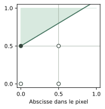
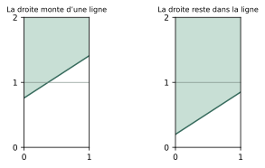
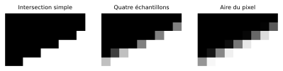

# École polytechnique · PSI et PT · Informatique 2008 · Corrigé brut

*Corrigé rédigé par IA, non officiel. Signalez toute erreur.*

**Rédaction** · GPT-6.2 Astra Ultra · vitesse non renseignée · 25 novembre 2026

**Lissage de vecteurs obliques.** Le langage choisi est Python. Les primitives `partieEntiere` et `peindrePixel` sont celles de l’énoncé. Le blanc est l’intensité 0 et le noir l’intensité 1. Le pixel est repéré par son coin inférieur gauche.

## I · Remplissage simple

### Question 1 · Noircir en examinant tous les pixels

```python
def peindreRegion(w, h, a, b):
    for x in range(w):
        bas = partieEntiere(a * x + b)
        for y in range(h):
            if y >= bas:
                peindrePixel(x, y, 1)
```

Le premier pixel à noircir dans la colonne $x$ a pour ordonnée $\lfloor ax+b\rfloor$. Lorsque $ax+b$ est entier, le pixel situé juste en dessous n’atteint pas la droite car son bord supérieur est exclu. Le programme examine $wh$ pixels. Les pixels non peints gardent le blanc initial.

### Question 2 · Explorer les seuls pixels à noircir

```python
def peindreRegionBis(w, h, a, b):
    for x in range(w):
        bas = partieEntiere(a * x + b)
        for y in range(bas, h):
            peindrePixel(x, y, 1)
```

Les hypothèses $a,b\geqslant0$ donnent $\text{bas}\geqslant0$. Si `bas >= h`, la colonne n’appelle pas la primitive. Si $K$ pixels sont noirs, le coût est $O(w+K)$.

## II · Suréchantillonnage

### Question 3 · Moyenner les quatre échantillons

```python
def intensite4(x, y, a, b):
    compte = 0
    for i in (0, 1):
        limite = a * (x + i / 2) + b
        for j in (0, 1):
            if y + j / 2 >= limite:
                compte += 1
    return compte / 4

def peindreRegionAA(w, h, a, b):
    for x in range(w):
        for y in range(h):
            peindrePixel(x, y, intensite4(x, y, a, b))
```

Un point exactement sur la droite appartient à la région supérieure. Le résultat prend une des cinq intensités $0,1/4,1/2,3/4,1$. Chaque pixel coûte quatre tests, soit $O(wh)$ pour l’écran.



### Question 4 · Éviter les pixels blancs au suréchantillonnage

```python
def plafond(u):
    return -partieEntiere(-u)

def peindreRegionAABis(w, h, a, b):
    for x in range(w):
        niveau = a * x + b
        premier = max(0, plafond(niveau - 0.5))
        noir = plafond(niveau + a / 2)
        for y in range(premier, min(noir, h)):
            peindrePixel(x, y, intensite4(x, y, a, b))
        for y in range(noir, h):
            peindrePixel(x, y, 1)
```

Si $y+1/2<ax+b$, les quatre tests échouent. Dès que $y\geqslant a(x+1/2)+b$, tous réussissent. Entre les deux, le point en haut à gauche appartient à la région et le point en bas à droite en est exclu. Une égalité à la première borne suffit donc à produire un gris non nul. On réalise quatre tests seulement pour les pixels intermédiaires et l’on ne peint aucun pixel blanc.

## III · Calcul d’intensité par surface

### Question 5 · Calculer la surface de deux pixels superposés

Posons $y_0=\lfloor ax+b\rfloor$ et $r=ax+b-y_0\in[0,1)$. Au-dessus de $x+u$, pour $0\leqslant u\leqslant1$, la droite passe à la hauteur relative $r+au$. Les deux pixels occupent une hauteur 2 et $0\leqslant r+au\leqslant2$. Ainsi

$$
S(x)=\int_0^1(2-r-au)\,du
    =2-\frac a2-ax-b+y_0.
$$

La borne précise est $1-a/2<S(x)\leqslant2-a/2$. Des bornes larges aux deux extrémités conviennent également au tableau du sujet. Le calcul porte sur la paire de carrés géométriques, même si le second se trouve au-dessus de l’écran affichable.



### Question 6 · Peindre les aires exactes en suivant S

```python
def peindreColonne(x, y, h, s0, s1):
    if y < h and s0 > 0:
        peindrePixel(x, y, s0)
    if y + 1 < h and s1 > 0:
        peindrePixel(x, y + 1, s1)
    for ligne in range(y + 2, h):
        peindrePixel(x, ligne, 1)

def peindreRegionAAA(w, h, a, b):
    y = partieEntiere(b)
    demi = a / 2
    S = 2 - demi - b + y
    for x in range(w):
        if y >= h:
            break
        monte = a > 0 and S <= 1 + demi
        if monte:
            s0 = (S - 1 + demi) ** 2 / (2 * a)
        else:
            s0 = S - 1
        peindreColonne(x, y, h, s0, S - s0)
        S -= a
        if monte:
            y += 1
            S += 1
```

Dans la branche où la droite reste sous le haut du premier pixel ou atteint son coin supérieur droit, l’aire du pixel supérieur vaut 1. Dans l’autre géométrie, la partie noire du pixel inférieur est un triangle d’aire $(1-r)^2/(2a)=f(S)$. Les deux formules donnent la même aire à $S=1+a/2$. L’option `monte` gère alors correctement le changement de $y$. Pour $a=0$, la garde explicite utilise le cas horizontal et évite de diviser par zéro. Les tests de hauteur évitent toute écriture hors de l’écran.

### Question 7 · Transporter la valeur d’un polynôme quadratique

Supposons $a>0$ et précomputons $A=1/(2a)$, $B=1/a$ et $C=a/2$. Comme $f''=1/a$,

$$
f(S+t)=f_0+t f_1+\frac{t^2}{2a},\qquad
f'(S+t)=f_1+\frac{t}{a}.
$$

Pour le déplacement $t=1$, les affectations suivantes utilisent quatre additions ou soustractions.

```python
f0 = (f0 + f1) + A
f1 = f1 + B
f2 = f2 - 1
```

Pour le déplacement $t=-a$, les quatre opérations sont

```python
f0 = (f0 + f2) + C
f1 = f1 - 1
f2 = f2 + a
```

La première ligne emploie les anciennes valeurs. La troisième maintient $f_2=-af_1$ puisque $-aB=-1$ et que la variation de $f_1$ vaut $-1$ dans le second cas.

### Question 8 · Suivre les aires avec des additions

```python
def peindreRegionAAAbis(w, h, a, b):
    y = partieEntiere(b)
    if a == 0:
        s0 = 1 - (b - y)
        for x in range(w):
            if y < h:
                peindreColonne(x, y, h, s0, 1)
        return

    C = a / 2
    A = 1 / (2 * a)
    B = 1 / a
    seuil = 1 + C
    S = 2 - C - b + y
    u = S - 1 + C
    f0 = u * u / (2 * a)
    f1 = u / a
    f2 = -a * f1
    for x in range(w):
        if y >= h:
            break
        monte = S <= seuil
        s0 = f0 if monte else S - 1
        peindreColonne(x, y, h, s0, S - s0)
        f0 = (f0 + f2) + C
        f1 -= 1
        f2 += a
        S -= a
        if monte:
            f0 = (f0 + f1) + A
            f1 += B
            f2 -= 1
            S += 1
            y += 1
```

À l’entrée de la boucle, le triplet représente $f(S), f'(S), -af'(S)$ au $S$ courant. Les formules de la question 7 rétablissent cet invariant à la colonne suivante. L’aire du pixel supérieur est $S-s_0$ et les lignes qui le surmontent sont noires. Toutes les multiplications et divisions sur les intensités sont effectuées avant la boucle. Le parcours proprement dit ne demande que des additions, des soustractions, des comparaisons et des accès aux pixels. Les identités sont exactes en arithmétique réelle. Pour des données rationnelles, une représentation rationnelle permet aussi de conserver exactement la décision aux coins de pixels.


