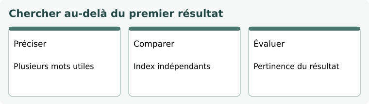
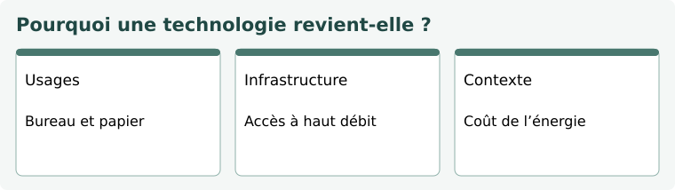
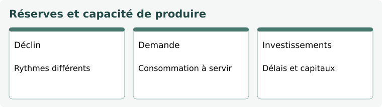
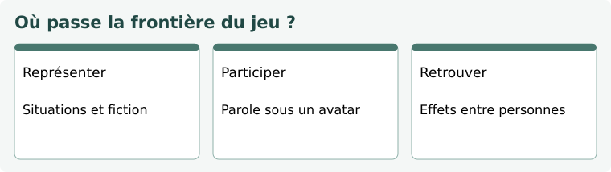
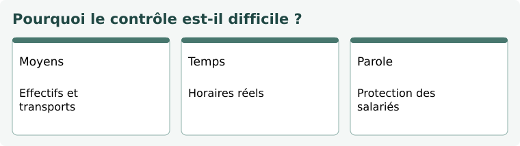

# Banque PT — Langue vivante A 2009 · Corrigé brut

*Corrigé rédigé par IA, non officiel.*

**Rédaction** · GPT-6.2 Astra Ultra · vitesse non renseignée

**Révision** · GPT-6.2 Astra Ultra · vitesse non renseignée

L’épreuve dure trois heures. Chaque candidat traite la langue choisie à l’inscription. La version française vaut 10 points. La question a demande 80 à 100 mots pour 4 points. La question b demande 200 à 250 mots pour 6 points.

[Sujet](https://www.banquept.fr/documents/2009/lv_a_2009.pdf) · [Rapport du jury](https://www.banquept.fr/documents/ecrit/rapport/2009/rapport_lv_a_ecrit_2009.pdf) · [Grille du livret](https://www.banquept.fr/documents/livret/2009/Livret_PT_2009.pdf#page=12)

## Allemand

*Internet-Suchmaschinen: Mehr finden im Netz*

### Version française

De « Internet-Suchmaschinen: Mehr finden im Netz » à « spezialisiert haben », titre compris.

Moteurs de recherche sur Internet. Comment trouver davantage d’informations sur la Toile

Les moteurs de recherche sont les guides de l’univers numérique. Pourtant, les voyageurs qui parcourent cet univers de données ont bien du mal à déterminer s’ils se trouvent dans la bonne galaxie.

Les moteurs de recherche nous aident à trouver des informations dans la jungle d’Internet. Quelques conseils permettent d’obtenir de meilleurs résultats encore auprès des trois principaux fournisseurs.

Neuf internautes sur dix s’en remettent au leader du marché, Google, pour leurs recherches sur Internet. Or il arrive que ses concurrents fassent apparaître des résultats que Google ne trouve pas ou qu’il relègue beaucoup plus loin dans ses listes. En outre, bien des internautes s’en tiennent aux cinq premiers résultats. Quelques conseils peuvent les aider à affiner leurs recherches en ligne.

Varier les plaisirs. En saisissant les mêmes termes dans plusieurs moteurs, on obtient parfois des listes de résultats très différentes. D’après des études scientifiques, les résultats des grands fournisseurs ne se recoupent guère, sauf pour les recherches qui servent à s’orienter ou qui visent, par exemple, à retrouver un site bien précis.

Choisir de véritables solutions de remplacement. Il ne reste que peu de moteurs de recherche indépendants sur le marché. Des entreprises comme AOL et T-Online utilisent la technologie du leader Google. Yahoo! et Live.com, le moteur de Microsoft, sont de sérieuses solutions de remplacement, de même qu’Ask.com pour les requêtes en anglais. Il existe, en outre, de nombreux services spécialisés dans un domaine particulier.

### Question a

*Erklären Sie, wie eine Suchmaschine genutzt werden soll, um die besten Ergebnisse zu finden.*

Zuerst würde ich die Frage möglichst genau formulieren und mehrere passende Suchbegriffe kombinieren. Dann lohnt es sich, dieselben Wörter in Suchmaschinen einzugeben, die tatsächlich unterschiedliche Technik verwenden. Verschiedene Namen auf der Startseite garantieren noch keine verschiedenen Treffer. Für ein bestimmtes Fachgebiet kann außerdem ein spezialisierter Dienst besser geeignet sein. Schließlich sollte man auch Einträge weiter unten und auf späteren Seiten lesen. Eine gut sichtbare Platzierung kann daran liegen, dass eine Seite besonders geschickt für Suchmaschinen gestaltet wurde. Sie sagt für sich genommen wenig über die Qualität einer Antwort aus.

**89 mots**

### Question b

*Können Sie sich ein Leben ohne Internet vorstellen? Warum?*

Ich kann mir ein Leben ohne Internet vorstellen, aber ich müsste einige Gewohnheiten ändern und wäre bei manchen Aufgaben stärker auf andere angewiesen. Als ich einmal mehrere Tage ohne Verbindung war, konnte ich problemlos lesen, einkaufen und Freunde besuchen. Ein Gespräch dauerte sogar länger, weil niemand nebenbei nach einer Nachricht sah. Auch eine Reise lässt sich mit einem gedruckten Fahrplan und einer guten Karte vorbereiten.

Schwieriger wird es, wenn die Umwelt voraussetzt, dass jeder jederzeit online ist. Wird eine Sprechstunde nur über eine Webseite vergeben, hilft es wenig, dass ich persönlich gut auf diese Webseite verzichten könnte. Für Menschen weit entfernt von einer Bibliothek oder einer Behörde ist der Zugang besonders wertvoll. Wer eine seltene Sprache lernt, kann außerdem regelmäßig mit jemandem sprechen, der sie im Alltag benutzt. Ein solches Gegenüber finde ich in meinem Wohnort vielleicht gar nicht.

Trotzdem möchte ich das Netz nicht mit allem verwechseln, was es mir zugänglich macht. Manche Fragen beantworte ich nach einem Gespräch mit einer erfahrenen Person besser als nach einer Stunde vor dem Bildschirm. Ich würde deshalb freiwillig Zeiten ohne Verbindung einplanen und zugleich dafür eintreten, dass wichtige Dienste auch persönlich erreichbar bleiben. Ein ganzes Leben ohne Internet wäre für mich möglich. Unter heutigen Bedingungen würde es meine Freiheit aber an einigen Stellen deutlich einschränken.

**213 mots**

## Anglais

*Not dead, just resting*

### Version française

Deux passages, de « It became a classic example » à « accounts departments », puis de « A third way » à « all-electric ones ».

C’était devenu l’exemple classique d’une prophétie technologique utopique qui avait fait fausse route. L’idée du « bureau sans papier », qui remonte aux années soixante, paraissait pourtant assez plausible. À mesure que les ordinateurs se répandaient et que les techniques d’affichage s’amélioraient, il semblait évident que de plus en plus de documents seraient rédigés, diffusés et lus sous forme électronique plutôt que sur papier. Les classeurs feraient place aux disques durs, les notes et les rapports seraient transmis par voie électronique, et les factures et bons de commande sur papier seraient remplacés par des messages électroniques filant d’un service comptable à l’autre.

Une troisième façon de redonner vie à des technologies apparemment moribondes tient à un choc extérieur. Le meilleur exemple en est peut-être la voiture électrique. Le rêve a toujours paru prometteur, car enfin le pétrole ne durera pas éternellement. Dans les faits, pourtant, on n’avait que des voitures à l’allure étrange et à l’autonomie limitée. La chute du cours du pétrole à la fin des années quatre-vingt-dix semblait avoir sonné le glas des voitures électriques. Mais, depuis, les préoccupations croissantes au sujet du changement climatique, les inquiétudes touchant la sécurité de l’approvisionnement énergétique et une flambée des cours du pétrole ont provoqué un revirement spectaculaire. Les constructeurs automobiles rivalisent désormais de vitesse pour fabriquer des véhicules hybrides combinant essence et électricité, dans lesquels on voit généralement une étape sur la voie du tout électrique.

### Question a

*In what ways can technologies make a comeback? Give examples to prove your point.*

A change in users’ habits can give an old idea a new chance. American office workers accustomed to reading on screens began to use less paper even though printing had become easier. Technical improvements can also matter. Widespread broadband eventually made some early predictions about electronic commerce realistic. Finally, circumstances outside an industry may change the value of an existing design. Rising oil prices and concern about climate and energy supplies, for instance, made manufacturers take another look at electric cars and the hybrids that might lead towards them.

**89 mots**

### Question b

*To what extent can it be said that technological changes and social changes are linked?*

A new machine rarely changes society in the straightforward way its promoters imagine. A faster printer made it easier to produce another paper copy, even though a computer already held the document. It took a generation more accustomed to reading and editing on screens for paper use to fall in American offices. The device made several ways of working possible, and users helped decide which one prevailed.

The influence also runs in the other direction. Consider a town choosing whether to invest in electric buses. Concern about air quality may give an existing technology a political opening. Yet the buses will change daily life only if the town can charge them, maintain them and run routes that people actually need. A vehicle that stays in the depot is an engineering achievement with little social effect. Decisions about fares and access may matter just as much as improvements to a battery.

Once people begin to rely on a service, their expectations can encourage further technical change. Passengers who need to reach work early may persuade the operator to change its charging schedule. This does not mean every invention responds to a demand that already existed, or that everybody benefits equally. It does mean that a convincing explanation must follow both the invention and the choices made around it, often over a much longer period than a sales forecast allows.

**228 mots**

## Arabe

*احتياطيات النفط العالمية*

### Version française

De « سعى التقرير » à « بشكل عام ». La traduction couvre les deux premiers paragraphes et s’arrête avant l’examen des réserves futures.

Le rapport, établi sous la direction du docteur Fatih Birol, expert turc qui avait travaillé pour l’Organisation des pays exportateurs de pétrole, l’OPEP, avant de rejoindre l’Agence internationale de l’énergie en 1995, visait à avertir l’Organisation de coopération et de développement économiques, l’OCDE, qui regroupe les pays industrialisés, que le taux de déclin des gisements de pétrole varie d’une région du monde à l’autre. Selon l’Agence, 800 gisements appartiennent à 54 grandes compagnies pétrolières. Elle estime toutefois probable qu’en l’absence des investissements nécessaires, les gisements situés hors de l’OPEP, en particulier aux États-Unis, en Grande-Bretagne et au Mexique, voient leur production diminuer à des rythmes variables allant de 10 à 11 % par an. En Russie et dans la région de la mer du Nord, le déclin devrait être plus rapide encore.

En revanche, l’OPEP, qui produit actuellement 40 % du pétrole mondial, est mieux placée, puisque le déclin n’y dépasserait pas 2 à 3 % par an. Les taux de déclin sont par ailleurs plus élevés et la baisse plus rapide dans les petits gisements que dans les champs géants. Le principal d’entre eux est celui de Ghawar, en Arabie saoudite. Il produit plus de cinq millions de barils par jour et assure environ 6 % des besoins du monde en pétrole. Un calcul conduit ainsi à estimer à plus de 6,7 % le taux de déclin mondial pour l’ensemble des gisements pétroliers.

### Question a

*بينوا الفكرة الأساسية للنص.*

يحذر التقرير من الخلط بين وجود احتياطيات نفطية كبيرة وبين القدرة على تلبية الطلب في الوقت المطلوب. فإنتاج الحقول العاملة يتراجع بنسب تختلف بين بلد وآخر وبين الحقول الصغيرة والعملاقة. وقد تملك الدول كميات كافية في باطن الأرض، لكن استخراج كميات جديدة لتعويض النقص يحتاج إلى استثمارات ضخمة، ولا سيما في المناطق البعيدة. وتزداد صعوبة المهمة مع نمو استهلاك الاقتصادات الصاعدة وتراجع القدرة على التمويل. لذلك يربط النص مستقبل الإمدادات بالمال والوقت والموقع، ولا يكتفي بحساب عدد البراميل التي يعتقد أنها موجودة.

**82 mots**

### Question b

*كيف ترون مستقبل العالم دون نفط؟*

أتخيل أن أول ما سنلاحظه في عالم قل فيه النفط كثيرا هو تغير طريقة الانتقال. فالأسرة التي لا تستطيع الذهاب إلى العمل إلا بسيارة خاصة ستدفع ثمنا أكبر من أسرة تعيش قرب قطار منتظم أو مدرسة قريبة. لذلك أرى أن الاستعداد لهذا المستقبل يبدأ اليوم من تخطيط المدن والقرى، حتى لا تصبح القدرة على السفر امتيازا لمن يستطيع شراء مركبة جديدة. وقد يكون تقريب خدمة طبية من الناس أنفع من تعويض كل رحلة بسيارة تعمل بمصدر آخر.

ولا يقتصر التغير على الوقود. فهناك مصانع وموانئ ومدن يعتمد دخلها على القطاع النفطي، ومن حق العاملين فيها أن يعرفوا كيف سيجدون عملا مناسبا إذا تغير الطلب. يمكن أن يشارك بعضهم في صيانة شبكات الكهرباء أو تحسين استهلاك الطاقة في الأبنية، لكن الانتقال يحتاج إلى تدريب وأجر خلال مدة التعلم. ولن يكفي أن تعدهم الحكومة بوظائف لم تحدد مكانها ولا موعدها.

ومن جهة أخرى، قد يتيح تراجع الاعتماد على النفط هواء أنظف ومزيدا من الاستقلال للبلدان التي تستورده. غير أن أي مصدر بديل يتطلب مواد ومساحات وقرارات تمس السكان. أفضّل عالما يقلل حاجته إلى الطاقة المهدورة ويختار مصادره بعد نقاش علني، على عالم يستبدل مادة بأخرى ويبقي الاستهلاك على حاله. والنجاح في رأيي هو أن يجد الناس وسيلة للعيش والعمل في ظروف عادلة، لا أن يتغير اسم الوقود وحده.

**206 mots**

## Espagnol

*Lo interesante del videojuego es su conexión con el mundo real*

### Version française

De « Creo que es beneficioso para la cultura » à « el motor del avance tecnológico ».

Carl Goodman. Je crois qu’il est bon pour la culture d’accorder aux jeux vidéo la même latitude qu’au cinéma pour explorer la réalité, et pas seulement l’univers du fantastique. Nous aimons tous passer dans un autre univers. Mais, intellectuellement, il est beaucoup plus intéressant de pouvoir transposer dans un jeu vidéo ce qui se passe autour de nous. Dans nombre de ces jeux, le degré de violence est très élevé. L’un d’eux, par exemple, met en scène un adolescent qui essaie d’échapper à d’autres jeunes qui le torturent. Ces jeux prêtent à controverse, car de telles situations existent dans le monde réel, et c’est un défi que d’adapter un jeu vidéo à cette réalité. D’ailleurs, les univers imaginaires sont, eux aussi, des lieux où l’on discute de questions bien réelles. Lorsqu’on incarne un personnage virtuel, c’est comme si un voile se levait et que, paradoxalement, on pouvait s’exprimer plus sincèrement qu’en se présentant sous sa véritable identité. Il y a quelque ironie à penser qu’une personne peut être plus authentique dans cet univers qu’à une soirée.

El País. Dans les jeux vidéo, technologie, art et marché se rencontrent. Quelles relations entretiennent-ils ?

Carl Goodman. C’est la culture populaire, ce sont les jeux vidéo, davantage que l’art vidéo, qui sont en train de devenir le moteur du progrès technologique.

### Question a

*¿Qué relación establece este científico entre el mundo virtual y el mundo real?*

Para Goodman, entrar en un mundo virtual no significa abandonar todo contacto con la realidad. Un juego puede representar un problema social y permitir que se hable de él desde otro punto de vista. Incluso en un escenario fantástico, quienes participan aportan sentimientos y experiencias propios. Un personaje inventado puede dar a alguien la libertad de expresarse con más sinceridad que en una reunión. La relación funciona también en sentido contrario, porque las decisiones y los encuentros del juego pueden influir en lo que los participantes hacen después.

**88 mots**

### Question b

*Analice Usted lo que implica esta afirmación final del texto: «Las nuevas generaciones especialmente… tienen consecuencias en el mundo real también».*

La afirmación de Goodman cuestiona la comodidad de pensar que al apagar la pantalla se borra todo lo ocurrido durante el juego. Si varios compañeros se organizan para resolver un problema, tal vez descubran que una persona a la que apenas escuchaban en clase sabe coordinar muy bien al grupo. Al día siguiente pueden tratarla de otra manera. También sucede lo contrario: una burla dirigida a un personaje puede dolerle a quien lo interpreta y continuar en el patio del colegio.

Eso no significa que realizar una acción imaginaria sea idéntico a realizarla fuera del juego. En una partida se aceptan reglas y papeles que los participantes pueden abandonar. Precisamente por eso es posible ensayar una decisión sin que todas sus consecuencias sean irreversibles. Lo que sí es real es el tiempo dedicado, el dinero gastado, la conversación mantenida o la confianza que se ha creado entre dos personas.

Me parece importante que las generaciones que crecen con estos medios aprendan a distinguir ambos niveles. El anonimato puede facilitar una intervención sincera, pero no elimina la responsabilidad por el trato que se da a otros. Un juego acompañado de conversación permite preguntar qué decisiones ofrecían sus reglas y a quién dejaban fuera. La experiencia virtual resulta entonces una ocasión de aprendizaje que el jugador puede llevar a su vida cotidiana.

**220 mots**

## Italien

*Quando la vita non vale un casco*

### Version française

De « Un settore anche a rischio » à « ci lavorano anche da un anno ».

L’agriculture est un autre secteur à risque. « C’est celui que nous avons le plus de mal à contrôler, parce que nos inspections se font aux heures normales de travail, et non tôt le matin ou le soir, quand les ouvriers agricoles sont parfois les plus nombreux à travailler », explique un inspecteur de Raguse. « J’ai vu de mes propres yeux des ouvriers travailler sous serre sans masque et respirer les émanations des pesticides, ou encore des agriculteurs manœuvrer à quelques centimètres d’autres ouvriers. »

Une chose est certaine, les inspecteurs sont peu nombreux et la Région ne paie pas les heures supplémentaires. « Il y a tout un monde, du commerce à l’agriculture, qui échappe pratiquement à notre contrôle parce que nous finissons à dix-neuf heures, disent les inspecteurs. Le samedi, les petits chantiers de réfection de façades se multiplient, car les gens du bâtiment savent que nous travaillons jusqu’au vendredi. »

« Notre métier n’est pas facile. Nous avons affaire en Sicile à des entreprises qui n’ont absolument pas la culture de la sécurité », déclare Vito Di Bella, directeur de l’inspection régionale du travail. « Nous rencontrons des entrepreneurs qui ne connaissent pas les lois sur la sécurité et des travailleurs non déclarés qui reviennent ensuite sur leurs déclarations faites pendant l’inspection. Ils disent être arrivés dans l’entreprise quelques jours plus tôt alors qu’ils y travaillent parfois depuis un an. »

### Question a

*Come mai le condizioni di lavoro sono così diverse in Sicilia che nelle altre regioni italiane?*

L’articolo spiega le difficoltà siciliane attraverso le condizioni concrete dei controlli. Circa centocinquanta ispettori devono seguire centinaia di migliaia di aziende, con pochi mezzi e senza straordinari pagati. Gli orari delle visite non coincidono sempre con quelli in cui si lavora nei campi o nei cantieri. Alcuni imprenditori ignorano le norme e lavoratori non dichiarati ritrattano ciò che hanno detto. È quindi difficile far emergere le violazioni e correggerle. Il confronto con altre regioni resta implicito: il testo documenta soprattutto i problemi osservati in Sicilia.

**85 mots**

### Question b

*« Sicilia, terzo mondo del lavoro », che cosa si potrebbe fare per rimediare a questa pessima situazione del lavoro e del rispetto delle leggi nella regione?*

Comincerei da ciò che gli ispettori possono effettivamente fare durante una settimana di lavoro. Avere abbastanza personale, mezzi di trasporto e risorse per gli straordinari permetterebbe di tenere conto degli orari reali dei diversi settori. Un ufficio che riceve segnalazioni dovrebbe poter rispondere in tempi ragionevoli e verificare, dopo una prima visita, se il problema sia stato risolto. Senza questa continuità anche un verbale accurato può avere effetti limitati.

Serve poi la collaborazione dei lavoratori. Chi dipende da un unico datore di lavoro e teme di perdere il salario difficilmente parlerà con libertà durante un controllo. Gli offrirei la possibilità di chiedere consiglio in modo riservato e di conoscere i propri diritti in una lingua che capisce. Per le piccole imprese organizzerei incontri pratici sulla prevenzione, accompagnati da scadenze chiare per rimediare alle carenze. Informare e sanzionare sono due compiti compatibili quando chi mette in pericolo gli altri non può limitarsi a promettere un cambiamento.

Infine pubblicherei dati sugli incidenti e sui miglioramenti verificati, distinti per settore. Sarebbe così possibile capire se una misura funziona e dove occorrono altri interventi. Ridurre una situazione complessa a un giudizio sull’intera regione non protegge nessuno. Garantire la sicurezza significa dare alle persone che devono far rispettare la legge il tempo e la possibilità di intervenire, e a chi lavora la libertà di segnalare un rischio.

**222 mots**

