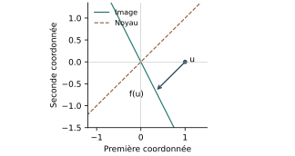
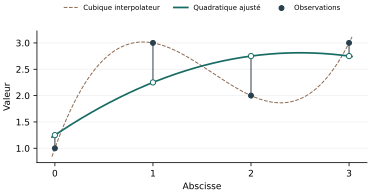

# Banque PT — Mathématiques A 2009 · Corrigé guidé

*Corrigé rédigé par IA, non officiel. Signalez toute erreur.*

**Rédaction** · GPT-6.2 Astra Ultra · vitesse non renseignée

L’épreuve de quatre heures contient quatre parties. Les projecteurs et les produits scalaires conduisent, dans la dernière partie, à un ajustement quadratique de quatre observations. [Sujet officiel](https://www.banquept.fr/documents/2009/math_a_2009.pdf) · [Rapport du jury](https://www.banquept.fr/documents/ecrit/rapport/2009/rapport_math_a_ecrit_2009.pdf) · [Grille des coefficients](https://www.banquept.fr/documents/livret/2009/Livret_PT_2009.pdf#page=12)

Le rapport souligne les erreurs de calcul pour la projection de la partie A et demande de démontrer les propriétés des produits scalaires pour un ordre quelconque. Dans la partie D, le résidu fournit un contrôle indépendant du polynôme ajusté.

## Partie A

### A.1.a · Identifier le projecteur et son rang

> [!INDICATION]
> Multiplier la matrice par elle-même puis comparer ses deux colonnes.

Écrivons $M=K/3$, avec $K=\left(\begin{smallmatrix}1&-1\\-2&2\end{smallmatrix}\right)$. Le calcul donne $K^2=3K$, donc $M^2=M$. Ainsi $f$ est un projecteur. Ses deux colonnes sont non nulles et opposées, donc son rang vaut un.

### A.1.b · Noyau et image en dimension deux

> [!INDICATION]
> Exprimer l’image d’un vecteur en fonction d’une seule forme linéaire.

Pour les coordonnées $(x,y)$, $f(x,y)=(x-y)(1,-2)/3$. Par conséquent $\ker f=\mathbb R(e_1+e_2)$ et $\operatorname{Im} f=\mathbb R(e_1-2e_2)$.

### A.2 · Projection sur un plan parallèlement à une droite

> [!INDICATION]
> Trouver une équation du plan $P$ et en déduire combien de fois il faut retrancher le vecteur directeur de $D$.

Soit $\ell(x,y,z)=x+2y+z$. Elle s’annule sur les deux vecteurs indépendants $\varepsilon_2=(1,0,-1)$ et $\varepsilon_3=(2,-1,0)$. Donc $P=\ker\ell$. Pour $\varepsilon_1=(1,3,-1)$, $\ell(\varepsilon_1)=6$. On a $E=P\oplus D$, et $w-\ell(w)\varepsilon_1/6$ appartient à $P$ avec une différence à $w$ dans $D$. La matrice du projecteur demandé est
$$I-\tfrac16\begin{pmatrix}1\\3\\-1\end{pmatrix}\begin{pmatrix}1&2&1\end{pmatrix}
=\tfrac16\begin{pmatrix}5&-2&-1\\-3&0&-3\\1&2&7\end{pmatrix}.$$
Elle fixe $\varepsilon_2,\varepsilon_3$ et annule $\varepsilon_1$, ce qui vérifie le sens de la projection.

### A.3 · Décomposition associée à un projecteur

> [!INDICATION]
> Décomposer un vecteur comme dans l’indication du sujet et vérifier que l’intersection est nulle.

Pour $x\in E$, $x=(x-px)+px$, avec $p(x-px)=px-p^2x=0$ et $px\in\operatorname{Im}p$. Ainsi noyau et image engendrent $E$. Sur l’image, $p$ agit par l’identité car $p(py)=py$. Un vecteur à la fois dans le noyau et l’image est donc nul. D’où $E=\ker p\oplus\operatorname{Im}p$.

### A.4 · Le projecteur complémentaire

> [!INDICATION]
> Étudier les actions de $I-p$ sur les deux termes de la somme directe.

$q^2=(I-p)^2=I-2p+p^2=q$. Sur $\operatorname{Im}p$, $q$ est nul. Sur $\ker p$, il est l’identité. Par A.3, $\ker q=\operatorname{Im}p$ et $\operatorname{Im}q=\ker p$. Enfin $pq=p-p^2=0$ et $qp=p-p^2=0$.

### A.5.a · Une combinaison de deux projecteurs

> [!INDICATION]
> Calculer les produits $p_1q$ et $p_2q$. Garder l’ordre des facteurs.

On suppose $p_1p_2=0$ et $q=p_1+p_2-p_2p_1$. Alors $p_1q=p_1^2+p_1p_2-p_1p_2p_1=p_1$ et $p_2q=p_2p_1+p_2^2-p_2^2p_1=p_2$. Par conséquent $q^2=p_1q+p_2q-p_2p_1q=p_1+p_2-p_2p_1=q$.

### A.5.b · Première inclusion des noyaux

> [!INDICATION]
> Évaluer la formule de $q$ sur un vecteur que les deux projecteurs annulent.

Si $p_1x=p_2x=0$, alors $qx=p_1x+p_2x-p_2(p_1x)=0$. Ainsi $\ker p_1\cap\ker p_2\subseteq\ker q$. Cette implication dépend seulement de la formule de $q$.

### A.5.c · Égalité des noyaux

> [!INDICATION]
> Pour extraire $p_1x$ et $p_2x$ à partir de $qx$, utiliser les identités de A.5.a.

Sous l’hypothèse $p_1p_2=0$, si $qx=0$ alors $p_1x=p_1qx=0$ et $p_2x=p_2qx=0$. Cette inclusion réciproque et A.5.b donnent $\ker q=\ker p_1\cap\ker p_2$.

### A.6.a · Norme d’un projecteur orthogonal

> [!INDICATION]
> Utiliser le théorème de Pythagore pour les deux composantes de A.3.

Si $p$ est un projecteur orthogonal, $pu$ appartient à l’image et $u-pu$ au noyau, qui lui est orthogonal. Donc $\|u\|^2=\|pu\|^2+\|u-pu\|^2\ge\|pu\|^2$. En prenant les racines positives, on a $\|pu\|\le\|u\|$.

### A.6.b · Réciproque de la contraction

> [!INDICATION]
> Pour un vecteur $x$ de l’image et un vecteur $y$ du noyau, appliquer l’inégalité à $x+ty$ pour tout réel $t$.

On a $p(x+ty)=x$, donc $0\le \|x+ty\|^2-\|x\|^2=2t\langle x,y\rangle+t^2\|y\|^2$ pour tout $t$. La fonction de $t$ admet un minimum en zéro, donc sa dérivée y est nulle et $\langle x,y\rangle=0$. Le noyau est orthogonal à l’image, donc $p$ est orthogonal.

## Partie B

### B.1 · Supplémentaire d’une droite

> [!INDICATION]
> Compléter $u$ en une base de l’espace réel $E$.

Comme $u\ne0$, la famille $(u)$ est libre et se complète en une base $(u,e_2,\ldots,e_n)$. Prenons $H_u=\operatorname{Vect}(e_2,\ldots,e_n)$. Alors $E=\mathbb Ru\oplus H_u$ et $\dim H_u=n-1$. Lorsque $n=1$, $H_u=\{0\}$.

### B.2 · Toute droite est stable

> [!INDICATION]
> Appliquer la commutation au vecteur $u$ que son projecteur fixe.

Soit $p_u$ le projecteur sur $\mathbb Ru$ parallèlement à $H_u$. Comme $p_u u=u$ et $fp_u=p_u f$, on a $f(u)=p_u f(u)\in \mathbb Ru$. Il existe un réel $\lambda_u$ unique vérifiant $f(u)=\lambda_u u$.

### B.3 · Comparer deux directions indépendantes

> [!INDICATION]
> Appliquer la propriété précédente au vecteur $u+v$.

Pour $u,v$ non colinéaires, $u+v\ne0$ et $\lambda_{u+v}(u+v)=f(u+v)=\lambda_u u+\lambda_v v$. L’indépendance des deux vecteurs donne $\lambda_{u+v}=\lambda_u=\lambda_v$.

### B.4 · Comparer deux vecteurs colinéaires

> [!INDICATION]
> Un multiple non nul de $u$ hérite du même facteur.

Écrivons $v=au$ avec $a\ne0$. Par linéarité, $f(v)=a f(u)=\lambda_u v$. Par unicité du facteur pour $v\ne0$, on a $\lambda_v=\lambda_u$.

### B.5 · Endomorphismes qui commutent avec tous les autres

> [!INDICATION]
> Fixer un vecteur non nul de référence et ne pas oublier de vérifier la réciproque.

D’après B.3–4, tous les vecteurs non nuls ont le même coefficient $\lambda$ et $f(0)=0$. Ainsi $f=\lambda I_E$. Réciproquement, pour chaque $g$, $(\lambda I_E)g=\lambda g=g(\lambda I_E)$. Les endomorphismes recherchés sont exactement les homothéties vectorielles, y compris l’application nulle.

## Partie C

### C.1 · Produit scalaire des coefficients

> [!INDICATION]
> Calculer le coefficient diagonal du produit $AB^\mathsf T$.

On a $\varphi(A,B)=\operatorname{Tr}(AB^\mathsf T)=\sum_i\sum_j a_{ij}b_{ij}$. Cette expression est bilinéaire et symétrique. Pour $A=B$, c’est une somme de carrés réels, positive ou nulle. Elle vaut zéro si et seulement si chaque $a_{ij}$ est nul. On a donc un produit scalaire sur tout $\mathcal M_n(\mathbb R)$.

### C.2 · Somme de tous les coefficients

> [!INDICATION]
> Chercher la matrice dont le produit scalaire avec $A$ est la somme demandée.

Soit $J$ la matrice dont toutes les entrées valent $1$. Alors $\varphi(A,J)=\sum_{i,j}a_{ij}$ et $\varphi(J,J)=n^2$. L’inégalité de Cauchy-Schwarz donne $|\sum_{i,j}a_{ij}|\le n\sqrt{\sum_{i,j}a_{ij}^2}$.

### C.3 · Matrices symétriques et antisymétriques

> [!INDICATION]
> Apparier dans la somme les termes d’indices $(i,j)$ et $(j,i)$.

Les ensembles $\mathcal S_n$ et $\mathcal A_n$ sont des sous-espaces car les conditions $S^\mathsf T=S$ et $K^\mathsf T=-K$ sont linéaires. Pour $S$ symétrique et $K$ antisymétrique, $k_{ii}=0$ et, si $i<j$, $s_{ij}k_{ij}+s_{ji}k_{ji}=0$. La somme de C.1 donne donc $\varphi(S,K)=0$.

### C.4 · Invariance de la norme par multiplication orthogonale

> [!INDICATION]
> Écrire la norme au carré pour faire apparaître le facteur $UU^\mathsf T$.

Si $U$ est orthogonale, $UU^\mathsf T=I_n$, donc $\Phi(MU)^2=\operatorname{Tr}(MUU^\mathsf TM^\mathsf T)=\operatorname{Tr}(MM^\mathsf T)=\Phi(M)^2$. Les normes sont positives ou nulles, donc $\Phi(MU)=\Phi(M)$.

### C.5.a · Base du supplémentaire orthogonal

> [!INDICATION]
> Le sous-espace $F$ est engendré par la diagonale $(1,-1)$ et la matrice d’échange.

Posons $H=\left(\begin{smallmatrix}1&0\\0&-1\end{smallmatrix}\right)$ et $K=\left(\begin{smallmatrix}0&1\\1&0\end{smallmatrix}\right)$. Une matrice $T=\left(\begin{smallmatrix}r&s\\t&u\end{smallmatrix}\right)$ est orthogonale à $F=\operatorname{Vect}(H,K)$ si et seulement si $r-u=s+t=0$. Donc $F^\perp=\operatorname{Vect}(I_2,J)$, où $J=\left(\begin{smallmatrix}0&1\\-1&0\end{smallmatrix}\right)$. Ces deux matrices indépendantes en forment une base.

### C.5.b · Projection orthogonale d’une matrice

> [!INDICATION]
> Diviser chaque produit scalaire par la norme carrée du vecteur de base correspondant.

Les matrices $H,K$ sont orthogonales et ont chacune une norme carrée de $2$. Pour $A=\left(\begin{smallmatrix}1&0\\1&0\end{smallmatrix}\right)$, les deux produits $\varphi(A,H)$ et $\varphi(A,K)$ valent $1$. Ainsi
$$A'=\tfrac12H+\tfrac12K=\tfrac12\begin{pmatrix}1&1\\1&-1\end{pmatrix}.$$
Le résidu $A-A'=(I_2-J)/2$ appartient à $F^\perp$.

## Partie D

### D.1 · Produit scalaire discret

> [!INDICATION]
> Utiliser le nombre de points d’évaluation et la borne sur le degré.

La forme $\psi(P,Q)=\sum_{i=0}^3P(i)Q(i)$ est bilinéaire et symétrique. Le carré $\psi(P,P)$ est une somme de carrés et ne s’annule que si $P(0)=P(1)=P(2)=P(3)=0$. Un polynôme de degré au plus trois ayant quatre racines distinctes est nul. C’est donc un produit scalaire sur $\mathbb R_3[X]$.

### D.2.a · Les six produits scalaires

> [!INDICATION]
> Pour deux monômes, sommer les puissances dont l’exposant est la somme des degrés.

Les sommes des puissances des entiers $0,1,2,3$ d’exposants $0$ à $4$ valent $4,6,14,36,98$. Dans l’ordre demandé, on trouve
$$\psi(1,1)=4,\quad\psi(1,X)=6,\quad\psi(1,X^2)=14,\quad
\psi(X,X)=14,\quad\psi(X,X^2)=36,\quad\psi(X^2,X^2)=98.$$

### D.2.b · Base orthonormale discrète

> [!INDICATION]
> Centrer $X$ sur la moyenne des quatre abscisses. Pour le terme quadratique, chercher un monique orthogonal à $1$ et à $X$.

$P_0=1/2$. Le polynôme $X-3/2$ est orthogonal à $1$ et sa norme carrée est $5$, donc $P_1=(X-3/2)/\sqrt5$. Pour $q=X^2+aX+b$, les équations d’orthogonalité donnent $14+6a+4b=0$ et $36+14a+6b=0$. Ainsi $a=-3,b=1$. Les valeurs de $q$ sont $(1,-1,-1,1)$ et sa norme vaut $2$. On obtient $P_2=(X^2-3X+1)/2$. Le coefficient dominant positif et la construction par projections assurent $\psi(P_k,X^k)>0$ et les bonnes inclusions de degrés. À chaque étape la direction orthogonale est une droite, et ce signe fixe le vecteur unitaire.

### D.3.a · Interpolation des quatre observations

> [!INDICATION]
> L’évaluation en quatre points distincts est une application linéaire entre deux espaces de dimension quatre.

L’application $P\mapsto (P(0),P(1),P(2),P(3))$ sur $\mathbb R_3[X]$ a un noyau nul par D.1. Elle est donc bijective, ce qui prouve l’existence et l’unicité de $R$. Pour les observations $(1,3,2,3)$, on peut le vérifier avec $R(X)=1+(31/6)X-4X^2+(5/6)X^3$, qui prend ces quatre valeurs.

### D.3.b · Polynôme quadratique ajusté

> [!INDICATION]
> Dans une base orthonormale, les coordonnées du projeté sont les produits scalaires avec les vecteurs de base.

Les quatre valeurs de $R$ suffisent pour obtenir $\psi(R,P_0)=9/2$, $\psi(R,P_1)=\sqrt5/2$ et $\psi(R,P_2)=-1/2$. Le projeté est donc
$$S=(9/2)P_0+(\sqrt5/2)P_1-(1/2)P_2=(5+5X-X^2)/4.$$
Il prend aux quatre abscisses les valeurs $5/4,9/4,11/4,11/4$.

### D.3.c · Minimum des moindres carrés

> [!INDICATION]
> Calculer les quatre résidus avec leur signe et utiliser Pythagore pour l’unicité.

Pour tout $P\in F$, le résidu $R-S$ est orthogonal à $S-P\in F$, donc $\|R-P\|_\psi^2=\|R-S\|_\psi^2+\|S-P\|_\psi^2$. Le second terme s’annule exactement pour $P=S$. Les résidus $R(i)-S(i)$ valent $-1/4,3/4,-3/4,1/4$. Le minimum de $\Sigma$ est donc $(1+9+9+1)/16=5/4$, atteint uniquement par $S$.

