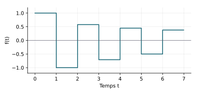
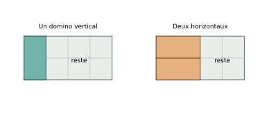

# Banque PT — Mathématiques C 2009 · Corrigé brut

*Corrigé rédigé par IA, non officiel. Signalez toute erreur.*

**Rédaction** · GPT-6.2 Astra Ultra · vitesse non renseignée · 26 novembre 2026

La Banque PT a programmé cet écrit le mardi 5 mai 2009, de 14 h à 18 h. La garde interdit la calculatrice. Le code imprimé est B50M. Les questions figurent aux pages 1 à 4 du PDF de 4 pages. En admissibilité, le coefficient de Mathématiques C est de 3 pour l’ENS Cachan et de 6 pour l’École polytechnique. [Sujet](https://www.banquept.fr/documents/2009/math_c_2009.pdf) · [Rapport du jury](https://www.banquept.fr/documents/ecrit/rapport/2009/rapport_math_c_ecrit_2009.pdf) · [Livret de la Banque PT, p. 8, 9 et 12](https://www.banquept.fr/documents/livret/2009/Livret_PT_2009.pdf)

## I. Transformation de Laplace

### Question I.1.a

Pour $s>0$, $\int_0^R e^{-st}\,dt=(1-e^{-sR})/s$. Comme $e^{-sR}\to0$, l’intégrale sur la demi-droite vaut $1/s$.

### Question I.1.b

Soit $M$ une borne de $|f|$. L’intégrande est continu par morceaux sur chaque segment et $|e^{-st}f(t)|\le M e^{-st}$. Le majorant a une intégrale finie par I.1.a, donc $F(s)$ converge absolument.

### Question I.2

Pour $f=\tau$ sur $[a,b]$ et nulle ailleurs, seuls les points du créneau contribuent. Ainsi $F(s)=\tau\int_a^b e^{-st}\,dt=(\tau/s)(e^{-sa}-e^{-sb})$.

### Question I.3.a.i

Le signal, constant égal à $(-1)^n\tau_n$ sur $[n,n+1[$, est intégrable par morceaux. Par Chasles et I.1.a,
$$\int_0^N e^{-st}f(t)\,dt=\sum_{n=0}^{N-1}(-1)^n\tau_n\frac{e^{-sn}-e^{-s(n+1)}}s=\frac{1-e^{-s}}s\sum_{n=0}^{N-1}(-1)^n\tau_n e^{-sn}.$$

### Question I.3.a.ii

Comme $0<\tau_n\le1$, on a $|(-1)^n\tau_ne^{-sn}|\le(e^{-s})^n$. Pour $s>0$ la raison est strictement inférieure à un, donc la série converge absolument.

### Question I.3.a.iii

La limite à gauche existe par I.1.b et la série à droite converge par I.3.a.ii. Ainsi $F(s)=\sum_{n\ge0}[(1-e^{-s})/s](-1)^n\tau_n e^{-sn}$, où le facteur entre crochets est indépendant du rang.

### Question I.3.b.i

Pour $n\ge2$, $\tau_n=1/\sqrt{n+(-1)^n}$. Si $n$ est pair, les radicands aux rangs $n,n+1$ sont $n+1,n$, donc la différence $\tau_{n+1}-\tau_n$ est positive. Si $n$ est impair, ils valent $n-1,n+2$, donc la différence est négative.

### Question I.3.b.ii

On a $\tau_n=n^{-1/2}(1+(-1)^n/n)^{-1/2}\sim n^{-1/2}$. La série de Riemann d’exposant $1/2$ diverge. Par comparaison des termes positifs, $\sum\tau_n$ diverge vers $+\infty$.

### Question I.3.b.iii

Pour $|u|\le1/2$, Taylor et la dérivée seconde bornée donnent $(1+u)^{-1/2}=1-u/2+O(u^2)$, avec constante uniforme. En $u=(-1)^n/n$, on obtient $\tau_n=n^{-1/2}-(-1)^n/(2n^{3/2})+O(n^{-5/2})$. Les nombres requis sont $\gamma_1=1$, $\gamma_2=-1/2$ et le reste vérifie l’inégalité du sujet.

### Question I.3.b.iv

On a $(-1)^n\tau_n=(-1)^n/\sqrt n-1/(2n^{3/2})+O(n^{-5/2})$. La première série converge par alternance car $n^{-1/2}$ décroît vers zéro. Les deux autres convergent absolument. Les premiers rangs sont finis, d’où la convergence, qui est conditionnelle par I.3.b.ii.

### Question I.4.a

Pour $n\ge1$, le changement $t=nu$ donne $nF(n)=\int_0^\infty f(t/n)e^{-t}\,dt$. Comme $\int_0^\infty e^{-t}\,dt=1$, la soustraction de $f(0)$ donne l’intégrale de $(f(t/n)-f(0))e^{-t}$.

### Question I.4.b

Si $|f|\le M$, la queue intégrée en valeur absolue au-delà de $A$ est majorée par $2M e^{-A}$ pour tout $n$. Pour $\varepsilon>0$, choisir $A_\varepsilon\ge0$ assez grand pour que $2Me^{-A_\varepsilon}\le\varepsilon/2$. Ce choix est indépendant de $n$.

### Question I.4.c

Par continuité en zéro, $|f(u)-f(0)|\le\varepsilon/2$ pour $0\le u\le\delta$ avec $\delta>0$. Dès que $A_\varepsilon/n\le\delta$, la contribution sur $[0,A_\varepsilon]$ est au plus $\varepsilon/2$ car la masse du noyau y est au plus un. Avec I.4.b cela donne $|nF(n)-f(0)|\le\varepsilon$. La limite demandée est zéro.

## II. Dérivées d’une fraction rationnelle

### Question II.1

Le discriminant de $x^2+x-1$ vaut $5$. Ses deux racines sont $\lambda_1=(-1-\sqrt5)/2$ et $\lambda_2=(-1+\sqrt5)/2$, dans cet ordre. Leur produit vaut $-1$ et leur différence $\lambda_2-\lambda_1=\sqrt5$.

### Question II.2

Le polynôme $P(x)=x^2+x-1$ est de classe $C^\infty$ et ne s’annule qu’aux deux racines. Par composition avec l’inverse, $f=1/P$ est de classe $C^\infty$ sur $\mathbb R\setminus\{\lambda_1,\lambda_2\}$.

### Question II.3

Pour $u,v$ de classe $C^n$ sur un intervalle, $(uv)^{(n)}=\sum_{k=0}^n\binom nk u^{(k)}v^{(n-k)}$. La dérivée d’ordre zéro désigne la fonction elle-même.

### Question II.4

La dérivée d’ordre $n\ge2$ de $Pf=1$ est nulle. La formule de Leibniz donne $Pf^{(n)}+n(2x+1)f^{(n-1)}+2\binom n2 f^{(n-2)}=0$. Le dernier coefficient est $n(n-1)$.

### Question II.5.a

Comme $P(0)=-1$, $u_0=f(0)=-1$. La dérivée $f'=-(2x+1)/P(x)^2$ donne $u_1=f'(0)=-1$.

### Question II.5.b

À l’ordre $p\ge2$ on obtient $-f^{(p)}(0)+p f^{(p-1)}(0)+p(p-1)f^{(p-2)}(0)=0$. Diviser par $p!$ donne $u_p=u_{p-1}+u_{p-2}$.

### Question II.5.c

Posons $r=-\lambda_1=(1+\sqrt5)/2$, $q=-\lambda_2=(1-\sqrt5)/2$. Ce sont les racines distinctes de $X^2-X-1$. La suite
$$u_p=-\frac{r^{p+1}-q^{p+1}}{\sqrt5}=\frac{(-\lambda_2)^{p+1}-(-\lambda_1)^{p+1}}{\sqrt5}$$
satisfait la récurrence. Les rangs zéro et un valent $-1$, car $r-q=\sqrt5$ et $r+q=1$. L’unicité par récurrence établit la formule.

### Question II.6

La fonction est $C^n$ au voisinage de zéro. Taylor–Young et II.5.c donnent, pour $x\to0$,
$$f(x)=\sum_{p=0}^n\frac{q^{p+1}-r^{p+1}}{\sqrt5}\,x^p+o(x^n),\qquad r=-\lambda_1,\quad q=-\lambda_2.$$

### Question II.7.a

Le coefficient de $1/(x-\lambda_1)$ est $\alpha=1/(\lambda_1-\lambda_2)=-1/\sqrt5$. Celui de $1/(x-\lambda_2)$ est $\beta=1/(\lambda_2-\lambda_1)=1/\sqrt5$. Le retour au dénominateur commun redonne le numérateur un.

### Question II.7.b

Chaque dérivation abaisse l’exposant et multiplie par sa valeur précédente. Les deux dérivées d’ordre $n$ valent donc respectivement $(-1)^{n+1}n!/[\sqrt5(x-\lambda_1)^{n+1}]$ et $(-1)^nn!/[\sqrt5(x-\lambda_2)^{n+1}]$.

### Question II.7.c

En évaluant les deux dérivées en zéro et en divisant par $p!$, on obtient $u_p=(\lambda_1^{-(p+1)}-\lambda_2^{-(p+1)})/\sqrt5$. Le produit $\lambda_1\lambda_2=-1$ donne $1/\lambda_1=-\lambda_2=q$ et $1/\lambda_2=-\lambda_1=r$, d’où la formule de II.5.c.

### Question II.8.a

La série de termes $v_n=\lambda_2^n/\sqrt5$ est géométrique, et $0<\lambda_2<1$. Elle converge donc absolument.

### Question II.8.b

La somme des termes de rang $k\ge n+1$ vaut $\lambda_2^{n+1}/[\sqrt5(1-\lambda_2)]$. Comme $\lambda_2^2=1-\lambda_2$, elle vaut aussi $\lambda_2^{n-1}/\sqrt5$.

## III. Séries génératrices

### Question III.1.a

Pour $0<x<1$, $\sum_{n\ge0}x^n=1/(1-x)$. La dérivation terme à terme à l’intérieur du rayon donne $\sum_{n\ge1}nx^{n-1}=1/(1-x)^2$. Donc $\sum_{n\ge1}nx^n=x/(1-x)^2$.

### Question III.1.b

Pour $y>1$, $x=1/y$ appartient à $]0,1[$, donc la série converge et vaut $(1/y)/(1-1/y)^2=y/(y-1)^2=1/(y-2+1/y)$.

### Question III.2.a

Avec $r,q$ de II.5.c, la suite $w_n=(r^n-q^n)/\sqrt5$ satisfait $w_0=0,w_1=1$ et la récurrence. Comme $|q|<1<r$, $w_n\sim r^n/\sqrt5$. Le rayon est donc $R=1/r=\lambda_2$. Aux deux bornes réelles les termes ne tendent pas vers zéro.

### Question III.2.b

Sur $|x|<R$ les séries convergent absolument. Si $W(x)=\sum_{n\ge0}w_n x^n$, le coefficient constant de $(1-x-x^2)W$ est $w_0=0$, celui de $x$ est $w_1-w_0=1$. Pour $n\ge2$, le coefficient $w_n-w_{n-1}-w_{n-2}$ est nul. Le produit vaut donc $x$.

### Question III.2.c

Pour $|y|>r$, $1/y$ est dans le disque de convergence. III.2.b donne $\sum_{n\ge0}w_n/y^n=(1/y)/(1-1/y-1/y^2)=1/(y-1-1/y)$. Pour $0<|y|\le r$, le terme général ne tend pas vers zéro par l’équivalent de III.2.a. Le point $y=0$ est exclu.

## IV. Pavages par des dominos

### Question IV

Un domino vertical occupant la première colonne laisse un rectangle de longueur $n-1$. Sinon le domino supérieur de cette colonne est horizontal et impose un domino horizontal juste en dessous. Les deux colonnes ainsi remplies laissent un rectangle de longueur $n-2$. Dans chaque cas tout pavage du reste s’étend d’une façon unique. Les classes sont disjointes et exhaustives, donc $z_n=z_{n-1}+z_{n-2}$ pour $n\ge3$, avec $z_1=1,z_2=2$. Ainsi $z_n=w_{n+1}=(r^{n+1}-q^{n+1})/\sqrt5$.

