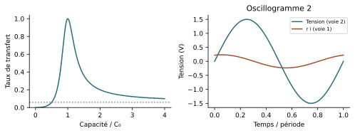
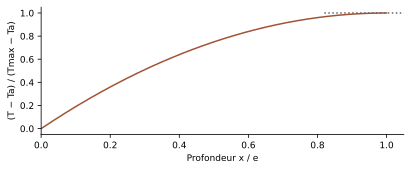
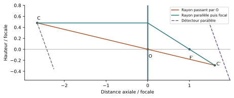
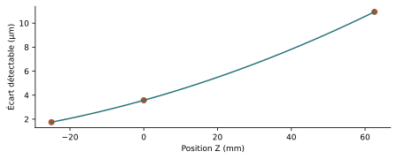

# Banque PT — Physique A 2009 · Corrigé guidé

*Corrigé rédigé par IA, non officiel. Signalez toute erreur.*

**Rédaction** · GPT-6.2 Astra Ultra · vitesse non renseignée

**Révision** · GPT-6.2 Astra Ultra · vitesse non renseignée

Le sujet relie l’induction et la diffusion thermique à deux questions de mesure : comment former l’image nette d’une règle inclinée et déduire une position de deux photocourants. Coefficients d’admissibilité : 6 pour l’École polytechnique, 3 pour l’ENS Cachan. [Sujet officiel](https://www.banquept.fr/documents/2009/phys_a_2009.pdf) · [Rapport du jury](https://www.banquept.fr/documents/ecrit/rapport/2009/rapport_phys_a_ecrit_2009.pdf) · [Grille des coefficients](https://www.banquept.fr/documents/livret/2009/Livret_PT_2009.pdf#page=12)

Le jury signale des confusions entre puissance et énergie, entre isolation et température nulle, et des difficultés dans la propagation de l’incertitude du capteur. Les mesures sur les photographies et oscillogrammes sont données avec une précision de lecture réaliste.

## A — Four à induction

### A.I.1 · Courant volumique orthoradial

> [!INDICATION]
> Un plan horizontal est un plan de symétrie des courants. Le champ magnétique est un vecteur axial.

**a.1–a.2.** Dans le modèle sans effets de bord, le champ est normal à ce plan, donc porté par $\vec u_z$. Les invariances par rotation autour de $Oz$ et par translation sur cet axe imposent $B_z=B_1(r)$. **b.** Pour un contour rectangulaire de hauteur $h$ dont les côtés verticaux sont à $r$ et à l’extérieur, Ampère donne $hB_1(r)=\mu_0 h\int_r^a\alpha s\,ds$. Ainsi $\vec B_1=\mu_0\alpha(a^2-r^2)\vec u_z/2$ pour $r\le a$ ; le champ s’annule en $a$, conformément à l’absence de courant de surface.

### A.I.2 · Nappe surfacique de courant

> [!INDICATION]
> Orienter la normale de l’intérieur vers l’extérieur du cylindre.

**a.** Dans la région creuse sans courant, un champ uniforme satisfait $\nabla\cdot\vec B=0$ et $\nabla\times\vec B=0$ en régime permanent. **b.** La composante normale de $\vec B$ est continue ; pour deux milieux de perméabilité $\mu_0$, $\vec n\times(\vec B_{\rm ext}-\vec B_{\rm int})=\mu_0\vec j_s$. **c.** Avec $\vec n=\vec u_r$, $\vec j_s=j_s\vec u_\theta$ et $\vec B_{\rm ext}=0$, on trouve $\vec B_0=\mu_0j_s\vec u_z$.

### A.II.1–II.2 · Champ et courant induit

> [!INDICATION]
> La f.é.m. autour d’un cercle est liée à la dérivée du flux qui le traverse.

**II.1.a.** Les $N$ spires réparties sur $H$ représentent une nappe $j_s=Ni/H$. **b.α–β.** Le modèle quasi stationnaire donne $\vec B_0=(\mu_0N/H)I_m\cos(\omega t)\vec u_z$, soit $K=\mu_0N/H$.

**II.2.a.** Dans l’approximation où les courants induits modifient peu le champ, $2\pi rE_1=-\pi r^2\dot B_0$, d’où $E_1=(r/2)KI_m\omega\sin\omega t$. **b.** La loi d’Ohm locale donne $\vec j_1=\gamma\vec E_1=(\gamma r/2)KI_m\omega\sin\omega t\,\vec u_\theta$.

### A.II.3 · Puissance Joule et durée de fusion

> [!INDICATION]
> Intégrer sur le volume avant de moyenner sur la période.

**a.** La densité de puissance cédée vaut $p_v=\vec j_1\cdot\vec E_1=\gamma E_1^2$ en W/m³. **b.** L’intégrale de $r^2$ sur le cylindre vaut $Va^2/2$, $V=\pi a^2H$, d’où $P(t)=\gamma Va^2(KI_m\omega)^2\sin^2\omega t/8$. **c.** La moyenne est $\bar P=\gamma Va^2(KI_m\omega)^2/16$.

**d.** Le métal est déjà à sa température de fusion. Les pertes sont chiffrées à 15 % de l’énergie requise pour fondre le métal, soit $E_{\rm pertes}=0,15M\Delta_{\rm fus}h$. Ainsi $t_f=1,15 M\Delta_{\rm fus}h/\bar P$. Avec $\omega=2\pi(4000)$ s$^{-1}$, on trouve $\bar P=95,9$ kW, $M\Delta_{\rm fus}h=28,0$ MJ et $t_f\simeq336$ s, soit 5,6 minutes, dans le modèle donné.

### A.III.1 · Puissance d’un dipôle inductif

> [!INDICATION]
> La puissance moyenne dissipée est calculée avec le courant efficace.

**a.α.** L’impédance $R+jL\omega$ donne $I_m=U_m/\sqrt{R^2+L^2\omega^2}$, $I_e=I_m/\sqrt2$ et $\phi=-\arctan(L\omega/R)$ avec la convention $i=I_m\cos(\omega t+\phi)$. **β.** $P=RI_e^2=RU_m^2/[2(R^2+L^2\omega^2)]$. **γ.** Le maximum (limite sinusoïdale à basse fréquence) est $P_{\max}=U_m^2/(2R)$. **δ.** $TP=1/[1+(L\omega/R)^2]$. **b.** À 4000 Hz, $L\omega/R=4$ et $TP=1/17\simeq5,88\,\%$.

### A.III.2 · Compensation réactive du modèle

> [!INDICATION]
> Rechercher quand l’impédance série est purement résistive.

**a.** Pour le circuit RLC série, $TP=R^2/[R^2+(L\omega-1/(C\omega))^2]$. **b.α–β.** La réactance s’annule à $C_0=1/(L\omega^2)=1/(400\times2\pi\times4000)=99,5$ nF ; $TP(C_0)=1$. **c.** À $C\to0$, $TP\sim(R\omega C)^2$. Il croît jusqu’au maximum en $C_0$ puis décroît vers $1/17$ à $C\to\infty$. **d.** À résonance, $I_m=U_m/R$ et $\phi=0$.

### A.III.3 · Lecture des oscillogrammes

> [!INDICATION]
> La voie 1 mesure la tension de la résistance témoin, la voie 2 celle du générateur. Ne pas confondre la valeur crête à crête avec la valeur crête.

**a (oscillogramme 1, p. 5).** Les voies sont en phase à $C=37,5$ nF. Donc $L_v=1/(\omega^2C)=42,2$ mH. Avec $r=30$ Ω et $V_{pp,1}=1,734$ V, $I_m=V_{pp,1}/(2r)=28,9$ mA. La résistance totale vaut $U_m/I_m$, d’où $R_v=1,500/0,0289-30\simeq21,9$ Ω.

**b (oscillogramme 2).** La petite sinusoïde de courant passe par un maximum avant celle de tension. Le décalage vaut environ 0,9 à 1 division de 50 microsecondes sur une période de 250 microsecondes. Ainsi $\phi=+2\pi\Delta t/T$ est d’environ $+1,2$ rad, soit environ $+70^\circ$ à la précision du tracé.

**c (oscillogramme 3).** Les voies sont à nouveau en phase pour $C'=43,7$ nF. On en déduit $L_c=1/(\omega^2C')=36,2$ mH, $I_m=1,078/(2\times30)=17,97$ mA et $R_c=1,500/I_m-30=53,5$ Ω.

### A.III.4 · Variation de la fréquence de résonance

> [!INDICATION]
> Examiner la dépendance de la fréquence propre à L à capacité constante.

Dans le modèle série à capacité fixée, la condition de transfert maximal est $L\omega^2 C=1$. Donc $f_0=1/(2\pi\sqrt{LC})$ augmente lorsque l’inductance diminue. L’évolution demandée du paramètre fréquence est une augmentation pour suivre la résonance théorique.

## B — Effets thermiques dans un ruban

### B.I · Puissance électrique

> [!INDICATION]
> Le courant traverse la section eb, tandis que la puissance volumique s’intègre sur ebL.

$I=j_0eb$, $P_e=RI^2=j_0^2ebL/\gamma$. La puissance volumique $p=P_e/(ebL)=j_0^2/\gamma=\vec j\cdot\vec E$ est positive et uniforme. Elle représente la chaleur produite par effet Joule dans le ruban.

### B.II.1–II.4 · Bilan thermique local et global

> [!INDICATION]
> Orienter x depuis l’unique face refroidie vers la face isolée.

**1.** En régime permanent $p\,ebL=h bL(T_a-T_e)$, d’où $T_a=T_e+pe/h$. **2.** La loi de Fourier donne $\vec j_q=-\lambda T'(x)\vec u_x$. **3.** Pour une tranche, $j_{q,x}(x)bL-j_{q,x}(x+dx)bL+p\,bL\,dx=0$, donc $j'_{q,x}=p$ et $T''=-p/\lambda$. **4.** À $x=e$ la paroi isolée ne transfère aucune puissance de conduction.

### B.II.5–II.7 · Profil dans l’épaisseur

> [!INDICATION]
> Une paroi isolée impose une dérivée nulle de la température.

**5.** Conditions aux limites : $T'(e)=0$, $\lambda T'(0)=h[T(0)-T_e]$ (ou $T(0)=T_a$ trouvé au bilan). **6.** Intégrer deux fois donne
$$T(x)=T_e+{pe\over h}+{p\over\lambda}\left(ex-\frac{x^2}{2}\right).$$
**7.** La parabole est croissante et concave sur $[0,e]$, à tangente horizontale en $e$. Le maximum vaut $T_{\max}=T_e+pe/h+pe^2/(2\lambda)$.

## C — Règle de Scheimpflug

### C.I · Conjugaison frontale et grandissement

> [!INDICATION]
> Conserver les signes des abscisses orientées avant de passer aux distances.

**1.** La conjugaison $\tfrac1{d_i}+\tfrac1{d_c}=\tfrac1{f'}$ donne $d_i=f'd_c/(d_c-f')$. **2.** Le grandissement transversal est $-d_i/d_c$ ; l’image renversée a pour taille $Hf'/(d_c-f')$. **3.** $d_i=30/7\simeq4,29$ cm pour $d_c=10$ cm et $f'=3$ cm. **4.** Pour un point de coordonnées $(x,y)$ avec $x<0$, $1/x'-1/x=1/f'$ et $y'/y=x'/x$. Ainsi $x'=f'x/(x+f')$ et $y'=f'y/(x+f')$, sauf au plan focal objet.

### C.II.1 · Plans objet et image inclinés

> [!INDICATION]
> Chercher l’ordonnée d’intersection de chaque droite avec le plan de la lentille.

**a (p. 8).** Dans les conventions de la figure 2, la droite objet est $y=-(x+d_c)\cot\alpha$. En substituant les relations de C.I.4, on obtient la droite image $y'=-[d_c+(1-d_c/f')x']\cot\alpha$. Son intersection avec $x'=0$ a pour ordonnée $-d_c\cot\alpha$, la même que celle de l’objet. D’autre part la droite image a pour équation $y'=-(x'-d_i)\cot\beta$ ; l’ordonnée en zéro est $d_i\cot\beta$. Ainsi $d_c/\tan\alpha=-d_i/\tan\beta$. Cette démonstration en optique de Gauss couvre le cas de faible inclinaison par rapport à l’axe demandé.

**b.** Pour $\alpha=-57^\circ$, $\tan\beta=-(d_i/d_c)\tan\alpha$. Avec $d_i=30/7$ cm, $\beta\simeq+33,4^\circ$ sur la branche de la figure.

### C.II.2 · Correspondance entre graduations

> [!INDICATION]
> Projeter le déplacement le long de la graduation sur les deux axes de la lentille.

**a.** Le tableau suivant utilise l’origine $O$ de la lentille. Poser $x_M=-d_c+\xi\sin\alpha$.

| Coordonnée | $M$ | $M'$ |
|---|---|---|
| Abscisse | $x_M$ | $f'x_M/(x_M+f')$ |
| Ordonnée | $-\xi\cos\alpha$ | $f'\xi\cos\alpha/(d_c-f'-\xi\sin\alpha)$ |

**b.** Du côté image, $y'=\mu\cos\beta$. **c.** Ainsi
$$\mu={K\xi\over1-D\xi},\qquad K={f'\cos\alpha\over(d_c-f')\cos\beta},\qquad D={\sin\alpha\over d_c-f'}.$$
Le facteur $1-D\xi$ rend les intervalles d’image inégaux pour des graduations objet également espacées.

### C.II.3 · Mesure sur la photographie de la règle

> [!INDICATION]
> Utiliser le rapport des deux longueurs mesurées pour éliminer le grandissement K.

Soit $s=1,5$ cm. Du côté des graduations 3 et 0, $l_3=Ks/(1-Ds)$ et $l_0=Ks/(1+Ds)$. Donc $D=(l_3-l_0)/[s(l_3+l_0)]$. Sur une même horizontale de la figure 3, les traits 3, 1,5 et 0 ont été relevés aux abscisses approchées 208, 398 et 550 pixels sur une image large de 755 pixels. Cela donne $l_3:l_0\simeq190:152$ (environ 5,34 et 4,27 cm sur le PDF). Ainsi $D\simeq0,074$ cm$^{-1}$ et, pour $d_c-f'=6$ cm, $\alpha=\arcsin[D(d_c-f')]\simeq26^\circ$. La lecture dépend légèrement de la hauteur de mesure et de l’épaisseur des traits.

## D — Capteur de position par triangulation

### D.I · Partage du photocourant

> [!INDICATION]
> Le courant choisit deux chemins résistifs menant au même potentiel.

**1.** $R_1=K'(L/2+x)$ et $R_2=K'(L/2-x)$. Ces résistances sont positives ou nulles sur le détecteur. **2.** On a $I_1+I_2=I_0$ et $R_1I_1=R_2I_2$. Ainsi $I_1=I_0R_2/(R_1+R_2)=I_0(1/2-x/L)$, $I_2=I_0R_1/(R_1+R_2)=I_0(1/2+x/L)$. **3.** Si le détecteur est éclairé, $x=(L/2)(I_2-I_1)/(I_2+I_1)$, indépendant du courant total.

### D.II · Trois montages du conditionneur

> [!INDICATION]
> Un amplificateur idéal en régime linéaire égalise les potentiels d’entrée et n’absorbe aucun courant.

| Montage a | Montage b | Montage c |
|---|---|---|
| $U_{S1}=-R_f I_e$ | $U_{S2}=-R_3(U_{e1}/R'_1+U_{e2}/R'_2)$ | $U_{S3}=U_{e4}-U_{e3}$ |

Dans a, le courant d’entrée parcourt la résistance de rétroaction. Dans b, les deux courants d’entrée s’y ajoutent. Dans c, le pont formé des deux $R_5$ donne $V_+=U_{e4}/2$. À l’autre entrée, les deux $R_4$ égales donnent $V_-=(U_{e3}+U_{S3})/2$. Leur égalité fournit la différence indiquée.

### D.III · Tension proportionnelle à la position

> [!INDICATION]
> Suivre séparément le sommateur supérieur et le soustracteur inférieur.

**1.** $V_A=-R_fI_1$, $V_B=-R_fI_2$, $V_{S1}=-(V_A+V_B)=R_f(I_1+I_2)$, $V_{S2}=V_B-V_A=R_f(I_1-I_2)$. **2.** Le diviseur donne $U_s=10\,\mathrm V\,(I_2-I_1)/(I_1+I_2)$. **3.** Donc $x=(L/20\,\mathrm V)U_s$, ou $U_s=(20\,\mathrm V/L)x$ ; plus le spot est proche de A2, plus $U_s$ est positif.

### D.IV.1 · Géométrie à détecteur parallèle

> [!INDICATION]
> Les droites de l’objet et du détecteur sont parallèles et leurs abscisses positives vont en sens opposés.

**a (p. 12).** Le rayon passant par $O$ n’est pas dévié. Le théorème de Thalès donne $x/Z=d_i/d_c$ avec les sens de la figure 5. **b.** Pour $x=\mp L/2$, $Z_{i,s}=\mp d_cL/(2d_i)$, soit $Z_i\simeq-23,3$ mm et $Z_s\simeq+23,3$ mm.

**c.** $U_s=Ax$ donne $\delta x=\delta U_s/A=1,0$ micromètre et $\delta Z=(d_c/d_i)\delta x\simeq2,33$ micromètres. Cette valeur est indépendante de la position dans le modèle du rayon unique.

### D.IV.2 · Image effective d’une cible diffusante

> [!INDICATION]
> Construire l’intersection du rayon central et d’un rayon émergent passant par le foyer image.

**a.** À partir d’une cible décentrée, le rayon passant par $O$ reste droit. Un rayon incident parallèle à l’axe émerge en passant par $F'$. Leur intersection $C'$ appartient à la droite image de Scheimpflug, qui passe par l’image de la référence. Sauf en référence, cette intersection est généralement hors du détecteur parallèle. Le dessin utilise une orientation simplifiée qui conserve ces constructions et la conjugaison des points.

**b.** Un point diffusant envoie une gerbe de rayons dans la lentille. L’intersection du détecteur avec cette gerbe forme une tache, variable avec la position. La résolution calculée pour un spot ponctuel dépend alors aussi de la défocalisation et de l’ouverture.

### D.IV.3 · Détecteur incliné et résolution

> [!INDICATION]
> Inverser la loi fractionnaire et dériver le signal par rapport à la position.

**a.** La règle donne $\beta=\arctan[-(4,3/10)\tan(-57^\circ)]\simeq+33,5^\circ$. Initialement parallèles, les deux droites détecteur et cible ont la même inclinaison modulo $180^\circ$. Il faut tourner le plan sensible de $\varphi=\beta-\alpha\simeq90,5^\circ$ modulo $180^\circ$ (rotation équivalente de $-89,5^\circ$).

**b.** De $x=BZ/(1+CZ)$ on tire $Z=x/(B-Cx)$. Avec $B=0,2797$, $C=11,98$ m$^{-1}$ et $x=\mp0,010$ m, $Z_i=-25,0$ mm, $Z_s=+62,5$ mm. **c.** Comme $dx/dZ=B/(1+CZ)^2$ et $\delta x=\delta U_s/A$, le plus petit écart local est $\delta Z=(\delta U_s/AB)(1+CZ)^2$ au premier ordre.

**d.α–β.** Pour $\delta U_s=1$ mV et $A=10^3$ V/m, on obtient respectivement $3,58$ micromètres en $Z=0$, $1,75$ micromètre en $Z_i$ et $10,94$ micromètres en $Z_s$. La fonction est croissante sur l’intervalle mesurable et sa courbe est convexe.

### D.IV.4 · Nécessité d’une réflexion diffuse

> [!INDICATION]
> Suivre la lumière après son arrivée sur la cible.

Une surface diffuse renvoie de la lumière dans de nombreuses directions, dont celles qu’intercepte l’objectif. Une surface spéculaire privilégie la seule direction réfléchie, déterminée par l’incidence. Lorsque cette direction manque l’objectif, le spot disparaît et les courants ne permettent plus la mesure de position.
