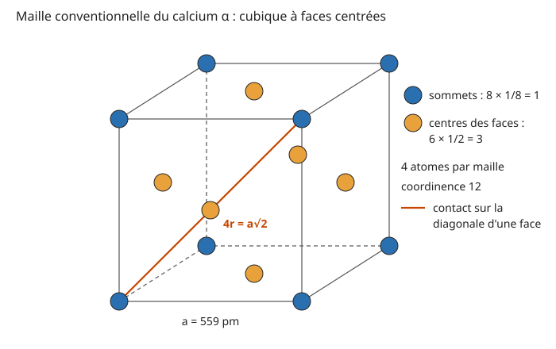
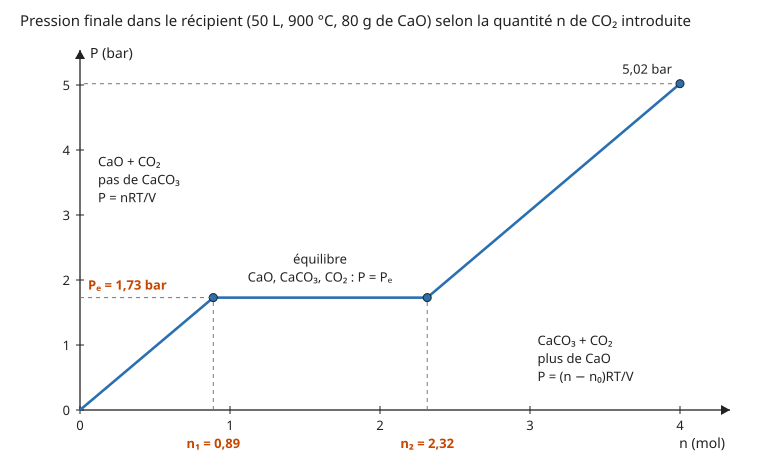
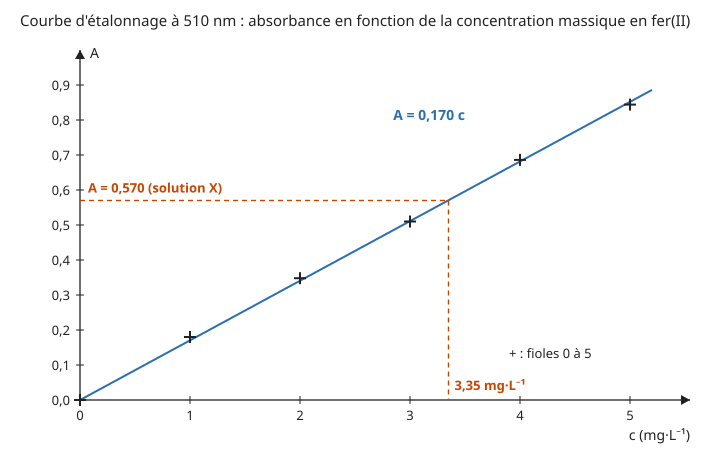
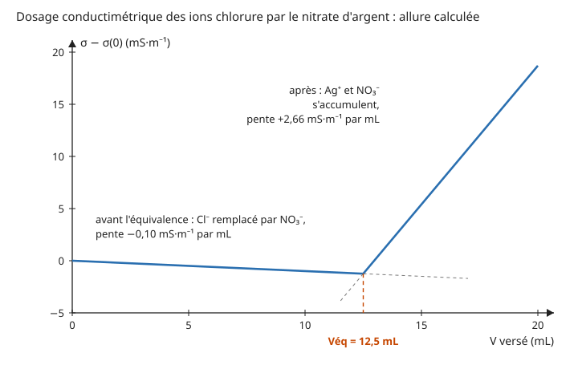

# Banque PT PT — Physique C - Chimie 2009 · Corrigé guidé

*Corrigé rédigé par IA, non officiel. Signalez toute erreur.*

**Rédaction** · modèle exact non renseigné (famille Claude) · effort non renseigné · vitesse non renseignée

**Révision (tour 2)** · modèle exact non renseigné (famille Claude) · effort non renseigné · vitesse non renseignée · 28 novembre 2026

## Présentation du sujet

**Thème.** Un matériau de construction : le ciment. L'épreuve dure 2 heures, **calculatrice autorisée**, et comporte 34 questions en quatre parties indépendantes, dont l'énoncé indique le poids dans le barème. Les données (masses molaires, constantes, $\mathrm{p}K_A$ de l'EDTA, $\mathrm{p}K_s$ du chlorure d'argent, potentiel standard du couple de l'argent, conductivités molaires ioniques) sont regroupées en tête du sujet ; les grandeurs thermodynamiques sont données au fil des questions. Il n'y a ni annexe ni document-réponse. Les questions sont repérées ici de A.1 à D.4 : l'énoncé écrit « A-1 », « C-2 a) », « D.1 a) » ou « D.2.1 a) », ce qui devient A.1, C.2.a, D.1.a et D.2.1.a.

- *Partie A, propriétés atomiques (2 questions, 10 % du barème)* : configuration électronique du calcium, ion usuel, famille, numéros atomiques des éléments voisins de la même colonne.
- *Partie B, cristallographie (2 questions, 14 %)* : calcium α cubique à faces centrées (maille, coordinence, rayon, masse volumique), calcium β cubique centré (paramètre calculé, comparaison à l'expérience, masse volumique).
- *Partie C, le calcium dans l'industrie cimentière (14 questions, 36 %)* : formation du silicate tricalcique (C.1 à C.2.c), apport d'énergie par combustion du méthane et rejets de dioxyde de carbone (C.3.a à C.3.c), comportement du ciment après un incendie (C.4), équilibre de décomposition du calcaire, affinité chimique et ruptures d'équilibre (C.5.a à C.5.f).
- *Partie D, analyse d'une solution représentative d'un ciment (16 questions, 40 %)* : dosage complexométrique du calcium par l'EDTA (D.1.a à D.1.c), dosage spectrophotométrique du fer (D.2.1.a à D.2.2.c), dosage conductimétrique des ions chlorure (D.3.a à D.3.f), concentration en aluminium par électroneutralité (D.4).

**Notions mobilisées.** Configuration électronique et classification périodique, cristaux métalliques (maille, coordinence, contact, masse volumique), thermochimie (loi de Hess, chaleur de réaction monobare, loi de Van't Hoff, affinité chimique, critère d'évolution, rupture d'équilibre hétérogène), solutions aqueuses (complexation et acidité du ligand, indicateur de fin de réaction, loi de Beer-Lambert et étalonnage, précipitation, conductimétrie, potentiométrie, électroneutralité). Le programme est celui en vigueur à la session 2009, antérieur à la réforme de 2013-2014 ; il couvre les deux années de préparation, affinité chimique comprise.

**Difficulté.** Les parties A et B sont des applications directes du cours. La partie C commence simplement et se termine par le passage le plus exigeant du sujet, l'étude des ruptures d'équilibre (C.5.c à C.5.f). La partie D pèse le plus lourd et demande surtout de comprendre des protocoles : beaucoup de questions y sont courtes, mais trois concentrations s'enchaînent et la dernière dépend des précédentes.

**Gestion du temps.** Environ 10 minutes pour la partie A, 15 minutes pour la partie B, 45 minutes pour la partie C et 45 minutes pour la partie D, en gardant 5 minutes pour relire. Les parties étant indépendantes, il est rentable de lire tout l'énoncé d'abord : la partie D contient des questions de connaissance pure (D.2.1.a, D.2.1.b, D.3.a, D.3.c) qui se traitent en quelques lignes.

> [!JURY]
> Le rapport 2009 souligne que la nouvelle organisation de l'épreuve C, en deux demi-épreuves de deux heures, a eu un effet positif sur les prestations en chimie : très peu de copies très faibles, et des candidats qui ont dans l'ensemble traité une ou plusieurs parties, mais rarement la quasi-totalité du sujet. Ceux qui ont lu tout l'énoncé ont pu gagner des points faciles de connaissance pure vers la fin. Les parties les mieux réussies sont la cristallographie et les premières questions de thermochimie ; la moins réussie est la chimie des solutions, qui contenait pourtant des questions très faciles. Le jury estime qu'un travail sérieux en chimie pouvait être récompensé par une bonne note, et félicite les candidats pour la qualité de leur rédaction.

[Sujet officiel (archive)](https://www.banquept.fr/documents/2009/phys_c_2009.zip) · [Rapport du jury](https://www.banquept.fr/documents/ecrit/rapport/2009/rapport_phys_c_ecrit_2009.pdf)

Le sujet officiel est une archive qui réunit les deux parties de Physique C ; la partie chimie y est le fichier `Phys_c_Chimie.PDF`. Le rapport du jury est commun aux deux parties.

*Mode d'emploi* : chercher chaque question seul, lire la première indication en cas de blocage, réessayer, puis la seconde, et seulement ensuite la solution.

## Partie A — Propriétés atomiques

### Question A.1

> [!INDICATION]
> Remplir les sous-couches dans l'ordre de la règle de Klechkowski ($n + \ell$ croissant) : après $3p$, quelle sous-couche vient, $3d$ ou $4s$ ?

> [!INDICATION]
> Les deux électrons les plus externes sont faciles à arracher : quelle configuration l'atome retrouve-t-il alors ? La famille se lit sur la configuration de valence $ns^2$.

#### Solution

Les 20 électrons se répartissent selon la règle de Klechkowski (remplissage par $n + \ell$ croissant, et à égalité par $n$ croissant) et le principe d'exclusion de Pauli (2 électrons au plus par orbitale, soit 2 dans une sous-couche $s$ et 6 dans une sous-couche $p$). La sous-couche $4s$ ($n + \ell = 4$) se remplit avant la $3d$ ($n + \ell = 5$) :

$$\boxed{\mathrm{Ca} : 1s^2\,2s^2\,2p^6\,3s^2\,3p^6\,4s^2}$$

En perdant ses deux électrons de valence $4s$, l'atome acquiert la configuration du gaz noble qui le précède, l'argon. Le calcium se rencontre donc sous la forme de l'ion

$$\boxed{\mathrm{Ca^{2+}} : 1s^2\,2s^2\,2p^6\,3s^2\,3p^6}$$

Sa configuration de valence $ns^2$ le place dans la deuxième colonne de la classification, quatrième ligne : il appartient à la famille des **alcalino-terreux**.

> [!JURY]
> Le rapport indique que la configuration électronique a été trouvée par l'ensemble des candidats, mais que la famille est parfois fantaisiste : le calcium a été rangé parmi les alcanes, les alcalins ou les halogènes. Il estime que la connaissance des grandes familles fait partie du bagage d'un scientifique.

### Question A.2

> [!INDICATION]
> Des éléments d'une même colonne ont la même configuration de valence, ici $ns^2$. Combien d'éléments contiennent les lignes 2, 3 et 4 ?

> [!INDICATION]
> Une ligne commence au remplissage de $ns$ et finit à celui de $np$. De $3s^2$ à $4s^2$ on ajoute $3p^6$ et $4s^2$ ; de $4s^2$ à $5s^2$ on ajoute $3d^{10}$, $4p^6$ et $5s^2$.

#### Solution

Règles utilisées : les éléments sont rangés par numéro atomique croissant ; la ligne $n$ débute avec le remplissage de la sous-couche $ns$ et s'achève avec celui de la sous-couche $np$ ; les éléments d'une même colonne ont la même configuration de valence. Les voisins du calcium ont donc une configuration qui se termine par $ns^2$ avec $n = 2$, $3$ et $5$, les sous-couches se remplissant dans l'ordre de Klechkowski.

- Ligne 2 : $1s^2\,2s^2$, soit $Z = 4$ (béryllium).
- Ligne 3 : $1s^2\,2s^2\,2p^6\,3s^2$, soit $Z = 12$ (magnésium).
- Ligne 5 : configuration du calcium complétée par $3d^{10}\,4p^6\,5s^2$, soit $Z = 20 + 18 = 38$ (strontium).

$$\boxed{Z = 4\ (\mathrm{Be}),\quad Z = 12\ (\mathrm{Mg}),\quad Z = 38\ (\mathrm{Sr})}$$

On retrouve la longueur des lignes : 8 éléments pour les lignes 2 et 3 (sous-couches $s$ et $p$), 18 pour la ligne 4 (sous-couches $4s$, $3d$, $4p$), d'où les écarts $20 - 12 = 8$, $12 - 4 = 8$ et $38 - 20 = 18$.

> [!JURY]
> D'après le rapport, les règles d'obtention des configurations électroniques ne sont que moyennement sues.

> [!PIEGE]
> Ajouter 8 pour passer du calcium au strontium : à partir de la quatrième ligne, les dix éléments du bloc $d$ s'intercalent et l'écart devient 18.

## Partie B — Cristallographie

### Question B.1

> [!INDICATION]
> Dans un empilement cubique à faces centrées, les atomes se touchent le long de la diagonale d'une face. Combien de rayons cette diagonale contient-elle ?

> [!INDICATION]
> La coordinence est le nombre de plus proches voisins d'un atome, pas le nombre d'atomes de la maille. Pour la masse volumique : masse des atomes de la maille divisée par $a^3$, tout en unités SI.

#### Solution

La maille conventionnelle est un cube d'arête $a$ ; les atomes occupent les 8 sommets et les centres des 6 faces.

**Coordinence.** Un atome placé à un sommet a pour plus proches voisins les atomes des centres des faces qui se coupent en ce sommet, à la distance $a\sqrt2/2$. Il y en a 4 dans chacun des trois plans de faces passant par ce sommet :

$$\boxed{\text{coordinence } 12}$$

**Rayon.** Dans le modèle des sphères dures, les atomes sont tangents le long de la diagonale d'une face, qui contient quatre rayons :

$$4r = a\sqrt2$$

$$r = \frac{a\sqrt2}{4} = \frac{559 \times \sqrt2}{4}$$

$$\boxed{r \approx 198\ \mathrm{pm}}$$

**Masse volumique.** La maille contient en propre

$$N = 8 \times \frac18 + 6 \times \frac12 = 4 \text{ atomes}$$

$$\rho_\alpha = \frac{N\,M_{\mathrm{Ca}}}{N_A\,a^3} = \frac{4 \times 40{,}1\cdot10^{-3}}{6{,}02\cdot10^{23} \times (559\cdot10^{-12})^3}$$

$$\boxed{\rho_\alpha \approx 1{,}53\cdot10^{3}\ \mathrm{kg\cdot m^{-3}}}$$

L'ordre de grandeur est celui d'un métal léger, une fois et demie la masse volumique de l'eau.

> [!JURY]
> Le rapport constate que tous les candidats savent représenter la maille cubique à faces centrées, mais qu'un assez grand nombre confondent la coordinence et le nombre d'atomes par maille. Le principe du calcul de la masse volumique est le plus souvent correct, mais certains aboutissent à des valeurs comme $10^{49}\ \mathrm{kg\cdot m^{-3}}$ ou $4{,}77\cdot10^{-16}\ \mathrm{kg\cdot m^{-3}}$ : le jury demande d'avoir en tête l'ordre de grandeur d'une masse volumique courante, celle de l'eau par exemple, et de réagir devant un résultat aberrant.

> [!METHODE]
> Convertir avant de calculer : $a$ en mètres, $M$ en $\mathrm{kg\cdot mol^{-1}}$. Le résultat sort alors directement en $\mathrm{kg\cdot m^{-3}}$.

### Question B.2

> [!INDICATION]
> Dans un empilement cubique centré, l'atome du centre touche ceux des sommets : le contact se fait le long de la grande diagonale du cube, de longueur $a'\sqrt3$.

> [!INDICATION]
> Comparer la valeur calculée à 448 pm revient à comparer le rayon de l'atome dans les deux formes. La coordinence est-elle la même ?

#### Solution

**Paramètre calculé.** Dans la maille cubique centrée (atomes aux 8 sommets et au centre du cube), le contact a lieu le long de la grande diagonale du cube :

$$4r = a'\sqrt3$$

$$a' = \frac{4r}{\sqrt3} = a\sqrt{\frac23} = 559 \times \sqrt{\frac23}$$

$$\boxed{a' \approx 456\ \mathrm{pm}}$$

**Comparaison.** La valeur expérimentale, 448 pm, est plus petite d'environ 2 %. Le rayon de l'atome n'est donc pas le même dans les deux formes : dans le calcium β,

$$r_\beta = \frac{448 \times \sqrt3}{4} \approx 194\ \mathrm{pm}$$

contre 198 pm dans la forme α. Le rayon métallique n'est pas une grandeur intrinsèque de l'atome : il dépend de l'environnement, et diminue un peu quand la coordinence passe de 12 à 8, chaque liaison étant alors plus forte. Le modèle des sphères dures de rayon fixé n'est qu'une approximation, ici correcte à 2 % près.

**Masse volumique.** La maille cubique centrée contient $8 \times \tfrac18 + 1 = 2$ atomes :

$$\rho_\beta = \frac{2\,M_{\mathrm{Ca}}}{N_A\,a_{\mathrm{exp}}^3} = \frac{2 \times 40{,}1\cdot10^{-3}}{6{,}02\cdot10^{23} \times (448\cdot10^{-12})^3}$$

$$\boxed{\rho_\beta \approx 1{,}48\cdot10^{3}\ \mathrm{kg\cdot m^{-3}}}$$

Elle est un peu plus faible que celle de la forme α : l'empilement cubique centré (compacité 0,68) est moins compact que le cubique à faces centrées (0,74), et la légère contraction du rayon ne compense pas cet écart.

> [!PIEGE]
> Reprendre 4 atomes par maille pour la forme β : la maille cubique centrée n'en contient que 2. Et le contact ne se fait plus sur la diagonale d'une face mais sur la grande diagonale du cube.

## Partie C — Le calcium dans l'industrie cimentière

### Question C.1

> [!INDICATION]
> Équilibrer d'abord le calcium : il en faut 3 par $\mathrm{Ca_3SiO_5}$. Que deviennent les atomes de carbone du calcaire ?

#### Solution

Trois moles de calcaire apportent les trois atomes de calcium ; le carbone part sous forme de dioxyde de carbone :

$$\boxed{3\,\mathrm{CaCO_3}_{(s)} + \mathrm{SiO_2}_{(s)} = \mathrm{Ca_3SiO_5}_{(s)} + 3\,\mathrm{CO_2}_{(g)} \qquad (1)}$$

Vérification pour l'oxygène : $9 + 2 = 11$ à gauche, $5 + 6 = 11$ à droite. Le sous-produit est le **dioxyde de carbone** gazeux.

### Question C.2.a

> [!INDICATION]
> Loi de Hess : somme des enthalpies de formation pondérées par les nombres stœchiométriques algébriques. Attention aux coefficients 3.

#### Solution

D'après la loi de Hess,

$$\Delta_r H_1^\circ = \Delta_f H^\circ(\mathrm{Ca_3SiO_5}) + 3\,\Delta_f H^\circ(\mathrm{CO_2}) - 3\,\Delta_f H^\circ(\mathrm{CaCO_3}) - \Delta_f H^\circ(\mathrm{SiO_2})$$

$$\Delta_r H_1^\circ = -2876 + 3 \times (-393{,}1) - 3 \times (-1206) - (-910{,}0)$$

$$\boxed{\Delta_r H_1^\circ \approx +473\ \mathrm{kJ\cdot mol^{-1}}}$$

(valeur non arrondie : $472{,}7\ \mathrm{kJ\cdot mol^{-1}}$). La réaction est fortement endothermique.

> [!JURY]
> Le rapport note que le calcul de l'enthalpie standard de réaction n'a pas posé de problème et que le début de cette partie a été traité par tous les candidats.

### Question C.2.b

> [!INDICATION]
> La question porte sur le déplacement de l'équilibre, pas sur la variation de $\Delta_r H^\circ$ avec $T$. Quelle loi relie $K^\circ$, $T$ et $\Delta_r H^\circ$ ?

#### Solution

La loi de Van't Hoff donne la variation de la constante d'équilibre avec la température :

$$\frac{\mathrm{d}\ln K_1^\circ}{\mathrm{d}T} = \frac{\Delta_r H_1^\circ}{R\,T^2}$$

Comme $\Delta_r H_1^\circ > 0$, la constante $K_1^\circ$ est une fonction croissante de la température. Partant d'un état d'équilibre, une élévation de température à pression constante rend $K_1^\circ$ supérieure au quotient de réaction : le système évolue dans le sens direct.

$$\boxed{\text{Une élévation de température déplace l'équilibre dans le sens direct (endothermique), celui de la formation de } \mathrm{Ca_3SiO_5}.}$$

C'est la raison pour laquelle la réaction est conduite dans un four à haute température.

> [!JURY]
> Selon le rapport, certains candidats confondent la variation de $\Delta_r H^\circ$ avec la température et l'influence de la température sur l'équilibre. Le jury attendait une réponse rapide s'appuyant sur la loi de Van't Hoff ; il accepte bien sûr la démonstration, faite par quelques candidats, qui repasse par l'affinité.

### Question C.2.c

> [!INDICATION]
> À pression et température constantes, la chaleur reçue est $Q = \Delta H = \xi\,\Delta_r H^\circ$. Que vaut l'avancement $\xi$ quand une tonne de calcaire a réagi ?

> [!INDICATION]
> Le coefficient du calcaire est 3 : $\xi = n(\mathrm{CaCO_3})/3$. En revanche il se forme une mole de $\mathrm{CO_2}$ par mole de calcaire.

#### Solution

Masse molaire du calcaire : $M(\mathrm{CaCO_3}) = 40{,}1 + 12{,}0 + 3 \times 16{,}0 = 100{,}1\ \mathrm{g\cdot mol^{-1}}$.

$$n(\mathrm{CaCO_3}) = \frac{1{,}00\cdot10^{6}}{100{,}1} \approx 9{,}99\cdot10^{3}\ \mathrm{mol}$$

Le nombre stœchiométrique du calcaire dans (1) vaut 3, donc l'avancement final est

$$\xi = \frac{n(\mathrm{CaCO_3})}{3} \approx 3{,}33\cdot10^{3}\ \mathrm{mol}$$

La transformation est monobare et monotherme, réactifs et produits étant dans leur état standard : la chaleur reçue par le système est égale à sa variation d'enthalpie,

$$Q_P = \Delta H = \xi\,\Delta_r H_1^\circ = 3{,}33\cdot10^{3} \times 472{,}7\cdot10^{3}$$

$$\boxed{Q_P \approx 1{,}57\cdot10^{9}\ \mathrm{J} = 1{,}57\cdot10^{6}\ \mathrm{kJ}}$$

Il se forme $3\xi = n(\mathrm{CaCO_3})$ moles de dioxyde de carbone, de masse molaire $44{,}0\ \mathrm{g\cdot mol^{-1}}$ :

$$m_1(\mathrm{CO_2}) = 9{,}99\cdot10^{3} \times 44{,}0\cdot10^{-3}$$

$$\boxed{m_1(\mathrm{CO_2}) \approx 440\ \mathrm{kg}}$$

> [!JURY]
> Le rapport relève de nombreuses erreurs à cette question : un certain nombre de candidats ont oublié de calculer l'avancement de la réaction, dont dépend la chaleur à fournir.

> [!PIEGE]
> Multiplier $\Delta_r H_1^\circ$ par la quantité de calcaire : l'enthalpie de réaction est rapportée à une mole d'avancement, c'est-à-dire à 3 moles de calcaire. L'erreur triple le résultat.

### Question C.3.a

> [!INDICATION]
> Écrire la combustion complète du méthane dans le dioxygène (produits : dioxyde de carbone et eau), puis égaler la chaleur dégagée à celle de la question C.2.c.

#### Solution

Combustion complète du méthane, écrite avec un nombre stœchiométrique $-1$ pour le méthane :

$$\mathrm{CH_4}_{(g)} + 2\,\mathrm{O_2}_{(g)} = \mathrm{CO_2}_{(g)} + 2\,\mathrm{H_2O} \qquad (2)$$

À pression et température constantes, la combustion de $n$ moles de méthane dégage la chaleur $n\,|\Delta_r H_2^\circ|$. En supposant que toute cette chaleur sert à la transformation (aucune perte), il faut

$$n(\mathrm{CH_4})\,|\Delta_r H_2^\circ| = Q_P$$

$$n(\mathrm{CH_4}) = \frac{1{,}574\cdot10^{6}}{690} \approx 2{,}28\cdot10^{3}\ \mathrm{mol}$$

Avec $M(\mathrm{CH_4}) = 12{,}0 + 4 \times 1{,}00 = 16{,}0\ \mathrm{g\cdot mol^{-1}}$ :

$$m(\mathrm{CH_4}) = 2{,}28\cdot10^{3} \times 16{,}0\cdot10^{-3}$$

$$\boxed{m(\mathrm{CH_4}) \approx 36{,}5\ \mathrm{kg}}$$

Remarque : le calcul utilise la valeur de l'énoncé, $-690\ \mathrm{kJ\cdot mol^{-1}}$, et l'équation (2) laisse l'eau sans état physique, parce que l'énoncé ne le précise pas. Les enthalpies standard de formation tabulées à 298 K ($-393{,}5$ pour $\mathrm{CO_2}_{(g)}$, $-74{,}8$ pour $\mathrm{CH_4}_{(g)}$, $-241{,}8$ pour $\mathrm{H_2O}_{(g)}$ et $-285{,}8\ \mathrm{kJ\cdot mol^{-1}}$ pour $\mathrm{H_2O}_{(l)}$) donnent, par la loi de Hess, $-802\ \mathrm{kJ\cdot mol^{-1}}$ si l'eau est formée à l'état de vapeur et $-890\ \mathrm{kJ\cdot mol^{-1}}$ si elle est liquide. La valeur de l'énoncé est plus petite en valeur absolue dans les deux cas ; avec $-802\ \mathrm{kJ\cdot mol^{-1}}$, on trouverait environ 31 kg de méthane : l'ordre de grandeur du résultat n'en est pas changé.

> [!JURY]
> Le rapport juge la question généralement bien traitée, tout en signalant que du dihydrogène apparaît assez souvent dans l'équation de combustion écrite par les candidats.

### Question C.3.b

> [!INDICATION]
> Une mole de méthane brûlée donne une mole de dioxyde de carbone.

#### Solution

D'après (2), $n(\mathrm{CO_2}) = n(\mathrm{CH_4}) \approx 2{,}28\cdot10^{3}\ \mathrm{mol}$ :

$$m_2(\mathrm{CO_2}) = 2{,}28\cdot10^{3} \times 44{,}0\cdot10^{-3}$$

$$\boxed{m_2(\mathrm{CO_2}) \approx 100\ \mathrm{kg}}$$

Au total, la transformation d'une tonne de calcaire rejette donc $m_1 + m_2 \approx 440 + 100 = 540\ \mathrm{kg}$ de dioxyde de carbone.

### Question C.3.c

> [!INDICATION]
> D'où vient le dioxyde de carbone rejeté ? Il y a deux origines, et elles ne pèsent pas le même poids.

#### Solution

Le dioxyde de carbone est un gaz à effet de serre, dont les rejets contribuent au réchauffement climatique. L'industrie cimentière en est un émetteur important, pour deux raisons qui s'ajoutent :

- la **réaction chimique elle-même** : la décarbonatation du calcaire libère 440 kg de $\mathrm{CO_2}$ par tonne de calcaire, soit environ 80 % du total calculé ici ; cette part est imposée par la stœchiométrie et ne dépend pas du mode de chauffage ;
- les **besoins en énergie** de cette réaction très endothermique : la combustion du méthane en ajoute 100 kg, et davantage en réalité puisque le four fonctionne à haute température, avec des pertes thermiques et souvent des combustibles plus carbonés.

Avec plus d'une demi-tonne de $\mathrm{CO_2}$ par tonne de calcaire traité et une production mondiale de béton de l'ordre de la dizaine de milliards de tonnes par an, l'enjeu est considérable. Changer de source d'énergie ne supprime que la seconde contribution ; réduire la première demande de modifier la composition des ciments ou de capter le gaz émis.

> [!JURY]
> Le rapport observe que tous les candidats, sensibilisés aux questions climatiques, connaissent l'effet des rejets de dioxyde de carbone. Le jury attendait qu'ils remarquent que le ciment produit ce gaz pour deux causes : la réaction chimique elle-même et l'énergie qu'elle réclame.

### Question C.4

> [!INDICATION]
> Deux équations inverses l'une de l'autre. Pour interpréter les masses volumiques, raisonner sur le volume occupé par une mole de solide : $V_m = M/\rho$.

> [!INDICATION]
> La quantité de calcium ne change pas. Comparer $V_m(\mathrm{CaO})$ et $V_m(\mathrm{Ca(OH)_2})$ : le solide gonfle-t-il ou se contracte-t-il à chaque étape ?

#### Solution

**Équations.** Pendant l'incendie, au-dessus de 400 °C, l'hydroxyde de calcium se déshydrate :

$$\boxed{\mathrm{Ca(OH)_2}_{(s)} = \mathrm{CaO}_{(s)} + \mathrm{H_2O}_{(g)}}$$

Au refroidissement, l'oxyde de calcium fixe lentement l'eau de l'atmosphère :

$$\boxed{\mathrm{CaO}_{(s)} + \mathrm{H_2O} = \mathrm{Ca(OH)_2}_{(s)}}$$

**Interprétation.** Le nombre de moles de calcium contenu dans le mur est conservé : il faut comparer les volumes molaires des deux solides.

$$M(\mathrm{CaO}) = 56{,}1\ \mathrm{g\cdot mol^{-1}} \qquad M(\mathrm{Ca(OH)_2}) = 74{,}1\ \mathrm{g\cdot mol^{-1}}$$

$$V_m(\mathrm{CaO}) = \frac{56{,}1}{3{,}25} \approx 17{,}3\ \mathrm{cm^3\cdot mol^{-1}}$$

$$V_m(\mathrm{Ca(OH)_2}) = \frac{74{,}1}{2{,}24} \approx 33{,}1\ \mathrm{cm^3\cdot mol^{-1}}$$

$$\frac{V_m(\mathrm{Ca(OH)_2})}{V_m(\mathrm{CaO})} \approx 1{,}9$$

Pendant l'incendie, le solide perd de l'eau (sa masse diminue) et son volume est presque divisé par deux : le ciment devient poreux et se fissure. Après l'incendie, la réhydratation fait presque doubler le volume de ce solide à l'intérieur d'un matériau rigide.

$$\boxed{\text{La réhydratation de CaO s'accompagne d'un gonflement (volume multiplié par 1,9) : le mur se fissure et éclate.}}$$

Un mur qui a résisté à l'incendie peut ainsi se dégrader plusieurs jours après, d'autant que la réhydratation est lente.

> [!JURY]
> Le rapport déplore que trop de candidats aient interprété l'augmentation de masse volumique comme une augmentation de la masse des murs, ce qu'il juge pour le moins surprenant ; une courte réflexion suffit à éviter cette erreur.

> [!METHODE]
> Pour comparer deux solides qui contiennent le même nombre de moles d'un élément, la grandeur utile est le volume molaire $M/\rho$, pas la masse volumique seule.

### Question C.5.a

> [!INDICATION]
> L'équilibre entre deux solides purs et un gaz fixe la pression : $K_4^\circ = P_{4e}/P^\circ$. En déduire $\Delta_r G_4^\circ$, qui n'a aucune raison d'être nul.

> [!INDICATION]
> $\Delta_r G^\circ = -RT\ln K^\circ = \Delta_r H^\circ - T\,\Delta_r S^\circ$, avec $T = 1000\ \mathrm{K}$.

#### Solution

Les deux solides sont purs dans leur phase (activité 1) ; à l'équilibre, la loi d'action des masses s'écrit

$$K_4^\circ(T) = \frac{P_{4e}}{P^\circ}$$

À $T_1 = 727 + 273 = 1000\ \mathrm{K}$, $K_4^\circ = 0{,}076$, d'où

$$\Delta_r G_4^\circ = -R\,T_1 \ln K_4^\circ = -8{,}31 \times 1000 \times \ln(0{,}076) \approx +21{,}4\ \mathrm{kJ\cdot mol^{-1}}$$

Or $\Delta_r G_4^\circ = \Delta_r H_4^\circ - T_1\,\Delta_r S_4^\circ$, donc

$$\Delta_r S_4^\circ = \frac{\Delta_r H_4^\circ - \Delta_r G_4^\circ}{T_1} = \frac{176{,}2\cdot10^{3} - 21{,}4\cdot10^{3}}{1000}$$

$$\boxed{\Delta_r S_4^\circ \approx +155\ \mathrm{J\cdot K^{-1}\cdot mol^{-1}}}$$

Le signe était prévisible : la réaction transforme un solide en un solide et un gaz, la quantité de matière gazeuse augmente ($\sum \nu_{i,\mathrm{gaz}} = +1$), donc le désordre augmente et $\Delta_r S_4^\circ > 0$.

> [!JURY]
> Le rapport signale des confusions entre changement d'état, de nature physique, et réaction chimique : l'enthalpie libre standard de la réaction n'était pas nulle. Il précise que beaucoup de candidats ont, eux, parfaitement mené ces calculs.

> [!PIEGE]
> Écrire $\Delta_r S^\circ = \Delta_r H^\circ/T$ : cette relation suppose $\Delta_r G^\circ = 0$, ce qui n'est vrai qu'à la température où $K^\circ = 1$ (ou pour un changement d'état sous $P^\circ$). Ici $K_4^\circ = 0{,}076$ à 1000 K.

### Question C.5.b

> [!INDICATION]
> Intégrer la loi de Van't Hoff entre 1000 K et 1173 K avec $\Delta_r H_4^\circ$ constante.

#### Solution

Avec $\Delta_r H_4^\circ$ indépendante de la température, la loi de Van't Hoff s'intègre entre $T_1 = 1000\ \mathrm{K}$ et $T_2 = 900 + 273 = 1173\ \mathrm{K}$ :

$$\ln\frac{K_4^\circ(T_2)}{K_4^\circ(T_1)} = \frac{\Delta_r H_4^\circ}{R}\left(\frac{1}{T_1} - \frac{1}{T_2}\right)$$

$$\ln\frac{K_4^\circ(T_2)}{K_4^\circ(T_1)} = \frac{176{,}2\cdot10^{3}}{8{,}31}\left(\frac{1}{1000} - \frac{1}{1173}\right) \approx 3{,}13$$

$$\ln K_4^\circ(T_2) = \ln(0{,}076) + 3{,}13 \approx 0{,}55$$

$$K_4^\circ(T_2) \approx 1{,}73$$

$$\boxed{P_e(900\ {}^\circ\mathrm{C}) \approx 1{,}73\ \mathrm{bar}}$$

La pression d'équilibre augmente avec la température, comme attendu pour une réaction endothermique. On retrouve la même valeur avec $\ln K_4^\circ = -\Delta_r H_4^\circ/(RT_2) + \Delta_r S_4^\circ/R$, ce qui revient à supposer aussi $\Delta_r S_4^\circ$ constante. L'exponentielle amplifie les arrondis : il faut y garder la valeur non arrondie $\Delta_r S_4^\circ \approx 154{,}78\ \mathrm{J\cdot K^{-1}\cdot mol^{-1}}$ (soit $\Delta_r G_4^\circ \approx 21{,}415\ \mathrm{kJ\cdot mol^{-1}}$), car la valeur encadrée 155 donnerait 1,78 bar.

### Question C.5.c

> [!INDICATION]
> Calculer l'affinité de la réaction (4), écrite dans le sens de la décomposition du carbonate, dans l'état initial « figé » : $\mathcal{A} = RT\ln(K^\circ/Q)$ avec $Q = P/P^\circ$.

> [!INDICATION]
> Une fois le signe de $\mathcal{A}$ trouvé, le critère $\mathcal{A}\,\mathrm{d}\xi > 0$ donne le sens d'évolution. Le réactif nécessaire à ce sens est-il présent dans le récipient ?

#### Solution

On considère la réaction (4), $\mathrm{CaCO_3}_{(s)} = \mathrm{CaO}_{(s)} + \mathrm{CO_2}_{(g)}$, dans l'état initial figé : le récipient contient $n_0$ moles d'oxyde de calcium et $n$ moles de dioxyde de carbone, sans carbonate. Le gaz, supposé parfait, est à la pression

$$P_i = \frac{n\,R\,T}{V}$$

Le quotient de réaction vaut $Q_i = P_i/P^\circ$ (le solide a une activité égale à 1) et l'affinité chimique

$$\mathcal{A}_i = R\,T \ln\frac{K_4^\circ}{Q_i} = R\,T \ln\frac{P_e}{P_i}$$

Pour $n$ très faible, $P_i < P_e$ :

$$\boxed{\mathcal{A}_i > 0}$$

Le critère d'évolution spontanée $\mathcal{A}\,\mathrm{d}\xi > 0$ impose alors $\mathrm{d}\xi > 0$ : la seule évolution permise est le sens direct, la décomposition du carbonate de calcium. Or le récipient n'en contient pas.

$$\boxed{\text{Il ne se passe rien : l'oxyde de calcium ne se carbonate pas et le gaz reste à la pression } P = nRT/V.}$$

Le système est en équilibre mécanique et thermique, mais l'équilibre chimique (4) n'est pas établi puisqu'une des trois espèces est absente : il y a rupture d'équilibre.

> [!JURY]
> Le rapport indique que bien peu de candidats ont traité correctement les questions C.5.c à C.5.f : la notion d'affinité n'est pas assez maîtrisée, certains déduisant le signe de l'affinité après avoir choisi celui de $\mathrm{d}\xi$. Le raisonnement correct consiste à calculer l'affinité dans l'état initial figé, puis à appliquer le critère d'évolution $\mathcal{A}\,\mathrm{d}\xi > 0$ pour obtenir le signe de $\mathrm{d}\xi$, donc le sens d'évolution spontanée. Le jury invite les futurs candidats à approfondir ces raisonnements.

### Question C.5.d

> [!INDICATION]
> Le système évolue dès que l'affinité initiale devient négative, c'est-à-dire dès que la pression initiale dépasse $P_e$.

> [!INDICATION]
> Pour $n > n_1$, la carbonatation consomme du gaz jusqu'à ramener la pression à $P_e$ : combien de moles de $\mathrm{CO_2}$ restent alors en phase gazeuse ?

#### Solution

L'affinité initiale $\mathcal{A}_i = RT\ln(P_e/P_i)$ devient négative dès que $P_i > P_e$. Le critère $\mathcal{A}\,\mathrm{d}\xi > 0$ donne alors $\mathrm{d}\xi < 0$ : le système évolue dans le sens inverse de (4), qui est possible puisque l'oxyde de calcium et le dioxyde de carbone sont présents. La valeur limite correspond à $P_i = P_e$ :

$$n_1 = \frac{P_e\,V}{R\,T} = \frac{1{,}73\cdot10^{5} \times 50\cdot10^{-3}}{8{,}31 \times 1173}$$

$$\boxed{n_1 \approx 0{,}89\ \mathrm{mol}}$$

Pour $n > n_1$, l'oxyde de calcium se carbonate :

$$\mathrm{CaO}_{(s)} + \mathrm{CO_2}_{(g)} \longrightarrow \mathrm{CaCO_3}_{(s)}$$

La pression diminue jusqu'à $P_e$, valeur pour laquelle l'affinité s'annule : les trois espèces coexistent et l'équilibre (4) est établi. Il reste $n_1$ moles de gaz et il s'est formé

$$n(\mathrm{CaCO_3}) = n - n_1$$

moles de carbonate, tant qu'il reste de l'oxyde de calcium. La pression finale reste égale à $P_e \approx 1{,}73\ \mathrm{bar}$ quelle que soit la quantité introduite : la température étant fixée, l'équilibre entre deux solides purs et un gaz impose la pression.

### Question C.5.e

> [!INDICATION]
> La carbonatation s'arrête faute d'oxyde de calcium. Combien de moles y en a-t-il dans 80 g ?

> [!INDICATION]
> Au-delà de $n_2$, tout le calcium est sous forme de carbonate et le gaz en excès s'accumule : comparer la pression finale à $P_e$ pour avoir le signe de l'affinité.

#### Solution

Le récipient contient initialement

$$n_0 = \frac{m(\mathrm{CaO})}{M(\mathrm{CaO})} = \frac{80}{56{,}1} \approx 1{,}43\ \mathrm{mol}$$

d'oxyde de calcium. D'après la question précédente, la quantité de carbonate formée à l'équilibre est $n - n_1$ : l'oxyde est entièrement consommé lorsque $n - n_1 = n_0$, soit pour

$$n_2 = n_1 + n_0 = 0{,}89 + 1{,}43$$

$$\boxed{n_2 \approx 2{,}32\ \mathrm{mol}}$$

Pour $n > n_2$, il ne reste plus d'oxyde de calcium : l'état final contient $n_0$ moles de carbonate et $n - n_0$ moles de gaz, à la pression

$$P_f = \frac{(n - n_0)\,R\,T}{V} > P_e$$

L'équilibre (4) est rompu, une des espèces ayant disparu. Dans cet état final,

$$\mathcal{A}_f = R\,T \ln\frac{P_e}{P_f}$$

$$\boxed{\mathcal{A}_f < 0}$$

Une affinité négative correspond à une évolution spontanée dans le sens inverse (formation de carbonate), mais ce sens est bloqué par l'absence d'oxyde de calcium. L'affinité n'est donc pas nulle dans l'état final : cela ne contredit pas le second principe, car la condition $\mathcal{A} = 0$ ne s'applique qu'à un équilibre chimique où toutes les espèces sont présentes. Le cas est symétrique de celui de la question C.5.c, où $\mathcal{A} > 0$ et où c'est le carbonate qui manque.

### Question C.5.f

> [!INDICATION]
> Trois domaines, délimités par $n_1$ et $n_2$ : gaz seul en présence de l'oxyde, équilibre, gaz en excès au-dessus du carbonate.

#### Solution

En rassemblant les résultats, avec $RT/V = 8{,}31 \times 1173/(50\cdot10^{-3}) \approx 1{,}95\cdot10^{5}\ \mathrm{Pa\cdot mol^{-1}}$, soit 1,95 bar par mole :

$$P = \begin{cases} \dfrac{n\,R\,T}{V} & \text{si } 0 < n \leqslant n_1 \\[2mm] P_e \approx 1{,}73\ \mathrm{bar} & \text{si } n_1 \leqslant n \leqslant n_2 \\[2mm] \dfrac{(n - n_0)\,R\,T}{V} & \text{si } n \geqslant n_2 \end{cases}$$

La courbe est formée de trois segments : une droite passant par l'origine, de pente $RT/V$ ; un palier à $P_e$ entre $n_1 \approx 0{,}89\ \mathrm{mol}$ et $n_2 \approx 2{,}32\ \mathrm{mol}$ ; une droite de même pente que la première, décalée de $n_0$. Elle est continue en $n_1$ et en $n_2$. À l'extrémité du tracé,

$$P(4\ \mathrm{mol}) = (4 - 1{,}43) \times 1{,}95 \approx 5{,}0\ \mathrm{bar}$$

> [!METHODE]
> Vérifier la continuité aux deux raccords : en $n_1$, $n_1RT/V = P_e$ par définition ; en $n_2$, $(n_2 - n_0)RT/V = n_1RT/V = P_e$. Un saut de pression signalerait une erreur de bilan.

## Partie D — Analyse d'une solution représentative d'un ciment

### Question D.1.a

> [!INDICATION]
> Le ligand $\mathrm{Y^{4-}}$ est aussi une base : c'est la forme la plus déprotonée du tétraacide $\mathrm{H_4Y}$. Sous quelle forme se trouve l'EDTA à pH 4,4, et à pH 13 ?

#### Solution

Le ligand qui complexe le calcium est l'ion $\mathrm{Y^{4-}}$, qui est aussi une base : c'est la base conjuguée du dernier couple du tétraacide $\mathrm{H_4Y}$, de $\mathrm{p}K_A = 10{,}2$. Il ne prédomine que pour $\mathrm{pH} > 10{,}2$.

- À pH 4,4 (après l'ajout d'ammoniac), l'EDTA est sous la forme $\mathrm{H_2Y^{2-}}$, qui prédomine entre 2,7 et 6,1 : le ligand est protoné et la complexation du calcium est très défavorisée.
- À pH 13, soit près de trois unités au-dessus de 10,2, l'EDTA est presque entièrement sous la forme $\mathrm{Y^{4-}}$ : la réaction $\mathrm{Ca^{2+}} + \mathrm{Y^{4-}} = \mathrm{CaY^{2-}}$ est alors quantitative.

De plus, le réactif versé est $\mathrm{H_2Y^{2-}}$ : la complexation libère des ions $\mathrm{H^+}$,

$$\mathrm{Ca^{2+}} + \mathrm{H_2Y^{2-}} = \mathrm{CaY^{2-}} + 2\,\mathrm{H^+}$$

que l'excès de soude consomme, ce qui maintient le pH. Enfin, les couleurs de l'indicateur et de son complexe ne sont données qu'à pH 13 : la forme libre $\mathrm{In^{3-}}$, bleue, est elle aussi une forme basique.

$$\boxed{\text{Le milieu basique maintient l'EDTA sous sa forme complexante } \mathrm{Y^{4-}} \text{ et l'indicateur sous sa forme } \mathrm{In^{3-}} : \text{la réaction de dosage est quantitative.}}$$

> [!JURY]
> Le rapport regrette que bien peu de candidats aient compris la nécessité d'un milieu basique lorsque le ligand est à la fois ligand et base.

### Question D.1.b

> [!INDICATION]
> Avant l'équivalence, une petite partie du calcium est liée à l'indicateur. Que fait l'EDTA quand il n'y a plus de calcium libre ?

#### Solution

L'indicateur, introduit en très petite quantité, complexe une faible part des ions calcium : la solution prend la teinte violette de $\mathrm{CaIn^-}$. L'EDTA versé réagit d'abord avec les ions calcium libres, en donnant $\mathrm{CaY^{2-}}$, incolore : la teinte ne change pas. Lorsque tout le calcium libre est consommé, c'est-à-dire à l'équivalence, la première goutte d'EDTA en excès arrache le calcium à l'indicateur :

$$\mathrm{CaIn^-} + \mathrm{Y^{4-}} = \mathrm{CaY^{2-}} + \mathrm{In^{3-}}$$

L'indicateur libéré $\mathrm{In^{3-}}$ donne à la solution sa couleur bleu clair : c'est le virage, et la teinte ne change plus ensuite.

Pour que ce déplacement de ligand soit quantitatif, sa constante, rapport des constantes de formation des deux complexes, doit être grande devant 1 :

$$\boxed{\mathrm{CaY^{2-}} \text{ est plus stable que } \mathrm{CaIn^-}}$$

Dans le cas contraire, l'EDTA ne déplacerait pas l'indicateur et on n'observerait aucun virage. Le complexe $\mathrm{CaIn^-}$ doit cependant être assez stable pour exister tant qu'il reste du calcium libre.

> [!JURY]
> Le rapport regrette que peu de candidats soient capables d'expliquer le rôle d'un indicateur coloré.

### Question D.1.c

> [!INDICATION]
> À l'équivalence, les quantités de matière de calcium et d'EDTA sont égales. Le volume qui compte est celui de la prise d'essai, pas les 200 mL après dilution.

#### Solution

À l'équivalence, les réactifs ont été introduits dans les proportions stœchiométriques de la réaction de dosage, soit mole à mole :

$$n(\mathrm{Ca^{2+}}) = n(\mathrm{EDTA})$$

$$C_1\,V_0 = C_{\mathrm{EDTA}}\,V$$

avec $V_0 = 50{,}0\ \mathrm{mL}$ (prise d'essai) et $V = 10{,}2\ \mathrm{mL}$. La dilution à 200 mL ne change pas la quantité de calcium dosée.

$$C_1 = \frac{0{,}0500 \times 10{,}2}{50{,}0}$$

$$\boxed{C_1 = 1{,}02\cdot10^{-2}\ \mathrm{mol\cdot L^{-1}}}$$

> [!JURY]
> Le rapport rappelle que la relation à l'équivalence porte sur les quantités de matière des réactifs.

### Question D.2.1.a

> [!INDICATION]
> Quelle loi relie l'absorbance d'une solution à la concentration de l'espèce colorée ?

#### Solution

La méthode repose sur la **loi de Beer-Lambert** : pour une solution diluée, traversée par une lumière monochromatique de longueur d'onde $\lambda$, l'absorbance est proportionnelle à la concentration de l'espèce absorbante et à l'épaisseur de solution traversée,

$$\boxed{A = \varepsilon(\lambda)\,\ell\,c}$$

où $\varepsilon$ est le coefficient d'absorption molaire de l'espèce à cette longueur d'onde, $\ell$ la longueur de la cuve et $c$ la concentration. L'absorbance, sans dimension, est définie par $A = \log(I_0/I)$, $I_0$ et $I$ étant les intensités lumineuses incidente et transmise.

> [!JURY]
> Le rapport constate que tous les candidats ne connaissent pas la loi de Beer-Lambert.

### Question D.2.1.b

> [!INDICATION]
> Il faut une courbe préalable : laquelle ? Sur cette courbe, quel point donne la meilleure sensibilité ?

#### Solution

Il faut d'abord tracer le **spectre d'absorption** du complexe, c'est-à-dire la courbe de l'absorbance en fonction de la longueur d'onde, $A = f(\lambda)$, pour l'une des solutions étalons, après avoir fait le « blanc » avec une solution qui contient tous les réactifs sauf le fer (fiole 0).

On choisit ensuite la longueur d'onde du **maximum d'absorption**, ici 510 nm : le complexe rouge absorbe dans le vert, couleur complémentaire. Ce choix se justifie de deux façons :

- la sensibilité est maximale, $\varepsilon$ étant le plus grand : une petite variation de concentration donne la plus grande variation d'absorbance ;
- au voisinage du maximum, la courbe $A(\lambda)$ est plate : une légère imprécision sur le réglage de la longueur d'onde n'a presque pas d'effet sur la mesure.

On vérifie enfin que les autres espèces présentes n'absorbent pas à cette longueur d'onde.

> [!JURY]
> Le rapport note que la notion de spectre est, elle aussi, mal connue.

### Question D.2.1.c

> [!INDICATION]
> La grandeur à porter en abscisse est la concentration du fer(II) dans chaque fiole de 50 mL, pas le volume de solution étalon prélevé.

#### Solution

La grandeur pertinente en abscisse est la concentration dans la fiole, puisque c'est elle qui intervient dans la loi de Beer-Lambert et qu'il faudra lire une concentration pour la solution X. Dans la fiole $i$, un volume $V_i$ de solution étalon à $0{,}050\ \mathrm{g\cdot L^{-1}}$ est dilué à 50 mL :

$$c_i = 0{,}050 \times \frac{V_i}{50} \ \mathrm{g\cdot L^{-1}}$$

soit $1{,}0\ \mathrm{mg\cdot L^{-1}}$ par millilitre de solution étalon. L'orthophénanthroline étant en large excès, tout le fer(II) est complexé : la concentration du complexe est égale à celle du fer(II) introduit.

| Fiole | 0 | 1 | 2 | 3 | 4 | 5 |
|---|---|---|---|---|---|---|
| $c$ ($\mathrm{mg\cdot L^{-1}}$) | 0 | 1,0 | 2,0 | 3,0 | 4,0 | 5,0 |
| $A$ | 0 | 0,180 | 0,348 | 0,51 | 0,686 | 0,844 |

Les six points s'alignent sur une droite passant par l'origine, en accord avec la loi de Beer-Lambert. Un ajustement linéaire passant par l'origine donne

$$\boxed{A = k\,c \quad\text{avec}\quad k \approx 0{,}170\ \mathrm{L\cdot mg^{-1}}}$$

les écarts des points à cette droite ne dépassant pas 0,01 unité d'absorbance.

> [!JURY]
> Le rapport signale que très peu de candidats ont tracé l'absorbance en fonction de la concentration obtenue en complexe, alors que la courbe d'étalonnage est une méthode qui n'est pas propre à la chimie : la courbe $A = f(V)$ n'était pas exploitable ici.

### Question D.2.2.a

> [!INDICATION]
> La question relève de la cinétique, pas de la thermodynamique.

#### Solution

La réduction des ions fer(III) par l'ion hydroxylammonium est une réaction d'oxydoréduction lente à température ordinaire. La température est un facteur cinétique : le chauffage au bain-marie bouillant pendant 20 minutes accélère la réaction et garantit que la réduction est totale avant l'ajout de l'orthophénanthroline.

$$\boxed{\text{On chauffe pour accélérer une réduction lente et la rendre complète dans la durée de la manipulation.}}$$

Si une partie du fer restait à l'état de fer(III), il ne serait pas complexé sous la forme colorée et la concentration serait sous-estimée.

### Question D.2.2.b

> [!INDICATION]
> La solution X a été préparée avec les mêmes réactifs et mesurée dans les mêmes conditions que les étalons : sa concentration se lit sur la droite d'étalonnage.

#### Solution

La solution X a été préparée comme les solutions étalons (mêmes volumes de réactifs, même fiole de 50 mL) et son absorbance est mesurée à la même longueur d'onde, dans la même cuve : la droite d'étalonnage s'applique. L'absorbance mesurée, 0,570, se situe dans le domaine étalonné, entre celles des fioles 3 et 4.

$$c_X = \frac{A}{k} = \frac{0{,}570}{0{,}170}$$

$$\boxed{c_X \approx 3{,}35\ \mathrm{mg\cdot L^{-1}} = 3{,}35\cdot10^{-3}\ \mathrm{g\cdot L^{-1}}}$$

Une interpolation linéaire entre les fioles 3 et 4 donne la même valeur à 0,01 près : $3{,}0 + (0{,}570 - 0{,}51)/(0{,}686 - 0{,}51) \approx 3{,}34\ \mathrm{mg\cdot L^{-1}}$.

### Question D.2.2.c

> [!INDICATION]
> Tout le fer(III) de la prise d'essai est devenu du fer(II) dans la solution X. Quel est le facteur de dilution entre la solution (S) et la solution X ?

#### Solution

La réduction étant totale, tout le fer(III) contenu dans la prise d'essai de $2{,}00\ \mathrm{mL}$ se retrouve à l'état de fer(II) dans les 50 mL de la solution X : la solution (S) a été diluée d'un facteur $50/2{,}00 = 25$.

Concentration molaire du fer dans X :

$$[\mathrm{Fe^{2+}}]_X = \frac{c_X}{M_{\mathrm{Fe}}} = \frac{3{,}35\cdot10^{-3}}{55{,}8} \approx 6{,}0\cdot10^{-5}\ \mathrm{mol\cdot L^{-1}}$$

$$C_2 = 25 \times [\mathrm{Fe^{2+}}]_X$$

$$\boxed{C_2 \approx 1{,}50\cdot10^{-3}\ \mathrm{mol\cdot L^{-1}}}$$

> [!JURY]
> D'après le rapport, la valeur obtenue pour $C_2$ a souvent été fausse parce que l'effet de la dilution avait été oublié.

### Question D.3.a

> [!INDICATION]
> La réaction de dosage est l'inverse de la dissolution du chlorure d'argent.

#### Solution

$$\boxed{\mathrm{Ag^+}_{(aq)} + \mathrm{Cl^-}_{(aq)} = \mathrm{AgCl}_{(s)}}$$

C'est la réaction inverse de la dissolution du chlorure d'argent, de constante $K_s$ :

$$K^\circ = \frac{1}{K_s} = 10^{\mathrm{p}K_s} = 10^{9{,}7}$$

$$\boxed{K^\circ \approx 5{,}0\cdot10^{9}}$$

La constante est très grande : la réaction est quantitative, ce qui convient à un dosage.

### Question D.3.b

> [!INDICATION]
> Calculer la concentration des ions argent apportés par une goutte une fois diluée dans le bécher, puis comparer le produit $[\mathrm{Ag^+}][\mathrm{Cl^-}]$ à $K_s$.

> [!INDICATION]
> Raisonner en quantité de matière : une goutte de $5\cdot10^{-5}\ \mathrm{L}$ à $0{,}0400\ \mathrm{mol\cdot L^{-1}}$ apporte $2{,}0\cdot10^{-6}\ \mathrm{mol}$, diluées dans 200 mL. Le cas le plus défavorable est la plus petite concentration en chlorure.

#### Solution

Choix du corrigé : l'énoncé ne précise pas à quelle solution se rapporte la concentration $C$ ni dans quel volume tombe la goutte. On prend pour $C$ la concentration des ions chlorure dans le bécher où l'on dose, et pour volume les 200 mL du protocole.

Une goutte de nitrate d'argent apporte

$$n(\mathrm{Ag^+}) = 0{,}0400 \times 5\cdot10^{-5} = 2{,}0\cdot10^{-6}\ \mathrm{mol}$$

Dans les 200 mL du bécher (le volume de la goutte est négligeable), avant toute précipitation :

$$[\mathrm{Ag^+}] = \frac{2{,}0\cdot10^{-6}}{0{,}200} = 1{,}0\cdot10^{-5}\ \mathrm{mol\cdot L^{-1}}$$

Le précipité apparaît si le quotient $Q = [\mathrm{Ag^+}][\mathrm{Cl^-}]$ dépasse $K_s = 10^{-9{,}7} \approx 2{,}0\cdot10^{-10}$. Dans le cas le plus défavorable, $C = 10^{-4}\ \mathrm{mol\cdot L^{-1}}$ :

$$Q = 1{,}0\cdot10^{-5} \times 1{,}0\cdot10^{-4} = 1{,}0\cdot10^{-9} > K_s$$

et pour $C = 0{,}1\ \mathrm{mol\cdot L^{-1}}$, $Q = 1{,}0\cdot10^{-6} \gg K_s$.

$$\boxed{Q > K_s \text{ sur tout l'intervalle : le chlorure d'argent précipite dès la première goutte.}}$$

La condition $Q > K_s$ équivaut à $C > K_s/[\mathrm{Ag^+}] = 2{,}0\cdot10^{-5}\ \mathrm{mol\cdot L^{-1}}$, valeur inférieure à la borne basse de l'intervalle. Pour la solution étudiée, la concentration en chlorure dans le bécher vaut $0{,}0500/20 = 2{,}5\cdot10^{-3}\ \mathrm{mol\cdot L^{-1}}$ (résultat de la question D.3.e, dilution par 20), d'où $Q = 2{,}5\cdot10^{-8}$, plus de cent fois $K_s$.

Remarque : si $C$ désignait la concentration de la solution avant la dilution par 20, la conclusion tomberait en défaut tout en bas de l'intervalle (pour $C = 10^{-4}\ \mathrm{mol\cdot L^{-1}}$, $Q = 5\cdot10^{-11} < K_s$) ; elle reste vraie dès que $C > 4\cdot10^{-4}\ \mathrm{mol\cdot L^{-1}}$.

> [!JURY]
> Le rapport indique que tous les candidats connaissent la précipitation des ions halogénure par les ions argent, mais que leurs explications sur la condition de précipitation montrent une difficulté persistante à manier quantités de matière et concentrations.

### Question D.3.c

> [!INDICATION]
> Le conductimètre mesure une grandeur électrique de la portion de solution située entre les plaques de la cellule. Comment passe-t-on à une grandeur propre à la solution ?

#### Solution

Le conductimètre mesure la **conductance** $G$ de la portion de solution comprise entre les deux plaques de la cellule, inverse de sa résistance ; elle s'exprime en **siemens** (S, soit $\Omega^{-1}$). L'appareil, une fois étalonné, affiche la **conductivité** de la solution,

$$\sigma = K_{\mathrm{cell}}\,G$$

où $K_{\mathrm{cell}}$ est la constante de la cellule (en $\mathrm{m^{-1}}$) ; la conductivité s'exprime en $\mathrm{S\cdot m^{-1}}$. Pour une solution diluée, elle est liée aux concentrations de **tous** les ions présents :

$$\sigma = \sum_i \lambda_i^\circ\,c_i$$

avec, pour l'homogénéité, $\lambda_i^\circ$ en $\mathrm{S\cdot m^2\cdot mol^{-1}}$ et $c_i$ en $\mathrm{mol\cdot m^{-3}}$. Les valeurs de l'énoncé sont en $\mathrm{mS\cdot m^2\cdot mol^{-1}}$ : avec des concentrations en $\mathrm{mol\cdot m^{-3}}$ ($1\ \mathrm{mol\cdot L^{-1}} = 10^{3}\ \mathrm{mol\cdot m^{-3}}$), $\sigma$ s'obtient en $\mathrm{mS\cdot m^{-1}}$.

$$\boxed{\text{On mesure une conductance } G \text{ en siemens, ou la conductivité } \sigma \text{ en } \mathrm{S\cdot m^{-1}}.}$$

### Question D.3.d

> [!INDICATION]
> Faire le bilan de tous les ions dans le bécher, y compris ceux qui ne réagissent pas : que devient l'ion nitrate apporté avec l'ion argent ?

> [!INDICATION]
> Avant l'équivalence, chaque ion chlorure précipité est remplacé par un ion nitrate ; après, les ions argent et nitrate s'ajoutent. Comparer $\lambda^\circ(\mathrm{NO_3^-})$ à $\lambda^\circ(\mathrm{Cl^-})$, puis considérer la somme $\lambda^\circ(\mathrm{Ag^+}) + \lambda^\circ(\mathrm{NO_3^-})$.

#### Solution

**Bilan des ions.** Les cations $\mathrm{Ca^{2+}}$, $\mathrm{Fe^{3+}}$ et $\mathrm{Al^{3+}}$ ne réagissent pas : leur quantité ne change pas. Les ions nitrate apportés par le réactif titrant ne réagissent pas non plus, mais ils participent à la conduction.

- *Avant l'équivalence* : chaque ion $\mathrm{Ag^+}$ versé précipite avec un ion $\mathrm{Cl^-}$, tandis qu'un ion $\mathrm{NO_3^-}$ entre en solution. Tout se passe comme si un ion chlorure était remplacé par un ion nitrate, un peu moins conducteur ($7{,}1 < 7{,}6$) : la conductivité **diminue légèrement**.
- *Après l'équivalence* : les ions $\mathrm{Ag^+}$ et $\mathrm{NO_3^-}$ versés s'accumulent : la conductivité **augmente nettement**.

**Vérification chiffrée.** Chaque millilitre versé apporte $4{,}00\cdot10^{-5}\ \mathrm{mol}$ dans $2{,}00\cdot10^{-4}\ \mathrm{m^3}$, soit $0{,}200\ \mathrm{mol\cdot m^{-3}}$. En négligeant la dilution :

$$\left(\frac{\Delta\sigma}{\Delta V}\right)_{\text{avant}} = 0{,}200 \times (7{,}1 - 7{,}6) = -0{,}10\ \mathrm{mS\cdot m^{-1}\ par\ mL}$$

$$\left(\frac{\Delta\sigma}{\Delta V}\right)_{\text{après}} = 0{,}200 \times (6{,}2 + 7{,}1) = +2{,}66\ \mathrm{mS\cdot m^{-1}\ par\ mL}$$

La courbe $\sigma = f(V)$ est donc formée de deux segments de droite : le premier presque horizontal et légèrement décroissant, le second fortement croissant.

**Rôle du grand volume d'eau.** Le volume de réactif versé (une vingtaine de millilitres) reste petit devant les 200 mL du bécher : le volume total est pratiquement constant, la dilution est négligeable et les concentrations varient linéairement avec le volume versé. Les portions de courbe sont alors des segments de droite, faciles à exploiter. Ce volume permet aussi d'immerger correctement la cellule et de rester en solution diluée, là où la relation $\sigma = \sum \lambda_i^\circ c_i$ est valable.

**Volume équivalent.** On trace les deux droites qui modélisent les points de part et d'autre de la rupture de pente :

$$\boxed{V_{\text{éq}} \text{ est l'abscisse du point d'intersection des deux segments de droite.}}$$

Quelques points bien répartis avant et après l'équivalence suffisent ; il est inutile de resserrer les mesures au voisinage de l'équivalence.

> [!JURY]
> Le rapport observe que la conductimétrie est connue, mais qu'un grand nombre de candidats ne mentionnent dans leur bilan que les ions de la réaction de précipitation : un ion comme le nitrate, apporté par le nitrate d'argent, participe à la conduction sans intervenir chimiquement.

> [!PIEGE]
> Dessiner une première branche fortement décroissante, comme pour un dosage acide-base où disparaît l'ion $\mathrm{H_3O^+}$ très mobile. Ici les conductivités des ions chlorure et nitrate sont voisines : la pente initiale est faible, 27 fois plus petite en valeur absolue que la pente finale.

### Question D.3.e

> [!INDICATION]
> Relation à l'équivalence, mole à mole, avec la prise d'essai de 10,0 mL.

#### Solution

À l'équivalence, $n(\mathrm{Cl^-}) = n(\mathrm{Ag^+})$ versé :

$$[\mathrm{Cl^-}]_S \times V_0 = C_{\mathrm{Ag}}\,V_{\text{éq}}$$

avec $V_0 = 10{,}0\ \mathrm{mL}$ (l'eau ajoutée ne change pas la quantité de chlorure dosée) :

$$[\mathrm{Cl^-}]_S = \frac{0{,}0400 \times 12{,}5}{10{,}0}$$

$$\boxed{[\mathrm{Cl^-}]_S = 5{,}00\cdot10^{-2}\ \mathrm{mol\cdot L^{-1}}}$$

### Question D.3.f

> [!INDICATION]
> La réaction ne met en jeu aucun échange de proton. En revanche, la concentration d'un ion métallique varie de plusieurs ordres de grandeur autour de l'équivalence, et l'énoncé donne un potentiel standard.

#### Solution

On peut suivre le dosage par **potentiométrie** (à intensité nulle). La pH-métrie ne convient pas : la réaction ne fait pas intervenir d'ions $\mathrm{H_3O^+}$.

**Matériel.** Une électrode de mesure en argent, une électrode de référence et un millivoltmètre de grande impédance, avec un agitateur magnétique et une burette. L'électrode de référence au calomel saturé contient des ions chlorure : on la protège par une allonge remplie d'une solution de nitrate de potassium, ou on la remplace par une électrode au sulfate mercureux, pour ne pas polluer la solution dosée.

**Principe.** Le potentiel du fil d'argent suit la loi de Nernst pour le couple $\mathrm{Ag^+/Ag}$, à 298 K :

$$E = E^\circ + 0{,}06\,\log[\mathrm{Ag^+}] = 0{,}80 + 0{,}06\,\log[\mathrm{Ag^+}]$$

On relève la différence de potentiel entre les deux électrodes, égale à $E$ à une constante près.

**Allure de la courbe.** Avant l'équivalence, les ions argent sont très minoritaires, leur concentration étant fixée par le précipité : $[\mathrm{Ag^+}] = K_s/[\mathrm{Cl^-}]$, et $E$ croît lentement. À l'équivalence, $[\mathrm{Ag^+}] = \sqrt{K_s}$. Après, les ions argent sont en excès et $E$ croît de nouveau lentement. La courbe $E = f(V)$ est une courbe croissante en forme de S, avec un **saut de potentiel** à l'équivalence, repérée par le point d'inflexion (maximum de la dérivée $\mathrm{d}E/\mathrm{d}V$). Avec les valeurs du dosage étudié :

$$E(V \to 0) \approx 0{,}80 + 0{,}06\,\log\frac{10^{-9{,}7}}{2{,}5\cdot10^{-3}} \approx 0{,}37\ \mathrm{V}$$

$$E(V_{\text{éq}}) = 0{,}80 - 0{,}06 \times \frac{9{,}7}{2} \approx 0{,}51\ \mathrm{V}$$

$$E(2V_{\text{éq}}) \approx 0{,}80 + 0{,}06\,\log(2{,}2\cdot10^{-3}) \approx 0{,}64\ \mathrm{V}$$

Le potentiel passe ainsi d'environ 0,37 V à 0,64 V, l'essentiel de la variation se faisant au voisinage de 12,5 mL.

> [!JURY]
> Le rapport note que rares sont les candidats qui ont pensé à la potentiométrie pour suivre la précipitation du chlorure d'argent, alors que beaucoup proposent la pH-métrie, ce qui surprend dans ce cas particulier. Il rappelle que même une question simple demande de réfléchir plutôt que de proposer une recette toute faite.

### Question D.4

> [!INDICATION]
> Une solution est électriquement neutre. Tous les ions chlorure proviennent des trois chlorures métalliques dissous.

#### Solution

La solution (S) est électriquement neutre. En négligeant les ions de l'eau devant les autres, l'électroneutralité s'écrit

$$2\,[\mathrm{Ca^{2+}}] + 3\,[\mathrm{Fe^{3+}}] + 3\,[\mathrm{Al^{3+}}] = [\mathrm{Cl^-}]$$

$$2\,C_1 + 3\,C_2 + 3\,C_3 = [\mathrm{Cl^-}]_S$$

C'est aussi le bilan des ions chlorure apportés par $\mathrm{CaCl_2}$, $\mathrm{FeCl_3}$ et $\mathrm{AlCl_3}$.

$$C_3 = \frac{[\mathrm{Cl^-}]_S - 2\,C_1 - 3\,C_2}{3} = \frac{5{,}00\cdot10^{-2} - 2 \times 1{,}02\cdot10^{-2} - 3 \times 1{,}50\cdot10^{-3}}{3}$$

$$C_3 = \frac{2{,}51\cdot10^{-2}}{3}$$

$$\boxed{C_3 \approx 8{,}4\cdot10^{-3}\ \mathrm{mol\cdot L^{-1}}}$$

Le résultat, obtenu par différence, cumule les incertitudes des trois dosages : deux chiffres significatifs suffisent.

> [!JURY]
> Le rapport indique que les rares candidats qui ont abordé cette dernière question ont parfois proposé une analyse contraire à la neutralité électrique de la solution.

> [!PIEGE]
> Écrire $C_1 + C_2 + C_3 = [\mathrm{Cl^-}]$ : chaque cation compte pour sa charge, 2 pour le calcium, 3 pour le fer(III) et l'aluminium.

## Bilan

**Ce qu'il faut retenir.**

- *Atomistique* : règle de Klechkowski et principe de Pauli ; une colonne regroupe les éléments de même configuration de valence ; lignes de 8 éléments (2 et 3) puis de 18 (4 et 5).
- *Cristaux métalliques* : cubique à faces centrées, 4 atomes par maille, coordinence 12, contact sur la diagonale d'une face ($4r = a\sqrt2$) ; cubique centré, 2 atomes par maille, coordinence 8, contact sur la grande diagonale ($4r = a\sqrt3$) ; $\rho = N\,M/(N_A\,a^3)$ en unités SI ; le rayon métallique dépend un peu de la coordinence.
- *Thermochimie* : loi de Hess ; chaleur reçue à $T$ et $P$ constantes $Q_P = \xi\,\Delta_r H^\circ$, avec l'avancement et non la quantité d'un réactif ; loi de Van't Hoff pour l'effet de la température ; $\Delta_r G^\circ = -RT\ln K^\circ = \Delta_r H^\circ - T\,\Delta_r S^\circ$.
- *Affinité et ruptures d'équilibre* : calculer $\mathcal{A} = RT\ln(K^\circ/Q)$ dans l'état initial figé, puis appliquer $\mathcal{A}\,\mathrm{d}\xi > 0$ ; un sens d'évolution n'est possible que si ses réactifs sont présents ; un équilibre entre solides purs et un gaz fixe la pression à température donnée ; hors équilibre, l'affinité de l'état final n'est pas nulle.
- *Dosages* : relation à l'équivalence entre quantités de matière ; un ligand basique impose de fixer le pH ; un indicateur de complexométrie forme avec le cation un complexe coloré moins stable que celui du réactif titrant ; loi de Beer-Lambert, spectre et maximum d'absorption, étalonnage en concentration, facteur de dilution ; en conductimétrie, bilan de tous les ions, deux segments de droite et équivalence à leur intersection ; potentiométrie avec une électrode d'argent pour suivre une précipitation d'halogénure ; électroneutralité pour obtenir une concentration par différence.

**Résultats numériques.** Calcium α : $r \approx 198\ \mathrm{pm}$, $\rho_\alpha \approx 1{,}53\cdot10^{3}\ \mathrm{kg\cdot m^{-3}}$. Calcium β : $a' \approx 456\ \mathrm{pm}$ calculé contre 448 pm mesuré, $\rho_\beta \approx 1{,}48\cdot10^{3}\ \mathrm{kg\cdot m^{-3}}$. Réaction (1) : $\Delta_r H_1^\circ \approx +473\ \mathrm{kJ\cdot mol^{-1}}$, $Q_P \approx 1{,}57\cdot10^{9}\ \mathrm{J}$ et 440 kg de $\mathrm{CO_2}$ par tonne de calcaire ; 36,5 kg de méthane et 100 kg de $\mathrm{CO_2}$ supplémentaires. Volumes molaires : 17,3 et 33,1 $\mathrm{cm^3\cdot mol^{-1}}$. Réaction (4) : $\Delta_r S_4^\circ \approx +155\ \mathrm{J\cdot K^{-1}\cdot mol^{-1}}$, $P_e \approx 1{,}73\ \mathrm{bar}$ à 900 °C, $n_1 \approx 0{,}89\ \mathrm{mol}$, $n_2 \approx 2{,}32\ \mathrm{mol}$, $P(4\ \mathrm{mol}) \approx 5{,}0\ \mathrm{bar}$. Solution (S) : $C_1 = 1{,}02\cdot10^{-2}\ \mathrm{mol\cdot L^{-1}}$, $c_X \approx 3{,}35\ \mathrm{mg\cdot L^{-1}}$, $C_2 \approx 1{,}50\cdot10^{-3}\ \mathrm{mol\cdot L^{-1}}$, $K^\circ \approx 5{,}0\cdot10^{9}$, $[\mathrm{Cl^-}]_S = 5{,}00\cdot10^{-2}\ \mathrm{mol\cdot L^{-1}}$, $C_3 \approx 8{,}4\cdot10^{-3}\ \mathrm{mol\cdot L^{-1}}$.

**Points signalés par le jury.** Famille du calcium fantaisiste ; règles de remplissage moyennement sues ; coordinence confondue avec le nombre d'atomes par maille ; masses volumiques aberrantes non remises en cause ; influence de la température sur l'équilibre confondue avec la variation de $\Delta_r H^\circ$ ; avancement oublié dans le calcul de la chaleur ; dihydrogène dans la combustion du méthane ; deux origines du dioxyde de carbone à relever ; masse volumique confondue avec la masse du mur ; enthalpie libre standard prise nulle comme pour un changement d'état ; raisonnements sur l'affinité à approfondir ; rôle du milieu basique et de l'indicateur mal expliqués ; loi de Beer-Lambert et notion de spectre mal connues ; étalonnage tracé en fonction du volume ; dilution oubliée pour $C_2$ ; quantités de matière et concentrations mal maniées dans la condition de précipitation ; ion nitrate oublié dans le bilan conductimétrique ; pH-métrie proposée à la place de la potentiométrie ; électroneutralité non respectée.

**Pour s'entraîner.** Refaire sans aide l'enchaînement C.5.c à C.5.f en traçant la courbe à main levée, puis la question C.2.c en surveillant l'avancement, les questions D.2.1.c à D.2.2.c en retraçant la droite d'étalonnage, enfin D.3.d en chiffrant les deux pentes.
