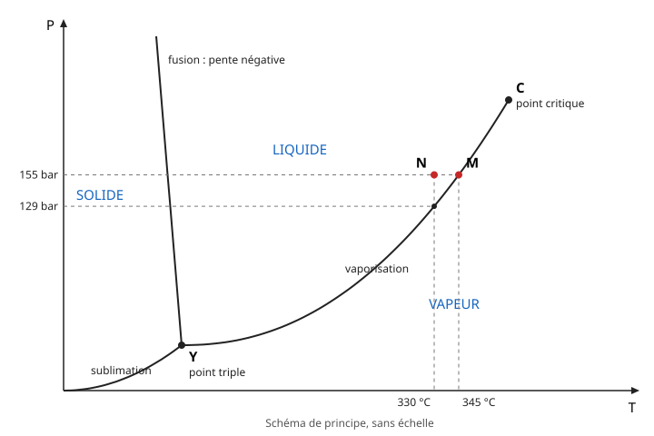
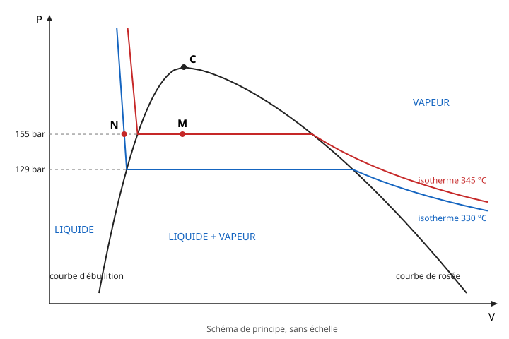
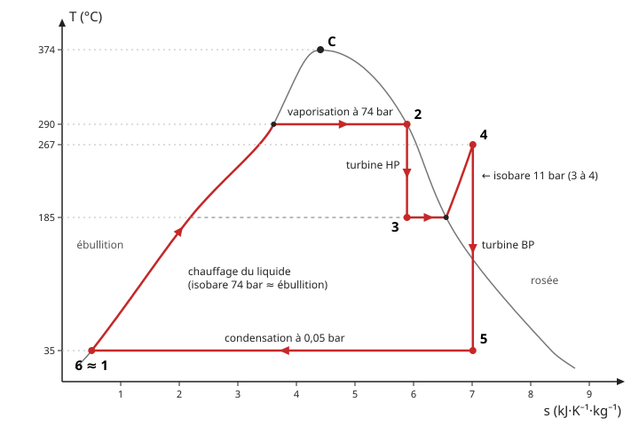

# Banque PT PT — Physique C - Thermodynamique 2009 · Corrigé brut

*Corrigé rédigé par IA, non officiel. Signalez toute erreur.*

**Rédaction** · modèle exact non renseigné (famille Claude) · effort non renseigné · vitesse non renseignée

**Révision (tour 2)** · modèle exact non renseigné (famille Claude) · effort non renseigné · vitesse non renseignée · 28 novembre 2026

Épreuve de 2 heures, calculatrice autorisée : étude simplifiée d'un réacteur à eau pressurisée, en 28 questions numérotées de 1 à 28 et réparties en quatre parties (rendement et dimensionnement du cœur, rôle du pressuriseur, générateur de vapeur, cycle de l'eau du circuit secondaire). Les 28 questions sont traitées. Le sujet ne comporte aucun diagramme gradué ; les seules valeurs à lire sont celles du tableau 1 (liquide saturant et vapeur saturante, trois lignes) et de la ligne du point 4 du tableau 2, reprises telles quelles avec tous leurs chiffres. Les valeurs que l'énoncé ne donne pas (point triple et point critique de l'eau, volume massique de l'eau liquide, nombre de générateurs de vapeur pris en exemple) sont signalées à leur place comme des valeurs de cours ou des choix du corrigé. Trois incohérences de l'énoncé sont signalées à leur place : données de la partie III incompatibles avec la puissance de la question 2 (question 19), entropie du liquide saturant à 74 bar dans le tableau 1 (question 21), puissances de la partie IV supérieures à celles de la partie I (question 28). Les figures 1 et 2 du corrigé sont des schémas de principe sans échelle ; la figure 3 est tracée à l'échelle avec les valeurs des tableaux.

[Sujet officiel (archive réunissant les deux parties de Physique C)](https://www.banquept.fr/documents/2009/phys_c_2009.zip) · [Rapport du jury](https://www.banquept.fr/documents/ecrit/rapport/2009/rapport_phys_c_ecrit_2009.pdf)

## Partie I — Rendement et dimensionnement du cœur

Conventions : $W$, $Q_c$, $Q_f$ sont les énergies **reçues algébriquement** par le fluide au cours d'un cycle. Températures absolues : $T_c = 290 + 273{,}15 = 563{,}15\ \mathrm{K}$ et $T_f = 35 + 273{,}15 = 308{,}15\ \mathrm{K}$.

### Question 1 — Rendement maximal d'un moteur ditherme

**Système.** Le fluide du moteur, qui décrit des cycles au contact d'une source chaude à $T_c$ et d'une source froide à $T_f < T_c$. Sur un cycle il reçoit le travail $W < 0$ et les transferts thermiques $Q_c > 0$ (source chaude) et $Q_f < 0$ (source froide).

**Premier principe sur un cycle** ($U$ est une fonction d'état) :

$$W + Q_c + Q_f = 0$$

**Second principe sur un cycle** ($S$ est une fonction d'état, l'entropie créée est positive ou nulle) :

$$\Delta S = \frac{Q_c}{T_c} + \frac{Q_f}{T_f} + S_{\text{créée}} = 0 \quad\Longrightarrow\quad \frac{Q_c}{T_c} + \frac{Q_f}{T_f} \leqslant 0$$

**Rendement.** La grandeur utile est le travail fourni $-W$, la grandeur coûteuse est $Q_c$ :

$$\eta = \frac{-W}{Q_c} = \frac{Q_c + Q_f}{Q_c} = 1 + \frac{Q_f}{Q_c}$$

L'inégalité de Clausius donne, après multiplication par $T_f / Q_c > 0$, $\dfrac{Q_f}{Q_c} \leqslant -\dfrac{T_f}{T_c}$. Donc

$$\eta \leqslant \eta_C \qquad\text{avec}\qquad \boxed{\eta_C = 1 - \frac{T_f}{T_c}}$$

L'égalité est atteinte pour un cycle réversible : c'est le cycle de Carnot, formé de deux isothermes réversibles (aux températures $T_c$ et $T_f$ des sources) et de deux adiabatiques réversibles (isentropiques). Ce rendement ne dépend pas du fluide.

**Application numérique.**

$$\eta_C = 1 - \frac{308{,}15}{563{,}15}$$

$$\boxed{\eta_C \approx 0{,}453 \quad\text{soit environ } 45\ \%}$$

### Question 2 — Puissance thermique à transférer

En régime permanent, le rendement réel est le rapport de la puissance mécanique fournie aux alternateurs, $P_m$, à la puissance thermique reçue du circuit primaire, $P_{th}$ :

$$\eta = \frac{P_m}{P_{th}} \quad\Longrightarrow\quad P_{th} = \frac{P_m}{\eta}$$

$$P_{th} = \frac{1450}{0{,}35}\ \mathrm{MW}$$

$$\boxed{P_{th} \approx 4{,}1 \times 10^{3}\ \mathrm{MW} = 4{,}1\ \mathrm{GW}}$$

(valeur non arrondie : $4143\ \mathrm{MW}$, conservée pour les calculs suivants). La différence, $P_{th} - P_m \approx 2{,}7\ \mathrm{GW}$, est cédée à la source froide. On vérifie que $\eta = 0{,}35 < \eta_C = 0{,}45$.

### Question 3 — Rayon d'un cœur sphérique

Toute la puissance thermique $P_{th}$ est produite dans le cœur, de puissance volumique $p_v = 120\ \mathrm{MW \cdot m^{-3}}$. Le volume du cœur est

$$V = \frac{P_{th}}{p_v} = \frac{4143}{120}\ \mathrm{m^3} \approx 34{,}5\ \mathrm{m^3}$$

Pour une boule, $V = \tfrac{4}{3}\pi R^3$, donc

$$R = \left(\frac{3\,P_{th}}{4\pi\,p_v}\right)^{1/3}$$

$$\boxed{R \approx 2{,}0\ \mathrm{m}}$$

(valeur calculée : $2{,}02\ \mathrm{m}$). Le cœur est donc très compact : quelques dizaines de mètres cubes pour plusieurs gigawatts.

## Partie II — Rôle du pressuriseur

Données de l'énoncé : pression du circuit primaire $155\ \mathrm{bar}$ ; équilibre liquide-vapeur à $345\ \mathrm{°C}$ dans le pressuriseur (point M) ; eau à $330\ \mathrm{°C}$ en sortie du cœur (point N), température à laquelle la pression de vapeur saturante vaut $P_S = 129\ \mathrm{bar}$. L'énoncé ne donne ni les coordonnées du point triple ni celles du point critique : les valeurs citées ci-dessous sont des valeurs de cours, rappelées à titre indicatif.

### Question 4 — Diagramme d'état (P, T) de l'eau

Le diagramme $(P, T)$ d'un corps pur comporte trois courbes d'équilibre diphasé qui se rejoignent au point triple Y :

- la courbe de **sublimation** (solide-vapeur), croissante, issue de l'origine ;
- la courbe de **vaporisation** (liquide-vapeur), croissante, qui s'arrête au **point critique** C ;
- la courbe de **fusion** (solide-liquide), quasi verticale et non limitée vers le haut.

**Particularité de l'eau : la courbe de fusion a une pente négative.** Pour la plupart des corps purs cette pente est positive. Cela traduit le fait que la glace est moins dense que l'eau liquide : une augmentation de pression à température fixée favorise la phase la plus dense, donc fait fondre la glace.

Valeurs de cours (non fournies par l'énoncé) : point triple à $0{,}01\ \mathrm{°C}$ et environ $6 \times 10^{2}\ \mathrm{Pa}$ ; point critique à environ $374\ \mathrm{°C}$ et $221\ \mathrm{bar}$. La figure est un schéma de principe : l'axe des pressions n'est pas à l'échelle (le point triple serait invisible à l'échelle du point critique).

### Question 5 — Domaines du solide, du liquide et de la vapeur

Sur la figure 1 :

- le **solide** occupe le domaine des basses températures, à gauche des courbes de sublimation et de fusion ;
- le **liquide** occupe le domaine compris entre la courbe de fusion et la courbe de vaporisation, aux pressions élevées ;
- la **vapeur** occupe le domaine situé sous les courbes de sublimation et de vaporisation, aux basses pressions et aux températures élevées.

Justification : à pression fixée, un chauffage (déplacement horizontal vers la droite) fait passer du solide au liquide puis à la vapeur ; à température fixée, une compression (déplacement vertical vers le haut) fait passer de la vapeur au liquide. Au-delà du point critique, on ne distingue plus liquide et vapeur : on parle de fluide supercritique.

### Question 6 — Points M et N dans le diagramme (P, T)

**Point M.** Dans le pressuriseur, liquide et vapeur coexistent à l'équilibre : M est **sur la courbe de vaporisation**, à l'abscisse $345\ \mathrm{°C}$ et à l'ordonnée $155\ \mathrm{bar}$. Autrement dit, $155\ \mathrm{bar}$ est la pression de vapeur saturante de l'eau à $345\ \mathrm{°C}$. M est sous le point critique ($345\ \mathrm{°C} < 374\ \mathrm{°C}$).

**Point N.** En sortie du cœur, la pression est la même ($155\ \mathrm{bar}$, pression du circuit primaire) et la température vaut $330\ \mathrm{°C}$ : N est **sur la même horizontale que M, à sa gauche**. À $330\ \mathrm{°C}$ la courbe de vaporisation passe à $P_S = 129\ \mathrm{bar}$, en dessous de N. Comme $155\ \mathrm{bar} > P_S(330\ \mathrm{°C})$, N est **dans le domaine du liquide** (voir la figure 1).

En N l'eau est donc liquide, dite sous-refroidie : il faudrait la chauffer de $15\ \mathrm{°C}$ à pression constante, ou la détendre de $26\ \mathrm{bar}$ à température constante, pour atteindre l'ébullition.

### Question 7 — Points M et N dans le diagramme (P, V)

Dans le diagramme de Clapeyron $(P, V)$, avec $V$ le volume massique, on trace la courbe de saturation (courbe d'ébullition à gauche, courbe de rosée à droite, réunies au point critique C) et les **deux isothermes d'Andrews** $345\ \mathrm{°C}$ et $330\ \mathrm{°C}$, qui sont les températures de M et de N. Chacune comporte :

- une branche presque verticale dans le domaine du liquide (liquide très peu compressible) ;
- un **palier horizontal** dans le domaine diphasé, à la pression de vapeur saturante : $155\ \mathrm{bar}$ pour l'isotherme $345\ \mathrm{°C}$, $129\ \mathrm{bar}$ pour l'isotherme $330\ \mathrm{°C}$ ;
- une branche décroissante dans le domaine de la vapeur.

L'isotherme $345\ \mathrm{°C}$ est au-dessus de l'isotherme $330\ \mathrm{°C}$, et son palier est plus court (on se rapproche du point critique).

**Point M.** État diphasé à $345\ \mathrm{°C}$ : M est **sur le palier de l'isotherme $345\ \mathrm{°C}$**, à $155\ \mathrm{bar}$. Sa position le long du palier dépend des proportions de liquide et de vapeur dans le pressuriseur, que l'énoncé ne donne pas ; la position choisie sur la figure est arbitraire.

**Point N.** Liquide à $330\ \mathrm{°C}$ sous $155\ \mathrm{bar}$ : N est à l'intersection de l'isotherme $330\ \mathrm{°C}$ et de l'horizontale $155\ \mathrm{bar}$, **sur la branche liquide de cette isotherme, à gauche de la courbe d'ébullition**, au-dessus du palier à $129\ \mathrm{bar}$.

### Question 8 — Conséquence d'une vaporisation dans le cœur

La vapeur est beaucoup moins dense que le liquide et **conduit beaucoup moins bien la chaleur** : sa conductivité thermique est nettement plus faible, et sa capacité thermique par unité de volume aussi. Si l'eau se vaporisait au contact des gaines du combustible, un film de vapeur isolant se formerait sur les parois : le transfert thermique entre le combustible et le fluide caloporteur chuterait brutalement.

Comme la puissance dégagée par les fissions ne diminue pas pour autant, la température des gaines et du combustible augmenterait fortement, avec un risque de détérioration, voire de fusion.

### Question 9 — Nécessité de la pression de 155 bar

Pour évacuer correctement la puissance du cœur, l'eau du circuit primaire doit **rester liquide partout**, y compris au point le plus chaud (sortie du cœur, $330\ \mathrm{°C}$). Il faut donc que la pression soit supérieure à la pression de vapeur saturante à cette température :

$$P > P_S(330\ \mathrm{°C}) = 129\ \mathrm{bar}$$

À la pression atmosphérique, l'eau bout à $100\ \mathrm{°C}$ : sans pressurisation, impossible de la porter à $330\ \mathrm{°C}$ à l'état liquide. Or on veut une température élevée pour avoir une source chaude à haute température, donc un bon rendement (question 1).

Avec $155\ \mathrm{bar}$, la température d'ébullition est $345\ \mathrm{°C}$ : on dispose d'une **marge de $15\ \mathrm{°C}$** (ou de $26\ \mathrm{bar}$) par rapport à l'ébullition en sortie du cœur. Le pressuriseur, seul endroit du circuit où coexistent liquide et vapeur, impose cette pression à tout le circuit : la pression y est fixée par la température de l'équilibre liquide-vapeur ($345\ \mathrm{°C}$).

## Partie III — Modélisation du générateur de vapeur

Notations : indice 1 pour le fluide primaire, indice 2 pour le fluide secondaire. Le fluide secondaire entre en $x = 0$ et circule vers les $x$ croissants ; le fluide primaire entre en $x = L$ et circule vers les $x$ décroissants. Ainsi $T_1(L) = T_{1E}$, $T_1(0) = T_{1S}$, $T_2(0) = T_{2E}$, $T_2(L) = T_{2S}$, et les pincements sont $\Delta T_0 = \Delta T(0)$ et $\Delta T_L = \Delta T(L)$.

### Question 10 — Premier principe pour un fluide en écoulement permanent

**Système.** La machine (ou la conduite) délimite un volume de contrôle $\Sigma_0$, système ouvert. On lui associe le **système fermé** $\Sigma^*$ suivant :

- à l'instant $t$ : le fluide contenu dans $\Sigma_0$, plus la masse $\mathrm{d}m_e$ qui va y entrer pendant $\mathrm{d}t$ ;
- à l'instant $t + \mathrm{d}t$ : le fluide contenu dans $\Sigma_0$, plus la masse $\mathrm{d}m_s$ qui en est sortie pendant $\mathrm{d}t$.

**Régime permanent.** La masse et l'énergie interne du fluide contenu dans $\Sigma_0$ ne dépendent pas du temps. La conservation de la masse de $\Sigma^*$ impose

$$\mathrm{d}m_e = \mathrm{d}m_s = \mathrm{d}m$$

**Variation d'énergie de $\Sigma^*$.** Les énergies cinétique et potentielle macroscopiques sont négligées. L'énergie interne du contenu de $\Sigma_0$ étant la même aux deux instants, il reste la différence entre la tranche sortie et la tranche entrée ($u$ : énergie interne massique) :

$$\mathrm{d}U^* = (u_s - u_e)\,\mathrm{d}m$$

**Énergies reçues par $\Sigma^*$ pendant $\mathrm{d}t$.**

- Travail des forces de pression en amont : le fluide amont pousse la tranche entrante, de volume $v_e\,\mathrm{d}m$, sous la pression $P_e$ : $+P_e v_e\,\mathrm{d}m$.
- Travail des forces de pression en aval : la tranche sortante, de volume $v_s\,\mathrm{d}m$, repousse le fluide aval sous la pression $P_s$ : $-P_s v_s\,\mathrm{d}m$.
- Travail indiqué, fourni par les parties mobiles de la machine : $w_i\,\mathrm{d}m$.
- Transfert thermique : $q\,\mathrm{d}m$.

**Premier principe appliqué à $\Sigma^*$.**

$$(u_s - u_e)\,\mathrm{d}m = \left(P_e v_e - P_s v_s\right)\mathrm{d}m + w_i\,\mathrm{d}m + q\,\mathrm{d}m$$

En regroupant, avec l'enthalpie massique $h = u + Pv$ :

$$(u_s + P_s v_s) - (u_e + P_e v_e) = w_i + q$$

$$\boxed{\Delta h = h_s - h_e = w_i + q}$$

### Question 11 — Application aux deux fluides du générateur de vapeur

Un échangeur ne comporte **aucune partie mobile** : $w_i = 0$ pour chaque fluide. La relation de la question 10 se réduit, pour chacun, à $\Delta h = q$.

Pour un liquide de capacité thermique massique $c$ constante, $\mathrm{d}h = c\,\mathrm{d}T$ (on néglige l'effet de la pression, et les pertes de charge). Entre l'entrée et la sortie du générateur de vapeur :

$$\boxed{\Delta h_1 = q_1 = c\,(T_{1S} - T_{1E})}$$

$$\boxed{\Delta h_2 = q_2 = c\,(T_{2S} - T_{2E})}$$

Le fluide primaire se refroidit ($T_{1S} < T_{1E}$, $\Delta h_1 < 0$ : il cède de la chaleur) ; le fluide secondaire se réchauffe ($\Delta h_2 > 0$).

### Question 12 — Puissances thermiques reçues par les deux fluides

Pendant $\mathrm{d}t$, une masse $D_1\,\mathrm{d}t$ de fluide primaire traverse le générateur de vapeur et reçoit le transfert thermique $q_1 D_1\,\mathrm{d}t$. La puissance thermique reçue est donc $\mathcal{P}_{th1} = D_1 q_1$, et de même pour le secondaire :

$$\boxed{\mathcal{P}_{th1} = D_1\,c\,(T_{1S} - T_{1E})}$$

$$\boxed{\mathcal{P}_{th2} = D_2\,c\,(T_{2S} - T_{2E})}$$

$\mathcal{P}_{th1} < 0$ (le primaire cède de l'énergie) et $\mathcal{P}_{th2} > 0$. Homogénéité : $\mathrm{kg \cdot s^{-1}} \times \mathrm{J \cdot kg^{-1} \cdot K^{-1}} \times \mathrm{K} = \mathrm{W}$.

### Question 13 — Relation entre les puissances

Le générateur de vapeur est **globalement** calorifugé et sans partie mobile : l'ensemble des deux fluides n'échange ni travail indiqué ni chaleur avec l'extérieur. En régime permanent, la puissance cédée par le primaire est intégralement reçue par le secondaire :

$$\boxed{\mathcal{P}_{th1} + \mathcal{P}_{th2} = 0}$$

On note dans la suite $P_{th} = \mathcal{P}_{th2} = -\mathcal{P}_{th1} > 0$ la puissance transférée du primaire au secondaire.

### Question 14 — Première relation entre débits et températures

En reportant les expressions de la question 12 dans $\mathcal{P}_{th1} + \mathcal{P}_{th2} = 0$ et en simplifiant par $c$ :

$$D_1\,(T_{1S} - T_{1E}) + D_2\,(T_{2S} - T_{2E}) = 0$$

$$\boxed{D_1\,(T_{1E} - T_{1S}) = D_2\,(T_{2S} - T_{2E})}$$

Le fluide de plus fort débit subit la plus faible variation de température : ici $D_1 > D_2$, donc le primaire se refroidit moins que le secondaire ne se réchauffe.

### Question 15 — Équations différentielles vérifiées par les deux températures

D'après la loi de Newton, la puissance thermique transférée du primaire vers le secondaire à travers l'élément de paroi $\mathrm{d}S = \ell\,\mathrm{d}x$ est

$$\frac{\delta Q}{\mathrm{d}t} = h\,\Delta T(x)\,\ell\,\mathrm{d}x \qquad\text{avec}\qquad \Delta T(x) = T_1(x) - T_2(x)$$

On applique le premier principe en écoulement permanent (question 10, sans travail indiqué) à chaque fluide, pour la tranche comprise entre $x$ et $x + \mathrm{d}x$. Il n'y a pas à écrire de loi de Fourier le long de $x$ : l'énergie est transportée par l'écoulement, et l'échange se fait transversalement à travers la paroi.

**Fluide secondaire** (circule vers les $x$ croissants : entrée en $x$, sortie en $x + \mathrm{d}x$ ; il reçoit la puissance) :

$$D_2\,c\,\left[T_2(x + \mathrm{d}x) - T_2(x)\right] = +h\,\Delta T(x)\,\ell\,\mathrm{d}x$$

$$\boxed{\frac{\mathrm{d}T_2}{\mathrm{d}x} = \frac{h\,\ell}{c\,D_2}\,\left[T_1(x) - T_2(x)\right]}$$

**Fluide primaire** (circule vers les $x$ décroissants : entrée en $x + \mathrm{d}x$, sortie en $x$ ; il cède la puissance) :

$$D_1\,c\,\left[T_1(x) - T_1(x + \mathrm{d}x)\right] = -h\,\Delta T(x)\,\ell\,\mathrm{d}x$$

$$\boxed{\frac{\mathrm{d}T_1}{\mathrm{d}x} = \frac{h\,\ell}{c\,D_1}\,\left[T_1(x) - T_2(x)\right]}$$

Vérification des signes : $\Delta T > 0$, donc $T_1$ et $T_2$ croissent toutes deux avec $x$. C'est cohérent : le secondaire se réchauffe en avançant vers $x = L$, et le primaire, qui avance vers $x = 0$, se refroidit dans son sens de parcours.

### Question 16 — Équation différentielle vérifiée par l'écart de température

En soustrayant les deux équations de la question 15 :

$$\frac{\mathrm{d}\,\Delta T}{\mathrm{d}x} = \frac{\mathrm{d}T_1}{\mathrm{d}x} - \frac{\mathrm{d}T_2}{\mathrm{d}x} = \frac{h\,\ell}{c}\left(\frac{1}{D_1} - \frac{1}{D_2}\right)\Delta T$$

Avec $D$ défini par $\dfrac{1}{D} = \dfrac{1}{D_1} - \dfrac{1}{D_2}$ :

$$\boxed{\frac{\mathrm{d}\,\Delta T}{\mathrm{d}x} = \frac{h\,\ell}{c\,D}\,\Delta T}$$

C'est une équation différentielle linéaire du premier ordre à coefficients constants. Remarque : $D = \dfrac{D_1 D_2}{D_2 - D_1}$ est **négatif** ici puisque $D_1 > D_2$ ; l'écart $\Delta T$ décroît donc quand $x$ augmente, ce qui est cohérent avec $\Delta T_0 = 60\ \mathrm{K} > \Delta T_L = 40\ \mathrm{K}$.

### Question 17 — Intégration

La solution de l'équation de la question 16 qui vaut $\Delta T_0$ en $x = 0$ est

$$\Delta T(x) = \Delta T_0\,\exp\!\left(\frac{h\,\ell\,x}{c\,D}\right)$$

En $x = L$, avec $S = L\,\ell$ :

$$\ln\!\left(\frac{\Delta T_L}{\Delta T_0}\right) = \frac{h\,S}{c\,D} = \frac{h\,S}{c}\left(\frac{1}{D_1} - \frac{1}{D_2}\right) = \frac{h\,S\,(D_2 - D_1)}{c\,D_1 D_2}$$

En changeant de signe les deux membres :

$$\boxed{\frac{h\,S\,(D_1 - D_2)}{c\,D_1 D_2} = \ln\!\left(\frac{\Delta T_0}{\Delta T_L}\right)}$$

Homogénéité : $h$ est en $\mathrm{W \cdot m^{-2} \cdot K^{-1}}$, donc $hS$ est en $\mathrm{W \cdot K^{-1}}$, comme $cD$ ; le premier membre est sans dimension.

### Question 18 — Puissance transférée et écart moyen logarithmique

La puissance reçue par le secondaire est $P_{th} = D_2\,c\,(T_{2S} - T_{2E})$, et aussi $P_{th} = D_1\,c\,(T_{1E} - T_{1S})$ (questions 12 à 14). Donc

$$T_{2S} - T_{2E} = \frac{P_{th}}{c\,D_2} \qquad\text{et}\qquad T_{1E} - T_{1S} = \frac{P_{th}}{c\,D_1}$$

Or

$$\Delta T_0 - \Delta T_L = (T_{1S} - T_{2E}) - (T_{1E} - T_{2S}) = (T_{2S} - T_{2E}) - (T_{1E} - T_{1S})$$

d'où

$$\Delta T_0 - \Delta T_L = \frac{P_{th}}{c}\left(\frac{1}{D_2} - \frac{1}{D_1}\right) = P_{th}\,\frac{D_1 - D_2}{c\,D_1 D_2}$$

La question 17 donne $\dfrac{D_1 - D_2}{c\,D_1 D_2} = \dfrac{1}{h\,S}\,\ln\!\left(\dfrac{\Delta T_0}{\Delta T_L}\right)$. En reportant :

$$\Delta T_0 - \Delta T_L = \frac{P_{th}}{h\,S}\,\ln\!\left(\frac{\Delta T_0}{\Delta T_L}\right)$$

$$\boxed{P_{th} = h\,S\,\Delta T_{ml} \qquad\text{avec}\qquad \Delta T_{ml} = \frac{\Delta T_0 - \Delta T_L}{\ln\left(\Delta T_0 / \Delta T_L\right)}}$$

$\Delta T_{ml}$ est l'écart moyen logarithmique : tout se passe comme si la paroi de surface $S$ séparait deux fluides dont l'écart de température est uniforme et égal à $\Delta T_{ml}$, valeur comprise entre $\Delta T_L$ et $\Delta T_0$.

### Question 19 — Surface d'échange nécessaire

**Écart moyen logarithmique.**

$$\Delta T_{ml} = \frac{60 - 40}{\ln(60/40)} = \frac{20}{\ln 1{,}5}\ \mathrm{K} \approx 49{,}3\ \mathrm{K}$$

**Surface.** Le coefficient $h$ s'exprime en $\mathrm{W \cdot m^{-2} \cdot K^{-1}}$ (unité SI) : $h = 3000\ \mathrm{W \cdot m^{-2} \cdot K^{-1}}$. La puissance à transférer du primaire au secondaire est celle de la question 2, $P_{th} = 4143\ \mathrm{MW}$. La relation de la question 18 donne

$$S = \frac{P_{th}}{h\,\Delta T_{ml}} = \frac{4{,}143 \times 10^{9}}{3000 \times 49{,}3}\ \mathrm{m^2}$$

$$\boxed{S \approx 2{,}8 \times 10^{4}\ \mathrm{m^2}}$$

soit près de trois hectares. C'est un ordre de grandeur, comme le demande l'énoncé.

**Incohérence des données de l'énoncé.** Les débits, la capacité $c$ et les deux pincements fixent à eux seuls la puissance échangée : les questions 14 et 18 donnent $P_{th} = c\,D_1 D_2\,(\Delta T_0 - \Delta T_L)/(D_1 - D_2)$, soit

$$P_{th} = \frac{5{,}0 \times 10^{3} \times 15\,000 \times 1720 \times 20}{15\,000 - 1720}\ \mathrm{W} \approx 1{,}9 \times 10^{2}\ \mathrm{MW}$$

(le secondaire ne s'échaufferait que de $22{,}6\ \mathrm{K}$ et le primaire ne se refroidirait que de $2{,}6\ \mathrm{K}$). C'est environ vingt fois moins que les $4143\ \mathrm{MW}$ de la question 2. L'écart vient de l'hypothèse simplificatrice de la partie III : en ignorant la vaporisation, on prive le fluide secondaire de l'essentiel de l'énergie qu'il absorbe (chaleur latente). Appliquée telle quelle avec ces données, la formule de la question 17 donnerait $S = \dfrac{c\,D_1 D_2}{h\,(D_1 - D_2)}\ln\!\left(\dfrac{\Delta T_0}{\Delta T_L}\right) \approx 1{,}3 \times 10^{3}\ \mathrm{m^2}$, surface d'un échangeur qui ne transmettrait que $1{,}9 \times 10^{2}\ \mathrm{MW}$. Le corrigé retient la première valeur, la seule compatible avec la puissance à transférer ; c'est un choix du corrigé, que l'énoncé ne tranche pas explicitement. Avec la seconde, un appareil ne transmettrait que $1{,}9 \times 10^{2}\ \mathrm{MW}$ et il en faudrait une vingtaine : la conclusion de la question 20 (plusieurs générateurs en parallèle) est la même dans les deux lectures.

### Question 20 — Plusieurs générateurs de vapeur en parallèle

Une surface d'échange de l'ordre de $3 \times 10^{4}\ \mathrm{m^2}$ ne peut pas raisonnablement être logée dans un seul appareil : les tubes, qui doivent en outre résister à une différence de pression de plusieurs dizaines de bars entre primaire et secondaire, formeraient un faisceau de taille démesurée, impossible à fabriquer, à transporter et à contrôler.

On répartit donc le débit primaire entre **plusieurs générateurs de vapeur montés en parallèle**. Chacun reçoit de l'eau primaire à la même température $T_{1E}$ et fonctionne avec les mêmes pincements, donc le même $\Delta T_{ml}$ : comme $P_{th} = h\,S\,\Delta T_{ml}$, **les puissances et les surfaces s'additionnent**. Avec $n$ appareils, chacun ne transfère que $P_{th}/n$ et n'a besoin que de la surface $S/n$ (par exemple environ $7 \times 10^{3}\ \mathrm{m^2}$ pour $n = 4$, valeur de $n$ choisie par le corrigé à titre d'illustration).

Le montage en parallèle apporte aussi une redondance utile à la sûreté : l'évacuation de la puissance du cœur ne repose pas sur un seul appareil.

## Partie IV — Cycle thermodynamique de l'eau du circuit secondaire

Notations du tableau 1 du sujet : $s'$, $h'$ pour le liquide saturant ; $s''$, $h''$ pour la vapeur saturante. Les entropies massiques sont en $\mathrm{kJ \cdot K^{-1} \cdot kg^{-1}}$ et les enthalpies massiques en $\mathrm{kJ \cdot kg^{-1}}$. Toutes les valeurs numériques utilisées dans cette partie sont lues dans le tableau 1 (trois lignes : $74\ \mathrm{bar}$ et $290\ \mathrm{°C}$, $11\ \mathrm{bar}$ et $185\ \mathrm{°C}$, $0{,}05\ \mathrm{bar}$ et $35\ \mathrm{°C}$) et dans la ligne du point 4 du tableau 2 ; elles sont reprises avec tous les chiffres donnés par le sujet (quatre ou cinq chiffres significatifs).

### Question 21 — Cycle dans le diagramme T-s

**Allure des isobares.**

*Liquide.* Pour une phase condensée incompressible de capacité thermique massique $c$ constante, l'identité thermodynamique $\mathrm{d}h = T\,\mathrm{d}s + v\,\mathrm{d}P$ et $\mathrm{d}h = c\,\mathrm{d}T + v\,\mathrm{d}P$ donnent

$$\mathrm{d}s = c\,\frac{\mathrm{d}T}{T} \quad\Longrightarrow\quad s - s_0 = c\,\ln\frac{T}{T_0} \quad\Longrightarrow\quad T = T_0\,\exp\!\left(\frac{s - s_0}{c}\right)$$

L'entropie du liquide ne dépend pas de la pression : dans le diagramme $(T, s)$, **toutes les isobares du liquide sont confondues en une seule courbe, une exponentielle croissante de pente $T/c$**. Cette courbe contient les états de liquide saturant : elle se confond donc avec la courbe d'ébullition.

*Domaine diphasé.* À pression fixée, la température d'équilibre est fixée : l'isobare est un **palier horizontal** (isobare et isotherme à la fois), de la courbe d'ébullition à la courbe de rosée.

*Vapeur sèche.* Pour un gaz parfait, $\mathrm{d}h = c_P\,\mathrm{d}T$, donc $\mathrm{d}s = c_P\,\dfrac{\mathrm{d}T}{T} - \dfrac{v}{T}\,\mathrm{d}P$. À pression constante :

$$\mathrm{d}s = c_P\,\frac{\mathrm{d}T}{T} \quad\Longrightarrow\quad T = T_0\,\exp\!\left(\frac{s - s_0}{c_P}\right)$$

L'isobare est encore une **exponentielle croissante, de pente $T/c_P$**, qui prolonge le palier au-delà de la courbe de rosée. Cette fois elle dépend de la pression : à température fixée, l'entropie diminue quand la pression augmente, donc les isobares de pression plus élevée sont décalées vers la gauche.

**Tracé du cycle.**

- **6** : liquide saturant à $35\ \mathrm{°C}$ ($0{,}05\ \mathrm{bar}$), sur la courbe d'ébullition.
- **6 → 1** (pompe) : compression isentropique du liquide. Les isobares du liquide étant confondues, **1 est pratiquement confondu avec 6** (même entropie, température quasi inchangée).
- **1 → 2** (générateur de vapeur, isobare $74\ \mathrm{bar}$) : échauffement du liquide le long de la courbe d'ébullition jusqu'à $290\ \mathrm{°C}$, puis palier de vaporisation jusqu'à la courbe de rosée. **2** : vapeur saturante sèche à $290\ \mathrm{°C}$.
- **2 → 3** (turbine haute pression) : détente adiabatique réversible, donc isentropique : **segment vertical** descendant jusqu'au palier $185\ \mathrm{°C}$ ($11\ \mathrm{bar}$). **3** est dans le domaine diphasé.
- **3 → 4** (sécheur-surchauffeur, isobare $11\ \mathrm{bar}$) : fin de vaporisation sur le palier $185\ \mathrm{°C}$ jusqu'à la courbe de rosée, puis surchauffe le long de l'isobare $11\ \mathrm{bar}$ de la vapeur sèche (arc d'exponentielle) jusqu'à $267\ \mathrm{°C}$.
- **4 → 5** (turbine basse pression) : détente isentropique, segment vertical jusqu'au palier $35\ \mathrm{°C}$. **5** est dans le domaine diphasé.
- **5 → 6** (condenseur) : palier horizontal à $35\ \mathrm{°C}$, parcouru vers la gauche jusqu'à la courbe d'ébullition.

Le cycle est parcouru dans le sens horaire : c'est un cycle moteur.

**Précision sur la figure.** Les points 2 à 6 et les extrémités des paliers sont placés à l'échelle avec les valeurs des tableaux 1 et 2 du sujet. La courbe de saturation n'est connue que par les trois lignes du tableau 1 : entre ces points, et jusqu'au point critique (placé à $374\ \mathrm{°C}$ et $4{,}4\ \mathrm{kJ \cdot K^{-1} \cdot kg^{-1}}$, valeurs de cours que l'énoncé ne donne pas), le tracé est une interpolation qui n'a qu'une valeur d'allure.

**Incohérence dans le tableau 1.** Sur un palier de changement d'état, $h'' - h' = T\,(s'' - s')$. Les lignes $11\ \mathrm{bar}$ et $0{,}05\ \mathrm{bar}$ vérifient cette relation à mieux que $0{,}3\ \%$. La ligne $74\ \mathrm{bar}$ ne la vérifie pas : $(h'' - h')/T = (2786 - 1290)/563{,}15 \approx 2{,}66\ \mathrm{kJ \cdot K^{-1} \cdot kg^{-1}}$, alors que $s'' - s' = 5{,}8877 - 3{,}611 \approx 2{,}28\ \mathrm{kJ \cdot K^{-1} \cdot kg^{-1}}$. Si les trois autres valeurs sont exactes, $s'$ à $74\ \mathrm{bar}$ devrait valoir environ $3{,}23$ au lieu de $3{,}611$. (Les tables de l'eau donnent environ $3{,}16$ à $290\ \mathrm{°C}$, valeur extérieure à l'énoncé : une inversion de chiffres, $3{,}161$ devenu $3{,}611$, est plausible.) Cette valeur de $s'$ n'intervient dans aucun calcul demandé (seule $s''$ à $74\ \mathrm{bar}$ sert) : les résultats des questions 23 à 28 n'en dépendent pas. Elle n'affecte que la position, sur la figure 3, de l'extrémité gauche du palier $290\ \mathrm{°C}$, tracée avec la valeur du sujet.

**Limite du modèle de gaz parfait.** Entre la vapeur saturante à $11\ \mathrm{bar}$ et le point 4, les tableaux donnent $\Delta s / \ln(T_4/T_3) \approx 2{,}8\ \mathrm{kJ \cdot K^{-1} \cdot kg^{-1}}$ mais $\Delta h / \Delta T \approx 0{,}94\ \mathrm{kJ \cdot K^{-1} \cdot kg^{-1}}$ : ces deux estimations de $c_P$ ne s'accordent pas. Le modèle du gaz parfait à $c_P$ constant ne sert donc qu'à justifier l'allure de l'isobare, pas à calculer.

### Question 22 — Transformation isenthalpique dans la pompe

On applique le premier principe en écoulement permanent (question 10) à l'eau qui traverse la pompe, entre 6 et 1 :

$$h_1 - h_6 = w_{i,\text{pompe}} + q_{\text{pompe}}$$

- La compression est isentropique, c'est-à-dire adiabatique et réversible : $q_{\text{pompe}} = 0$.
- L'énoncé indique que le travail apporté par la pompe à l'eau, qui reste liquide, est négligeable : $w_{i,\text{pompe}} \approx 0$.

Donc

$$\boxed{h_1 \approx h_6 = h'(0{,}05\ \mathrm{bar}) = 146{,}6\ \mathrm{kJ \cdot kg^{-1}}}$$

**Ordre de grandeur du terme négligé.** Pour une évolution isentropique, $\mathrm{d}h = T\,\mathrm{d}s + v\,\mathrm{d}P = v\,\mathrm{d}P$. Le liquide étant quasi incompressible, $w_{i,\text{pompe}} = h_1 - h_6 \approx v\,(P_1 - P_6)$. Avec $v \approx 1{,}0 \times 10^{-3}\ \mathrm{m^3 \cdot kg^{-1}}$ (volume massique de l'eau liquide, valeur de cours que l'énoncé ne donne pas) :

$$w_{i,\text{pompe}} \approx 1{,}0 \times 10^{-3} \times (74 - 0{,}05) \times 10^{5}\ \mathrm{J \cdot kg^{-1}} \approx 7\ \mathrm{kJ \cdot kg^{-1}}$$

C'est moins de $1\ \%$ du travail fourni par les turbines (environ $10^{3}\ \mathrm{kJ \cdot kg^{-1}}$, question 26) : l'approximation est justifiée, grâce au très faible volume massique du liquide.

### Question 23 — Tableau des états 2 à 6

**Point 2.** Vapeur saturante sèche à $290\ \mathrm{°C}$, $74\ \mathrm{bar}$ : $x_2 = 1$, $s_2 = s''(74\ \mathrm{bar}) = 5{,}8877$, $h_2 = h''(74\ \mathrm{bar}) = 2786$ (ligne 1 du tableau 1).

**Point 6.** Liquide saturant à $35\ \mathrm{°C}$, $0{,}05\ \mathrm{bar}$ : $x_6 = 0$, $s_6 = s'(0{,}05\ \mathrm{bar}) = 0{,}5049$, $h_6 = h'(0{,}05\ \mathrm{bar}) = 146{,}6$ (ligne 3 du tableau 1).

**Point 3.** Mélange liquide-vapeur à $11\ \mathrm{bar}$, donc à $185\ \mathrm{°C}$. La détente 2 → 3 est adiabatique réversible, donc isentropique : $s_3 = s_2 = 5{,}8877$. L'entropie massique du mélange s'écrit $s_3 = x_3\,s'' + (1 - x_3)\,s'$ (valeurs de la ligne $11\ \mathrm{bar}$), d'où

$$x_3 = \frac{s_3 - s'}{s'' - s'} = \frac{5{,}8877 - 2{,}1876}{6{,}5565 - 2{,}1876} = \frac{3{,}7001}{4{,}3689}$$

$$\boxed{x_3 \approx 0{,}847}$$

De même pour l'enthalpie massique :

$$h_3 = h' + x_3\,(h'' - h') = 785{,}2 + 0{,}8469 \times (2782 - 785{,}2)$$

$$\boxed{h_3 \approx 2476\ \mathrm{kJ \cdot kg^{-1}}}$$

**Point 5.** Mélange liquide-vapeur à $0{,}05\ \mathrm{bar}$, donc à $35\ \mathrm{°C}$. La détente 4 → 5 est isentropique : $s_5 = s_4 = 7{,}0123$ (tableau 2). Avec la ligne $0{,}05\ \mathrm{bar}$ du tableau 1 :

$$x_5 = \frac{s_5 - s'}{s'' - s'} = \frac{7{,}0123 - 0{,}5049}{8{,}3519 - 0{,}5049} = \frac{6{,}5074}{7{,}8470}$$

$$\boxed{x_5 \approx 0{,}829}$$

$$h_5 = h' + x_5\,(h'' - h') = 146{,}6 + 0{,}8293 \times (2565 - 146{,}6)$$

$$\boxed{h_5 \approx 2152\ \mathrm{kJ \cdot kg^{-1}}}$$

**Tableau 2 complété** ($s$ en $\mathrm{kJ \cdot K^{-1} \cdot kg^{-1}}$, $h$ en $\mathrm{kJ \cdot kg^{-1}}$) :

| point | $P$ (bar) | $T$ (°C) | $s$ | $h$ | $x$ |
|---|---|---|---|---|---|
| 2 | 74 | 290 | 5,8877 | 2786 | 1 |
| 3 | 11 | 185 | 5,8877 | 2476 | 0,847 |
| 4 | 11 | 267 | 7,0123 | 2859 | (vapeur sèche) |
| 5 | 0,05 | 35 | 7,0123 | 2152 | 0,829 |
| 6 | 0,05 | 35 | 0,5049 | 146,6 | 0 |

La ligne du point 4 est celle que donne le sujet. Les titres sont donnés avec trois chiffres significatifs ; les calculs suivants utilisent les valeurs non arrondies ($h_3 = 2476{,}3$ et $h_5 = 2152{,}1$).

### Question 24 — Taux d'humidité en sortie des turbines

Le taux d'humidité est le titre massique en liquide, $y = 1 - x$.

- Sortie de la turbine haute pression (point 3) : $y_3 = 1 - 0{,}847$, soit $\boxed{y_3 \approx 15{,}3\ \%}$.
- Sortie de la turbine basse pression (point 5) : $y_5 = 1 - 0{,}829$, soit $\boxed{y_5 \approx 17{,}1\ \%}$.

**La limite de $15\ \%$ n'est strictement respectée en sortie d'aucun des deux corps** : elle est tout juste atteinte, et très légèrement dépassée, en sortie du corps haute pression ($15{,}3\ \%$), et dépassée de deux points en sortie du corps basse pression ($17{,}1\ \%$). Dans ce modèle idéal, le cycle fonctionne donc à la limite de ce qui est toléré. À la précision de la limite donnée (deux chiffres), on peut aussi dire qu'elle est respectée en sortie du corps haute pression ($15\ \%$) et dépassée en sortie du corps basse pression ($17\ \%$) : c'est probablement la réponse attendue.

Remarque : dans une turbine réelle, la détente n'est pas réversible ; l'entropie massique augmente, le point de sortie se déplace vers la droite sur le palier et le taux d'humidité réel est un peu plus faible que celui du modèle.

### Question 25 — Intérêt de la surchauffe

Sans sécheur-surchauffeur, la détente isentropique se poursuivrait depuis le point 2 jusqu'à $0{,}05\ \mathrm{bar}$, en un point noté 5' par le corrigé, d'entropie $s_{5'} = s_2 = 5{,}8877$. Avec la ligne $0{,}05\ \mathrm{bar}$ du tableau 1 :

$$x_{5'} = \frac{s_2 - s'}{s'' - s'} = \frac{5{,}8877 - 0{,}5049}{8{,}3519 - 0{,}5049} = \frac{5{,}3828}{7{,}8470} \approx 0{,}686$$

$$\boxed{y_{5'} = 1 - x_{5'} \approx 31\ \%}$$

Le taux d'humidité serait le double de la limite admise : les gouttelettes d'eau, projetées à grande vitesse sur les aubages, endommageraient la turbine (érosion, corrosion). **Le séchage et la surchauffe à $11\ \mathrm{bar}$ déplacent la seconde détente vers les entropies plus élevées** (sur la figure 3, la verticale 4 → 5 est à droite de la verticale 2 → 3), ce qui ramène le taux d'humidité final de $31\ \%$ à $17\ \%$.

### Question 26 — Travaux indiqués et transferts thermiques massiques

On applique $\Delta h = w_i + q$ (question 10) à chaque organe, avec $h_1 = h_6 = 146{,}6$ (question 22), $h_2 = 2786$, $h_3 = 2476{,}3$, $h_4 = 2859$, $h_5 = 2152{,}1$ (en $\mathrm{kJ \cdot kg^{-1}}$). Toutes les grandeurs sont reçues algébriquement par l'eau.

**Travaux indiqués** (turbines adiabatiques, $q = 0$) :

$$w_{HP} = h_3 - h_2 = 2476{,}3 - 2786 \qquad\Longrightarrow\qquad \boxed{w_{HP} \approx -310\ \mathrm{kJ \cdot kg^{-1}}}$$

$$w_{BP} = h_5 - h_4 = 2152{,}1 - 2859 \qquad\Longrightarrow\qquad \boxed{w_{BP} \approx -707\ \mathrm{kJ \cdot kg^{-1}}}$$

Le travail de la pompe est négligé ($w_{i,\text{pompe}} \approx 0$). Les turbines fournissent donc à l'arbre $-(w_{HP} + w_{BP}) \approx 1017\ \mathrm{kJ \cdot kg^{-1}}$.

**Transferts thermiques fournis par la source chaude** (eau du circuit primaire ; pas de partie mobile, $w_i = 0$) :

$$q_{GV} = h_2 - h_1 = 2786 - 146{,}6 \qquad\Longrightarrow\qquad \boxed{q_{GV} \approx 2639\ \mathrm{kJ \cdot kg^{-1}}}$$

$$q_{SC} = h_4 - h_3 = 2859 - 2476{,}3 \qquad\Longrightarrow\qquad \boxed{q_{SC} \approx 383\ \mathrm{kJ \cdot kg^{-1}}}$$

$$\boxed{q_c = q_{GV} + q_{SC} \approx 3022\ \mathrm{kJ \cdot kg^{-1}}}$$

**Transfert thermique dans le condenseur** :

$$q_{CD} = h_6 - h_5 = 146{,}6 - 2152{,}1 \approx -2006\ \mathrm{kJ \cdot kg^{-1}}$$

L'eau cède cette énergie : **la source froide reçoit** $\boxed{-q_{CD} \approx 2006\ \mathrm{kJ \cdot kg^{-1}}}$.

**Vérification (premier principe sur le cycle).** $w_{HP} + w_{BP} + q_{GV} + q_{SC} + q_{CD} = -309{,}7 - 706{,}9 + 2639{,}4 + 382{,}7 - 2005{,}5 = 0$ : le bilan est bien nul.

### Question 27 — Rendement du cycle

Le rendement est le rapport du travail fourni à l'arbre à la chaleur reçue de la source chaude :

$$\eta = \frac{-(w_{HP} + w_{BP})}{q_{GV} + q_{SC}} = \frac{1016{,}5}{3022{,}1}$$

$$\boxed{\eta \approx 0{,}336 \quad\text{soit environ } 34\ \%}$$

On retrouve la même valeur par $\eta = 1 + q_{CD}/q_c = 1 - 2005{,}5/3022{,}1$.

Ce rendement est inférieur au rendement de Carnot entre $290\ \mathrm{°C}$ et $35\ \mathrm{°C}$ ($0{,}453$, question 1), comme il se doit. Bien que toutes les transformations du fluide soient réversibles dans ce modèle, une grande partie de la chaleur est reçue à une température inférieure à $290\ \mathrm{°C}$ (échauffement du liquide de $35\ \mathrm{°C}$ à $290\ \mathrm{°C}$, séchage à $185\ \mathrm{°C}$) : l'échange avec une source chaude à $290\ \mathrm{°C}$ est alors irréversible. Il est proche du rendement réel annoncé à la question 2 ($0{,}35$).

### Question 28 — Puissance utile disponible sur l'arbre

Avec le débit massique $D_2 = 1720\ \mathrm{kg \cdot s^{-1}}$ :

$$P_u = D_2 \times \left[-(w_{HP} + w_{BP})\right] = 1720 \times 1016{,}5\ \mathrm{kW}$$

$$\boxed{P_u \approx 1{,}75 \times 10^{3}\ \mathrm{MW} = 1{,}75\ \mathrm{GW}}$$

**Commentaires.**

- L'ordre de grandeur est le bon : on retrouve une puissance de l'ordre du gigawatt, comparable aux $1450\ \mathrm{MW}$ de la question 2, mais supérieure d'environ $20\ \%$.
- La puissance thermique correspondante, $D_2\,q_c = 1720 \times 3022{,}1\ \mathrm{kW} \approx 5{,}2 \times 10^{3}\ \mathrm{MW}$, est elle aussi supérieure aux $4{,}1 \times 10^{3}\ \mathrm{MW}$ de la question 2. Les données des différentes parties ne sont donc pas exactement cohérentes entre elles : le débit $D_2$ et le modèle simplifié du cycle conduisent à surestimer les puissances.
- Le modèle est idéalisé : détentes réversibles dans les turbines, travail de la pompe négligé, pas de pertes de charge ni de pertes mécaniques, et surtout pas de soutirages. Dans l'installation réelle, une partie de la vapeur est prélevée dans les turbines pour réchauffer l'eau avant son retour au générateur de vapeur : le débit qui traverse entièrement les turbines est plus faible, la puissance sur l'arbre aussi, tandis que la chaleur à fournir diminue.
- L'essentiel de l'énergie reçue par l'eau est la chaleur latente de vaporisation ($h'' - h' \approx 1500\ \mathrm{kJ \cdot kg^{-1}}$ à $74\ \mathrm{bar}$) : c'est elle que la partie III ignorait, d'où l'incohérence relevée à la question 19.
- Environ les deux tiers de la puissance thermique, $D_2 \times 2005{,}5\ \mathrm{kW} \approx 3{,}4 \times 10^{3}\ \mathrm{MW}$, sont rejetés à la source froide : d'où la nécessité d'un circuit de refroidissement de grande capacité (fleuve, mer ou tours aéroréfrigérantes).
