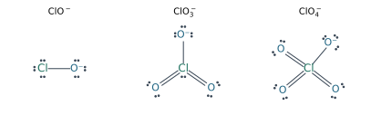
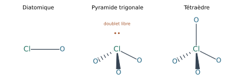
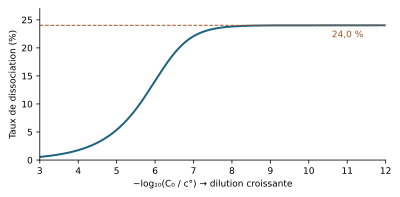
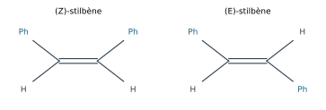

# ENS de Lyon — Second concours, Chimie 2009 · Corrigé guidé

*Corrigé rédigé par IA, non officiel.*

**Rédaction (tour 1)** · GPT-6.2 Astra Ultra · vitesse non renseignée

Les deux éditions traitent 14 des 23 questions ou sous-questions terminales. Elles couvrent les formules de Lewis, les géométries, la mésomérie, les équilibres d’un monoacide avec autoprotolyse de l’eau, les nombres d’oxydation et les deux configurations du stilbène. Les rubriques I.2, II.1 à II.4, II.5.2, III.1, III.2.2 et III.2.3 sont hors couverture. Le sujet original de quatre pages et le passage du rapport de jury consacré à l’écrit ont été consultés.

## I.1. Décrire les oxyanions

### Question I.1.1 — Structures de Lewis des oxyanions

> [!INDICATION]
> Compter d’abord $7+6n+1$ électrons de valence pour l’ion à $n$ oxygènes.

#### Solution

$\mathrm{ClO^-}$ possède 14 électrons de valence. Dans la forme **Cl–O⁻**, chaque atome porte trois doublets non liants. Pour $\mathrm{ClO_3^-}$, les 26 électrons donnent une forme à deux liaisons Cl=O, une liaison Cl–O⁻ et un doublet libre sur Cl. Chaque O en double liaison a deux doublets libres et O⁻ en porte trois. Pour $\mathrm{ClO_4^-}$, les 32 électrons donnent trois Cl=O et une Cl–O⁻, sans doublet libre sur Cl. On attribue deux doublets à chaque O doublement lié et trois à O⁻. Ces écritures à octet étendu pour Cl minimisent les charges formelles. Les doubles liaisons du dessin sont une représentation de Lewis.

### Question I.1.2 — Géométrie VSEPR

> [!INDICATION]
> Dans le décompte autour de Cl, une double liaison occupe-t-elle une ou deux directions ?

#### Solution

L’ion diatomique $\mathrm{ClO^-}$ est **linéaire**. Autour de Cl on compte une direction de liaison et trois doublets libres. Pour $\mathrm{ClO_3^-}$, Cl est de type **AX₃E**, d’où un arrangement électronique tétraédrique et une forme moléculaire **pyramidale trigonale**. Pour $\mathrm{ClO_4^-}$, Cl est **AX₄** et l’ion est **tétraédrique**, avec des angles proches de $109{,}5^\circ$.

### Question I.1.3 — Formes mésomères

> [!INDICATION]
> Peut-on permuter les oxygènes d’un ion sans déplacer aucun noyau ?

#### Solution

Dans l’écriture à charges formelles minimales, l’oxygène portant la liaison simple et la charge négative peut être choisi de **trois** façons dans $\mathrm{ClO_3^-}$ et de **quatre** façons dans $\mathrm{ClO_4^-}$. Les formes équivalentes contribuent à une délocalisation et les liaisons Cl–O d’un même ion deviennent équivalentes en l’absence de perturbation extérieure. Pour l’ion diatomique, il n’existe aucun autre oxygène sur lequel permuter la charge. Cl–O⁻ est sa forme usuelle respectant les deux octets.

## I.2. Unités

*Question I.2 hors couverture.*

## I.3. Équilibre acido-basique et autoprotolyse

### Question I.3.1 — Acide de Brønsted

> [!INDICATION]
> Quel transfert définit un couple acide–base conjugué ?

#### Solution

Un **acide de Brønsted** est une espèce susceptible de céder un proton à une base. L’acide et la base conjuguée diffèrent d’un proton. Dans l’eau, le transfert peut se faire vers une molécule $\mathrm{H_2O}$.

### Question I.3.2 — Force d’un acide dans l’eau

> [!INDICATION]
> Quel équilibre détermine la force de l’acide pour un solvant donné ?

#### Solution

Un acide fort dans l’eau cède son proton à l’eau de manière pratiquement quantitative dans les conditions ordinaires. Un acide faible établit un équilibre où les formes AH et A⁻ peuvent coexister en quantités appréciables. La force est caractérisée par $K_a$ dans un solvant et à une température donnés. À conditions identiques, un plus grand $K_a$ correspond à un acide plus fort.

### Question I.3.3.1 — Équilibre du monoacide

> [!INDICATION]
> Placer les deux couples conjugués de part et d’autre de l’équation.

#### Solution

Pour le monoacide étudié, $\mathrm{HOCl(aq)+H_2O(l)\rightleftharpoons ClO^-(aq)+H_3O^+(aq)}$. Dans la suite, on note $AH=\mathrm{HOCl}$ et $A^-=\mathrm{ClO^-}$. La quantité totale de matière de ce couple acide–base est conservée.

### Question I.3.3.2 — Tableau d’avancement en concentrations

> [!INDICATION]
> À quel terme de l’avancement faut-il ajouter la contribution de l’eau dans le bilan des oxoniums ?

#### Solution

Par unité de volume, l’avancement de la dissociation vaut $C_0\alpha$. Pour le couple, on passe de $(C_0,\,0)$ à **$[AH]=C_0(1-\alpha)$ et $[A^-]=C_0\alpha$**. Le transfert acide apporte $C_0\alpha$ d’oxonium. Posons $w=[\mathrm{H_3O^+}]_3$ pour la contribution de l’autoprotolyse au bilan. En l’absence d’autres ions, $w=[\mathrm{OH^-}]$ et l’oxonium **total** est $h=C_0\alpha+w$, conformément à l’électroneutralité. Cette décomposition comptable n’attribue pas une identité durable aux protons.

### Question I.3.4 — Autoprotolyse de l’eau

> [!INDICATION]
> Écrire deux molécules d’eau avant transfert du proton.

#### Solution

Le bilan est **$2\,\mathrm{H_2O(l)}\rightleftharpoons\mathrm{H_3O^+(aq)}+\mathrm{OH^-(aq)}$**. L’équilibre est présent aussi dans une solution où un acide apporte des ions oxonium.

### Question I.3.5.1 — Constantes d’équilibre

> [!INDICATION]
> Dans les deux équilibres, doit-on employer l’oxonium produit par une seule réaction ou la quantité totale ?

#### Solution

Avec les activités et en prenant l’eau liquide comme référence, $K_a=a(\mathrm{H_3O^+})a(A^-)/a(AH)$ et $K_e=a(\mathrm{H_3O^+})a(\mathrm{OH^-})$. Pour les calculs qui suivent, on assimile les activités aux concentrations divisées par $c^\circ=1\ \mathrm{mol\,L^{-1}}$ et on emploie les **valeurs numériques** des concentrations en mol/L. Alors **$K_a=h\alpha/(1-\alpha)$ et $K_e=hw$**. L’activité d’oxonium est la même dans les deux expressions.

### Question I.3.5.2 — Concentration de la forme acide

> [!INDICATION]
> Isoler $h$ au moyen de $K_a$, puis retrouver $C_0\alpha$ à partir de l’électroneutralité.

#### Solution

Comme $h=K_a(1-\alpha)/\alpha$ et $C_0\alpha=h-w$, on obtient $C_0(1-\alpha)=\dfrac{1-\alpha}{\alpha}\left[K_a\dfrac{1-\alpha}{\alpha}-w\right]$. En développant, **$[AH]=K_a[(1-\alpha)/\alpha]^2-w(1-\alpha)/\alpha$**, avec la convention de concentration de I.3.5.1. Le terme en $w$ devient important près de la dilution infinie.

### Question I.3.5.3 — Rapport des constantes

> [!INDICATION]
> Diviser les deux expressions de la question I.3.5.1 avant toute approximation supplémentaire.

#### Solution

En divisant $K_e=hw$ par $K_a=h\alpha/(1-\alpha)$, l’oxonium total se simplifie et **$K_e/K_a=w(1-\alpha)/\alpha$**. Avec les activités rigoureuses, la grandeur qui remplace $w$ est son rapport à $c^\circ$ dans l’approximation idéale.

### Question I.3.5.4 — Taux maximal à dilution infinie

> [!INDICATION]
> Quelle limite le milieu impose-t-il à $h$ lorsque l’acide devient infiniment dilué ?

#### Solution

On a $\alpha=K_a/(K_a+h)$. Pour un monoacide seul dans l’eau, $h\geqslant\sqrt{K_e}$, car $h-w=C_0\alpha\geqslant0$ et $hw=K_e$. Le taux tend donc vers **$\alpha_{\max}=K_a/(K_a+\sqrt{K_e})$** lorsque $C_0\to0^+$. À 25 °C, avec $pK_a=7{,}5$ et $pK_e=14$, $\alpha_{\max}=1/(1+10^{0{,}5})\simeq\mathbf{0{,}240}$, soit **24,0 %**. Poser l’oxonium de l’eau égal à zéro conduirait à une limite erronée.

## II. Bilan des rubriques et états d’oxydation

*Question II.1 hors couverture.*

*Question II.2 hors couverture.*

*Question II.3 hors couverture.*

*Question II.4 hors couverture.*

### Question II.5.1 — Nombres d’oxydation

> [!INDICATION]
> Pour un oxyanion de charge −1, quelle somme doivent vérifier les nombres d’oxydation ?

#### Solution

Le chlore a pour nombres d’oxydation **$-I$** dans $\mathrm{Cl^-}$, **0** dans $\mathrm{Cl_2}$, **$+I$** dans $\mathrm{ClO^-}$ et $\mathrm{HOCl}$, **$+V$** dans $\mathrm{ClO_3^-}$, **$+VII$** dans $\mathrm{ClO_4^-}$. Dans un ion $\mathrm{ClO_n^-}$, ils résultent de $x-2n=-1$. Ces nombres d’oxydation diffèrent de la charge formelle inscrite sur un dessin de Lewis.

*Question II.5.2 hors couverture.*

## III. Stéréochimie du composé initial

*Question III.1 hors couverture.*

### Question III.2.1 — Les deux stilbènes

> [!INDICATION]
> À chaque extrémité de la double liaison, comparer les priorités du phényle et de l’hydrogène.

#### Solution

Le 1,2-diphényléthène s’écrit **$\mathrm{C_6H_5-CH=CH-C_6H_5}$**. Chaque carbone de la double liaison porte H et Ph. Les phényles sont prioritaires sur H selon les règles CIP. Les deux stéréoisomères sont donc le **(Z)-stilbène**, phényles du même côté, et le **(E)-stilbène**, phényles de côtés opposés. La rotation restreinte autour de C=C rend ces configurations distinctes.

*Question III.2.2 hors couverture.*

*Question III.2.3 hors couverture.*
