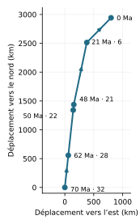
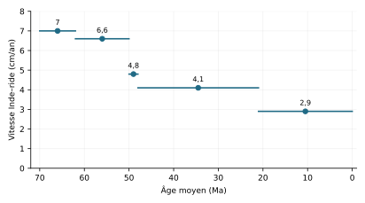
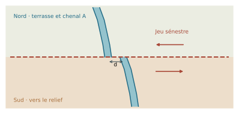
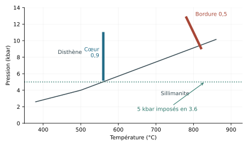
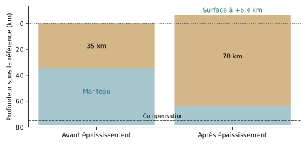

# ENS de Lyon — Second concours, Géosciences 2009 · Corrigé brut

*Corrigé rédigé par IA, non officiel.*

**Rédaction (tour 1)** · GPT-6.2 Astra Ultra · vitesse non renseignée

Les 26 questions sont traitées à partir du scan officiel et du rapport écrit. Les mesures de carte et de photographie sont données avec leur précision de lecture. Le gradient de la bordure à 5 kbar fait l’objet d’une estimation conditionnelle, car l’isoplèthe 0,5 imprimée ne rejoint pas cette pression. La dernière carte porte le numéro 13 dans le document et le numéro 12 dans la consigne.

## 1. Géodynamique

### Question 1.1 — Reconstituer le trajet dans le repère de la ride

Les bandes de même anomalie enregistrent la position d’un axe d’accrétion ancien. On suit une ligne de courant à travers les isochrones, en raccordant les tronçons décalés par les zones de fracture. Le fragment d’anomalie 6 situé du côté indien de la ride sert de repère récent. Sur le graphe ci-dessous, chaque vecteur de déplacement pointe du domaine jeune vers le domaine plus ancien du même flanc. On les ajoute dans l’ordre 70, 62, 50, 48, 21, 0 Ma. L’origine spatiale est arbitraire. Le trajet remonte d’abord presque vers le nord puis s’infléchit vers le nord-est. La ride actuelle est indiquée par un âge nul. La carte fixe mieux les directions des segments que le raccord entre les anomalies 21 et 6.

### Question 1.2 — Vitesses et âges moyens

Une lecture arrondie du flanc indien donne le tableau suivant. On mesure l’intervalle entre deux bandes le long du trajet de la question 1.1. Le point temporel du graphe est au milieu de chaque intervalle.

| Repères et âges (Ma) | Distance approchée (km) | Durée (Ma) | Âge moyen (Ma) | Vitesse (cm/an) |
| --- | ---: | ---: | ---: | ---: |
| 32 → 28, de 70 à 62 | 560 | 8 | 66 | 7,0 |
| 28 → 22, de 62 à 50 | 790 | 12 | 56 | 6,6 |
| 22 → 21, de 50 à 48 | 95 | 2 | 49 | 4,8 |
| 21 → 6, de 48 à 21 | 1 100 | 27 | 34,5 | 4,1 |
| 6 → ride, de 21 à 0 | 600 | 21 | 10,5 | 2,9 |

Ainsi $560/8=70$ km/Ma, soit $7,0$ cm/an. Le dernier intervalle prolonge le calcul jusqu’à la ride. L’espacement 22–21 ne représente qu’environ une demi-barre de 200 km et le raccord 21–6 traverse un changement de direction. Ces deux mesures sont particulièrement sensibles au tracé. Ces valeurs caractérisent **un flanc** par rapport à la ride.

### Question 1.3 — Interpréter les changements de mouvement

De 70 à environ 50 Ma, le mouvement rapide, presque méridien, est compatible avec la consommation d’un domaine océanique de la Téthys par subduction. Vers 50–48 Ma, la vitesse diminue. L’arrivée de la lithosphère continentale indienne, flottante, à la marge asiatique rend difficile la poursuite de la subduction océanique et engage la collision. Après cette transition, les vitesses moyennes sont plus faibles, la direction évolue vers le NE et le raccourcissement continental absorbe une part de la convergence. La réorganisation des limites et la traction de la plaque plongeante contribuent à l’évolution du mouvement. Les anomalies mesurent un mouvement Inde–ride, la convergence Inde–Asie exacte demanderait un second repère cinématique.

## 2. Tectonique

### Question 2.1 — Lire la coupe de la chaîne

Du sud vers le nord, la couverture sédimentaire de l’avant-pays est entraînée sous la chaîne. Des chevauchements à pendage nord découpent et empilent des écailles de croûte supérieure indienne, avec une vergence vers le sud. Ils se raccordent en profondeur à un niveau de décollement. La croûte inférieure indienne s’enfonce sous la partie interne, jusqu’au contact du domaine asiatique indiqué à droite. Le Moho passe d’environ 40–45 km à près de 80 km de profondeur. Cet épaississement crustal associe empilement en surface et sous-charriage en profondeur.

### Question 2.2 — Suivre la propagation de la déformation

Le domaine interne septentrional enregistre un épisode vers 40–30 Ma, puis les domaines plus méridionaux vers 30–10 Ma, 10–5 Ma et enfin 5–0 Ma près du front. À mesure que l’Inde converge, de nouvelles écailles sont incorporées du côté de l’avant-pays et viennent soutenir les plus anciennes. Le front de chevauchement progresse ainsi vers le sud. L’âge d’activité principale d’une zone laisse la possibilité de reprises ultérieures.

### Question 2.3 — Déduire le jeu des failles du champ GPS

Au MBT (Main Boundary Thrust), le bloc au sud avance davantage vers le nord que son voisin au nord. Le raccourcissement correspond à un chevauchement à vergence sud. À la suture Inde–Asie, la différence des vecteurs présente encore une composante de raccourcissement, plus faible, avec un mouvement oblique. Sur les accidents à direction dominante E–W du Kunlun et de l’est de l’Altyn Tagh, le bloc méridional avance davantage vers l’est. Le décrochement est sénestre. Le long du Fleuve Rouge, orienté NW–SE, le bloc au NE a une composante vers le SE supérieure à celle du bloc au SW. Le décrochement est dextre.

### Question 2.4 — Projeter les vitesses relatives

Soit $\Delta\vec v=\vec v_2-\vec v_1$. La composante de décrochement vaut $\Delta\vec v\cdot\vec t$ pour un vecteur unitaire parallèle à la trace. Pour un chevauchement, la composante horizontale de raccourcissement se lit sur la normale $\vec n$. Les petits vecteurs et leurs ellipses imposent de donner des ordres de grandeur.

| Accident | Mesure horizontale approchée (mm/an) | Lecture du couple de stations |
| --- | ---: | --- |
| MBT | 15–17 en raccourcissement | Environ 40 vers le nord au sud du front, contre 24–25 immédiatement au nord. |
| Suture Inde–Asie | 4–7 en raccourcissement | Les composantes méridiennes des flèches proches valent environ 24–25 et 19–20. Une composante tangentielle est également visible. |
| Fleuve Rouge | 4–6, dextre | L’écart des deux flèches vers le SE représente environ un huitième de l’étalon. |
| Kunlun | de l’ordre de 1–3, sénestre | Deux petites flèches vers l’ENE sont très proches. Leur écart tangentiel est du même ordre que l’incertitude. |
| Altyn Tagh oriental | environ 4–6, sénestre | La différence projetée entre la flèche au sud et la très courte flèche au nord vaut environ un huitième de l’étalon. |

Les stations moyennent aussi la déformation entre la faille et le site de mesure. Pour un glissement purement inverse de pendage $\delta$, la valeur sur le plan serait $|\Delta v_n|/\cos\delta$. La figure 3 seule ne fournit pas le pendage nécessaire pour passer du raccourcissement horizontal au glissement tridimensionnel exact.

### Question 2.5 — Interpréter la photographie de l’Altyn Tagh

Un linéament traverse le pied du relief à peu près de gauche à droite sur la photographie. Les chenaux qui descendent depuis le relief méridional le recoupent. Les deux tronçons homologues de la rivière A se raccordent mieux si l’on ramène le compartiment méridional vers la gauche. Dans leur position actuelle, le tronçon côté relief est déplacé vers la droite par rapport au tronçon au nord, ce qui s’accorde avec un décrochement sénestre. Le croquis fait apparaître les limites de la terrasse et l’écart parallèle à la faille.

### Question 2.6 — Convertir le décalage en vitesse

Sur l’image imprimée, la petite rupture du bord du chenal A au franchissement de la trace est de l’ordre du dixième de la barre de 500 m. Le choix du bord dans cette vignette donne une lecture de quelques dizaines de mètres, par exemple 50 m (environ 30–75 m selon le pointé). Avec un âge de 2 200 ans, $v=50\times 1\,000/2\,200\simeq23$ mm/an, soit environ 14–34 mm/an avec les deux bornes de lecture. Cette estimation suppose que le bord était continu lors de l’abandon de la terrasse et que son âge est celui à partir duquel le décalage a été conservé. La longueur entière du segment qui longe la faille dépend aussi du tracé initial du cours d’eau.

### Question 2.7 — Comparer deux fenêtres de temps

Le décalage morphologique suggère quelques dizaines de mm/an sur 2 200 ans. La projection GPS sur le tronçon oriental donne quelques mm/an durant 1998–2002. Une faille peut rester bloquée entre des séismes et accumuler une déformation élastique autour de sa trace, puis libérer une partie du déplacement pendant un séisme. La terrasse peut additionner plusieurs de ces épisodes. Les stations et la terrasse n’échantillonnent pas nécessairement le même tronçon, le glissement peut se répartir sur plusieurs branches, et la lecture du décalage reste imprécise. Deux fenêtres aussi différentes ne suffisent donc pas à établir une accélération ou un ralentissement séculaire.

## 3. Évolution thermique

### Question 3.1 — Décrire la lame mince

La roche présente une foliation marquée par des lits de micas orientés, qui contournent des cristaux plus gros, avec des plages de quartz à extinction variable. Des micas clairs et des lamelles plus sombres évoquent muscovite et biotite. Le grenat forme des porphyroblastes à relief marqué, parfois riches en inclusions, restant noirs en lumière polarisée analysée car ils sont isotropes. Des cristaux allongés et clivés, à relief élevé en lumière naturelle et faibles teintes d’interférence, sont compatibles avec le disthène identifié dans le rapport. L’association grenat–disthène dans une roche foliée riche en micas est celle d’un micaschiste métapélitique. Le scan en niveaux de gris limite l’emploi des couleurs d’interférence.

### Question 3.2 — Placer l’assemblage sur la grille

Le point triple des silicates d’alumine se situe près de 500 °C et 4 kbar. Le domaine du disthène est du côté des plus fortes pressions par rapport aux limites disthène–andalousite et disthène–sillimanite. Il faut encore se placer du côté « Grt + » de la limite du grenat, avec biotite stable. Par exemple, à 550–600 °C il faut dépasser approximativement 5–6 kbar pour rester du côté disthène ; à 750 °C le seuil approche 8–9 kbar. Une plage de l’ordre de 450–750 °C et 5–11 kbar contient de nombreuses solutions possibles, sans que tous les couples de ce rectangle soient admissibles. Les lignes de réaction délimitent un domaine, et aucune intersection unique n’est imposée par la seule présence de ces phases.

### Question 3.3 — Normaliser les formules du grenat

Avec les masses atomiques données, les masses molaires de SiO₂, Al₂O₃, MgO et FeO sont 60, 102, 40 et 72 g/mol. Pour le cœur, on obtient par exemple $n_{\mathrm{Fe}}=39,5/72=0,5486$ mol et $n_{\mathrm{Al}}=2\times21/102=0,4118$ mol.

| Pour 100 g (mol) | Fe | Mg | Si | Al | O |
| --- | ---: | ---: | ---: | ---: | ---: |
| Cœur | 0,5486 | 0,0625 | 0,6167 | 0,4118 | 2,4621 |
| Bordure | 0,3333 | 0,3375 | 0,6667 | 0,4412 | 2,6659 |

Le total d’oxygènes est $n_{\mathrm{Fe}}+n_{\mathrm{Mg}}+2n_{\mathrm{Si}}+1,5n_{\mathrm{Al}}$. Multiplier chaque nombre de cations par $24/n_{\mathrm O}$ donne pour le cœur $\mathrm{Fe}_{5,35}\mathrm{Mg}_{0,61}\mathrm{Si}_{6,01}\mathrm{Al}_{4,01}\mathrm O_{24}$, et pour la bordure $\mathrm{Fe}_{3,00}\mathrm{Mg}_{3,04}\mathrm{Si}_{6,00}\mathrm{Al}_{3,97}\mathrm O_{24}$. À l’arrondi, environ six sites sont occupés par Fe et Mg, six par Si et quatre par Al, comme dans la formule proposée.

### Question 3.4 — Exploiter les isoplèthes Fe–Mg

Au cœur $X_{\mathrm{Fe}}=0,5486/(0,5486+0,0625)=0,898$, contre $0,3333/(0,3333+0,3375)=0,497$ au bord. Le cœur suit donc l’isoplèthe 0,9, proche de 560 °C dans son tronçon presque vertical du domaine à disthène (environ 5–11 kbar). La bordure correspond à 0,5, vers 770–820 °C sur le **segment figuré**, à environ 9–13 kbar. Le rapport exprimé en poids d’oxydes donnerait une autre valeur, car MgO et FeO ont des masses molaires différentes. Les traits interrompus par des réactions ne doivent pas être prolongés en leur attribuant la précision d’une mesure.

### Question 3.5 — Reconstruire la succession thermique

Le cœur riche en Fe s’est formé avant la bordure beaucoup plus magnésienne. L’incorporation relative de Mg augmente lors de la croissance à température plus élevée, dans les conditions de la calibration proposée. La zonation conserve deux étapes d’un réchauffement de plusieurs centaines de degrés malgré une diffusion interne incomplète. Le contexte de collision suggère un enfouissement suivi d’un réchauffement retardé de la croûte épaissie. Le sens de variation de la pression ne se déduit pas des deux compositions seules. L’hypothèse indépendante de 5 kbar pour la bordure, en 3.6, invite à envisager un réchauffement associé à une décompression si le cœur s’est formé plus profondément.

### Question 3.6 — Estimer les gradients enregistrés

La graduation secondaire indique environ 30 km pour 10 kbar, soit environ 15 km pour les 5 kbar de la bordure. Pour le cœur vers 560 °C à 5–11 kbar, cela donne environ $560/(15\text{ à }33)$, soit 17–37 °C/km. Un choix illustratif de 9 kbar correspond à 27 km et environ 21 °C/km. La pression du cœur reste un intervalle. Le tronçon 0,5 de la figure 6 s’interrompt au-dessus de 5 kbar. Si l’on conserve, comme estimation d’ordre de grandeur, la température chaude de 800 °C suggérée par la bordure, le gradient apparent à 5 kbar est $800/15\simeq53$ °C/km. Cette dernière valeur dépend d’une hypothèse de température à 5 kbar. La grille imprimée ne permet pas une lecture exacte à cette pression. Avec une conversion lithostatique indépendante de 2,7 g/cm³, les 5 kbar donnent 19 km et environ 42 °C/km pour la même température. Dans les deux conventions, la bordure témoigne d’une roche encore chaude à faible profondeur, situation compatible avec relaxation thermique et exhumation. Ces quotients décrivent les conditions enregistrées par un minéral, sans imposer un gradient vertical uniforme à toute la chaîne.

### Question 3.7 — Expliquer la relaxation thermique

Le profil initial est discontinu au contact d’empilement vers 35 km. Le toit froid de la croûte inférieure dans l’empilement devient voisin de la base plus chaude de la croûte sus-jacente. La diffusion de chaleur atténue ce contraste. Les profils à 10, 30 et 50 Ma deviennent continus et la croûte profonde se réchauffe. Le gradient dépend de la température de surface, du flux venu du manteau, de la conductivité et de la distribution en profondeur des éléments radioactifs. Diffusivité et durée fixent la vitesse de relaxation. Les déplacements de matière, l’érosion et le magmatisme peuvent modifier un géotherme naturel. Dans ce modèle, l’épaississement superpose deux volumes de croûte productrice de chaleur radiogénique. Avec une base alimentée en chaleur, l’état progressivement atteint est donc plus chaud à profondeur donnée que le profil initial froid du paquet enfoui. La radioactivité continue d’alimenter le flux après dissipation du contraste d’empilement.

## 4. Morphologie

### Question 4.1 — Décrire la topographie de l’Inde au Tibet

La péninsule indienne associe un socle à reliefs de plateau souvent inférieurs à 1 000 m, des reliefs de bordure et des basses plaines littorales. Au nord s’étend une large plaine alluviale indo-gangétique, principalement dans la classe 1–200 m. Une rupture de pente franche marque le pied de l’Himalaya. La chaîne étroite, arquée et accidentée concentre les plus hauts sommets dans la tranche 5 501–8 844 m. Plus au nord, le Tibet conserve sur une grande largeur une altitude moyenne voisine de 4 à 5 km. C’est un haut plateau, malgré les chaînes et bassins qui en accidentent la surface. Les bassins plus bas au nord de ce plateau complètent la coupe morphologique.

### Question 4.2 — Calculer l’altitude isostatique

Soit $\Delta H=70-35=35$ km l’épaisseur crustale supplémentaire. Elle se partage en une élévation $h$ et une racine $r=\Delta H-h$. À profondeur de compensation égale, $\rho_c\Delta H=\rho_m r$. D’où $r=35\times2,7/3,3=28,6$ km et $h=35-28,6=6,4$ km. L’épaississement par collision permet donc une forte altitude moyenne avec une racine crustale. La valeur calculée suppose l’équilibre local, des densités uniformes et une surface libre. Les pics individuels et les charges portées par une lithosphère rigide s’écartent de cette moyenne.

### Question 4.3 — Raisonner sur l’érosion localisée

L’incision enlève de la masse dans la vallée. À l’échelle où la lithosphère réagit à cette décharge, elle se soulève en partie. Le fond du vallon perd une épaisseur supérieure au rebond et s’abaisse, tandis qu’une crête voisine peu érodée profite du soulèvement et peut gagner de l’altitude. Le relief local vallée–crête augmente alors. La réponse dépend de la largeur de la zone déchargée, de la rigidité de la plaque et de l’érosion propre du sommet. Une incision ponctuelle n’entraîne pas un rebond uniforme dans toute la chaîne.

## 5. Sédimentologie

### Question 5.1 — Interpréter les isopaques

À l’ouest, les dépôts s’épaississent près du débouché de l’Indus et se déploient en mer d’Arabie. À l’est, un corps plus vaste s’étend de l’embouchure du Gange–Brahmapoutre au golfe du Bengale et loin au sud. L’épaisseur atteint plusieurs kilomètres, localement des valeurs de l’ordre de 8 à 12 km sur le secteur oriental, et décroît vers les bords et le large (courbes 2, 1, 0,5 km). Ce sont des éventails détritiques sous-marins. Les fleuves drainent les reliefs, les sédiments franchissent le plateau puis empruntent des canyons et des chenaux sous-marins. Des courants de turbidité les étalent en lobes successifs. Apports, subsidence, migration des chenaux et espace disponible expliquent que les isopaques ne soient pas concentriques autour de l’Inde.

### Question 5.2 — Lire l’histoire des apports terrigènes

Vers 60–40 Ma, le taux est bas après une petite diminution initiale. Il augmente ensuite par paliers et surtout depuis environ 10 Ma. Dans l’unité de l’axe de la figure 10, la bande est proche de 0,2–0,4 entre 40 et 60 Ma et atteint environ 1,2–2,2 à l’extrémité récente. La collision, l’épaississement et la surrection accroissent le relief et les pentes. L’incision et les mouvements de masse libèrent davantage de détritus vers l’Indus, le Gange et le Brahmapoutre. La mousson et les fluctuations glaciaires agissent sur l’érosion et le débit. Captures de drainage, stockage continental et capacité des bassins à conserver les sédiments modulent le taux mesuré. Le retard entre début de collision et maximum d’apport est donc plausible.

## 6. Orogenèse et climat

### Question 6.1 — Lire la production carbonatée mondiale

La figure mesure une masse par tranche d’âge. Elle montre une valeur élevée dans la tranche la plus ancienne (environ 32 × 10¹⁸ kg vers 65–70 Ma), puis un niveau d’environ 10 × 10¹⁸ kg vers 60 Ma, un creux de 3–4 × 10¹⁸ kg vers 35–45 Ma, une remontée autour de 7–8 × 10¹⁸ kg vers 25–30 Ma et un recul à 2–3 × 10¹⁸ kg dans la tranche récente. Des tranches de durée différente doivent être rapportées à leur durée pour comparer des flux. Les carbonates se forment par précipitation de CaCO₃, souvent par des organismes calcifiants. La sursaturation dépend du calcium, de l’alcalinité, du pH et de la température. Le dégazage du CO₂ et l’activité photosynthétique peuvent favoriser la précipitation. La surface des plates-formes, la productivité et la dissolution en profondeur interviennent dans la masse finalement enfouie.

### Question 6.2 — Relier les deux archives sédimentaires

Les deux séries ne sont pas proportionnelles. De 40 à 25 Ma environ, les dépôts détritiques régionaux et la masse carbonatée mondiale augmentent ensemble. Depuis environ 25 Ma, les premiers continuent de croître tandis que la seconde diminue. Une érosion accrue renouvelle les surfaces altérables, en particulier les plagioclases calciques. L’altération des silicates au contact de l’eau chargée en CO₂ exporte Ca²⁺ et bicarbonate par les fleuves. En mer, ces solutés peuvent alimenter les carbonates. Pour un silicate calcique idéalisé, le bilan après enfouissement s’écrit $\mathrm{CaSiO_3+CO_2\longrightarrow CaCO_3+SiO_2}$. La seule précipitation à partir de bicarbonate restitue une partie du CO₂ à l’eau. La figure mondiale intègre de nombreux bassins, le climat, l’aire des plates-formes et la conservation des dépôts, d’où les évolutions différentes.

### Question 6.3 — Fermer la boucle climat–érosion

L’augmentation des flux terrigènes témoigne d’une érosion mécanique accrue. Si cette érosion expose des silicates dont l’altération puis l’enfouissement carbonaté augmentent, le CO₂ atmosphérique diminue à longue échéance. Un effet de serre moins intense favorise le refroidissement et l’extension des glaciers en haute altitude. Les glaciers creusent des vallées, déplacent des débris et modifient l’albédo. Le climat modifie aussi les précipitations, la mousson et l’intensité de l’altération. C’est une boucle possible reliant relief et climat. La seule courbe des volumes détritiques ne quantifie pas un bilan de CO₂.

### Question 6.4 — Lire le contraste des précipitations

L’air humide de la mousson estivale provient de l’océan Indien. Les flux venant de la mer d’Arabie et du golfe du Bengale rencontrent les Ghâts occidentaux, puis le relief himalayen au nord et au nord-est. L’ascendance sur les versants au vent refroidit l’air, la vapeur se condense et les pluies augmentent. La côte occidentale et le nord-est du sous-continent portent les teintes de précipitations fortes. Le nord-ouest de l’Inde et le Tibet intérieur sont plus secs. Le versant sous le vent et le haut plateau reçoivent un air déjà appauvri en eau qui se réchauffe en redescendant. Cette ombre pluviométrique explique le contraste de part et d’autre de la chaîne. La dernière carte, appelée figure 12 dans la question, est imprimée « Figure 13 ». Sa classe noire porte un seuil incompatible avec l’ordre des autres classes. Elle se lit ici comme la classe la plus arrosée, sans lui attribuer de limite numérique corrigée.
