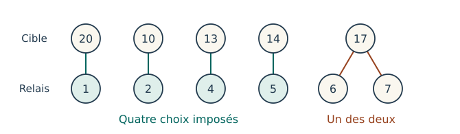
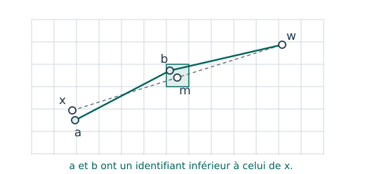
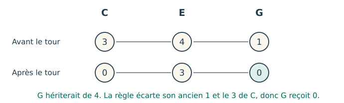

# ENS de Lyon · Second concours · Informatique 2009 — corrigé guidé

*Corrigé rédigé par IA, non officiel. Signalez toute erreur.*

**Rédaction** · GPT-6.2 Astra Ultra · vitesse non renseignée · 25 novembre 2026

On note $d_G$ la distance dans le graphe simple non orienté. La deuxième couronne de $x$ est l’ensemble des sommets à distance exactement deux de $x$.

## Repères

Les parties 1 et 2 portent sur des graphes abstraits. On introduit les distances euclidiennes seulement à la question 3.2. Pour les deux colorations de la partie 4, recopier les couleurs à chaque tour avant de calculer le tour suivant. Un fils et son parent lisent ainsi le même état de l’arbre.


## 1. Chemins et distance

### Question 1.1 · Deux distances voisines

**Indication.** Prolonger d’une arête un chemin vers chacun des deux sommets voisins.

#### Solution

Si $y$ est accessible depuis $x$, on peut ajouter l’arête $yz$ à un plus court chemin de $x$ à $y$. On obtient $d(x,z)\le d(x,y)+1$. Échanger $y$ et $z$ donne $|d(x,y)-d(x,z)|\le1$. L’égalité des distances est possible, par exemple dans un triangle. Si $y$ est inaccessible, $z$ l’est aussi, puisque $yz$ est une arête.

### Question 1.2 · Calculer une distance

**Indication.** Quel ordre de traitement garantit que le premier chemin trouvé est le plus court ?

#### Solution

Un parcours en largeur utilise une file FIFO. On marque un sommet dès son insertion, ce qui évite les insertions multiples. Voici un code Python où `N[v]` est la liste des voisins de `v`.

```python
from collections import deque
from math import inf

def distance(N, x, y):
    file = deque([x])
    d = {x: 0}
    while file:
        v = file.popleft()
        if v == y:
            return d[v]
        for w in N[v]:
            if w not in d:
                d[w] = d[v] + 1
                file.append(w)
    return inf
```

Les sommets de distance $k$ sont insérés après ceux de distance $k-1$. Tout voisin encore inédit d’un sommet de distance $k$ a donc distance $k+1$, puisqu’un chemin plus court l’aurait déjà fait découvrir. Dans le pire cas, on dépile $|V|$ sommets et on lit deux fois chaque arête. Temps $O(|V|+|E|)$ avec accès constant aux marques (tableau indexé par sommet, ou dictionnaire en moyenne), espace supplémentaire $O(|V|)$.

## 2. Multi-points relais, routage et diffusion

### Question 2.1 · Minimum sur la figure 1

**Indication.** Chercher des sommets de la deuxième couronne qui n’ont qu’un seul voisin dans la première.

#### Solution

Écrivons $B=N(x)$, $T=N(B)\setminus(B\cup\{x\})$ et $S_i=N(x_i)\cap T$ pour un voisin $x_i$ de $x$. Ici $B=\{x_1,\ldots,x_7\}$ et $T$ contient les sommets de $x_8$ à $x_{24}$ sauf $x_{21}$, qui est à distance trois. Un choix de taille cinq est

$$
A=\{x_1,x_2,x_4,x_5,x_6\}.
$$

La lecture des arêtes vers $T$ donne les indices suivants.

| Relais | Indices des sommets couverts |
|---|---|
| $x_1$ | 8, 9, 19, 20, 22 |
| $x_2$ | 9, 10, 11, 23, 24 |
| $x_4$ | 12, 13 |
| $x_5$ | 14, 15, 16 |
| $x_6$ | 15, 16, 17, 18 |

Pour la borne inférieure, $x_{20},x_{10},x_{13},x_{14}$ imposent respectivement $x_1,x_2,x_4,x_5$. Aucun de ces quatre relais ne couvre $x_{17}$, qui requiert $x_6$ ou $x_7$. Toute couverture a donc au moins cinq éléments.



### Question 2.2 · Tous les voisins indispensables

**Indication.** Donner à chaque voisin une cible qu’aucun autre voisin ne peut atteindre en un saut.

#### Solution

Prenons quatre chaînes $x-u_i-v_i$, pour $1\le i\le4$, sans autre arête. Chaque $v_i$ est à distance deux et seul $u_i$ le couvre. Ainsi $N(x)=\{u_1,u_2,u_3,u_4\}$ est le seul ensemble de relais possible.

### Question 2.3 · Aucun relais nécessaire

**Indication.** La condition ne porte que sur les sommets à distance exactement deux.

#### Solution

Dans une étoile de centre $x$ et de quatre feuilles, $|N(x)|=4$ et $T=\varnothing$. L’ensemble vide couvre donc toutes les cibles demandées.

### Question 2.4 · Chercher une couverture de cardinal minimum

**Indication.** Dans quel ordre énumérer les sous-ensembles pour pouvoir s’arrêter au premier succès ?

#### Solution

Construire $T$ et les listes $S_u=N(u)\cap T$ pour $u\in B$. Pour $k=0,1,\ldots,|B|$, énumérer les sous-ensembles $A\subseteq B$ à $k$ éléments. Pour chacun, marquer les cibles des $S_u$ avec $u\in A$ dans un tableau booléen initialement vide. Renvoyer $A$ si toutes les cibles sont marquées. Au plus tard, $B$ réussit par définition de $T$. Un sous-ensemble de plus petit cardinal aurait été examiné avant celui qui est renvoyé.

Si $b=|B|$, $t=|T|$ et $s=\sum_{u\in B}|S_u|$, le prétraitement coûte $O(|V|+|E|)$ et les essais coûtent au plus $O(2^b(1+b+t+s))$. On peut générer les combinaisons l’une après l’autre. Une mémoire de $O(|V|+|E|)$ suffit.

### Question 2.5 · Retirer les relais superflus

**Indication.** « Optimal » au sens du sujet signifie que toute suppression détruit la couverture. Un témoin découvert au cours de la réduction peut-il disparaître ?

#### Solution

Partir de $A=B$. Pour chaque cible $z\in T$, compter ses relais actuels dans $c[z]$. Parcourir une fois les voisins $u$ de $x$. Si toutes les cibles de $S_u$ vérifient $c[z]\ge2$, enlever $u$ et décrémenter leurs compteurs. Sinon, conserver $u$. Le test est vrai quand $S_u$ est vide.

Chaque suppression préserve la couverture. Lorsqu’on conserve $u$, une cible $z$ n’a déjà plus que lui. Les étapes suivantes retirent uniquement des relais, donc $z$ reste son témoin jusqu’à la fin. Tout relais restant est indispensable. On parcourt chaque liste $S_u$ au plus trois fois, initialisation incluse. Temps $O(b+t+s)$ après construction des listes, donc $O(|V|+|E|)$ au total.

### Question 2.6 · Connexité du sous-graphe

**Indication.** Partir d’un chemin qui perd une arête. Un relais choisi par son dernier sommet peut-il remplacer son avant-dernier sommet ?

#### Solution

Raisonnons par induction sur $k=d_G(x,y)$. Pour $k=0$, $y=x$. Pour $k=1$, l’arête $xy$ est explicitement conservée dans $G_M(x)$. Pour $k\ge2$, soit $z$ le sommet situé deux pas avant $y$ sur un plus court chemin depuis $x$. Alors $d_G(z,y)=2$. Comme les relais de $y$ couvrent sa deuxième couronne, il existe $u\in M(y)$ voisin de $z$. On a $d_G(x,u)\le k-1$. Par récurrence, $x$ est relié à $u$ dans le sous-graphe. L’arête $uy$, conservée puisque $u\in M(y)$, termine le chemin. Tout sommet est ainsi relié à $x$.

### Question 2.7 · Conservation des distances

**Indication.** Comparer la longueur du chemin construit à la distance dans le graphe de départ.

#### Solution

Reprenons la même induction avec la propriété « il existe un chemin de longueur $k$ dans $G_M(x)$ ». Comme $u$ est voisin de $y$, la question 1.1 donne $d_G(x,u)\ge k-1$. L’inégalité de 2.6 donne donc l’égalité. Le chemin de longueur $k-1$ obtenu par induction, prolongé par $uy$, a bien longueur $k$. Réciproquement tout chemin du sous-graphe est un chemin de $G$. Ainsi $d_{G_M(x)}(x,y)=d_G(x,y)$, y compris pour des sommets inaccessibles.

### Question 2.8 · Tous les sommets reçoivent le message

**Indication.** Fixer le destinataire et classer les émetteurs selon leur distance à ce destinataire. Que garantit la première émission à distance minimale ?

#### Solution

Une émission du modèle est reçue par l’ensemble des voisins. Ordonnons ces émissions et supposons qu’une réémission déclenchée est finalement effectuée. Fixons un destinataire $t$. Parmi les émetteurs (il y a au moins la source), soit $d$ la distance minimale à $t$. Si $d=0$, le message est déjà arrivé. Si $d=1$, un voisin de $t$ émet et $t$ le reçoit.

Supposons $d\ge2$. Considérons le **premier** émetteur $v$ à distance $d$. Sur un plus court chemin de $v$ à $t$, soit $z$ le sommet situé deux pas après $v$. Un relais $u\in M(v)$ est adjacent à $z$, donc $d_G(u,t)=d-1$ par le même encadrement qu’en 2.7. Si $u$ avait reçu le message plus tôt, son émetteur aurait été à distance au plus $d$ de $t$. Une distance strictement inférieure contredirait la définition de $d$, une distance égale contredirait le choix du premier émetteur. Ainsi $u$ reçoit pour la première fois de $v$, qui l’a choisi comme relais. Il réémet, en contradiction avec la minimalité de $d$. Cela prouve la réception par tout $t$. La notion de première émission utilisée ici traite la diffusion locale comme un seul événement de réception par ses voisins.

## 3. Ensembles dominants

### Question 3.1 · Domination et connexité

**Indication.** Les décisions utilisent les identifiants initiaux. Dans quel ordre peut-on ensuite retirer les sommets éliminés en gardant leurs témoins ?

#### Solution

Notons $Y_v$ les voisins de $v$ d’identifiant inférieur. Dès que $v$ est éliminable, tout voisin $w$ de $v$ est voisin d’un élément de $Y_v$, par l’inclusion $N(v)\subseteq N(Y_v)$. Fixons un sommet $w$ et partons d’un voisin $v$. Si $v$ est éliminable, on trouve ainsi un nouveau voisin de $w$ d’identifiant strictement plus petit que celui de $v$. La descente s’arrête sur un voisin conservé. C’est la domination demandée, même pour $w\in D$.

Pour la connexité, retirer les sommets marqués par **identifiants décroissants**. Au retrait de $v$, tous les éléments de $Y_v$ sont encore là. Si un chemin utilisait le segment $u,v,w$, on joint $u$ à un membre de $Y_v$, puis on traverse l’ensemble connexe $Y_v$, puis on rejoint $w$. Aucun autre sommet retiré ne figure dans ce détour. Chaque retrait préserve donc la connexité entre les sommets restants. Le résultat suppose un graphe connexe d’au moins deux sommets. Pour un sommet isolé unique, la définition ouverte de la domination écrite dans le sujet ne peut être satisfaite.

### Question 3.2 · Borne uniforme pour la taille moyenne

**Indication.** Une maille entièrement peuplée par des identifiants anciens aide tous les sommets de rang ultérieur. Comment choisir des témoins qui restent dans le terrain près de son bord ?

#### Solution

Dans le modèle usuel, les positions sont indépendantes et uniformes dans le rectangle, avec un ordre des identifiants indépendant des positions. Nous montrons que $\mathbb E|D|$ est bornée indépendamment du nombre $n$ de points. Si l’on couple les tirages par identifiants croissants, cette espérance admet même une limite finie.

Pavons le rectangle par $J$ cellules rectangulaires de même aire et de diamètre $\delta<1/4$, en ajustant le nombre de subdivisions dans chaque direction. $J$ dépend du terrain fixé. Imaginons une suite infinie de tirages. Soit $H$ l’instant où chaque cellule contient au moins deux points. Un sommet $x$ arrivé après $H$ satisfait le critère d’élimination. En effet, la cellule de $x$ fournit un point ancien $a$ à distance au plus $\delta$. Pour tout voisin $w$ de $x$, le milieu $m$ de $[x,w]$ reste dans le rectangle. Sa cellule contient deux points anciens, dont au moins un $b$ distinct de $w$. On a

$$
|x-b|<1/2+\delta,\qquad |w-b|<1/2+\delta,\qquad |a-b|<1/2+2\delta<1.
$$

Ainsi $b\in Y_x$ est voisin de $w$. Tout voisin est couvert. Si $w\in Y_x$, le chemin $w,b,a$ est entièrement formé de voisins de rang inférieur. Si $b=a$, l’arête $wa$ suffit. Tous les éléments de $Y_x$ sont ainsi reliés à $a$, y compris près des bords.

Pour une cellule donnée, chaque tirage tombe dedans avec probabilité $1/J$. L’attente moyenne de chacune des deux arrivées est $J$, donc l’instant de sa deuxième arrivée a pour espérance $2J$. Le maximum de ces $J$ instants est majoré par leur somme, d’où $\mathbb E H\le2J^2$. Comme les survivants figurent parmi les $H$ premiers identifiants, $\mathbb E|D|\le2J^2$ pour tout $n$. Dans le couplage par ordre de naissance, un ancien sommet conserve le même ensemble $Y_v$. Si sa connexité échoue ou si un ancien voisin n’est pas couvert, cet échec persiste après l’arrivée de nouveaux points. La taille de $D$ est donc croissante au sens large. Son espérance, croissante et bornée, admet une limite finie.



## 4. Coloration des arbres

### Question 4.1 · Un parent par sommet

**Indication.** Que produiraient deux chemins simples distincts entre la racine et le même sommet ?

#### Solution

Tout sommet d’un arbre est relié à la racine par un chemin simple. Deux tels chemins distincts contiendraient un cycle entre leur séparation et leur première réunion, impossible dans un arbre. Pour $v$ distinct de la racine, l’avant-dernier sommet du chemin unique est un voisin à distance de la racine inférieure d’une unité. Un second voisin plus proche fournirait un second chemin, contradiction. Tout autre voisin de $v$ a donc $v$ pour parent.

### Question 4.2 · Tours de réduction des identifiants

**Indication.** Lire le bit de poids faible en premier. Calculer toutes les nouvelles couleurs avant de remplacer les anciennes.

#### Solution

Les sommets $A,B,C,D,E,F,G,H,I$ désignent respectivement la racine, ses trois fils de gauche à droite, les deux fils de $C$, les deux fils de $E$, puis le fils de $H$. Chaque tour lit les couleurs du tour précédent. Si le premier bit différent est en position $i$, la nouvelle couleur est $2i+b$, où $b$ est le bit propre du sommet à cette position. Pour la racine on prend $i=0$. Le dessin contient neuf sommets et donne directement des identifiants distincts sur quatre bits, dont certains dépassent huit. On utilise les codes du dessin.

| Étape | A | B | C | D | E | F | G | H | I |
|---|---|---|---|---|---|---|---|---|---|
| Code | 1010 | 1101 | 1100 | 1000 | 0011 | 0001 | 0010 | 0100 | 0110 |
| Tour 1 | 0 | 1 | 2 | 2 | 1 | 1 | 0 | 0 | 3 |
| Tour 2 | 0 | 1 | 3 | 3 | 1 | 1 | 0 | 0 | 1 |

On commence à $L=4$. Après le premier tour, $L=\lceil\log_2 4\rceil+1=3$. Par exemple, $C$ et $A$ diffèrent d’abord au bit 1. Ce bit de $C$ vaut 0, d’où 2. Au tour suivant, $C$ vaut 2 et son parent 0, ce qui donne cette fois $2\cdot1+1=3$.

### Question 4.3 · Préserver un coloriage valide

**Indication.** Si les deux nouvelles couleurs d’une arête choisissent le même indice, quels sont leurs bits à cet indice ?

#### Solution

Les identifiants donnent au départ des couleurs distinctes aux extrémités de chaque arête. Sur une arête parent $p$, fils $v$, l’indice $i_v$ est donc défini. Si $i_v\ne i_p$, la partie entière de la nouvelle couleur divisée par deux distingue les couleurs. Si les indices coïncident, $v$ a choisi un bit où son ancienne couleur diffère de celle de $p$. Les bits ajoutés à l’indice commun sont donc distincts. Pour la racine, le même argument s’applique à son indice imposé 0. L’invariant est conservé à chaque tour.

### Question 4.4 · Six couleurs suffisent

**Indication.** Combien de positions peut-on choisir dans un mot de trois bits ?

#### Solution

Si les couleurs tiennent sur $L$ bits, l’indice $i$ appartient à $\{0,\ldots,L-1\}$. La couleur $2i+b$ est inférieure à $2L$ et tient sur $\lceil\log_2 L\rceil+1$ bits. Cette nouvelle borne est strictement plus petite que $L$ pour tout entier $L\ge4$ (équivalemment $L\le2^{L-2}$, vérifié dès 4 par récurrence). On atteint donc $L\le3$. Au tour supplémentaire $i\le2$, d’où $0\le2i+b\le5$. Il s’agit d’au plus six couleurs. L’arbre réduit à sa seule racine se colorie directement en 0.

### Question 4.5 · Supprimer successivement les couleurs 5, 4 et 3

**Indication.** Pour un fils, écrire d’abord la couleur héritée du parent, puis remplacer uniquement la couleur en cours d’élimination.

#### Solution

Gardons l’ordre de sommets de 4.2. La racine prend la plus petite couleur différente de son ancienne couleur. Tous les autres lisent les anciennes couleurs du tour.

| Étape | A | B | C | D | E | F | G | H | I |
|---|---|---|---|---|---|---|---|---|---|
| Figure 4 | 3 | 2 | 4 | 5 | 1 | 2 | 5 | 0 | 3 |
| Après $c=5$ | 0 | 3 | 3 | 3 | 4 | 4 | 1 | 1 | 0 |
| Après $c=4$ | 1 | 0 | 0 | 0 | 3 | 3 | 0 | 0 | 1 |
| Après $c=3$ | 0 | 1 | 1 | 1 | 0 | 0 | 1 | 1 | 0 |

Par exemple, au deuxième passage $G$ hériterait du 4 de $E$. Sa propre ancienne couleur vaut 1 et celle de son grand-parent $C$ vaut 3. La plus petite couleur disponible est 0. Le troisième passage élimine de même la couleur 3.



### Question 4.6 · Preuve du passage de six à trois couleurs

**Indication.** Décomposer un tour en deux opérations synchrones. Quelles couleurs voient tous les voisins d’un sommet qui doit abandonner $c$ ?

#### Solution

Au début du tour, tous les sommets autres que la racine prennent **provisoirement** l’ancienne couleur du parent. La racine prend la plus petite couleur différente de sa propre ancienne couleur. Le coloriage provisoire est valide. Pour une arête intérieure, ses deux couleurs proviennent d’une arête de l’ancien arbre. Pour une arête issue de la racine, le fils porte l’ancienne couleur de la racine, distincte de sa nouvelle couleur.

Les sommets provisoirement de couleur $c$ forment donc un ensemble sans arête interne. Pour un tel sommet $v$, tous ses fils portent l’ancienne couleur de $v$ et son parent porte l’ancienne couleur du grand-parent. Si ce parent est la racine, on lit sa **nouvelle** couleur, déjà définie par la règle de la racine. C’est la convention de bord nécessaire au pseudo-code, qui écrit le grand-parent sans le définir pour les fils de la racine. On choisit pour $v$ la plus petite couleur différente de ces deux valeurs. Elle appartient à $\{0,1,2\}$. La racine elle-même vaut 0 ou 1 et n’a jamais besoin de cette seconde opération.

Comme les sommets recolorés ne sont pas voisins, leurs choix simultanés préservent la validité, et aucune couleur supérieure ou égale à $c$ n’est réintroduite après sa suppression. Après les passages pour 5, 4 et 3, il reste un coloriage valide à valeurs dans $\{0,1,2\}$.
