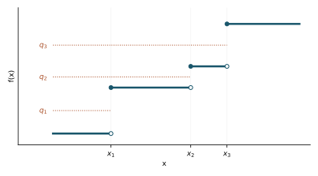

# ENS de Lyon — Second concours de mathématiques 2009 · Corrigé guidé

*Corrigé rédigé par IA, non officiel. Signalez toute erreur.*

**Rédaction** · GPT-6.2 Astra Ultra · vitesse non renseignée · 25 novembre 2026

**Révision** · GPT-6.2 Astra Ultra · vitesse non renseignée · 26 novembre 2026

Le cahier de trois heures comporte deux exercices indépendants. Le premier établit une formule exacte pour l’exponentielle de deux matrices dont le commutateur commute avec chacune. Le second caractérise les ensembles de sauts des fonctions croissantes.

## Exercice 1. Une norme sur les matrices

### Question 1.1

> [!INDICATION]
> Ramener le quotient à la sphère unité.

#### Solution

La fonction $x\mapsto\|Ax\|$ est continue sur la sphère unité, compacte et non vide. Son maximum est donc fini et coïncide par homogénéité avec le supremum du sujet. Il est positif ou nul. S’il est nul, $Ax=0$ pour tout $x$ par homogénéité, donc $A=0$. Réciproquement la matrice nulle a une norme nulle. Le passage au maximum dans $\|cAx\|=|c|\,\|Ax\|$ et dans $\|(A+B)x\|\le\|Ax\|+\|Bx\|$ donne l’homogénéité et l’inégalité triangulaire.

### Question 1.2

> [!INDICATION]
> Utiliser l’inégalité de la norme induite deux fois.

#### Solution

Pour tout $x$, $\|ABx\|\le\|A\|\|Bx\|\le\|A\|\|B\|\|x\|$, y compris si $Bx=0$. Sur la sphère unité, prendre le maximum donne $\|AB\|\le\|A\|\|B\|$.

### Question 1.3

> [!INDICATION]
> Écrire la norme euclidienne à l’aide du produit scalaire.

#### Solution

Pour tout vecteur $v$, $\|v\|=\max_{\|y\|=1}(v,y)$ par Cauchy–Schwarz, avec égalité en $v/\|v\|$ si $v\ne0$. Ainsi $\|A\|=\max_{\|x\|=\|y\|=1}(Ax,y)=\max_{\|y\|=1}\|A^Ty\|$. Au carré on maximise $(AA^Ty,y)$. Cette matrice est symétrique positive. Dans une base orthonormale propre, le quotient est la moyenne des valeurs propres pondérée par les carrés des coordonnées unitaires. Le maximum est donc la plus grande valeur propre, atteinte sur un vecteur propre unitaire. Elle vaut $\rho(AA^T)$, et $\|A\|=\sqrt{\rho(AA^T)}$. Au passage $\|A\|=\|A^T\|$.

### Question 1.4.a

> [!INDICATION]
> Transporter les vecteurs propres non nuls entre les deux produits.

#### Solution

Sur $\mathbb C$, si $ABv=\lambda v$, $v\ne0$ et $\lambda\ne0$, alors $Bv\ne0$ et $BA(Bv)=\lambda Bv$. L’argument réciproque échange $A$ et $B$. Pour zéro, $\det(AB)=\det A\det B=\det(BA)$, donc l’un est singulier exactement quand l’autre l’est. Ainsi $\sigma(AB)=\sigma(BA)$.

### Question 1.4.b

> [!INDICATION]
> Prendre la transposée du produit.

#### Solution

Pour $A,B$ symétriques on a $(AB)^T=BA$. L’invariance de la norme par transposition établie en 1.3 donne $\|AB\|=\|BA\|$.

### Question 1.4.c

> [!INDICATION]
> Faire agir une matrice diagonale successivement à gauche et à droite d’une unité matricielle.

#### Solution

Fixons $(u,v)\in\mathbb R_+^2$. Dans la base canonique prenons $A=E_{12}$ et $B=\operatorname{diag}(v,u,0,\dots,0)$. Alors $AB=uE_{12}$ et $BA=vE_{12}$. Or $\|E_{12}\|=1$ puisque $E_{12}x=x_2e_1$, l’égalité étant atteinte en $e_2$. Le couple de normes vaut exactement $(u,v)$, même si l’une de ces valeurs est nulle.

La construction utilise seulement deux coordonnées. En dimension un, l’image se réduit à la diagonale $\{(s,s):s\ge0\}$ puisque les matrices scalaires commutent.

## Exercice 1. Exponentielle et formule de Baker–Campbell–Hausdorff

### Question 1.5

> [!INDICATION]
> Majorer la série par une exponentielle scalaire.

#### Solution

La sous-multiplicativité et $\|I\|=1$ donnent $\|A^j/j!\|\le\|A\|^j/j!$. La série de ces majorants converge et l’espace matriciel est complet car de dimension finie. La série converge donc absolument en norme.

### Question 1.6

> [!INDICATION]
> Identifier chaque terme du produit de Cauchy.

#### Solution

Les deux séries convergent absolument. Leur produit de Cauchy a pour terme de degré $m$ la somme $\sum_{j=0}^m A^jB^{m-j}/(j!(m-j)!)=(A+B)^m/m!$, par le binôme puisque $AB=BA$. En sommant, $\exp(A+B)=\exp A\exp B$. Appliqué à $A$ et $-A$, dans les deux ordres, cela donne $(\exp A)^{-1}=\exp(-A)$.

### Question 1.7

> [!INDICATION]
> Exploiter le spectre réel de la matrice symétrique.

#### Solution

La diagonalisation orthogonale de $A$ conserve la norme euclidienne et donne $\|A\|=\max_{\lambda\in\sigma(A)}|\lambda|=\rho(A)$. La série de 1.5 donne alors $\|\exp A\|\le e^{\|A\|}=e^{\rho(A)}$. Plus précisément ses valeurs propres sont les $e^\lambda$, d’où $\|\exp A\|=e^{\max\sigma(A)}$.

### Question 1.8

> [!INDICATION]
> Dériver la série sur un intervalle borné arbitraire.

#### Solution

Pour $|t|\le R$, la série des dérivées est normalement convergente puisque $\sum_{j\ge1} R^{j-1}\|A\|^j/(j-1)!=\|A\|e^{R\|A\|}$. Par dérivation terme à terme, $(\exp(tA))'=A\exp(tA)=\exp(tA)A$. En réitérant, la dérivée d’ordre $r$ est $A^r\exp(tA)$, continue. L’application est $C^\infty$ sur $\mathbb R$.

### Question 1.9

> [!INDICATION]
> Commencer par conjuguer B seul, puis réintroduire le facteur A du sujet.

#### Solution

Posons $C=[B,A]$, qui commute avec $A$ et $B$. Pour $U(t)=e^{-tA}Be^{tA}$, la règle du produit donne $U'(t)=e^{-tA}(BA-AB)e^{tA}=C$. Donc $U(t)=B+tC$. Comme $A$ commute avec ses exponentielles et avec $C$, multiplier à gauche par $A$ donne exactement $e^{-tA}ABe^{tA}=AB+tCA$.

### Question 1.10

> [!INDICATION]
> Utiliser le résultat intermédiaire portant sur B.

#### Solution

Multiplier $U(t)=B+tC$ à droite par $e^{-tA}$ puis soustraire $Be^{-tA}$ donne $[e^{-tA},B]=t[B,A]e^{-tA}$. Ce calcul vaut aussi lorsque $A$ est singulière.

### Question 1.11

> [!INDICATION]
> Regrouper les trois dérivées en un commutateur.

#### Solution

Soit $W(t)=e^{-tA}e^{-tB}e^{t(A+B)}$. Les termes contenant $B$ s’annulent, car $e^{-tB}$ commute avec $B$. Les autres donnent $W'=e^{-tA}[e^{-tB},A]e^{t(A+B)}$. En échangeant $A,B$ dans 1.10, $[e^{-tB},A]=t[A,B]e^{-tB}$. Comme $[A,B]$ commute avec $e^{-tA}$, on obtient $W'=t[A,B]W$.

### Question 1.12

> [!INDICATION]
> Intégrer l’équation puis mettre les deux matrices dans l’ordre demandé.

#### Solution

Posons $D=[A,B]$. La dérivée de $e^{-t^2D/2}W(t)$ est nulle par 1.11 et la valeur initiale est $I$. Donc $W(t)=e^{t^2D/2}$. Il en résulte $e^{t(A+B)}=e^{tB}e^{tA}e^{t^2[A,B]/2}$. On échange maintenant les noms $A,B$ et on prend $t=1$, ce qui donne $e^{A+B}=e^Ae^Be^{[B,A]/2}$.

### Question 1.13

> [!INDICATION]
> Choisir deux unités de la partie triangulaire stricte.

#### Solution

Dans $M_3(\mathbb R)$, $A=E_{12}$ et $B=E_{23}$ vérifient $AB=E_{13}$ et $BA=0$. Or $E_{13}$ a un produit nul à gauche et à droite avec chacune de ces deux matrices. Le commutateur $E_{13}\ne0$ commute donc avec les deux.

Cet exemple permet aussi de vérifier le signe de 1.12. Ici $(A+B)^2=E_{13}$ et $(A+B)^3=0$, donc $e^{A+B}=I+A+B+E_{13}/2$. Le produit $e^Ae^B=I+A+B+E_{13}$ doit bien être corrigé par le facteur $e^{[B,A]/2}=I-E_{13}/2$.

## Exercice 2. Discontinuités des fonctions croissantes

### Question 2.1

> [!INDICATION]
> Encadrer les valeurs de chaque côté par des valeurs finies.

#### Solution

Pour $x\in I$, il existe $a,b\in I$ avec $a<x<b$. À gauche de $x$ les valeurs de $f$ forment un ensemble non vide majoré par $f(x)$, et à droite elles forment un ensemble non vide minoré par $f(x)$. Leur borne supérieure $L$ et leur borne inférieure $R$ sont réelles. Si $\varepsilon>0$, une valeur de gauche dépasse $L-\varepsilon$, et toute valeur plus proche de $x$ du même côté est entre $L-\varepsilon$ et $L$. À droite, une valeur est inférieure à $R+\varepsilon$ et toutes les valeurs intermédiaires sont entre $R$ et $R+\varepsilon$. Les limites unilatérales existent.

### Question 2.2

> [!INDICATION]
> Reprendre les deux encadrements avec la définition des bornes.

#### Solution

L’encadrement à gauche de 2.1 donne $f(x_-)=\sup_{y\in I,\ y<x}f(y)$, et celui à droite $f(x_+)=\inf_{y\in I,\ y>x}f(y)$. En particulier $f(x_-)\le f(x)\le f(x_+)$. La valeur prise au point peut occuper n’importe quelle place entre les deux limites.

### Question 2.3

> [!INDICATION]
> Tester si les deux limites entourant la valeur peuvent être égales.

#### Solution

Si $f(x_-)=f(x_+)$, l’encadrement de $f(x)$ oblige les trois valeurs à coïncider, donc $f$ est continue en $x$. Si $f(x_-)<f(x_+)$, les limites diffèrent et la continuité est impossible. Cette inégalité stricte caractérise la discontinuité.

### Question 2.4

> [!INDICATION]
> Associer au saut un rationnel en fixant une énumération de tous les rationnels.

#### Solution

Pour chaque discontinuité $x$, posons $J_x=(f(x_-),f(x_+))$. Si $x<z$, prendre $y$ entre $x$ et $z$ donne $f(x_+)\le f(y)\le f(z_-)$, donc $J_x\cap J_z=\varnothing$. Fixons une énumération $(r_k)$ de $\mathbb Q$. Par densité, chaque $J_x$ contient au moins un $r_k$. Associons à $x$ celui de plus petit indice. Les intervalles disjoints donnent des rationnels distincts. L’ensemble des discontinuités s’injecte donc dans $\mathbb N$ et est fini ou dénombrable.

### Question 2.5

> [!INDICATION]
> Additionner des marches qui commencent aux points prescrits.

#### Solution

Pour une liste $x_1,\ldots,x_m$, prenons $f(x)=\sum_{j=1}^m\mathbf1_{[x_j,+\infty)}(x)$ sur $I$. Cette fonction est croissante. Chaque valeur distincte de la liste porte un saut égal à son nombre d’occurrences. En tout autre point, un voisinage évite la liste finie et $f$ y est constante. La liste vide donne la fonction nulle.

### Question 2.6

> [!INDICATION]
> Contrôler la queue indépendamment de x, y compris pour une suite dense.

#### Solution

La série prescrite $f(x)=\sum_{n\ge0}2^{-n}\mathbf1_{[x_n,+\infty)}(x)$ converge uniformément par comparaison à $\sum_{n\ge0}2^{-n}=2$. Sa somme est croissante. Si $x=x_j$, alors pour tout $y<x$ on a $f(x)-f(y)\ge2^{-j}$ puisque chaque terme contribue positivement à la différence. Le saut à gauche est donc strict. Si $x$ diffère de tous les $x_n$, chaque somme partielle est continue en $x$ car elle y est localement constante. Leur limite uniforme est continue en $x$. Ces deux arguments valent aussi pour les répétitions et pour les suites denses dans $I$.

Plus précisément, la convergence uniforme autorise le passage aux limites unilatérales terme à terme et donne $f(x+)-f(x-)=\sum_{\{n:x_n=x\}}2^{-n}$. La série compte donc exactement tous les indices qui désignent le même point.

