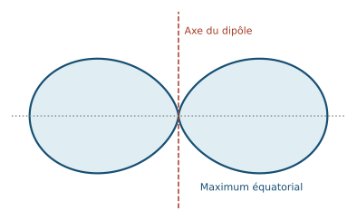
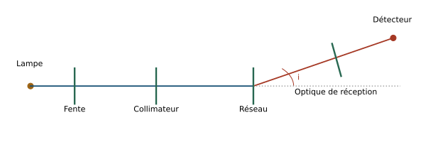
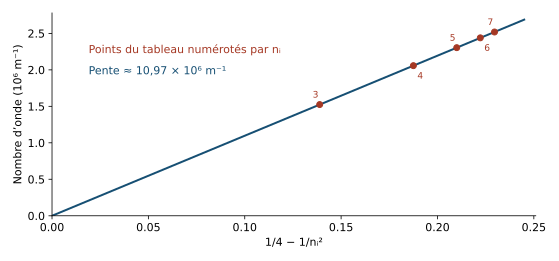

# ENS de Lyon, second concours 2009 — Physique · Corrigé brut

*Corrigé rédigé par IA, non officiel. Signalez toute erreur.*

**Rédaction** · GPT-6.2 Astra Ultra · vitesse non renseignée

## Q — Questionnaire

### Question Q.1 — Échelles de vitesse et de longueur

**a)** La vitesse du son dans l’air vaut environ $3.3\times10^2\,\mathrm{m\,s^{-1}}$ aux conditions normales. **b)** Pour la taille d’un atome, compter $10^{-10}$ m. Une cellule eucaryote typique mesure une dizaine de micromètres, soit $10^{-5}$ m. Le rayon terrestre est d’environ $6.4\times10^6$ m et la distance moyenne Terre–Soleil d’environ $1.5\times10^{11}$ m.

### Question Q.2 — Électronvolt

Un électronvolt est l’énergie gagnée par une particule portant une charge élémentaire lorsqu’elle est accélérée par une différence de potentiel de un volt dans le sens favorable. $1\,\mathrm{eV}=e(1\,\mathrm V)\simeq1.6\times10^{-19}$ J.

### Question Q.3 — Six relations physiques

**a)** $PV=nRT$. **b)** $\partial_t T=D\nabla^2T$. **c)** $\partial_t^2s=c^2\nabla^2s$. **d)** Pour une onde plane progressive dans le vide, $\mathbf E\perp\mathbf k$, $\mathbf B\perp\mathbf k$ et $\mathbf B=\hat{\mathbf k}\times\mathbf E/c$. **e)** $\nabla\times\mathbf E=-\partial_t\mathbf B$. **f)** $p+\rho gz+\rho v^2/2$ est constant sur une ligne de courant dans un écoulement stationnaire parfait et incompressible sous pesanteur. À la sortie d’un grand réservoir ouvert, pour un petit orifice situé à une profondeur $h$, $v\simeq\sqrt{2gh}$.

## I.A — Charge positive du modèle de Thomson

### Question I.A.1 — Champ au sein de la charge positive

À l’intérieur de la distribution positive, une sphère de rayon $r<a$ contient $Q_{\rm int}=e\,r^3/a^3$. Par symétrie, le champ est radial et son module constant sur cette surface de Gauss. Alors $4\pi r^2 E_r=Q_{\rm int}/\epsilon_0$ et $\mathbf E=e\mathbf r/(4\pi\epsilon_0 a^3)$. Le champ s’annule au centre. On calcule ici le champ extérieur à l’électron, en excluant son propre champ.

### Question I.A.2 — Rappel élastique

La charge électronique vaut $-e$, donc $\mathbf F=-e\mathbf E=-k_0\mathbf r$ avec $k_0=e^2/(4\pi\epsilon_0 a^3)$. La force linéaire ramène l’électron vers le centre dans chaque direction, comme un ressort isotrope, d’où l’expression « électron élastiquement lié ».

## I.B — Oscillations libres

### Question I.B.1 — Oscillation libre

Le principe fondamental donne $m_e\ddot{\mathbf r}=-k_0\mathbf r$. Chaque composante vérifie la même équation harmonique, avec $\omega_0^2=k_0/m_e$. La fréquence ordinaire de l’oscillateur est $f_0=(2\pi)^{-1}\sqrt{k_0/m_e}$.

### Question I.B.2 — Fréquence pour un rayon de 0,1 nm

Utiliser $a=10^{-10}$ m et $1/(4\pi\epsilon_0)=\mu_0c^2/(4\pi)\simeq9.0\times10^9$ en unités SI. On trouve $k_0\simeq2.30\times10^2\,\mathrm{N\,m^{-1}}$, $\omega_0\simeq1.59\times10^{16}\,\mathrm{s^{-1}}$ et $f_0\simeq2.53\times10^{15}\,\mathrm{Hz}$.

### Question I.B.3 — Rayonnement correspondant

Dans le vide $\lambda_0=c/f_0\simeq1.18\times10^{-7}$ m, soit environ $118$ nm. Cette longueur d’onde se situe dans l’ultraviolet.

## I.C — Excitation optique

### Question I.C.1 — Échelle de vitesse

Pour une oscillation libre d’amplitude $a_{\rm osc}$, la vitesse maximale est $\omega_0 a_{\rm osc}$. L’électron restant dans la sphère, une amplitude de l’ordre du rayon fournit l’échelle haute $\omega_0 a\simeq1.6\times10^6\,\mathrm{m\,s^{-1}}$, soit environ $5\times10^{-3}c$. La vitesse réelle dépend de l’amplitude. La dynamique non relativiste convient à cette échelle.

### Question I.C.2 — Influence magnétique

Pour une onde plane dans le vide, $B=E/c$ en amplitude. Le rapport de la force magnétique à la force électrique est au plus $evB/(eE)=v/c\ll1$ en ordre de grandeur. La force électrique domine la réponse de l’électron.

### Question I.C.3 — Approximation du champ uniforme

Le déphasage à travers l’atome est de l’ordre de $ka=2\pi a/\lambda\ll1$. Les phases du champ au centre et à la position électronique sont alors presque égales. En prenant la phase au centre pour origine, $\mathbf E(t)\simeq E_0\cos(\omega t)\mathbf e_z$.

### Question I.C.4 — Solution forcée

La projection sur $Oz$ donne $\ddot z+\omega_0^2z=-(eE_0/m_e)\cos\omega t$. Hors résonance, la composante forcée à la fréquence incidente est $z(t)=-eE_0\cos(\omega t)/[m_e(\omega_0^2-\omega^2)]$. Le modèle sans amortissement conserve aussi toute oscillation propre imposée par les conditions initiales. Le « régime permanent » désigne ici la seule composante forcée, ou la limite d’un faible amortissement après extinction du transitoire.

### Question I.C.5 — Analogue électrique

Un générateur sinusoïdal de tension alimente une inductance $L$ et un condensateur $C$ en série. Si $q$ est la charge du condensateur, $L\ddot q+q/C=U_0\cos\omega t$. La charge, ou la tension $q/C$, présente la même dépendance en $1/(\omega_0^2-\omega^2)$ avec $\omega_0^2=1/(LC)$. L’orientation du générateur fixe le signe.

## I.D — Diffusion de Rayleigh

### Question I.D.1 — Dipôle dans la limite de Rayleigh

Pour $\omega\ll\omega_0$, le mouvement suit presque statiquement le champ et $z\simeq-eE_0\cos(\omega t)/(m_e\omega_0^2)$. Ainsi $\mathbf p=-ez\mathbf e_z\simeq[e^2E_0/(m_e\omega_0^2)]\cos(\omega t)\mathbf e_z=4\pi\epsilon_0a^3\mathbf E(t)$. À amplitude dipolaire fixée, le champ rayonné est proportionnel à $\ddot p$, donc à $\omega^2$. La puissance rayonnée chute comme $\omega^4$. À basse fréquence la perte par cycle est petite devant l’énergie élastique et la rétroaction du rayonnement peut être négligée au premier ordre.

### Question I.D.2 — Temps retardé

Le potentiel vecteur à distance $r$ et au temps $t$ dépend de la dérivée du moment dipolaire à $t-r/c$. Le délai $r/c$ est le temps de parcours à la célérité de la lumière depuis la source. Voilà l’origine du mot « retardé ».

### Question I.D.3 — Structure locale de l’onde

Les champs donnés sont transverses, respectivement portés par $\mathbf e_\theta$ et $\mathbf e_\phi$, avec $B=E/c$ en amplitude signée. On a $\mathbf B=\mathbf e_r\times\mathbf E/c$. Sur une portion de front petite devant $r$ en zone lointaine, la direction radiale, l’orientation et le facteur d’amplitude en $1/r$ varient peu. On retrouve localement la structure d’une onde plane progressive, bien que le front global soit sphérique.

### Question I.D.4 — Rayonnement angulaire

Avec $t_r=t-r/c$, le vecteur de Poynting est $\mathbf R=(\mathbf E\times\mathbf B)/\mu_0=[\mu_0\ddot p(t_r)^2/(16\pi^2 c r^2)]\sin^2\theta\,\mathbf e_r$. Il est radial sortant. Sa norme s’annule sur l’axe du dipôle et atteint son maximum dans tout le plan équatorial. La figure donne la coupe méridienne de la distribution. Une rotation autour de l’axe engendre son diagramme tridimensionnel.

### Question I.D.5 — Puissance rayonnée

La puissance instantanée est l’intégrale de $\mathbf R\cdot\mathbf e_r\,r^2\sin\theta\,d\theta\,d\phi$. Le facteur angulaire vaut $2\pi(4/3)$, donc $P(t)=\mu_0\ddot p(t_r)^2/(6\pi c)$. Pour un dipôle sinusoïdal, $\ddot p=-\omega^2p$, et la moyenne sur une période est indépendante du décalage $r/c$. On trouve $\langle P\rangle=\alpha\omega^4\langle p^2\rangle$ avec $\alpha=\mu_0/(6\pi c)=1/(6\pi\epsilon_0 c^3)$. Si $p_0$ est l’amplitude crête, $\langle p^2\rangle=p_0^2/2$.

### Question I.D.6 — Couleurs du ciel et du Soleil

Dans le régime considéré, l’amplitude du dipôle varie peu avec la fréquence pour un même champ incident. La puissance diffusée varie alors comme $\lambda^{-4}$. Le ciel observé hors de la direction solaire reçoit davantage de courtes longueurs d’onde et paraît bleu. Au coucher, le trajet du faisceau direct dans l’atmosphère est plus long. Il perd préférentiellement son bleu par diffusion et apparaît orangé ou rouge. La couleur perçue dépend aussi de la sensibilité de l’œil et de la composition spectrale effective.

### Question I.D.7 — Polarisation du ciel

Une lumière polarisée rectilignement conserve une direction de vibration électrique fixe dans le plan transverse. Pour une lumière incidente non polarisée, décomposons $\mathbf E$ suivant la normale au plan de diffusion et une direction appartenant à ce plan. Un dipôle ne rayonne pas sur son axe. À $90^\circ$ de la direction incidente, la seconde composante disparaît dans la direction observée et la première subsiste, perpendiculaire au plan de diffusion. Plus généralement les intensités relatives des deux composantes sont $1$ et $\cos^2\chi$, où $\chi$ est l’angle de diffusion. Le mélange est partiellement polarisé. Les diffusions multiples réduisent la polarisation observée dans le ciel réel.

### Question I.D.8 — Résonance et absorption

À $\omega=\omega_0$, la solution forcée bornée précédente disparaît. Dans le modèle idéal, un terme $-eE_0t\sin(\omega_0t)/(2m_e\omega_0)$ s’accumule au cours du temps. C’est la résonance. Un terme $2\gamma\dot z$ dans l’équation représente la perte d’énergie par rayonnement ou par interactions avec le milieu et donne une réponse finie de largeur non nulle. Le rapprochement avec l’ozone est qualitatif. Ses transitions moléculaires absorbent fortement dans certaines bandes ultraviolettes, ce qui réduit le rayonnement UV transmis vers le sol. Un unique oscillateur de Thomson ne prédit pas ces bandes.

## II.A — Dynamique coulombienne

### Question II.A.1 — Analogie planétaire

Le noyau et l’électron sont de signes contraires. Ils s’attirent par une force centrale en $1/R^2$, comme deux masses gravitant l’une autour de l’autre. En comparant les modules des forces, $1/(4\pi\epsilon_0)$ joue le rôle de $G$, et les modules des charges nucléaire et électronique ceux de la masse de l’astre central et de la masse du satellite. L’attraction électrique vient ici du signe opposé des charges. La gravitation newtonienne attire deux masses positives.

### Question II.A.2 — Approximation du noyau fixe

L’électron et le noyau subissent des forces opposées de même module. Le rapport de leurs accélérations, $a_p/a_e=m_e/m_p\simeq5.4\times10^{-4}$, est très petit. Dans le référentiel du centre de masse, le rayon de l’orbite du noyau est dans le même rapport à celui de l’électron. Négliger ce mouvement est donc une première approximation.

### Question II.A.3 — Conservation du moment cinétique

Le noyau étant pris pour origine fixe d’un référentiel galiléen, $d\mathbf L/dt=\mathbf r\times\mathbf F=0$ puisque la force est radiale. La conservation est commune aux mouvements à force centrale. Pour $\mathbf L\ne\mathbf0$, la position et la vitesse restent dans le plan fixe normal à $\mathbf L$ et la vitesse aréolaire est constante. La forme circulaire est une hypothèse de cette partie.

### Question II.A.4 — Vitesse et période

Posons $K=e^2/(4\pi\epsilon_0)$. L’équilibre radial de l’orbite circulaire donne $m_ev^2/R=K/R^2$, donc $v=\sqrt{K/(m_eR)}$ et $T=2\pi R/v=2\pi\sqrt{m_eR^3/K}$. Cela donne $T^2\propto R^3$, comme pour les orbites circulaires gravitationnelles.

### Question II.A.5 — Énergie de l’orbite

Avec l’origine des énergies potentielles à l’infini, $E_p(R)=-K/R$ vérifie $-dE_p/dR=-K/R^2$. L’énergie cinétique est $m_ev^2/2=K/(2R)$, d’où $E=-K/(2R)=-e^2/(8\pi\epsilon_0 R)$. Le signe négatif correspond à un état lié.

### Question II.A.6 — Exposant dans la puissance de Larmor

La grandeur $e^2/\epsilon_0$ a les dimensions d’une énergie multipliée par une longueur, soit $\mathrm{kg\,m^3\,s^{-2}}$. Diviser par $c^3$ donne $\mathrm{kg\,s}$. Pour obtenir des watts, il faut multiplier par $\mathrm{m^2\,s^{-4}}$, donc par $a_e^2$. L’exposant cherché vaut $x=2$.

### Question II.A.7 — Instabilité classique

Sur l’orbite circulaire, la vitesse change de direction, donc $a_e\ne0$. La formule de Larmor prédit une puissance rayonnée positive. Sans apport extérieur, l’énergie mécanique décroît. Comme $E=-K/(2R)$ pour la famille des orbites circulaires, le rayon tend à diminuer. Le modèle classique ne rend donc pas compte de la stabilité de l’atome isolé.

## II.B — Quantification de Bohr

### Question II.B.1 — Rayons quantifiés

Le postulat $m_evR_n=n\hbar$ et la relation $m_ev^2=K/R_n$ entraînent $n^2\hbar^2=m_eKR_n$. Ainsi $R_n=n^2R_1$ avec $R_1=\hbar^2/(m_eK)=4\pi\epsilon_0\hbar^2/(m_ee^2)$. Avec les constantes arrondies de l’énoncé, $R_1\simeq5.26\times10^{-11}$ m, soit environ $0.053$ nm.

### Question II.B.2 — Niveaux d’énergie

Par substitution des rayons permis, $E_n=-K/(2R_n)=E_1/n^2$, où $E_1=-m_eK^2/(2\hbar^2)=-m_e e^4/(8\epsilon_0^2h^2)$. Avec les données du fascicule, $E_1\simeq-2.19\times10^{-18}$ J ou $-13.7$ eV. Les niveaux excités se rapprochent du seuil d’ionisation $E=0$.

### Question II.B.3 — Loi de Balmer–Rydberg

Pour une transition entre $p>n$, l’énergie absolue du photon est $hc/\lambda=|E_1|(1/n^2-1/p^2)$. La constante du modèle à noyau fixe est donc $R_\infty=|E_1|/(hc)=m_e e^4/(8\epsilon_0^2 h^3 c)\simeq1.11\times10^7\,\mathrm{m^{-1}}$. Elle est appelée $R_H$ à ce stade dans l’énoncé. La prise en compte de la masse finie du noyau la corrige en II.C.4.

## II.C — Spectroscopie atomique

### Question II.C.1 — Diffraction par le réseau

Pour des rayons incidents normaux au plan du réseau, deux traits voisins sont excités en phase. Dans la direction $i_p$, leur différence de marche est $d\sin i_p$. Une interférence constructive exige $d\sin i_p=p\lambda$, avec $p$ entier et $|p\lambda/d|\le1$.

### Question II.C.2 — Échelle angulaire et montage

À 500 traits par millimètre, le pas vaut $d=2.00\,\mu\mathrm m$. À l’ordre 1, $\lambda/d$ varie de $0.20$ à $0.40$. Les angles exacts sont $0.201$ à $0.412$ rad. La linéarisation $i_1\simeq\lambda/d$ donne une erreur relative sur l’angle allant d’environ $0.7$ à $2.8$ %. Elle convient à un premier tracé. Un étalonnage plus fin conserve l’arcsinus. Une lampe éclaire la fente d’entrée, un collimateur donne un faisceau parallèle à incidence normale sur le réseau, puis une optique de réception sélectionne et focalise la direction diffractée sur un détecteur. On mesure l’intensité en fonction de l’angle.

### Question II.C.3 — Mesure graphique de la constante

Pour une transition du niveau $n_i$ vers le niveau 2, tracer $y=1/\lambda$ en fonction de $x=1/4-1/n_i^2$. En lisant le tableau imprimé pour $n_i=3,4,5,6,7$, on trouve respectivement $656,486,434,410,397$ nm. Les abscisses valent $0.13889,\,0.18750,\,0.21000,\,0.22222,\,0.22959$. Les ordonnées valent $1.5244,\,2.0576,\,2.3041,\,2.4390,\,2.5189$ en $10^6\,\mathrm{m^{-1}}$. Les points se placent sur une droite passant par l’origine à la précision de lecture. L’ajustement de pente $\sum x_i y_i/\sum x_i^2$ donne $R_H\simeq1.0973\times10^7\,\mathrm{m^{-1}}$. Trois chiffres significatifs conviennent compte tenu des longueurs d’onde arrondies au nanomètre.

### Question II.C.4 — Masse réduite et isotopes

Pour le mouvement relatif d’un noyau de masse $M$ et d’un électron, la masse pertinente est $\mu_M=m_eM/(m_e+M)$. La constante de Rydberg est proportionnelle à $\mu_M$, et la longueur d’onde d’une transition donnée à $1/\mu_M$. Avec $M_H=m_p$ et $M_D\simeq2m_p$, on obtient
$$
\frac{\lambda_D-\lambda_H}{\lambda_H}=\frac{\mu_H}{\mu_D}-1=-\frac{m_e}{2(m_p+m_e)}\simeq-\frac{m_e}{2m_p}\simeq-2.7\times10^{-4}.
$$
Le deutérium présente des raies légèrement décalées vers le bleu. Pour la raie autour de $656$ nm, l’écart en valeur absolue est voisin de $0.18$ nm.

### Question II.C.5 — Limite de résolution

Pour $N$ traits éclairés, le premier zéro du pic principal est à un écart de différence de marche $\lambda/N$ par rapport à son maximum. À ordre fixé cela donne $\delta i\simeq\lambda/(Nd\cos i_p)$. Deux pics de longueurs d’onde voisines sont séparés de $\Delta i\simeq |p|\Delta\lambda/(d\cos i_p)$. Au critère de Rayleigh, $\Delta i=\delta i$, donc $\lambda/\Delta\lambda=N|p|$. Un centimètre de réseau contient $5000$ traits. À l’ordre 1, le pouvoir théorique 5000 dépasse le minimum requis, environ $1/(2.7\times10^{-4})\simeq3700$. Les raies sont donc théoriquement séparables. Autour de $656$ nm, la résolution idéale est $0.13$ nm, pour un écart voisin de $0.18$ nm. La largeur des fentes, les aberrations, l’échantillonnage du détecteur et les largeurs intrinsèque, Doppler ou collisionnelle des raies peuvent rendre la séparation plus difficile.

### Question II.C.6 — Portée des modèles

Dans la description quantique non relativiste, l’état de l’électron est une fonction d’onde $\psi$. Pour un état lié de l’hydrogène, les orbitales sont des états propres du Hamiltonien coulombien. La densité $|\psi|^2$ donne les probabilités de position et il n’y a pas d’orbite classique assignée. Le dipôle lié de Thomson conserve une valeur de modèle effectif pour la polarisation et la diffusion loin d’une résonance. Bohr retrouve les énergies en $1/n^2$ en associant dynamique classique, quantification du moment cinétique et transitions par photons. Le qualificatif « semi-classique » s’applique littéralement à ce mélange chez Bohr. Le modèle de Thomson tel qu’il est posé ici est un oscillateur **classique**. Sa réutilisation dans des descriptions semi-classiques de l’interaction lumière–matière explique le rapprochement proposé dans la question.
