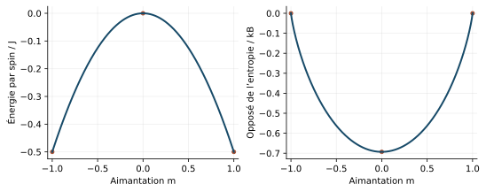
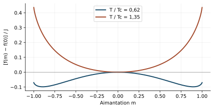
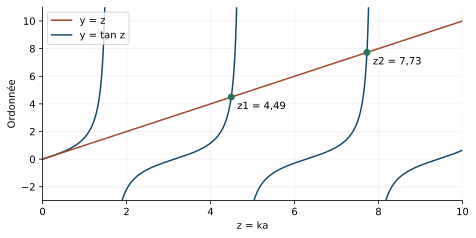
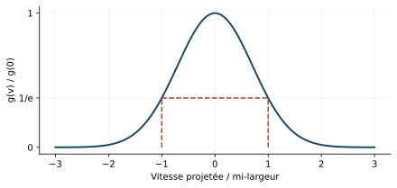
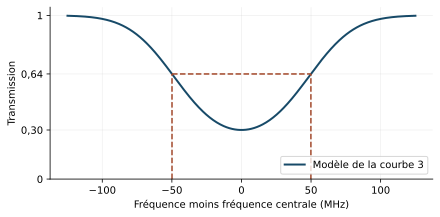

# ENS de Paris PC 2009 — Physique PC1 · Corrigé brut

*Corrigé rédigé par IA, non officiel. Signalez toute erreur.*

**Lecture du rapport du jury** · GPT-6.2 Astra Ultra · vitesse non renseignée

**Rédaction** · GPT-6.2 Astra Ultra · vitesse non renseignée

## Du facteur de Boltzmann à la mesure acoustique et optique de la constante des gaz parfaits

## 1.1 · Atmosphère isotherme

### Question 1 — Équilibrer une tranche de fluide

Sur une tranche horizontale de section $S$ et d’épaisseur $dz$, la résultante verticale des forces de pression est $[P(z)-P(z+dz)]S$. Le poids vaut $-\rho(z)gS\,dz$. La somme est nulle au repos. En divisant par $S\,dz$ puis en passant à la limite, on trouve $dP/dz=-\rho g$. La pression diminue lorsqu’on monte.

### Question 2 — Loi locale du gaz parfait

Un petit volume $dV$ contient la quantité de matière $dn=\rho\,dV/M$. La loi du gaz parfait appliquée à ce volume s’écrit $P\,dV=dn\,RT$, soit $P(z)=\rho(z)RT(z)/M$. Les deux champs peuvent donc varier avec l’altitude, même si leur quotient reste fixé dans un gaz isotherme.

### Question 3 — Variation de la pression avec l’altitude

À température constante, $P'/P=-Mg/(RT)$ s’intègre entre $0$ et $z$. Ainsi $\ln [P(z)/P_0]=-Mgz/(RT)$ et $P(z)=P_0\exp[-Mgz/(RT)]$. L’exposant est sans dimension puisque $Mgz$ et $RT$ sont deux énergies molaires.

### Question 4 — Facteur de Boltzmann

Si $m=M/N_A$ est la masse d’une molécule, $n=\rho/m=P/(k_BT)$ car $R=N_Ak_B$. Avec l’origine de l’énergie potentielle prise à $z=0$, $E_p(z)=mgz$. On obtient $n(z)=n_0\exp[-E_p(z)/(k_BT)]$, où $n_0=P_0/(k_BT)$. Un autre choix d’origine modifierait seulement la constante devant l’exponentielle.

### Question 5 — Échelle verticale de l’atmosphère

La hauteur $H=RT/(Mg)=k_BT/(mg)$ fait décroître la densité et la pression d’un facteur $e$. Avec $T=293{,}15\ \mathrm K$ et $M=0{,}029\ \mathrm{kg\,mol^{-1}}$, on trouve $H=8{,}314\times293{,}15/(0{,}029\times9{,}81)\ \mathrm m\simeq8{,}57\ \mathrm{km}$.

### Question 6 — Portée du modèle atmosphérique

Une hauteur de quelques kilomètres explique la diminution marquée de la pression en montagne. Pour une couche de faible épaisseur, $g$ varie peu et une température moyenne convient à un ordre de grandeur. Sur toute l’atmosphère, $T$ varie d’une couche à l’autre, l’humidité et parfois la composition changent, et les mouvements de l’air perturbent l’équilibre. En conservant $M$ et $g$ constants, une température mesurée $T(z)$ donnerait déjà $\ln(P/P_0)=-(Mg/R)\int_0^z dz'/T(z')$.

## 1.2 · Aimantation et entropie

### Question 7 — Compter les configurations et trouver les états fondamentaux

Chacun des $N$ degrés de liberté possède deux valeurs, d’où $2^N$ configurations. La double somme se factorise et $E=-J(\sum_i\sigma_i)^2/(2N)$. Pour $J>0$, il faut maximiser $|\sum_i\sigma_i|$. Sa valeur $N$ est atteinte par les deux configurations entièrement alignées, d’énergie $-JN/2$.

### Question 8 — Aimantations accessibles

Avec $n_+$ signes positifs et $N-n_+$ signes négatifs, $m=(2n_+-N)/N$. Les valeurs sont $-1,-1+2/N,\ldots,1$ et zéro est accessible si $N$ est pair. Comme $\sum_i\sigma_i=Nm$, on a $E(C)=-NJm(C)^2/2$.

### Question 9 — Dégénérescence d’un niveau d’aimantation

Une fois fixée une valeur permise de $m$, les effectifs $n_\pm=N(1\pm m)/2$ sont imposés. Choisir les emplacements des $n_+$ spins positifs détermine entièrement la configuration. Sa multiplicité est donc $\Omega_N(m)=N!/(n_+!\,n_-!)$. En particulier, pour $m=\pm1$, il n’y a qu’une configuration par valeur de $m$.

### Question 10 — Entropie combinatoire par degré de liberté

Posons $x_\pm=(1\pm m)/2$. Dans $\ln N!-\ln (Nx_+)!-\ln (Nx_-)!$, les termes en $N\ln N$ et les termes linéaires s’annulent car $x_++x_-=1$. La formule de Stirling laisse
$$\lim_{N\to\infty}\frac{\ln\Omega_N}{N}=-x_+\ln x_+-x_-\ln x_-.$$
La limite se prend sur des valeurs admissibles tendant vers $m$. Aux extrémités, on prolonge $x\ln x$ par zéro, conformément à $\Omega_N=1$.

### Question 11 — Potentiel à température fixée

L’énergie libre contrainte vaut $F^*(N,T;m)=E(m)-Tk_B\ln\Omega_N(m)$. La division par $N$ puis la limite précédente donnent $f^*=e(m)-Ts(m)$, avec $e(m)=-Jm^2/2$ et $s(m)=-k_B[x_+\ln x_++x_-\ln x_-]$. À $m=0$, les deux orientations équiprobables produisent l’entropie maximale $k_B\ln2$.

### Question 12 — Équilibre de l’aimantation

À $N,T$ imposés, l’aimantation d’équilibre réalise le minimum global de $f^*(T;m)$ sur $[-1,1]$. Pour un minimum intérieur, il faut $\partial_m f^*=0$ et la courbure doit être positive ou nulle. Il reste à comparer les valeurs du potentiel si plusieurs points stationnaires existent.

### Question 13 — Forme des contributions énergétique et entropique

L’énergie $e=-Jm^2/2$ est une parabole paire concave. En $m=-1,0,1$, ses valeurs sont $-J/2,0,-J/2$ et ses pentes $J,0,-J$. Pour $T>0$, la contribution $-Ts$ est paire et convexe, de valeurs $0,-k_BT\ln2,0$ aux mêmes points. Sa dérivée $(k_BT/2)\ln[(1+m)/(1-m)]$ tend vers $-\infty$ au bord gauche et $+\infty$ au bord droit, et vaut zéro au centre.

### Question 14 — Compétition entre ordre et désordre

La contribution énergétique est minimale aux deux bords $m=\pm1$, lorsque tous les spins s’alignent. La contribution entropique préfère le grand nombre de configurations de $m=0$. Pour $k_BT\ll J$, l’énergie impose un fort alignement. Pour $k_BT\gg J$, le terme entropique l’emporte et l’aimantation d’équilibre s’annule.

### Question 15 — Un ou deux minimums

La dérivée du potentiel est $f'=-Jm+k_BT\,\mathrm{artanh}(m)$ et sa courbure $f''=-J+k_BT/(1-m^2)$. Au-dessus de la température critique, la courbure est positive partout et le centre est l’unique minimum. En dessous, le centre devient un maximum. Pour $0<m<1$, la courbure croît, puis la pente diverge au bord. Il existe donc un unique minimum du côté positif et son symétrique du côté négatif.

### Question 16 — Température critique

Le changement de signe de $f''(0)=-J+k_BT$ impose $T_c=J/k_B$. À cette température, les contributions quadratiques se compensent. Le premier terme non constant près de l’origine est $k_BT_c m^4/12>0$, de sorte que le minimum s’aplatit sans se transformer en maximum à $T=T_c$.

### Question 17 — Équation des aimantations spontanées

Pour un extremum intérieur, $Jm=k_BT\,\mathrm{artanh}(m)$. L’application de la tangente hyperbolique donne $m=\tanh[Jm/(k_BT)]$. Pour $0<T<T_c$, la pente à l’origine du membre droit vaut $T_c/T>1$, puis cette courbe sature. Les deux solutions non nulles correspondent aux minimums de Q15, la solution $m=0$ au maximum.

### Question 18 — Température de Curie du fer

Sous $T_c$, l’interaction favorise une aimantation spontanée dans chaque domaine. Le champ de l’aimant peut en orienter le résultat dans le clou. Au-dessus, l’agitation thermique détruit cet ordre et l’attraction macroscopique chute fortement. Une faible réponse paramagnétique demeure possible. La donnée $800\,^\circ\mathrm C\simeq1073\ \mathrm K$ fixe ici l’ordre de grandeur de $J=k_BT_c$. Le modèle de spins binaires à interaction identique entre toutes les paires décrit la transition, mais laisse de côté les domaines, les interactions de voisinage et le champ appliqué.

## 2.1 · Vitesse du son

### Question 19 — Homogénéité sur un mètre

L’équilibre hydrostatique donne une variation relative $|\Delta P|/P_0\simeq L/H$. Pour $L\simeq1\ \mathrm m$ et $H$ de plusieurs kilomètres, elle est de l’ordre de $10^{-4}$. Dans un gaz à température uniforme, la variation relative de densité est du même ordre. On prend donc $P_0,\rho_0$ constants dans la cavité. Au repos, poids et gradient hydrostatique se compensent exactement. Dans la dynamique acoustique, le terme de flottabilité rapporté à un gradient de surpression est de l’ordre de $gL/c_a^2\ll1$.

### Question 20 — Linéarisation de l’équation du mouvement

Le fluide est traité comme continu et parfait pour cette propagation, avec viscosité négligeable. Après retrait de l’équilibre, l’équation d’Euler donne $\rho[\partial_t\mathbf v+(\mathbf v\cdot\nabla)\mathbf v]=-\nabla P_1$. Les perturbations $P_1/P_0$, $\rho_1/\rho_0$ et le nombre de Mach $|\mathbf v|/c_a$ sont petits. Au premier ordre, le produit $\rho_1\partial_t\mathbf v$ et le terme convectif disparaissent. Il reste $\rho_0\partial_t\mathbf v=-\nabla P_1$.

### Question 21 — Conservation de la masse

La conservation locale s’écrit $\partial_t(\rho_0+\rho_1)+\nabla\cdot[(\rho_0+\rho_1)\mathbf v]=0$. L’état de base est stationnaire et homogène. Le flux $\rho_1\mathbf v$ est quadratique. Au premier ordre, $\partial_t\rho_1=-\rho_0\nabla\cdot\mathbf v$. Une divergence positive traduit un départ de matière et une baisse de densité.

### Question 22 — Compressibilité isentropique

Pour une parcelle de masse fixe, $dV/V=-d\rho/\rho$. La définition devient $\chi_S=(1/\rho)(\partial\rho/\partial P)_S$. L’évolution adiabatique réversible conserve l’entropie de la parcelle, d’où $\rho_1=\rho_0\chi_S P_1$ à l’ordre acoustique, avec $\chi_S$ évaluée au repos. Q21 fournit $\chi_S\partial_tP_1=-\nabla\cdot\mathbf v$.

### Question 23 — Équation des ondes de pression

Dérivons le résultat précédent dans le temps et prenons la divergence de l’équation d’Euler linéarisée. On trouve $\chi_S\partial_t^2P_1=(1/\rho_0)\Delta P_1$, soit $\Delta P_1-c_a^{-2}\partial_t^2P_1=0$, avec $c_a=(\rho_0\chi_S)^{-1/2}$. Le produit $\rho_0\chi_S$ a la dimension d’un inverse de vitesse au carré.

### Question 24 — Loi de Laplace et vitesse du son

Pour $n$ moles idéales à capacités constantes, $nC_{V,m}\,dT=-P\,dV$. Avec $PV=nRT$ et $C_{P,m}-C_{V,m}=R$, on obtient $dT/T=-(\gamma-1)dV/V$. Ainsi $TV^{\gamma-1}$ puis $PV^\gamma$ sont constants. En différentiant cette dernière relation à entropie constante, $\chi_S=1/(\gamma P_0)$. Q23 et $P_0/\rho_0=RT/M$ donnent $c_a=\sqrt{\gamma RT/M}$.

### Question 25 — Choix de l’argon

L’argon est un gaz noble monoatomique. En régime dilué, aux températures étudiées, les trois translations fournissent $C_{V,m}=3R/2$. La relation de Mayer donne $C_{P,m}=5R/2$, donc $\gamma=5/3$. L’absence de rotations et de vibrations moléculaires simplifie l’interprétation de la mesure.

### Question 26 — Célérité à zéro degré Celsius

Avec la donnée $M/\gamma=24\times10^{-3}\ \mathrm{kg\,mol^{-1}}$ et $T=273{,}15\ \mathrm K$, on a $c_a=\sqrt{8{,}314\times273{,}15/0{,}024}=307{,}6\ \mathrm{m\,s^{-1}}$. Cette vitesse servira pour les fréquences acoustiques de la sphère.

## 2.2 · Résonances acoustiques sphériques

### Question 27 — Réduire la propagation radiale à une dimension

Pour une pression indépendante des angles, $\Delta P_1=r^{-1}\partial_r^2(rP_1)$. En multipliant Q23 par $r>0$, on obtient $\partial_r^2\psi-c_a^{-2}\partial_t^2\psi=0$ pour $\psi=rP_1$. Une pression finie au centre impose $\psi(0,t)=0$. La pression elle-même peut parfaitement y être non nulle.

### Question 28 — Profil régulier de pression

Avec la convention $e^{-i\omega t}$, l’amplitude $\psi(r)$ satisfait $\psi''+k^2\psi=0$ et $k=\omega/c_a$. Le terme en $\cos(kr)$ est exclu par la condition au centre. Ainsi $P_1(r,t)=C\sin(kr)e^{-i\omega t}/r$ en notation complexe. Sa limite au centre est $Ck\,e^{-i\omega t}$. Les champs mesurés en sont les parties réelles.

### Question 29 — Vitesse acoustique radiale

L’équation d’Euler conduit à $i\omega\rho_0\mathbf v=\nabla P_1$. Ainsi
$$\mathbf v(r,t)=\frac{C e^{-i\omega t}}{i\omega\rho_0}\frac{kr\cos(kr)-\sin(kr)}{r^2}\,\mathbf e_r.$$
Près du centre, le numérateur vaut $-(kr)^3/3+O(r^5)$. La vitesse s’y annule, comme l’exige la régularité d’un champ radial.

### Question 30 — Condition de paroi rigide

L’imperméabilité d’une paroi immobile impose $\mathbf v(a,t)\cdot\mathbf e_r=0$. Le champ étant radial, toute la vitesse y est nulle. Pour $\omega>0$, l’équation d’Euler traduit cette condition par $\partial_r P_1(a,t)=0$. La surpression à la paroi peut être élevée.

### Question 31 — Quantification des fréquences

À $r=a$, le numérateur de la vitesse s’annule si $z\cos z-\sin z=0$, où $z=ka$. Aux racines, $\cos z\ne0$, donc $\tan z=z$. Les racines strictement positives $z_p$, classées par ordre croissant, donnent $\omega_p=c_a z_p/a$. La solution $z=0$ relève du champ statique et ne compte pas comme une résonance acoustique.

### Question 32 — Racines et grandes valeurs de l’indice

Les intersections de $y=z$ et de $y=\tan z$ se trouvent pour $p\ge1$ dans $(p\pi,(p+\tfrac12)\pi)$. La fonction $\tan z-z$ y croît strictement de $-p\pi$ à $+\infty$. Posons $b_p=(p+\tfrac12)\pi$ et $z_p=b_p-\varepsilon_p$. Comme $\cot\varepsilon_p=b_p-\varepsilon_p$ et $\cot\varepsilon=1/\varepsilon-\varepsilon/3+O(\varepsilon^3)$, on a $\varepsilon_p=b_p^{-1}+O(b_p^{-3})$. Ainsi $z_p=b_p-b_p^{-1}+O(p^{-3})$.

### Question 33 — Fréquence acoustique fondamentale radiale

La sphère de volume $V=3{,}0\times10^{-3}\ \mathrm{m^3}$ a pour rayon $a=(3V/4\pi)^{1/3}=0{,}08947\ \mathrm m$. La première racine est $z_1=4{,}49341$. En divisant la pulsation par $2\pi$, $f_1=c_a z_1/(2\pi a)=2{,}46\ \mathrm{kHz}$. Cette fréquence concerne la famille de modes radiaux étudiée.

## 2.3 · Étalonnage électromagnétique

### Question 34 — Mesurer un rayon avec une autre famille d’ondes

Dans le vide, la seule combinaison de $a$ et $c$ de dimension fréquence est $c/a$. On a $f_j=C_j c/a$, où le nombre sans dimension $C_j$ dépend du mode. L’échelle $c/a\simeq3{,}4\times10^9\ \mathrm{Hz}$ place les premiers modes dans les micro-ondes. Une fréquence électromagnétique mesurée donne $a=C_j c/f_j$ dès que le mode et son coefficient sont connus. On peut aussi former un rapport de fréquences acoustique et électromagnétique pour éliminer directement $a$.

### Question 35 — Maxwell dans le vide de la cavité

Sans charge ni courant dans le volume intérieur, les équations locales sont $\nabla\cdot\mathbf E=0$, $\nabla\cdot\mathbf B=0$, $\nabla\times\mathbf E=-\partial_t\mathbf B$ et $\nabla\times\mathbf B=\mu_0\varepsilon_0\,\partial_t\mathbf E$. Des charges ou courants surfaciques peuvent cependant exister sur la paroi.

### Question 36 — Ondes électromagnétiques

Prenons le rotationnel de la loi de Faraday. Le double rotationnel vaut $\nabla(\nabla\cdot\mathbf E)-\Delta\mathbf E=-\Delta\mathbf E$, tandis que le membre droit est $-\mu_0\varepsilon_0\partial_t^2\mathbf E$. D’où $\Delta\mathbf E-c^{-2}\partial_t^2\mathbf E=0$ avec $c=(\mu_0\varepsilon_0)^{-1/2}$. En partant de Maxwell-Ampère et en utilisant $\nabla\cdot\mathbf B=0$, on obtient la même équation pour $\mathbf B$.

### Question 37 — Champs au contact du conducteur parfait

Pour les champs oscillants, $\mathbf E$ et $\mathbf B$ sont nuls dans le conducteur parfait. Au bord côté vide, $E_{\parallel}=0$ et $B_{\perp}=0$. Si $\mathbf n$ va du métal vers le vide, les deux autres composantes vérifient $\mathbf n\cdot\mathbf E=\sigma/\varepsilon_0$ et $\mathbf n\times\mathbf B=\mu_0\mathbf K$, où $\sigma$ et $\mathbf K$ sont les densités surfaciques de charge et de courant. Les champs tangentiel magnétique et normal électrique peuvent donc subsister.

### Question 38 — Absence de mode électrique purement radial

Si $\mathbf E=E(r,t)\mathbf e_r$, son flux à travers toute sphère intérieure vaut $4\pi r^2E(r,t)$. La cavité ne contient aucune charge et le théorème de Gauss impose un flux nul pour tout rayon. Le seul champ régulier de cette forme est donc le champ nul. Une dépendance angulaire des composantes est indispensable pour construire un mode.

### Question 39 — Équations pour les amplitudes complexes

Avec $e^{-i\omega t}$, les deux divergences sont nulles et $\nabla\times\mathbf E=i\omega\mathbf B$, $\nabla\times\mathbf B=-i\omega\mathbf E/c^2$. Les amplitudes satisfont les équations de Helmholtz $\Delta\mathbf E+k^2\mathbf E=0$ et $\Delta\mathbf B+k^2\mathbf B=0$, avec $k=\omega/c$. La même convention temporelle doit être gardée dans les deux rotationnels.

### Question 40 — Équation radiale du champ azimutal

Pour $\mathbf E=E(r)\sin\theta\,\mathbf e_\varphi$, les composantes radiale et polaire de son rotationnel valent $2E\cos\theta/r$ et $-(E'+E/r)\sin\theta$. Le second rotationnel possède alors une seule composante, $[-E''-2E'/r+2E/r^2]\sin\theta$ suivant $\mathbf e_\varphi$. Or Maxwell donne $\nabla\times\nabla\times\mathbf E=k^2\mathbf E$. Ainsi $E''+2E'/r+(k^2-2/r^2)E=0$, avec $k=\omega/c$. Le terme en $2/r^2$ vient de la structure angulaire.

### Question 41 — Vérification de la condition magnétique

Le champ électrique est tangent à la sphère, donc $E(a)=0$. Par Faraday,
$$\mathbf B=\frac{1}{i\omega}\left[\frac{2E}{r}\cos\theta\,\mathbf e_r-\left(E'+\frac Er\right)\sin\theta\,\mathbf e_\theta\right].$$
À $r=a$, la composante normale $B_r$ est directement proportionnelle à $E(a)$ et s’annule. La composante tangentielle peut être proportionnelle à $E'(a)$ et être soutenue par un courant superficiel.

### Question 42 — Variable radiale sans dimension

Posons $x=kr$ et $E(r)=f(x)$. Alors $E'=kf'$ et $E''=k^2f''$, les primes de $f$ se rapportant à $x$. Après division par $k^2$, on obtient $f''+(2/x)f'+(1-2/x^2)f=0$, équation de Bessel sphérique d’ordre un.

### Question 43 — Spectre de la famille électromagnétique

La solution régulière donnée est $f(x)=(\sin x-x\cos x)/x^2$, qui vaut $x/3+O(x^3)$ à l’origine. La condition $f(ka)=0$ donne à rayon non nul $\sin(ka)-ka\cos(ka)=0$. Les mêmes nombres $z_p$ qu’en acoustique interviennent, donc $\omega_p^{\rm em}=c z_p/a$. Ce résultat porte sur la polarisation choisie en Q40.

### Question 44 — Première fréquence électromagnétique calculée

Pour le même volume et $z_1=4{,}49341$, $f_1^{\rm em}=cz_1/(2\pi a)\simeq2{,}40\times10^9\ \mathrm{Hz}$. Le rapport à la fréquence de Q33 est $c/c_a$, soit près d’un million. Cette comparaison fournit une mesure de $c_a$ indépendante du rayon.

### Question 45 — Effet du gaz diélectrique

Un gaz homogène, non magnétique et de permittivité relative $\varepsilon_r$ transporte l’onde à $c/\sqrt{\varepsilon_r}$. La géométrie et la condition de paroi fixent toujours $ka=z_p$. Il vient $\omega_p^{\rm em}=cz_p/(a\sqrt{\varepsilon_r})$. Pour $\varepsilon_r>1$, la fréquence diminue.

## 2.4 · Élasticité de la paroi

### Question 46 — Oscillateur mécanique de la paroi

Orientons $x$ de la chambre de gaz vers l’extérieur et mesurons-le depuis l’équilibre. Les pressions de base s’annulent, donc $\mu S\ddot x=SP_1-\kappa x$, où $\mu S$ est la masse du piston. Ainsi $\ddot x+\omega_c^2x=P_1/\mu$ avec $\omega_c=\sqrt{\kappa/(\mu S)}$.

### Question 47 — Admittance du piston

En régime harmonique, $x=P_1/[\mu(\omega_c^2-\omega^2)]$ et $v=-i\omega x$. L’admittance vaut donc $Y(\omega)=-i\omega/[\mu(\omega_c^2-\omega^2)]$. Dans ce modèle sans dissipation, elle est imaginaire pure en dehors de la résonance. Elle tend vers zéro pour une raideur infinie.

### Question 48 — Résonances avec une paroi mobile

La faible amplitude permet d’appliquer la condition au rayon moyen $a$. Dans le gaz, Q28 et Q29 donnent $v_r(a)/P_1(a)=(z\cot z-1)/(i\omega\rho_0a)$ avec $z=\omega a/c_a$. L’égalité avec $Y(\omega)$ impose
$$z\cot z-1=\frac{\rho_0a\,\omega^2}{\mu(\omega_c^2-\omega^2)}.$$
Les pulsations cherchées sont les racines de cette équation couplée. À paroi rigide, son membre droit s’annule et l’on retrouve Q31.

### Question 49 — Décalage perturbatif

Posons $G(z)=z\cot z-1$. Pour la racine rigide, $\cot z_p=1/z_p$ et $G'(z_p)=\cot z_p-z_p(1+\cot^2z_p)=-z_p$. Comme $\delta z=z_p\Delta_p/\omega_p$, la linéarisation donne $-z_p^2\Delta_p/\omega_p=\rho_0a\omega_p^2/[\mu(\omega_c^2-\omega_p^2)]$. Avec $z_p=\omega_p a/c_a$,
$$\frac{\Delta_p}{\omega_p}=-\frac{A}{1-(\omega_p/\omega_c)^2},\qquad A=\frac{\rho_0c_a^2}{\mu a\omega_c^2}.$$
Le coefficient est sans dimension. L’approximation suppose que la petite admittance varie peu sur le décalage considéré.

### Question 50 — Correction du cinquième mode

La cinquième racine est $z_5=17{,}2208$. Avec $a$ et $c_a$ des Q26 et Q33, $f_5=9{,}423\ \mathrm{kHz}$. Pour $f_c=13{,}58\ \mathrm{kHz}$ et $A=10^{-6}$, on trouve $\Delta f_5/f_5=-1{,}93\times10^{-6}$, soit $\Delta f_5\simeq-0{,}018\ \mathrm{Hz}$. Sous la résonance mécanique, la paroi rend le mode plus lent. Un tel déplacement compte pour une mesure à la partie par million.

### Question 51 — Choix des modes pour la métrologie

À l’approche de $f_c$, la correction est amplifiée et dépend fortement de la fréquence propre réelle ainsi que de l’amortissement de la paroi. Il faut écarter les modes les plus proches. Ici $p=7$ et $p=8$ encadrent $13{,}58\ \mathrm{kHz}$ avec $12{,}87$ et $14{,}59\ \mathrm{kHz}$, respectivement. Le domaine précis à exclure dépend de la largeur de la résonance et de l’incertitude tolérée.

### Question 52 — Autres corrections de cavité

Les couches limites thermiques et visqueuses à la paroi dissipent de l’énergie et déplacent les pics. L’écart au gaz parfait et les impuretés modifient l’équation d’état et la célérité. Une température inhomogène, la dilatation de la sphère, les défauts de sphéricité et les ouvertures pour les transducteurs changent les fréquences. Pour une mesure précise, on contrôle la température et la composition et on mesure plusieurs pressions afin d’extrapoler vers le gaz dilué.

## 3.1 · Distribution des vitesses

### Question 53 — Flux de particules sur une surface

Dans le modèle à six directions, seule la population dirigée vers la face et normale à celle-ci peut la heurter. Sa densité est $n/6$. Les particules situées à distance normale inférieure à $v_0\,dt$ traversent la surface $\delta S$ durant $dt$. Leur nombre moyen est donc $(n/6)\,\delta S\,v_0\,dt$.

### Question 54 — Impulsion transférée dans un choc

Soit $\mathbf n$ la normale sortant du gaz. La quantité de mouvement de la particule passe de $mv_0\mathbf n$ à $-mv_0\mathbf n$. Sa variation est $-2mv_0\mathbf n$. Par conservation de la quantité de mouvement lors du choc, la paroi reçoit $+2mv_0\mathbf n$.

### Question 55 — Pression cinétique

L’impulsion normale reçue par $\delta S$ pendant $dt$ vaut $(n/6)\delta S\,v_0dt\times 2mv_0$. La pression est cette quantité divisée par $\delta S\,dt$. On trouve $P=nmv_0^2/3$, de dimension énergie par volume. Le facteur $1/3$ traduit l’isotropie des trois axes dans ce modèle.

### Question 56 — Énergie cinétique et température

L’équation d’état s’écrit $P=nk_BT$. En identifiant au résultat précédent, on obtient $v_0=\sqrt{3k_BT/m}$. Cette vitesse unique du modèle représente la vitesse quadratique moyenne, puisque $mv_0^2/2=3k_BT/2$.

### Question 57 — Distribution de Maxwell

L’énergie de translation est $m(v_x^2+v_y^2+v_z^2)/2$. La dépendance en position se factorise à l’intégration sur les positions accessibles. Le facteur de Boltzmann se sépare donc en trois gaussiennes indépendantes. Normalisée à une intégrale unité, chacune est $g(v)=\sqrt{m/(2\pi k_BT)}\exp[-mv^2/(2k_BT)]$. Le produit $g(v_x)g(v_y)g(v_z)d^3v$ donne la probabilité recherchée.

### Question 58 — Vitesse quadratique moyenne

Avec $\beta=m/(2k_BT)$, le quotient des intégrales fourni vaut $\langle v_x^2\rangle=1/(2\beta)=k_BT/m$. Les deux autres composantes ont la même variance. Ainsi $\langle v^2\rangle=3k_BT/m$ et $v_{\rm rms}=\sqrt{3k_BT/m}$. La vitesse vectorielle moyenne s’annule, par parité de chaque composante.

### Question 59 — Largeur de la gaussienne des vitesses

La densité d’une composante est paire, maximale en zéro, et décroît de chaque côté. Le rapport $g(v)/g(0)$ atteint $1/e$ pour $mv^2/(2k_BT)=1$. La mi-largeur vaut $v_l=\sqrt{2k_BT/m}=\sqrt{2RT/M}$. Pour l’ammoniac à $273{,}15\ \mathrm K$, $M=0{,}017\ \mathrm{kg\,mol^{-1}}$ donne $v_l\simeq517\ \mathrm{m\,s^{-1}}$. Elle représente une largeur de composante, distincte de la vitesse quadratique totale.

### Question 60 — Limite diluée

À température fixée et loin de la condensation, la basse pression correspond à une faible densité. La distance moyenne entre particules dépasse alors largement leur taille et la portée des interactions. Le volume propre et les contributions d’interaction à l’énergie et à la pression deviennent négligeables. Des collisions rares suffisent encore à établir l’équilibre si le temps d’observation est assez long.

## 3.2 · Élargissement Doppler

### Question 61 — Pulsation dans le référentiel du récepteur

Le récepteur suit $\mathbf r(t)=\mathbf r_0+\mathbf v t$. La phase $\mathbf k\cdot\mathbf r-\omega t$ évaluée sur cette trajectoire devient une constante moins $(\omega-\mathbf k\cdot\mathbf v)t$. Avec $\mathbf k=(\omega/c)\mathbf u$, $\omega_D=\omega[1-\mathbf u\cdot\mathbf v/c]$. Cette description utilise le temps commun de l’approximation non relativiste adaptée à l’agitation thermique.

### Question 62 — Manifestation audible

Une personne immobile entend le son d’une sirène plus aigu lorsque le véhicule la rejoint et plus grave après son passage. La vitesse relative suivant la ligne de visée change de signe. Pour un récepteur mobile et une source fixe, se diriger vers les crêtes augmente également la fréquence des rencontres.

### Question 63 — Sélection Doppler des molécules absorbantes

Seule compte la composante $v_\parallel=\mathbf u\cdot\mathbf v$, distribuée selon $g$. La résonance $\omega_D=\omega_a$ sélectionne $v_\parallel=c(\omega-\omega_a)/\omega$. À $\omega$ fixé, une petite fenêtre $\delta\omega$ autour de la résonance correspond à $|\delta v_\parallel|=c\,\delta\omega/\omega$. La densité absorbante est proportionnelle à $n\,g(v_\parallel)|\delta v_\parallel|$. On obtient
$$\alpha(\omega)\propto\frac1\omega\exp\left[-\left(u\frac{\omega-\widehat\omega}{\omega}\right)^2\right],\quad u=\frac{c}{v_l}=c\sqrt{\frac m{2k_BT}},\quad\widehat\omega=\omega_a.$$
Le préfacteur $1/\omega$ est le jacobien du passage de la fenêtre de pulsation à la fenêtre de vitesse.

### Question 64 — Positions des points à un sur e

Le facteur exponentiel a son maximum égal à un en $\omega=\omega_a$. Posons $w=1/u=v_l/c$. Pour les deux abscisses de hauteur $1/e$, $|1-\omega_a/\omega|=w$. On trouve $\omega_-=\omega_a/(1+w)$ et $\omega_+=\omega_a/(1-w)$. La courbe est en cloche près de la résonance et sa légère dissymétrie vient du $\omega$ du dénominateur.

### Question 65 — Mi-largeur dans la limite thermique

Pour l’ammoniac à $0\,^\circ\mathrm C$, $w\simeq1{,}72\times10^{-6}$, donc $u\simeq5{,}8\times10^5$. La demi-différence exacte des racines est $\Delta\omega=\omega_a w/(1-w^2)\simeq\omega_a v_l/c$. Sur cette largeur, $1/\omega$ varie relativement d’environ $w$. Son remplacement par $1/\omega_a$ préserve donc le calcul dominant de la largeur.

### Question 66 — Déduction de la constante molaire

En élevant au carré $\Delta\omega/\omega_a\simeq v_l/c$ puis en remplaçant $v_l^2$ par $2RT/M$, on obtient
$$R=\frac{Mc^2}{2T}\left(\frac{\Delta\omega}{\omega_a}\right)^2.$$
La largeur et la fréquence centrale peuvent toutes deux être en hertz ou toutes deux en radians par seconde. Le rapport élimine $2\pi$.

### Question 67 — Ordre des pressions sur la figure expérimentale

Au centre de la raie, la transmission décroît de la courbe 1 à la courbe 5. D’après $\mathcal T=\exp(-\alpha L)$, l’épaisseur optique augmente. À température et longueur fixées, en régime dilué, le nombre de molécules absorbantes et l’absorption centrale augmentent avec la pression. La courbe 5 correspond ainsi à la pression la plus élevée.

### Question 68 — Lire une largeur d’absorption sur un graphe de transmission

Sur la courbe 3, le minimum de transmission se lit $\mathcal T_0\simeq0{,}30$. Au point où l’absorption vaut $\alpha_0/e$, la transmission vaut $\exp[(\ln\mathcal T_0)/e]=\mathcal T_0^{1/e}\simeq0{,}64$. À cette ordonnée, les intersections se lisent vers $28\,953{,}644$ et $28\,953{,}744\ \mathrm{GHz}$, pour un centre à $28\,953{,}694\ \mathrm{GHz}$. La demi-différence est environ $0{,}050\ \mathrm{GHz}$, soit $50\ \mathrm{MHz}$ à la précision du tracé.

### Question 69 — Estimation numérique de R

Avec $\Delta\nu=49{,}9\times10^6\ \mathrm{Hz}$ et $\nu_a=28\,953{,}694\times10^9\ \mathrm{Hz}$, le rapport vaut $1{,}72\times10^{-6}$. La formule de Q66 avec $M=0{,}017\ \mathrm{kg\,mol^{-1}}$, $c=3{,}00\times10^8\ \mathrm{m\,s^{-1}}$ et $T=273{,}15\ \mathrm K$ fournit $R\simeq8{,}32\ \mathrm{J\,mol^{-1}\,K^{-1}}$. La précision des données est cohérente avec la valeur $8{,}314$ du formulaire.

### Question 70 — Autres mécanismes de largeur

La durée de vie finie du niveau excité produit une largeur naturelle, incompressible pour une transition donnée. Les collisions interrompent la cohérence de l’oscillation et élargissent la raie quand la densité augmente. On réduit leur effet à basse pression. Une intensité excessive sature la transition et un temps de traversée trop court du faisceau augmente aussi la largeur mesurée. Un faisceau large et une faible intensité limitent ces contributions. Refroidir le gaz diminue la largeur Doppler comme $\sqrt T$.
