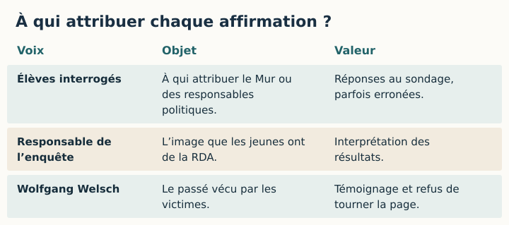

# ENS Rennes · D1 · Allemand 2009 — Corrigé brut

*Corrigé rédigé par IA, non officiel. Signalez toute erreur.*

**Rédaction** · GPT-6.2 Astra Ultra · vitesse non renseignée

Écrit de l’ENS de Cachan, conservé dans les archives D1 de Rennes. Beate Strobel, Focus, 3 octobre 2008.

## Version française

**L’oubli des autres**

Si l’Allemagne réunifiée était une personne, elle serait maintenant majeure. Elle aurait le droit de passer son permis et d’aller voter. Sans doute sont-ils eux aussi majeurs, et donc électeurs aujourd’hui, ces jeunes auxquels des chercheurs de l’Université libre de Berlin ont posé, entre 2005 et 2007, diverses questions d’histoire et d’éducation civique.

Il y aurait de quoi rire des résultats si, en même temps, ils n’étaient pas si tristes. Près d’une personne interrogée sur quatre croit que « la RDA n’était pas une dictature ». Près d’une sur deux croit savoir que c’est l’Union soviétique qui a construit le Mur, et non la RDA. Pour 13,5 % des élèves, Helmut Kohl était un homme politique est-allemand. Quant à Erich Honecker, pas moins de 8,2 % des personnes interrogées ont coché la réponse qui faisait de lui un Allemand de l’Ouest. Klaus Schröder, qui dirigeait l’étude, a résumé leur point de vue : la jeunesse d’aujourd’hui verrait dans la RDA « un pays pauvre, bizarre et drôle, mais qui, d’une manière ou d’une autre, était très social ».

Ces résultats témoignent-ils simplement de la piètre culture générale des jeunes, ou révèlent-ils déjà une dangereuse tendance à minimiser le passé ? Que devrait-on savoir aujourd’hui de la RDA, que pourrait-on sans inquiétude pardonner et oublier ? […]

Les seuls pour qui oublier et pardonner pose problème, ce sont les victimes. Wolfgang Welsch, détenu sept ans au total dans les prisons de la Stasi, où il a notamment subi l’isolement et la torture, refuse énergiquement que l’on tourne déjà la page des actes de ce régime d’injustice, vingt ans après l’ouverture du Mur. Le passé, fait-il valoir, n’est pas mort tant que les victimes vivent et souffrent encore.

## Expression en allemand

Commenter la phrase sur la présence du passé tant que les victimes vivent et souffrent. 100 mots.

Wolfgang Welsch erinnert daran, dass ein politischer Umbruch das Leiden der Betroffenen nicht automatisch beendet. Wer Jahre in Haft verbracht hat, kann auch nach der Öffnung der Mauer mit den Folgen leben müssen. Deshalb sollten Schulen neben Daten und Namen auch persönliche Zeugnisse zugänglich machen. Sie zeigen, was ein staatlicher Eingriff für einen einzelnen Menschen bedeutete. Dennoch darf niemand von einem Opfer verlangen, öffentlich über seine Erfahrungen zu sprechen oder gar zu vergeben. Die Verantwortung für die Erinnerung liegt bei der gesamten Gesellschaft. Auch wer später geboren wurde, kann zuhören, Quellen prüfen und einer Verharmlosung der Diktatur mit Gründen widersprechen.

*100 mots, comptés par espaces.*

[Feuillet original, p. 2](https://www.ens-rennes.fr/medias/fichier/epreuve-de-l-v-e-d1_1423059201606-pdf#page=2) · [Rapport du jury, partie écrite](https://www.ens-rennes.fr/medias/fichier/reo1a-09d1-e-o-allemand-1_1423059248747-pdf#page=1)
