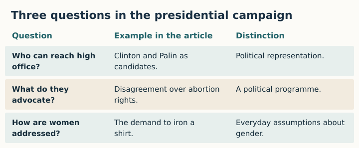

# ENS Rennes · D1 · Anglais 2009 — Corrigé guidé

*Corrigé rédigé par IA, non officiel. Signalez toute erreur.*

**Rédaction** · GPT-6.2 Astra Ultra · vitesse non renseignée

Écrit de l’ENS de Cachan, conservé dans les archives D1 de Rennes. Adapté de The Economist, 13 septembre 2008.

## Version française

**Le triomphe du féminisme**

Ce devait être l’année où les féministes américaines fêteraient l’effondrement du plus haut des plafonds de verre. Leur candidate idéale s’appelait Hillary Rodham Clinton : le feu des batailles politiques de Washington avait forgé son caractère.

Or elle ne s’est pas contentée de perdre des primaires qu’elle ne pouvait pas perdre. Tout au long de la campagne, elle s’est fait rabaisser et vilipender. Chris Matthews, de la chaîne MSNBC, a déclaré qu’elle devait son siège au Sénat aux infidélités de son mari. Deux jeunes gens lui ont enjoint : « Repasse ma chemise ! »

En choisissant Sarah Palin pour faire campagne à ses côtés, John McCain a changé cette défaite en apocalypse. Mme Palin incarne tout ce que détestent les féministes progressistes : chrétienne évangélique qui se promène armée, ancienne reine de beauté qui ne porte pas les ours polaires dans son cœur, cette mère de cinq enfants est opposée au droit à l’avortement.

Gloria Steinem, la fondatrice du magazine *Ms.*, affirme que « le seul point commun entre Palin et Clinton, c’est un chromosome ». « Dix-huit millions de fissures, et une fêlée », ironise *The New Republic*, par allusion aux dix-huit millions de voix recueillies par Mme Clinton et au plafond de verre.

Mais le féminisme va-t-il vraiment si mal ? À sa manière bien particulière, Mme Palin représente aussi la réalisation du rêve féministe. Si le féminisme consiste essentiellement à permettre aux femmes de se mesurer à armes égales aux autres dans le monde du travail tout en décidant elles-mêmes de l’organisation de leur vie familiale, alors Mme Palin mérite qu’on la considère comme une pionnière au lieu de la traiter de fêlée.

## Expression en anglais

What are the various faces of feminism? 100 mots.

Feminism can mean removing barriers that prevent women from reaching positions of authority. In that sense two politicians with different programmes can both widen the range of careers a girl can imagine. Yet representation is only one face of feminism. Another concerns the rights and services that allow people to decide how to combine work and family life. A candidate can advance the first cause while opposing measures that other women consider essential to the second. Feminism also questions everyday expectations: asking a politician to iron a shirt reduces her public role to a domestic duty regardless of her politics.

*100 mots, comptés par espaces.*

## Comment construire la réponse

**Dater le débat.** En septembre 2008, l’article revient sur les primaires perdues par Hillary Clinton et sur le choix de Sarah Palin comme colistière de John McCain. Le siège au Sénat mentionné au deuxième paragraphe appartient à Clinton. Le discours sur les ours polaires et la formule de Gloria Steinem appartiennent aux voix dont l’auteur rend compte.

**Maintenir la plaisanterie.** Les voix données à Clinton auraient fissuré le plafond de verre. À partir de *cracks*, le magazine forme *crackpot*, qui est une insulte. « Fissures » et « fêlée » conservent le rapport entre la matière qui se fend et le jugement porté sur Palin. Le dernier paragraphe reprend la même insulte pour la discuter.

**Distinguer trois questions.** Une femme peut rendre visible l’accès des femmes à une fonction ; elle peut aussi défendre ou contester certaines politiques relatives à cet accès. Les insultes domestiques constituent encore un autre problème. Ces distinctions permettent de traiter les « divers visages » du féminisme sans ramener la réponse à une préférence personnelle entre les deux personnalités.

[Feuillet original, p. 3](https://www.ens-rennes.fr/medias/fichier/epreuve-de-l-v-e-d1_1423059201606-pdf#page=3) · [Rapport du jury, partie écrite](https://www.ens-rennes.fr/medias/fichier/re1a-09d1-anglais_1423059213156-pdf#page=1)
