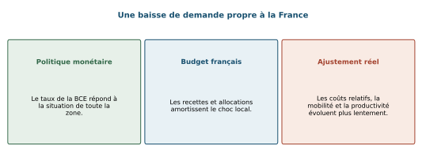
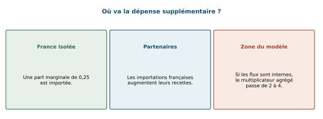

# ENS de Cachan D1 — Composition d’ordre économique 2009 · Corrigé guidé

*Corrigé rédigé par IA, non officiel. Signalez toute erreur.*

**Lecture du rapport du jury** · GPT-6.2 Astra Ultra · vitesse non renseignée

**Rédaction** · GPT-6.2 Astra Ultra · vitesse non renseignée

## 10 ans d’union monétaire ont-ils modifié la conception de la politique économique française ?

### Introduction

> [!INDICATION]
> Fixer le point de départ en 1999. Poser une question sur la conception des interventions empêche de réduire le devoir à un inventaire des institutions de l’euro.

En octobre 2008, le gouvernement français s’engage à soutenir le financement des banques. Une entreprise française qui doit renouveler son crédit dépend alors à la fois d’un engagement de l’État, du refinancement que l’Eurosystème offre à sa banque et des décisions de ses clients français et étrangers. Qui conduit la politique économique dans ces conditions ? La France utilise l’euro depuis le 1er janvier 1999, trois ans avant l’introduction des billets et des pièces. La politique économique recouvre les choix par lesquels les pouvoirs publics agissent sur l’activité, la répartition et la capacité productive. Son évolution se juge donc aux objectifs retenus, aux moyens mobilisés et aux autorités qui en répondent.

Que reste-t-il de la conception nationale de cette politique lorsque la France partage une monnaie avec des économies dont les besoins diffèrent des siens ? De 1999 au printemps 2009, l’union a rendu durable un changement déjà engagé dans la conduite de la stabilisation. Elle a aussi donné de nouvelles raisons d’agir sur les structures productives et de concevoir certaines interventions à plusieurs pays, tout en laissant à la France des choix de répartition considérables.

### I. Stabiliser l’économie française suppose désormais d’agir avec des instruments répartis entre plusieurs autorités

#### A. La monnaie unique consacre un changement de priorité amorcé avant 1999

> [!INDICATION]
> Pour mesurer le changement propre à 1999, comparer le choix antérieur de rester dans un régime de change et la disparition du taux de change national à l’intérieur de la zone.

Un gouvernement disposant de sa monnaie peut demander un assouplissement monétaire pour soutenir l’emploi ou compter sur la dépréciation du change pour écouler davantage de produits à l’étranger. Pareille stratégie comporte un coût. Une baisse du franc renchérit les importations. Si chaque entreprise et chaque salarié anticipent ensuite une inflation plus élevée, la relance nominale peut perdre une partie de son effet réel. La France avait déjà choisi la désinflation et le maintien d’un change stable au sein du système monétaire européen après 1983. Dans un espace de capitaux mobiles, défendre la parité limitait fortement l’autonomie du taux français. La loi de 1993 sur l’indépendance de la Banque de France puis la convergence prévue par Maastricht ont précédé le changement de monnaie.

Depuis 1999, ces arbitrages sont institutionnalisés à une autre échelle. Le Conseil des gouverneurs de la BCE fixe une politique pour l’ensemble de la zone et a pour objectif principal la stabilité des prix. La France participe à cet ensemble, mais un écart de chômage exclusivement français ne détermine pas le taux directeur. Si l’inflation anticipée vaut 1 % en France et 3 % chez un partenaire, un même taux nominal de 4 % signifie approximativement des taux réels de 3 % et de 1 %. Une orientation commune peut ainsi être relativement restrictive dans l’économie déjà peu dynamique. La suppression du risque de change entre participants facilite le commerce et la comparaison des prix, sans supprimer ce problème de stabilisation.

#### B. Le budget national amortit les chocs sous des contraintes financières et européennes

> [!INDICATION]
> Prendre un choc propre à la France puis un choc touchant tous les partenaires. Les instruments sont les mêmes, leur combinaison souhaitable change.

Si la demande adressée aux usines françaises se contracte relativement à celle des partenaires, le taux de change entre eux ne bouge plus. Les salaires et les prix relatifs, la mobilité des travailleurs et la diversification des revenus financiers peuvent compenser une partie du choc. Ces mécanismes sont lents ou inégalement répartis. Le budget national conserve donc une fonction d’assurance. Quand l’emploi baisse, les recettes fiscales diminuent tandis que les allocations chômage soutiennent le revenu disponible. Une dépense temporaire peut compléter cet amortissement si les ménages contraints consomment une part importante du revenu supplémentaire.

Cependant, l’État emprunte dans une monnaie dont il ne règle pas les conditions. Un déficit persistant reporte des prélèvements sur l’avenir et peut accroître les charges d’intérêt. Le Pacte de stabilité et de croissance organise la surveillance multilatérale, avec les références du traité de 3 % du PIB pour le déficit et 60 % pour la dette. Leur signification diffère de celle d’une interdiction mécanique de laisser fonctionner les stabilisateurs en récession. Le débat porte sur la position dans le cycle, la soutenabilité et la réaction commune aux circonstances exceptionnelles. La crise de 2008 illustre précisément le maintien d’un choix budgétaire national. La relance française et l’appui aux banques supposent des décisions françaises au moment où la BCE intervient sur la liquidité et les taux. Leur efficacité dépend de la cohérence des interventions.

### II. Les politiques françaises se redéploient vers les capacités de production et les interventions coordonnées

#### A. Le changement de prix relatifs passe durablement par les coûts, la qualité et l’innovation

> [!INDICATION]
> Illustrer aussi une politique agissant sur la qualité du produit. La compétitivité ne se réduit pas au coût du travail.

À change nominal fixe avec ses partenaires, un producteur français perd de la compétitivité-prix si ses coûts unitaires augmentent durablement plus vite que les leurs. Schématiquement, le coût salarial unitaire est le salaire moyen divisé par la productivité du travail. Si le salaire augmente de 3 % et la productivité de 2 %, la hausse du coût unitaire est proche de 1 %. Mais une politique de réduction générale des salaires pèserait immédiatement sur les revenus et la demande. Tous les membres ne peuvent en outre gagner simultanément des parts de marché les uns sur les autres par la seule compression salariale.

L’enjeu se déplace vers la productivité, l’adéquation des qualifications et la qualité des biens. Une dépense d’enseignement ou de recherche peut accroître les débouchés d’un producteur en améliorant sa compétitivité hors prix. Elle peut aussi profiter à des entreprises qui n’ont pas financé l’innovation, ce qui justifie un soutien public ciblé. La stratégie de Lisbonne engagée en 2000 donne une dimension européenne à l’économie de la connaissance. Les choix concrets de formation, l’organisation des services publics et les arbitrages fiscaux restent largement nationaux. Le contrôle européen des aides d’État et le droit de la concurrence demandent de vérifier les effets d’une intervention sur les partenaires. Le marché unique et ses règles sont d’ailleurs antérieurs à l’euro. Attribuer leur création à la monnaie unique fausserait le bilan des dix ans.

#### B. L’interdépendance appelle une coordination dont le degré demeure un choix politique

> [!INDICATION]
> Montrer qu’une même importation est une fuite pour le pays acheteur et une recette pour son partenaire. C’est cette relation qui justifie de discuter la coordination.

Une relance française finance en partie des importations. Pour la France seule, cette fuite réduit le multiplicateur domestique. Pour l’union, elle est en partie une commande destinée à un partenaire qui peut à son tour importer de France. Dans un exemple où la propension à consommer vaut 0,75, les prix sont fixes et les impôts forfaitaires, une propension marginale à importer de 0,25 donne un multiplicateur domestique de $1/(1-0{,}75+0{,}25)=2$. Si les importations considérées sont toutes internes à une zone qui relance simultanément et dont les échanges extérieurs sont négligés dans cet exemple, le multiplicateur agrégé devient $1/(1-0{,}75)=4$. Le calcul isole une interdépendance. Il ne mesure pas le multiplicateur effectif de 2009, qui dépend aussi de l’offre, des décalages et de la réaction monétaire.

Il en résulte deux problèmes collectifs. Chaque État peut attendre que son voisin soutienne la demande commune à ses frais. À l’inverse, un endettement excessif ou une garantie bancaire mal conçue peuvent reporter des risques sur les voisins. Le plan européen de relance présenté à la fin de 2008 cherche à coordonner des mesures principalement nationales. Le budget communautaire a une taille et des fonctions qui limitent sa capacité à remplacer les stabilisateurs nationaux. La France peut toujours choisir de financer une allocation plutôt qu’un investissement. La décision exige toutefois d’examiner qui bénéficie de la dépense, qui en supporte la dette et quels effets traversent les frontières.

### Conclusion

> [!INDICATION]
> Revenir au mot « conception ». Le diagnostic doit expliquer comment se décide une politique, à quel niveau et au service de quels objectifs.

La décennie de l’euro a moins bouleversé les fins françaises de croissance, de stabilité et d’emploi qu’elle n’a changé les conditions de leur poursuite. Une monnaie commune rend irréversible à l’échelle nationale l’abandon de certains ajustements et oblige à raisonner sur la zone pour les autres. Les choix budgétaires, sociaux et productifs demeurent assez différents pour que leurs auteurs répondent de leurs conséquences. La crise de 2008 révèle la tension centrale de cette conception renouvelée. Une économie peut partager la monnaie et les risques de ses voisins sans disposer d’un budget commun capable de décider seul de sa stabilisation.

[Sujet de la session](https://www.ens-rennes.fr/medias/fichier/dissertation-d-ordre-econ-et-social-d1_1423059180494-pdf) · [Rapport du jury](https://www.ens-rennes.fr/medias/fichier/re1a-09d1-economie_1423059230928-pdf)
