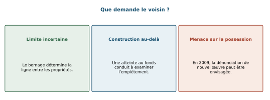

# ENS de Cachan D1 — Droit civil 2009 · Corrigé guidé

*Corrigé rédigé par IA, non officiel. Signalez toute erreur.*

**Lecture du rapport du jury** · GPT-6.2 Astra Ultra · vitesse non renseignée

**Rédaction** · GPT-6.2 Astra Ultra · vitesse non renseignée

## Le voisin en droit civil

### Introduction

> [!INDICATION]
> Définir le voisin par une relation de proximité. Réserver à chaque règle la détermination de ceux qui peuvent effectivement l’invoquer.

Une fenêtre peut respecter la limite d’une propriété tout en plongeant sur l’intérieur de la maison voisine. Un chantier autorisé peut endommager le bâtiment contigu. Dans le premier cas, la qualité des fonds, leur disposition et la nature de l’ouverture commandent la solution. Dans le second, l’auteur du trouble peut n’être propriétaire d’aucun des deux immeubles. Le voisin, au sens usuel, occupe ou utilise un lieu assez proche d’un autre pour que les deux usages se rencontrent. Le droit civil de 2009 ne lui attache aucun statut uniforme.

La proximité transforme-t-elle donc tout voisin en titulaire des mêmes droits contre l’autre ? Les règles qui organisent durablement les rapports entre fonds s’attachent surtout aux propriétés et à leurs limites. Lorsque l’activité d’un occupant porte atteinte à un autre, le droit protège aussi des personnes dont le titre et la durée de présence diffèrent. Il faut comprendre comment ces deux logiques permettent d’abord de rendre compatibles les usages voisins, puis de remédier à leurs conflits.

### I. La proximité de deux fonds conduit à organiser par avance l’exercice des droits immobiliers

#### A. Délimiter l’assiette de chaque droit rend possibles la jouissance et la protection de l’autre

> [!INDICATION]
> Un mur légèrement décalé, un mur commun et une clôture encore en chantier appellent trois raisonnements distincts. Identifier l’objet de la demande avant de choisir le mécanisme.

Le bornage fixe contradictoirement la ligne qui sépare deux propriétés privées contiguës. L’article 646 du Code civil permet à chacun des propriétaires d’y obliger l’autre, à frais communs. La fixation de la limite ne transmet pas à l’un ce qui appartient à l’autre. Une fois la ligne déterminée, le propriétaire peut en principe se clore en vertu de l’article 647, sous réserve notamment du droit de passage attaché à l’enclave. Un mur séparatif peut encore être mitoyen. La présomption de l’article 653 est soumise aux hypothèses du texte et aux titres ou marques contraires. Une limite sépare les pouvoirs, mais leur support matériel peut ainsi être commun et appeler un partage des dépenses et des décisions.

Lorsqu’une construction déborde effectivement sur la parcelle voisine, la question change. Il s’agit de restituer au propriétaire l’intégrité de son fonds. L’article 545 et la jurisprudence sur l’empiètement permettent de demander la suppression de la partie qui empiète, même de faible étendue. L’empiètement ne suppose ni une intention de nuire ni une nuisance plus grave que celles normalement liées à la vie locale. À l’inverse, un voisin bruyant peut répondre de son activité sans avoir matériellement franchi la limite. Dans le droit alors en vigueur, la protection possessoire répondait encore à une autre nécessité. La dénonciation de nouvel œuvre permettait, sous les conditions des actions possessoires, de réagir à des travaux commencés sur le fonds voisin qui menaçaient la possession avant l’achèvement du trouble. Cette protection concernait la situation de possession, indépendamment de la décision au fond sur la propriété.

#### B. Les charges de voisinage organisent l’utilité entre fonds, y compris dans la dimension verticale

> [!INDICATION]
> Partir d’une utilité concrète, passer, recevoir la lumière ou entretenir un mur, puis rechercher si elle est attachée au fonds ou accordée personnellement.

La servitude, selon l’article 637, est une charge imposée sur un héritage pour l’usage et l’utilité d’un héritage appartenant à un autre propriétaire. Un passage conventionnel établi au profit d’un fonds demeure utile à son acquéreur. Le voisin qui emprunte occasionnellement un jardin par simple permission ne dispose pas pour autant d’un tel droit réel. Pour un fonds enclavé ou dont l’issue sur la voie publique est insuffisante dans les conditions de l’article 682, la loi permet de réclamer un passage suffisant moyennant une indemnité proportionnée au dommage. Le besoin d’accès explique la restriction du droit de se clore.

D’autres prescriptions évitent les conflits récurrents de lumière, de vue et d’entretien. À défaut des règlements et usages locaux envisagés par l’article 671, les arbres dont la hauteur dépasse deux mètres se plantent à deux mètres de la ligne séparative, les autres à un demi-mètre. Les règles comprennent leurs propres exceptions. Les branches qui avancent peuvent faire l’objet d’une demande de coupe au voisin, alors que racines, ronces et brindilles peuvent être coupées à la limite dans les conditions de l’article 673. Un jour destiné à laisser passer la lumière et une vue donnant sur le fonds d’autrui obéissent à des règles différentes. Sauf les exceptions prévues par les textes, la vue droite exige dix-neuf décimètres, la vue oblique six décimètres. Le droit prend au sérieux la géométrie de la proximité.

La superposition compte aussi. Une propriété divisée en volumes peut mettre en présence deux propriétaires situés l’un au-dessus de l’autre. Dans une copropriété issue de la loi du 10 juillet 1965, le lot réunit partie privative et quote-part des parties communes. Chaque copropriétaire use des parties privatives de son lot et des parties communes dans le respect des droits des autres et de la destination de l’immeuble. Le règlement organise ces usages et le syndicat défend les intérêts collectifs. Le voisin du dessous dispose aussi, le cas échéant, d’une action individuelle pour le dommage personnel qu’il subit.

### II. Les incidences d’une activité sur les voisins font naître des obligations qui dépassent la seule propriété

#### A. La faute et l’abus sanctionnent une conduite déterminée

> [!INDICATION]
> Expliquer ce qu’il faudrait prouver devant le juge. Une faute de chantier, un abus de propriété et une intervention utile ne se déduisent pas de la même circonstance.

Un voisin qui cause un dommage par négligence peut engager sa responsabilité sur le fondement des articles 1382 et 1383, numérotation applicable en 2009. Percer une canalisation après avoir omis une vérification élémentaire illustre la faute. Un autre voisin peut accomplir un acte formellement compris dans ses prérogatives mais l’employer à seule fin de nuire. Dans l’affaire Clément-Bayard du 3 août 1915, un propriétaire avait dressé des dispositifs hérissés de pointes, sans utilité pour l’exploitation du fonds et dans le but de nuire à son voisin. La Cour de cassation admet l’abus. La suppression des éléments dommageables et la réparation se justifient par l’usage fait de la prérogative. Le seul déplaisir du voisin ne suffit pas à établir ce dessein.

La proximité peut même permettre une intervention utile chez autrui. Le voisin qui, pendant l’absence de l’occupant, prend spontanément des mesures nécessaires pour protéger les lieux contre une fuite peut agir en gestion d’affaires si les conditions de ce quasi-contrat sont réunies. Un droit général de pénétrer chez son voisin compromettrait la maîtrise de celui-ci sur son domicile. Le passage de la proximité à l’obligation exige ici une initiative utile et justifiée, comme le passage de la liberté à l’abus exige à l’inverse des circonstances précises.

#### B. Le trouble anormal protège la jouissance concrète, même en l’absence de faute

> [!INDICATION]
> Comparer l’exploitation demeurée identique et celle qui a fortement augmenté ses nuisances après l’installation du voisin. Vérifier les conditions cumulatives de la règle historique.

En 2009, le principe jurisprudentiel selon lequel nul ne doit causer à autrui un trouble anormal de voisinage permet d’agir sans démontrer une faute. Des vibrations répétées ou une fumée persistante peuvent excéder les inconvénients ordinaires du lieu. Le juge apprécie notamment l’intensité, la durée, la fréquence et les circonstances locales. Le respect d’une autorisation administrative ou d’une norme technique n’exclut donc pas, à lui seul, l’anormalité. La victime doit toutefois établir le trouble, son lien avec l’activité et le préjudice dont elle demande réparation. Un propriétaire, un locataire ou un occupant peuvent être affectés. Sur un chantier, un entrepreneur intervenu temporairement peut être considéré comme voisin occasionnel si son activité est en relation directe avec le trouble.

L’antériorité de l’activité ne suffit pas non plus à interdire toute demande du nouvel arrivant. L’ancien article L. 112-16 du Code de la construction et de l’habitation prévoyait une exception pour certaines activités énumérées qui préexistaient dans les conditions du texte à l’occupation ou à la construction du bâtiment exposé. Encore fallait-il que l’activité soit conforme aux dispositions législatives ou réglementaires et se soit poursuivie dans les mêmes conditions. Une aggravation significative commande donc un nouvel examen. Le remède peut indemniser le dommage ou faire cesser le trouble par des travaux appropriés. C’est l’intérêt de cette responsabilité objective que de répartir le coût d’un voisinage devenu excessif sans transformer chaque bruit ordinaire en faute. Le projet de réforme du droit des biens porté alors par l’association Henri Capitant proposait de réunir des règles de voisinage dans un titre propre. En 2009, il éclairait cette recherche d’unité tout en demeurant un projet.

### Conclusion

> [!INDICATION]
> Conclure par la relation entre la qualité du demandeur, le fait générateur et le remède.

Le voisin civil est tantôt le titulaire d’un droit réel qu’une limite ou une servitude rend opposable, tantôt la personne dont l’activité ou la jouissance se trouve concrètement affectée. Un titre permet de demander le bornage, mais la jouissance lésée peut appartenir à un locataire et le trouble provenir d’un entrepreneur. La cohérence des règles tient à leur finalité commune. Elles distribuent à l’avance les usages compatibles, puis font supporter à celui qui en remplit les conditions le coût de la faute, de l’empiètement ou du trouble excessif.

[Sujet de la session](https://www.ens-rennes.fr/medias/fichier/droit-civil-d1_1423059188906-pdf) · [Rapport du jury](https://www.ens-rennes.fr/medias/fichier/re1a-09d1-droit-civil_1423059219496-pdf) · [Code civil en avril 2009](https://www.legifrance.gouv.fr/codes/texte_lc/LEGITEXT000006070721/2009-04-01/) · [Loi du 10 juillet 1965 sur la copropriété en avril 2009](https://www.legifrance.gouv.fr/loda/id/JORFTEXT000000880200/2009-04-01/) · [Article L. 112-16 du CCH en 2009](https://www.legifrance.gouv.fr/codes/article_lc/LEGIARTI000006824237/2009-04-01)
