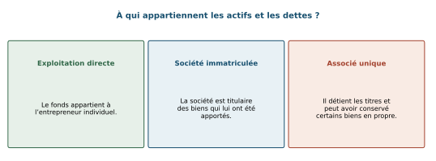
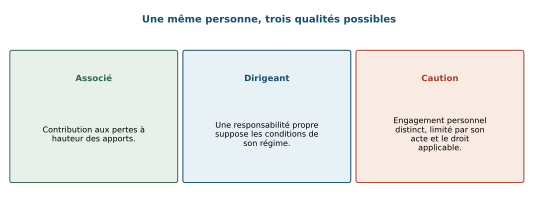

# ENS de Cachan D1 — Droit commercial 2009 · Corrigé guidé

*Corrigé rédigé par IA, non officiel. Signalez toute erreur.*

**Lecture du rapport du jury** · GPT-6.2 Astra Ultra · vitesse non renseignée

**Rédaction** · GPT-6.2 Astra Ultra · vitesse non renseignée

## Entreprise individuelle et société unipersonnelle

### Introduction

> [!INDICATION]
> Comparer les deux formes sous chaque question. Le nom sur la facture donne une entrée plus concrète qu’une juxtaposition de définitions.

Un menuisier veut travailler seul. S’il commande du matériel en son propre nom, il en devient personnellement débiteur. S’il commande pour une EURL immatriculée dont il est l’unique associé et le gérant, c’est en principe cette société qui doit le prix. Pour le fournisseur, le même atelier et le même interlocuteur recouvrent deux débiteurs possibles. Pour le menuisier, la question devient décisive lorsqu’il doit donner sa caution pour obtenir les machines.

L’entreprise désigne une activité économique organisée. Son exploitation individuelle ne crée en 2009 aucune personne distincte de l’entrepreneur. Une société peut en revanche être instituée par l’acte de volonté d’une seule personne dans les cas prévus par la loi. La SARL unipersonnelle, dite EURL, et la société par actions simplifiée unipersonnelle, dite SASU, en sont deux illustrations. En quoi ces techniques changent-elles véritablement la répartition du risque de celui qui travaille seul ? Le choix oppose d’abord deux organisations juridiques. L’évolution des règles de protection de l’entrepreneur et les exigences de ses créanciers rendent ensuite les effets pratiques du choix moins tranchés.

### I. Travailler seul n’attribue pas les biens, les dettes et les décisions au même sujet de droit

#### A. L’exploitation directe et l’exploitation par une personne morale engagent des patrimoines distinctement organisés

> [!INDICATION]
> Tracer trois colonnes, exploitant, société et créancier, puis y placer l’atelier, les titres et la dette d’achat. Avant l’immatriculation, vérifier le régime propre aux actes passés pour la société en formation.

Dans l’entreprise individuelle, le fonds de commerce, lorsqu’il existe, est un ensemble de biens qui appartient au commerçant. Il n’a ni dette propre ni personnalité. L’entrepreneur acquiert le matériel, conclut le bail et doit le prix des marchandises. Dans le droit de 2009, les biens professionnels et privés entrent en principe dans le même patrimoine et forment le gage général de ses créanciers, sous réserve des protections et sûretés particulières. Affecter comptablement une camionnette à l’entreprise ne suffit pas à réserver sa valeur aux fournisseurs. Au décès de l’exploitant, le fonds et les dettes suivent les règles successorales applicables au patrimoine du défunt.

La société unipersonnelle procède autrement. L’article 1832 du Code civil admet l’acte d’institution unilatéral lorsque la loi le prévoit. La loi du 11 juillet 1985 a ouvert la SARL à un seul associé et la réforme de 1999 a admis la SAS à associé unique. La personnalité morale naît à l’immatriculation. Si le menuisier apporte son fonds, les biens compris dans l’apport deviennent, selon leurs règles de transfert, ceux de la société. Il reçoit des parts ou actions. Une simple mise à disposition d’un local personnel ne produit pas ce transfert. La société immatriculée devient débitrice des contrats qu’elle conclut. L’associé contribue en principe aux pertes à hauteur de ses apports. Le fournisseur peut poursuivre tous les biens saisissables de la société, dont la valeur n’est pas plafonnée par le chiffre inscrit au capital.

#### B. La séparation de personnes organise la décision et la transmission

> [!INDICATION]
> Imaginer l’entrée d’un second investisseur. Identifier ce qu’il achète et qui reste débiteur du fournisseur après l’opération.

L’entrepreneur individuel décide en son nom, dans les limites du droit commun, du régime matrimonial et des droits de ses partenaires. Il n’a pas à se verser un dividende pour prélever les bénéfices de son activité. Les obligations comptables et les formalités liées à la nature du commerce subsistent. La société unipersonnelle doit, elle, distinguer la qualité d’associé et la fonction de dirigeant. L’EURL a un gérant, la SASU un président. Même si une personne cumule les deux qualités, la conclusion d’un bail pour la société et l’approbation annuelle des comptes sont des actes différents. L’associé unique exerce les pouvoirs revenant à l’assemblée et ses décisions sont enregistrées dans les conditions légales. Les simplifications prévues pour l’associé unique personne physique dirigeant lui-même sa société évitent certaines formalités redondantes.

La différence devient manifeste au moment de s’associer ou de transmettre. Un entrepreneur individuel souhaitant accueillir un investisseur peut céder des éléments, apporter son activité à une société ou organiser d’autres droits contractuels. Il ne peut vendre une action que son entreprise individuelle n’a jamais émise. L’unique associé d’une EURL peut au contraire céder une partie de ses parts. La SARL continue avec plusieurs associés. Le bail et les dettes de la société demeurent les siens, sous réserve des clauses ou règles particulières. Pour l’acquéreur de titres, cela signifie que le passif antérieur reste dans la structure acquise. Une cession de fonds appelle une analyse différente des éléments et contrats transmis, comme des garanties des créanciers. L’unipersonnalité peut ainsi préparer une entreprise qui cessera d’être individuelle au sens économique.

### II. La protection effective du patrimoine personnel dépend aussi des biens en cause et des garanties consenties

#### A. L’unité du patrimoine individuel s’accommode de protections ciblées

> [!INDICATION]
> Tester la même déclaration contre trois créanciers, fournisseur antérieur, fournisseur professionnel postérieur et créancier personnel. Ce test révèle la portée exacte de la mesure.

Le législateur a écarté certains effets du gage général sans conférer de personnalité à l’activité. La loi Madelin de 1994 a notamment prévu, dans certaines demandes de garanties par les établissements de crédit, une information de l’entrepreneur sur la possibilité de proposer une sûreté portant sur des biens nécessaires à l’exploitation. Une procédure prévoit également, sous conditions, une poursuite prioritaire de certains biens professionnels pour une créance professionnelle. Ce type de priorité ne crée pas au profit de tout entrepreneur deux masses étanches. Il faut connaître la nature de la créance, les formalités et les biens disponibles pour mesurer la protection.

Un autre mécanisme vise les immeubles. Depuis la loi du 1er août 2003, une déclaration notariée d’insaisissabilité permettait sous conditions de protéger la résidence principale. La loi de modernisation de l’économie du 4 août 2008 a étendu la faculté aux droits sur d’autres biens fonciers bâtis ou non bâtis non affectés à l’usage professionnel. En 2009, la protection repose sur la déclaration et sa publicité. Elle joue contre les créanciers dont les droits naissent, après publicité, à l’occasion de l’activité professionnelle. Elle ne rend donc pas indisponible l’ensemble du patrimoine à l’égard de tous les créanciers. La fiducie, qui comporte un transfert de biens à un fiduciaire dans un patrimoine distinct, apporte un autre exemple de spécialisation patrimoniale sans constituer un régime automatique d’exercice individuel. Le patrimoine d’affectation de l’entrepreneur, discuté à cette date, demeure un projet au moment de l’épreuve.

#### B. La société unipersonnelle place les risques au premier plan de la négociation

> [!INDICATION]
> Séparer trois qualités possibles d’une même personne, associé, dirigeant et caution. Préciser pour chacune d’où peut naître l’obligation de payer.

En 2009 le montant du capital d’une SARL est fixé par les statuts. La réforme de 2008 a aussi supprimé l’exigence de minimum applicable à la SAS à compter de 2009. Un capital symbolique facilite l’accès aux formes sociales. Il ne procure pas à l’entreprise les ressources réelles nécessaires à un atelier. Imaginons une machine de 20 000 euros achetée à crédit par une EURL au capital de 1 euro. En l’absence de sûreté personnelle et si la société a régulièrement contracté, le vendeur reste créancier de la société pour 20 000 euros. La dette ne devient pas une dette de 1 euro. La faible capitalisation l’incite en revanche à demander une réserve de propriété, une autre garantie ou un paiement comptant.

Si la banque exige du dirigeant un cautionnement personnel et que celui-ci est valable, elle dispose d’un engagement à son encontre dans les limites de l’acte et des protections applicables. Un fournisseur qui n’a obtenu aucune caution ne peut se prévaloir de celle donnée à la banque. De même, une faute de gestion ayant contribué à une insuffisance d’actif peut, dans les conditions légalement requises, conduire le tribunal à mettre tout ou partie de cette insuffisance à la charge du dirigeant. Le seul échec commercial ne suffit pas. La limitation des pertes conserve donc son utilité envers les créanciers ordinaires et lorsque les patrimoines sont effectivement respectés.

Enfin, l’essor des statuts du conjoint et des formalités allégées rapproche la vie quotidienne de certaines exploitations individuelles et sociétaires. Le conjoint collaborateur peut, sous les conditions prévues par les textes, travailler tant auprès d’un entrepreneur individuel qu’auprès d’un gérant associé unique d’EURL. La comparaison finale porte donc sur le besoin de financement, le projet de transmission, les charges de fonctionnement et les protections véritablement opposables dans chaque cas. La facilité d’immatriculation à elle seule ne décide d’aucun de ces points.

### Conclusion

> [!INDICATION]
> Reprendre le cas du menuisier. La solution peut différer pour la banque et pour le fournisseur alors même qu’ils financent la même activité.

En 2009, travailler seul permet déjà deux choix très différents. L’un assume directement les liens juridiques de l’activité, l’autre les fait naître dans le patrimoine d’une société dont il détient les titres. L’évolution de l’insaisissabilité, la simplicité des sociétés unipersonnelles et la pratique des sûretés rapprochent leurs effets sans effacer cette différence. Pour apprécier le risque réel, il faut identifier le débiteur, les biens saisissables et les engagements supplémentaires consentis à chaque créancier.

[Sujet de la session](https://www.ens-rennes.fr/medias/fichier/epreuve-a-options-d1_1423059195691-pdf#page=2) · [Rapport du jury](https://www.ens-rennes.fr/medias/fichier/re1a-09d1-droit-commercial-1_1423059225556-pdf) · [Code de commerce en avril 2009](https://www.legifrance.gouv.fr/codes/texte_lc/LEGITEXT000005634379/2009-04-01/) · [Loi de modernisation de l’économie du 4 août 2008](https://www.legifrance.gouv.fr/loda/id/JORFTEXT000019283050/2009-04-01/)
