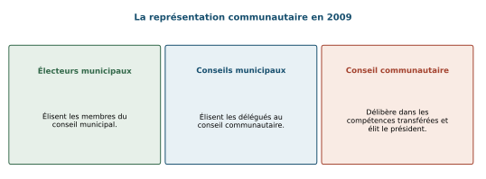

# ENS de Cachan D1 — Droit public 2009 · Corrigé brut

*Corrigé rédigé par IA, non officiel. Signalez toute erreur.*

**Rédaction** · GPT-6.2 Astra Ultra · vitesse non renseignée

## L’administration des agglomérations urbaines en France

### Introduction

Une ligne d’autobus prend des voyageurs dans une commune résidentielle, traverse une seconde commune et dessert la gare de la ville-centre. Si chaque commune décide seule du tracé, des horaires et du financement, aucune ne maîtrise le service dont dépendent pourtant ses habitants. Le territoire de vie dépasse le territoire municipal. L’agglomération peut ainsi désigner une continuité du bâti ou un bassin quotidien d’activités. En droit français, aucune de ces réalités ne devient, par sa seule existence, une autorité dotée d’une compétence générale.

Administrer une agglomération suppose de déterminer qui peut décider à cette échelle, au moyen de quelles ressources et sous quel contrôle. La réponse doit être située au printemps 2009. La coopération intercommunale permet alors d’administrer ensemble des fonctions urbaines que la commune isolée peine à assurer. Elle conserve pourtant un régime de compétences attribuées, une représentation issue des communes et des frontières qui ne coïncident pas toujours avec le bassin de vie. Cette double caractéristique explique aussi bien les acquis que les difficultés de l’administration urbaine française.

### I. La coopération entre communes construit une autorité à l’échelle de fonctions urbaines communes

#### A. Des formes graduées permettent d’adapter l’organisation à la ville

La commune demeure une collectivité territoriale. Son conseil règle les affaires de la commune et le maire dispose d’attributions propres, notamment de police municipale. Le morcellement communal rend cependant coûteuse l’organisation isolée de l’eau, des transports ou du traitement des déchets. Un syndicat intercommunal peut réunir plusieurs communes pour un ou plusieurs services déterminés. Il offre une organisation spécialisée, mais une multitude de syndicats dotés de périmètres différents rend difficile l’arbitrage entre logement, déplacements et implantation des activités. Une commune peut aussi se réunir à une autre par fusion, au prix d’une transformation du cadre politique local. L’intercommunalité permet de réunir l’action sans supprimer les communes.

Les communautés urbaines, introduites par la loi de 1966, puis les formes organisées ou reprises par les lois de 1992 et du 12 juillet 1999 proposent une intégration plus large. En avril 2009, l’article L. 5216-1 du Code général des collectivités territoriales prévoit pour la création d’une communauté d’agglomération un ensemble de plus de 50 000 habitants, d’un seul tenant et sans enclave, autour d’une ou de plusieurs communes-centres de plus de 15 000 habitants, avec notamment la dérogation à ce dernier seuil pour le chef-lieu ou la commune la plus importante du département. Pour une communauté urbaine nouvelle, l’article L. 5215-1 retient alors plus de 500 000 habitants et prévoit des dispositions préservant les communautés antérieures à la loi de 1999. La communauté de communes peut aussi répondre aux besoins de territoires moins peuplés. Il n’existe donc pas une seule forme juridique pour toute agglomération observée.

#### B. Les compétences et les ressources communes donnent une portée pratique au changement d’échelle

La communauté est un établissement public de coopération intercommunale, doté de la personnalité morale, d’un budget et d’un organe délibérant. Elle est soumise au principe de spécialité. Dans son périmètre et dans les matières transférées, elle exerce les compétences au lieu et place des communes membres. Pour la communauté d’agglomération, le droit de 2009 énumère quatre groupes obligatoires, développement économique, aménagement de l’espace, équilibre social de l’habitat et politique de la ville. Il faut en outre retenir au moins trois des six groupes optionnels alors définis par la loi. L’intérêt communautaire, lorsqu’un texte le prévoit, répartit certaines opérations entre le niveau communal et le niveau communautaire. Il ne confère pas à l’établissement une compétence universelle.

Ainsi un réseau de transports urbains peut être organisé à l’échelle de l’agglomération. La communauté arbitre entre la desserte d’une nouvelle zone d’habitat et celle d’une zone d’activités, avec un budget et une tarification conçus pour le réseau. Le financement communautaire, dont la taxe professionnelle unique est en 2009 une composante importante pour les communautés d’agglomération, atténue la concurrence fiscale entre communes membres. Une commune qui accueille des logements peut bénéficier de services financés à l’échelle de l’ensemble au sein duquel se concentrent ailleurs les activités. Mécanismes d’attribution de compensation, dotations et contributions empêchent cependant de déduire mécaniquement la répartition finale des ressources de la seule localisation des entreprises.

### II. Les leviers d’action de l’agglomération restent liés aux pouvoirs et aux choix des autres institutions

#### A. La décision communautaire demeure ancrée dans la représentation municipale

En 2009, l’article L. 5211-6 du code prévoit un organe délibérant composé de délégués élus par les conseils municipaux des communes membres. Le conseil communautaire élit son président, qui prépare et exécute ses délibérations. La représentation associe les communes au fonctionnement de l’établissement. Elle rend possible un compromis entre la ville-centre et les communes périphériques sur la desserte ou la localisation d’un équipement. Elle peut aussi compliquer l’imputation politique d’un choix. Les habitants qui jugent insatisfaisant le réseau de transport élisent directement leurs conseillers municipaux, alors que la décision est négociée ensuite à l’échelle communautaire.

Le transfert est juridiquement encadré. Pour certaines compétences supplémentaires non prévues par la loi ou l’acte constitutif, l’article L. 5211-17 prévoit la délibération de l’établissement, l’intervention des conseils municipaux aux majorités requises et un arrêté du représentant de l’État. Les biens, droits et obligations nécessaires suivent les règles de transfert ou de mise à disposition prévues. Le maire conserve ses compétences municipales résiduelles et ses pouvoirs propres sous réserve des règles spéciales applicables. Le préfet exerce le contrôle de légalité et peut déférer un acte au juge administratif. Ces contrôles et procédures organisent l’articulation des autorités. Ils ne font pas du président de la communauté le supérieur hiérarchique des maires.

#### B. Les périmètres et les régimes particuliers imposent des coopérations à plusieurs échelles

Les ménages peuvent déménager au-delà de la limite de l’établissement tout en continuant à emprunter chaque jour ses trains ou ses routes. Les émissions, l’urbanisation commerciale et le prix du logement débordent aussi les frontières. Un plan de transport interne ne suffit donc pas à desservir les déplacements régionaux. Des syndicats mixtes, des conventions et des documents de planification comme le schéma de cohérence territoriale permettent d’associer plusieurs établissements et collectivités compétents. Le département, la région et l’État demeurent concernés selon leurs attributions, notamment pour les infrastructures et transports dont ils ont la charge. L’avantage est de pouvoir travailler à la bonne échelle pour chaque usage. La contrepartie tient à la superposition des procédures, à la lisibilité des contributions financières et au temps nécessaire pour parvenir à un accord.

Les cas des grandes villes montrent particulièrement bien ces écarts. En 2009, Paris est à la fois une commune et un département aux institutions particulières. L’administration parisienne ne dispose pas pour autant d’un pouvoir général sur les communes voisines de l’agglomération. Les transports franciliens relèvent pour leur organisation d’une autorité régionale spécifique, le Syndicat des transports d’Île-de-France. Paris, Lyon et Marseille disposent par ailleurs d’arrondissements ou de secteurs à organes locaux institués par la loi de 1982. Rapprocher certaines décisions des habitants à l’intérieur d’une grande commune répond à un enjeu supplémentaire, distinct de celui de l’organisation commune avec les villes voisines. Les débats du printemps 2009 sur l’organisation des grandes agglomérations posent ainsi une question institutionnelle encore ouverte. Un changement de statut ne garantit à lui seul ni la cohérence du périmètre ni l’identification par les citoyens du responsable d’une décision.

### Conclusion

La France de 2009 administre ses agglomérations en donnant une personne, des compétences et des recettes à une coopération entre communes. Cette réponse permet de financer des réseaux et des choix d’aménagement impossibles à isoler commune par commune. Ses limites viennent du même compromis. Les responsables de l’établissement procèdent des communes, les bassins urbains évoluent plus vite que leurs limites et plusieurs politiques relèvent encore d’autres autorités. L’efficacité urbaine dépend donc de la pertinence des transferts et des accords autant que du nom donné à l’établissement.

[Sujet de la session](https://www.ens-rennes.fr/medias/fichier/epreuve-a-options-d1_1423059195691-pdf#page=3) · [Code général des collectivités territoriales en avril 2009](https://www.legifrance.gouv.fr/codes/texte_lc/LEGITEXT000006070633/2009-04-01/) · [CGCT, article L. 5211-6 en 2009](https://www.legifrance.gouv.fr/codes/article_lc/LEGIARTI000006392797/2009-04-01) · [CGCT, article L. 5216-1 en 2009](https://www.legifrance.gouv.fr/codes/article_lc/LEGIARTI000006393207/2009-04-01) · [CGCT, article L. 5216-5 en 2009](https://www.legifrance.gouv.fr/codes/article_lc/LEGIARTI000006393223/2009-04-01)
