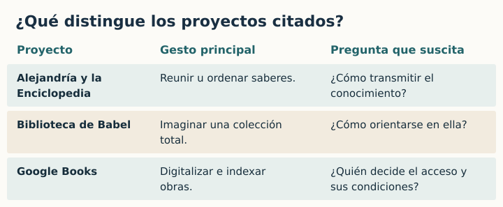

# ENS Rennes · D1 · Espagnol 2009 — Corrigé guidé

*Corrigé rédigé par IA, non officiel. Signalez toute erreur.*

**Rédaction** · GPT-6.2 Astra Ultra · vitesse non renseignée

Écrit de l’ENS de Cachan, conservé dans les archives D1 de Rennes. D’après El País, 21 janvier 2009.

## Version française du passage délimité

Les dirigeants du géant de l’informatique devront dédommager les éditeurs pour ne pas avoir respecté le droit d’auteur dans leur projet mondial de numérisation des livres.

Cataloguer les connaissances accumulées dans les livres et les rendre accessibles à tous les êtres humains : tel était le rêve des bibliothécaires d’Alexandrie, celui des encyclopédistes français et aussi la vision vertigineuse qu’imagina Jorge Luis Borges dans *La Bibliothèque de Babel*. Cet idéal, qui devient peu à peu réalité grâce à la numérisation et à la publication de livres sur Internet, se heurte à un obstacle incontournable : les droits des auteurs et des éditeurs.

## Expression en espagnol

Distinguer le projet de Google des projets de catalogage évoqués au début du texte. Au moins 100 mots.

Los bibliotecarios de Alejandría buscaban reunir el saber en un lugar; los enciclopedistas franceses aspiraban a ordenarlo para que circulara. Borges convirtió la idea de una biblioteca total en una ficción que también muestra lo difícil que resulta orientarse entre todos los libros posibles. Google dispone de medios técnicos para transformar parte de ese sueño en un servicio consultable desde numerosos dispositivos. Sin embargo, no es una biblioteca pública: una empresa selecciona los fondos, negocia con los titulares de derechos y puede obtener ingresos por publicidad. La diferencia afecta tanto al acceso como a quién decide sus condiciones y se beneficia de la base de datos creada.

*107 mots, comptés par espaces.*

## Comment construire la réponse

**S’arrêter à la borne imprimée.** Le titre général du texte situe le problème mais la version commence au chapeau sur l’indemnisation et se termine avec les droits des auteurs et des éditeurs, à la fin du paragraphe suivant. Le reste du document nourrit la réponse à la question.

**Passer du rêve au processus.** Les deux infinitifs de l’ouverture espagnole ont pour objet les connaissances réunies par les livres. *Se va haciendo realidad* présente une réalisation progressive ; *se enfrenta* fait surgir l’obstacle au présent. Le rapport insiste sur le vocabulaire français de la numérisation et du catalogage.

**Comparer des projets précis.** Le jury demande d’expliquer les références à l’Encyclopédie et à Borges. L’encyclopédie organise des savoirs pour des lecteurs ; la bibliothèque littéraire de Borges pousse jusqu’au vertige la fiction d’une collection totale. Avec Google Books, la possibilité de chercher dans les textes devient aussi une question de contrats, d’outils de recherche et de modèle économique. Le minimum de cent mots autorise à développer cette comparaison.

[Feuillet original, p. 4](https://www.ens-rennes.fr/medias/fichier/epreuve-de-l-v-e-d1_1423059201606-pdf#page=4) · [Rapport du jury, partie écrite](https://www.ens-rennes.fr/medias/fichier/s-ro01-09d1-esp-1_1423059265684-pdf#page=2)
