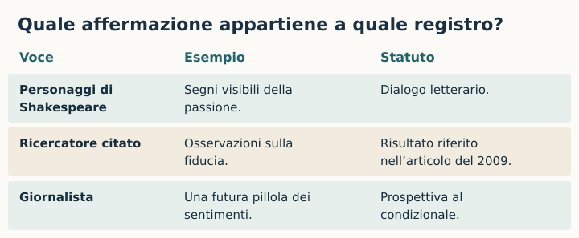

# ENS Rennes · D1 · Italien 2009 — Corrigé guidé

*Corrigé rédigé par IA, non officiel. Signalez toute erreur.*

**Rédaction** · GPT-6.2 Astra Ultra · vitesse non renseignée

Écrit de l’ENS de Cachan, conservé dans les archives D1 de Rennes. Enrico Franceschini, Repubblica.it, 9 janvier 2009.

## Version française

**Adieu les flèches de Cupidon, voici la pilule de l’amour**

« Comment sais-tu que je suis amoureux ? » demande un personnage de Shakespeare dans *Les Deux Gentilshommes de Vérone*. Et l’autre de répondre : « Vous avez appris à vous délecter d’un chant d’amour comme un rouge-gorge, à vous promener seul comme un pestiféré, à soupirer comme un écolier, […] à jeûner comme quelqu’un au régime, à veiller comme quelqu’un qui craint les voleurs. » Rien de neuf pour quiconque est transpercé par les flèches de Cupidon. Mais le jour approche où l’on pourrait provoquer artificiellement des sensations semblables, à volonté, en avalant une gélule avec un verre d’eau.

« Des médicaments agissant sur les mécanismes cérébraux pour renforcer ou atténuer les sentiments éprouvés pour une autre personne pourraient bientôt voir le jour », annonce dans la revue scientifique *Nature* le professeur Larry Young, biologiste à l’université Emory. Jusqu’à présent, nous nous sommes contentés de la pilule de l’amour au sens sexuel du terme, le Viagra et d’autres produits semblables. Or voici que semble se profiler, dans un avenir proche, la perspective d’une pilule de l’amour au sens du sentiment. L’amour dont parle Shakespeare, l’amour entier, le véritable amour.

Cela fait déjà quelque temps que l’on évoque des expériences de cet ordre. Au cours d’essais sur des souris et d’autres rongeurs, les don Juans de l’espèce se transforment aussitôt en conjoints voués à la monogamie. Mais les études auxquelles se réfère le professeur Young concernent les êtres humains. On a, par exemple, déjà montré, affirme le scientifique, que l’administration nasale d’ocytocine, une hormone, accroît la confiance et donne le sentiment de partager les émotions d’autrui.

## Expression en italien

È auspicabile che la scienza possa modificare il carattere? Aucun nombre de mots imprimé.

È auspicabile che la ricerca aiuti una persona a superare una sofferenza che limita la sua libertà. Questo obiettivo va però distinto dal desiderio di decidere al posto suo quali sentimenti debba provare. Un carattere non è un insieme di difetti da correggere secondo le preferenze della famiglia o del datore di lavoro. Inoltre, misurare una variazione della fiducia durante un esperimento non equivale a spiegare un legame costruito nel tempo. Per giudicare un intervento chiederei quindi chi ne definisce lo scopo, quali risultati sono davvero dimostrati e se la persona interessata può accettarlo o rifiutarlo senza pressioni.

*98 mots, comptés par espaces.*

## Comment construire la réponse

**Entendre les deux voix.** La comparaison avec un rouge-gorge, un écolier et un homme qui redoute les voleurs relève du dialogue shakespearien. Le retour à « rien de neuf » appartient au journaliste. Conserver le vouvoiement de la réponse là où le premier interlocuteur tutoie son partenaire fait sentir le changement de voix.

**Respecter les degrés de certitude.** *Potrebbero* et *sembra intravedersi* ouvrent des perspectives, tandis que *afferma lo scienziato* attribue la dernière affirmation au biologiste. L’article date de 2009. La version conserve les déclarations de cette époque. Aucun résultat sur la confiance, pris isolément, ne démontre la possibilité de créer un attachement amoureux.

**Passer des sentiments au caractère.** La question vise plus large que le scénario de la gélule. Le modèle examine qui définit la fin recherchée, la portée de l’observation et la liberté de consentir. Il distingue ainsi un changement voulu par une personne d’une normalisation imposée à celle-ci.

[Feuillet original, p. 5](https://www.ens-rennes.fr/medias/fichier/epreuve-de-l-v-e-d1_1423059201606-pdf#page=5)
