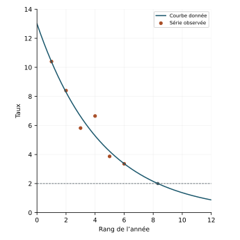

# ENS de Cachan D1 — Mathématiques appliquées et statistiques 2009 · Corrigé guidé

*Corrigé rédigé par IA, non officiel. Signalez toute erreur.*

**Rédaction** · GPT-6.2 Astra Ultra · vitesse non renseignée

**Révision** · GPT-6.2 Astra Ultra · vitesse non renseignée

Trois exercices traitent du conditionnement, d’un ajustement exponentiel et de calculs d’analyse et d’algèbre. Les deux questions imprimées « d » de la régression sont distinguées par leur objet.

## Exercice 1. Probabilités

### Question 1.I.1

> [!INDICATION]
> Modéliser chaque choix uniforme par une indicatrice.

#### Solution

Les cinq réponses choisies indépendamment ont chacune probabilité $1/3$ de succès. Donc $X\sim\mathcal B(5,1/3)$ et $P(X=k)=\binom5k2^{5-k}/3^5$ pour $0\le k\le5$. Dans l’ordre, les numérateurs sur 243 sont $32,80,80,40,10,1$.

### Question 1.I.2

> [!INDICATION]
> Additionner les masses aux rangs 3, 4 et 5.

#### Solution

$P(X\ge3)=(40+10+1)/243=17/81\simeq0{,}210$.

### Question 1.I.3

> [!INDICATION]
> Additionner les cinq espérances identiques.

#### Solution

$\mathbb EX=5/3\simeq1{,}667$ réponse exacte.

### Question 1.I.4

> [!INDICATION]
> Prendre la racine de la variance de la binomiale.

#### Solution

$V(X)=5(1/3)(2/3)=10/9$, donc $\sigma_X=\sqrt{10}/3\simeq1{,}054$ réponse.

### Question 1.II

> [!INDICATION]
> Essayer de remplir un tableau de 48 personnes. Le quart est vacciné, puis un douzième des vaccinés est malade. Utiliser pour finir le rapport entre malades vaccinés et non vaccinés.

#### Solution

Notons $V$ le statut vacciné et $M$ la maladie. Le texte donne $P(V)=1/4$, $P(V\mid M)=1/5$ et $P(M\mid V)=1/12$. Ainsi $P(M\cap V)=1/48$ et $P(M)=5/48$. La probabilité cherchée est $P(M\mid V^c)=(5/48-1/48)/(3/4)=1/9$.

Une population fictive de 48 personnes permet de lire les deux conditionnements sans changer implicitement de dénominateur.

| État | Vaccinées | Non vaccinées | Total |
|---|---:|---:|---:|
| Malades | 1 | 4 | 5 |
| Non malades | 11 | 32 | 43 |
| Total | 12 | 36 | 48 |

Parmi les cinq malades, une personne est vaccinée. Parmi les 36 personnes non vaccinées, quatre sont malades, ce qui redonne $4/36$.

### Question 1.III

> [!INDICATION]
> Préciser comment l’enfant accompagnant est choisi avant de conditionner.

#### Solution

En supposant les sexes des deux enfants indépendants et équiprobables, les configurations ordonnées $FF,FG,GF,GG$ ont chacune probabilité $1/4$. Si l’enfant accompagnant est choisi uniformément entre les deux, la probabilité d’observer une fille dans ces configurations vaut successivement $1,1/2,1/2,0$. L’événement $A$ de la rencontre a donc probabilité $1/2$. Se tromper revient à être dans $FF$, d’où $P(FF\mid A)=(1/4)/(1/2)=1/2$.

Si l’information signifie uniquement « la famille a au moins une fille » (par exemple elle présente toujours une fille lorsqu’elle le peut), les trois configurations $FF,FG,GF$ restent équiprobables et la réponse devient $1/3$. La seule équiprobabilité des sexes annoncée dans le texte ne fixe ni leur indépendance ni le mécanisme de présentation.

## Exercice 2. Modèle exponentiel d’un taux

### Question 2.I.1

> [!INDICATION]
> Le coefficient de x dans l’exposant est négatif.

#### Solution

Pour $x\to+\infty$, $f(x)=13e^{-0{,}225x}\to0$. La demi-droite $y=0$ est asymptote horizontale à droite et la courbe l’approche par valeurs positives.

### Question 2.I.2

> [!INDICATION]
> Vérifier le signe de la dérivée sur le domaine du modèle.

#### Solution

$f'(x)=-2{,}925e^{-0{,}225x}<0$. Sur $[0,+\infty[$, $f$ décroît strictement de $f(0)=13$ vers sa limite 0.

| $x$ | $0$ | $0<x<+\infty$ | $+\infty$ |
|---|---:|:---:|---:|
| Signe de $f'(x)$ | $-$ | $-$ | |
| $f(x)$ | $13$ | $\searrow$ | $0$ (limite) |

### Question 2.I.3

> [!INDICATION]
> Placer l’ordonnée initiale et exploiter l’asymptote.

#### Solution

Dans un repère de 2 cm par unité sur les deux axes, placer $(0,13)$, puis, par exemple, $(4,5{,}286)$ et $(8,2{,}149)$. La courbe décroît vers l’axe horizontal et reste convexe car $f''(x)>0$.

### Question 2.I.4

> [!INDICATION]
> Repérer l’intersection avec la droite horizontale donnée.

#### Solution

L’intersection avec $y=2$ se situe vers $x=8{,}32$. Comme $f$ décroît, $f(x)<2$ pour $x>\ln(13/2)/0{,}225\simeq8{,}319$.

### Question 2.II.1

> [!INDICATION]
> Associer les six taux à leurs six rangs entiers dans le même repère.

#### Solution

Les six points reportés sur la figure de 2.I.3 ont pour ordonnées successives 10,4, 8,4, 5,82, 6,65, 3,87 et 3,36, pour $x=1,\ldots,6$. Le taux remonte de 2005 à 2006 malgré la décroissance d’ensemble.

### Question 2.II.2.a

> [!INDICATION]
> Prendre le logarithme népérien de chaque taux.

#### Solution

Le tableau donne les valeurs arrondies au millième.

| $x_i$ | 1 | 2 | 3 | 4 | 5 | 6 |
|---|---:|---:|---:|---:|---:|---:|
| $Y_i=\ln y_i$ | 2,342 | 2,128 | 1,761 | 1,895 | 1,353 | 1,212 |

### Question 2.II.2.b

> [!INDICATION]
> Diviser les sommes par six pour les moments descriptifs.

#### Solution

Avec les logarithmes non arrondis, $\bar x=3{,}500$, $V_x=35/12\simeq2{,}917$, $\bar Y\simeq1{,}782$, $V_Y\simeq0{,}159$ et $C_{xY}=\sum_i x_iY_i/6-\bar x\bar Y\simeq-0{,}653$.

### Question 2.II.2.c

> [!INDICATION]
> Normaliser la covariance.

#### Solution

Le coefficient $r=C_{xY}/\sqrt{V_xV_Y}\simeq-0{,}959$ indique une forte corrélation linéaire décroissante.

### Question 2.II.2.d (droite)

> [!INDICATION]
> Chercher la droite des moindres carrés de Y en x.

#### Solution

La pente est $a=C_{xY}/V_x\simeq-0{,}224027$. L’ordonnée à l’origine est $b=\bar Y-a\bar x\simeq2{,}565952$. La droite $Y\simeq-0{,}224x+2{,}566$ représente bien la tendance : $r^2\simeq0{,}920$.

### Question 2.II.2.d (retour à y)

> [!INDICATION]
> Exponentier les deux membres de la relation ajustée.

#### Solution

La seconde ligne marquée d dans le cahier donne $\widehat y=e^b e^{ax}\simeq13{,}013e^{-0{,}224027x}$. Les paramètres sont proches des valeurs de la partie I.

### Question 2.II.3

> [!INDICATION]
> Identifier le premier rang entier satisfaisant l’inégalité stricte.

#### Solution

Avec les paramètres ajustés, $\widehat y<2$ équivaut à $x>(\ln2-b)/a\simeq8{,}360$. Le premier entier est 9, soit l’année **2011** puisque 2003 porte le rang 1. Cette valeur est une extrapolation.

## Exercice 3. Algèbre et analyse

### Question 3.I.1

> [!INDICATION]
> Un point fixe doit appartenir au domaine avant de résoudre l’équation.

#### Solution

Pour $x\ne-2$, $f(x)=(x-2)/2$. L’équation $f(x)=x$ donne $x=-2$, exclu : $f$ n’a aucun point fixe. Pour $g(x)=\sqrt{2x+1}-1$, le domaine est $[-1/2,+\infty[$. On y a $x+1>0$, donc $\sqrt{2x+1}=x+1$ équivaut à $2x+1=(x+1)^2$, soit $x=0$. Il vérifie bien l’équation.

### Question 3.I.2.a

> [!INDICATION]
> Rationaliser la différence pour faire disparaître le quotient en x.

#### Solution

Pour $x\ne0$, $h(x)=(\sqrt{1+x^2}-1)/x=x/(\sqrt{1+x^2}+1)$. Cette dernière expression est continue en zéro, de valeur 0. Elle définit le prolongement $k$ sur $\mathbb R$.

### Question 3.I.2.b

> [!INDICATION]
> Dériver le quotient valide même au point ajouté.

#### Solution

Posons $s=\sqrt{1+x^2}$. Les fonctions intervenant dans $k=x/(s+1)$ sont dérivables sur $\mathbb R$ et $s+1>0$. Ainsi $k'=[s+1-x^2/s]/(s+1)^2=1/[s(s+1)]$. En particulier $k'(0)=1/2$.

### Question 3.I.2.c

> [!INDICATION]
> Observer la continuité de tous les facteurs du dénominateur.

#### Solution

$s$ et $s+1$ sont continues et strictement positives sur $\mathbb R$. Leur produit a donc un inverse continu. Ainsi $k'$ est continue et $k$ est de classe $C^1$.

### Question 3.I.3

> [!INDICATION]
> Un zéro de la dérivée seconde demande parfois le signe de la dérivée première.

#### Solution

$w(x)=x^3+x^4$, $w'=x^2(3+4x)$ et $w''=6x+12x^2$. Les points critiques sont $-3/4$ et 0. En $-3/4$, $w''=9/4>0$ et $w=-27/256$ : c’est un minimum strict, même global. En 0, $w''=0$ mais $w'$ reste positif de part et d’autre. Ce point stationnaire n’est pas un extremum. Il n’y a pas de maximum local.

### Question 3.II.1.a

> [!INDICATION]
> Dériver l’identité d’homogénéité le long d’un rayon.

#### Solution

Pour une fonction différentiable homogène de degré $\alpha$, dériver $f(\lambda x,\lambda y)=\lambda^\alpha f(x,y)$ par rapport à $\lambda>0$. La règle de la chaîne donne $xf_x(\lambda x,\lambda y)+yf_y(\lambda x,\lambda y)=\alpha\lambda^{\alpha-1}f(x,y)$. En prenant $\lambda=1$, on obtient l’identité d’Euler.

### Question 3.II.1.b

> [!INDICATION]
> Les deux termes ont le même facteur lorsque les variables sont multipliées par λ.

#### Solution

Pour $xy\ge0$ et $\lambda>0$, $f(\lambda x,\lambda y)=\lambda^3x^2y+(\lambda^2xy)^{3/2}=\lambda^3 f(x,y)$. Le degré est 3. À l’intérieur du domaine, $f_x=2xy+(3/2)y\sqrt{xy}$ et $f_y=x^2+(3/2)x\sqrt{xy}$. Alors $xf_x+yf_y=3x^2y+3(xy)^{3/2}=3f$. Ces formules se prolongent sur les axes, par exemple en prolongeant $(xy)^{3/2}$ par $(\max(xy,0))^{3/2}$.

### Question 3.II.2

> [!INDICATION]
> Calculer les deux dérivées secondes pures et garder les deux occurrences du terme mixte.

#### Solution

Sur $x+z\ne0$, pour $y=xz/(x+z)$, on obtient $y_x=z^2/(x+z)^2$ et $y_z=x^2/(x+z)^2$. Puis $y_{xx}=-2z^2/(x+z)^3$, $y_{zz}=-2x^2/(x+z)^3$ et $y_{xz}=2xz/(x+z)^3$. La différentielle d’ordre deux est
$$d^2y=y_{xx}\,dx^2+2y_{xz}\,dx\,dz+y_{zz}\,dz^2=-\frac{2(z\,dx-x\,dz)^2}{(x+z)^3}.$$

### Question 3.II.3.a

> [!INDICATION]
> Exprimer les dérivées cartésiennes au point correspondant.

#### Solution

Pour $z=f(r\cos\theta,r\sin\theta)$, la règle de la chaîne donne $z_r=f_x\cos\theta+f_y\sin\theta$ et $z_\theta=r(-f_x\sin\theta+f_y\cos\theta)$.

### Question 3.II.3.b

> [!INDICATION]
> Développer les deux carrés et annuler les termes croisés.

#### Solution

Pour $r>0$, $z_r^2+(z_\theta/r)^2=(f_x\cos\theta+f_y\sin\theta)^2+(-f_x\sin\theta+f_y\cos\theta)^2=f_x^2+f_y^2$ puisque $\cos^2\theta+\sin^2\theta=1$. Le second membre cartésien est bien $z_x^2+z_y^2$.

### Question 3.II.4

> [!INDICATION]
> Résoudre le système du gradient puis identifier les valeurs extrêmes.

#### Solution

Les équations critiques sont $y=x^3$ et $x=y^3$, soit $(0,0),(1,1),(-1,-1)$. L’identité $f(x,y)=(x^2-y^2)^2+2(xy-1)^2-1$ prouve que le minimum global vaut $-1$, atteint aux deux points $(1,1)$ et $(-1,-1)$. À l’origine, les chemins $y=x$ et $y=-x$ donnent des variations opposées autour de 1, donc c’est un point selle. La fonction est non bornée supérieurement et aucun autre point critique ne pourrait être un maximum local.

### Question 3.III.1.a

> [!INDICATION]
> Prendre le dénominateur commun en excluant les deux pôles.

#### Solution

Pour $t\ne0,-1$, le numérateur commun de $1/(1+t)^2+2/(1+t)-1/t$ est $t+2t(1+t)-(1+t)^2=t^2+t-1$, d’où l’égalité annoncée.

### Question 3.III.1.b

> [!INDICATION]
> Intégrer chaque fraction entre les mêmes bornes.

#### Solution

Une primitive sur $[1,2]$ est $-1/(1+t)+2\ln(1+t)-\ln t$. On en déduit $I_1=1/6+2\ln(3/2)-\ln2=1/6+\ln(9/8)$.

### Question 3.III.2

> [!INDICATION]
> Changer de variable avec l’exponentielle du paramètre.

#### Solution

Posons $u=e^z$, donc $du=e^z dz$. Les nouvelles bornes sont $1/3$ et $1/2$. Comme $1/(1-u^2)=[1/(1+u)+1/(1-u)]/2$,
$$I_2=\left[\frac12\ln\frac{1+u}{1-u}\right]_{1/3}^{1/2}=\frac12\ln(3/2).$$

### Question 3.III.3

> [!INDICATION]
> Utiliser une primitive du logarithme.

#### Solution

$I_3=[t\ln t-t]_{e^2}^{e^3}=2e^3-e^2=e^2(2e-1)$.

### Question 3.IV.1

> [!INDICATION]
> Contrôler les formats avant de multiplier ligne par colonne.

#### Solution

$A,B,C$ ont les tailles $3\times3,3\times2,2\times2$. Entre deux matrices distinctes, seuls $AB$ et $BC$ existent et valent
$$AB=\begin{pmatrix}1&5\\-7&0\\4&-1\end{pmatrix},\qquad BC=\begin{pmatrix}-3&9\\0&0\\1&4\end{pmatrix}.$$
En autorisant la répétition d’un facteur, on obtient également
$$A^2=\begin{pmatrix}3&6&0\\-9&19&-1\\-6&9&6\end{pmatrix},\qquad C^2=\begin{pmatrix}1&4\\0&9\end{pmatrix}.$$
Par exemple, le premier coefficient de $AB$ vaut $1\cdot3+0\cdot0+2(-1)=1$.

### Question 3.IV.2

> [!INDICATION]
> Résoudre le système linéaire de second membre quelconque.

#### Solution

En notant $M$ la matrice donnée, résolvons $M(x,y,z)^\top=(u,v,w)^\top$. La première et la troisième lignes donnent $x=u/3-w/6$, $y=-u/6+w/3$. En les substituant dans la deuxième, $z=-u/6+v-7w/6$. La solution est unique pour tout second membre, donc
$$M^{-1}=\begin{pmatrix}1/3&0&-1/6\\-1/6&0&1/3\\-1/6&1&-7/6\end{pmatrix}.$$

Pour contrôler le dernier coefficient, la troisième colonne de l’inverse est $(-1/6,1/3,-7/6)^\top$. Multipliée à gauche par $M$, elle donne $(0,0,1)^\top$ : les trois produits sont $-4/6+2/3$, $-3/6+5/3-7/6$ et $-2/6+4/3$.
