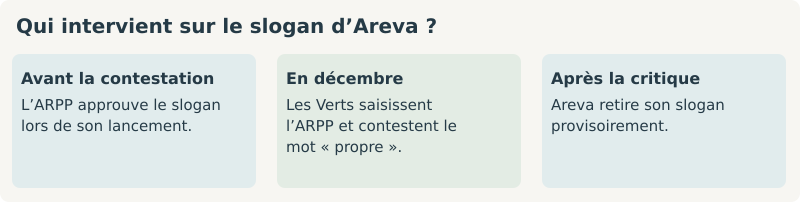

# ENS MP-PC — Allemand (LV1) 2009 · Corrigé guidé

*Corrigé rédigé par IA, non officiel. Signalez toute erreur.*

**Lecture du rapport du jury** · GPT-6.2 Astra Ultra · vitesse non renseignée

**Rédaction** · GPT-6.2 Astra Ultra · vitesse non renseignée

Le cahier commun aux ENS de Paris, Lyon et Cachan prévoit deux heures sans dictionnaire. La version compte pour douze points, les deux réponses en allemand pour huit points au total. L’énoncé demande environ cent mots par réponse.

## I. Version française

> [!INDICATION]
> Reconstituer les sujets de trois verbes. Qui approuve le slogan huit mois avant la saisine ? Qui reproche au slogan de tromper le public ? Qui décide de le retirer ? Ces trois actes ne peuvent pas tous être attribués à l’autorité de régulation.

L’énergie nucléaire n’est pas « propre ». C’est ce que reconnaît à présent, pour la première fois, l’organisme français d’autorégulation de la publicité, l’ARPP. Dans le pays où la densité de centrales nucléaires est la plus forte au monde, l’ARPP critique un slogan qui orne les brochures du groupe nucléaire Areva : « L’énergie au sens propre ». En réaction à ces critiques, le groupe a retiré le slogan. Mais à titre provisoire seulement.

En décembre, les Verts français ont saisi l’ARPP, qui avait approuvé sans difficulté le slogan lors de son lancement, huit mois auparavant. Ils lui reprochent de tromper le public en laissant croire que le nucléaire est une énergie propre. Pour preuve du contraire, les Verts citent les graves dommages causés à l’environnement dans le nord du Niger, où l’on extrait de l’uranium destiné principalement à la France. Ils rappellent aussi que la France produit chaque année 1 200 tonnes de déchets nucléaires hautement radioactifs, qui restent dangereux pendant une durée pouvant atteindre 100 000 ans.

Les professionnels français de la publicité n’ont créé l’ARPP qu’au printemps dernier, répondant aussi au souhait du gouvernement français, soucieux de donner une nouvelle image de sa politique environnementale. La mission principale de l’ARPP est de rendre la publicité « écoresponsable ». Elle ne prononce toutefois aucune interdiction et se borne à émettre des recommandations.

Trois grands groupes dont l’ARPP avait critiqué les slogans les ont pourtant modifiés aussitôt. Ainsi, BMW a remplacé son premier slogan, « Le plaisir est une énergie renouvelable », par « Le plaisir est toujours responsable ». […] Les nouveaux slogans ne sont pas forcément plus respectueux de l’environnement que les anciens. Mais ils montrent que les grands groupes sont sensibles aux exigences accrues de l’opinion et des responsables politiques en matière d’environnement.

*D’après Dorothea Hahn, « Le nucléaire reste bel et bien une électricité sale », Tageszeitung, 9 janvier 2009.*

> [!INDICATION]
> Dans *der Spruch täusche*, *suggeriere* et *sei*, le subjonctif I fait entendre l’accusation des Verts. Introduire le passage par « ils lui reprochent » rend cette distance sans une succession de conditionnels. Dans *hauptsächlich für Frankreich bestimmtes Uran*, repartir du noyau *Uran* avant de traduire *bestimmt* et son complément. Le minerai est extrait au Niger.

## II. Questions en allemand

### 1. Wie stellen Sie sich eine öko-verantwortliche Werbung vor?

> [!INDICATION]
> Choisir un produit et imaginer ce que son acheteur pourrait réellement vérifier. Le chiffre, sa base de comparaison et la limite de l’affirmation fournissent trois éléments précis. La publicité elle-même peut ensuite être examinée comme consommatrice de ressources.

Ökologisch verantwortliche Werbung sollte mir helfen, zwei Produkte sinnvoll zu vergleichen. Wenn eine Firma behauptet, eine Waschmaschine spare Strom, möchte ich wissen, gegenüber welchem Modell und bei welchem Waschprogramm sie das gemessen hat. Ein grünes Blatt auf der Verpackung beantwortet keine dieser Fragen. Außerdem sollte die Firma angeben, wie lange Ersatzteile erhältlich sind. Eine kleine Ersparnis beim Waschen nützt wenig, wenn ich die Maschine nach drei Jahren ersetzen muss. Auch das Werbemittel selbst zählt. Ein glaubwürdiger Hersteller muss seine Botschaft nicht die ganze Nacht auf einem beleuchteten Bildschirm zeigen. Eine überprüfbare Angabe am Verkaufsort wäre für mich überzeugender.

### 2. Inwiefern darf Atomkraft heutzutage als eine saubere Energie betrachtet werden?

> [!INDICATION]
> *Inwiefern* demande de fixer un critère et de voir jusqu’où il s’applique. Distinguer les émissions lors de la production d’électricité et les effets de la filière complète. Reprendre un fait du Niger en le rattachant à ce second critère.

Das hängt davon ab, was man unter sauberer Energie versteht. Wer nur den Betrieb eines Kraftwerks betrachtet, kann der Atomkraft einen Vorteil gegenüber der Kohle zusprechen. Bei der Stromerzeugung wird keine Kohle verbrannt, und die direkten Kohlendioxidemissionen sind gering. Für die Bewohner eines Uranabbaugebiets ist jedoch auch entscheidend, was mit ihrem Boden und ihrem Wasser geschieht. Hinzu kommen die radioaktiven Abfälle, die noch lange nach dem Abschalten des Kraftwerks sicher gelagert werden müssen. Deshalb würde ich in einer Diskussion über den Klimaschutz von einer kohlenstoffarmen Energiequelle sprechen. Das Wort „sauber“ verspricht dagegen mehr, als dieser Vergleich belegen kann.

[Cahier de deux heures, p. 2](https://www.ens.psl.eu/IMG/file/concours/2009/MP/2009_sujet_mp_pc_lv1.pdf#page=2) · [Rapport du jury](https://www.ens.psl.eu/IMG/file/concours/2009/PC/pc2009_ecri_allemand_lv1.pdf)
