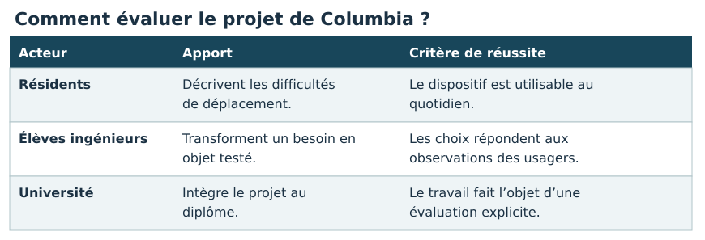

# ENS · MP-PC · Anglais (LE2) 2009 — Corrigé guidé

*Corrigé rédigé par IA, non officiel. Signalez toute erreur.*

**Rédaction** · GPT-6.2 Astra Ultra · vitesse non renseignée

Épreuve commune aux ENS de Paris et de Cachan. Durée totale de deux heures. La page 3 du cahier prévoit une version sur 15 points et une réponse en anglais d’au moins 100 mots sur 5 points. Le dictionnaire est interdit.

## I. Version — À Columbia, les étudiants conjuguent études et bénévolat pour obtenir des crédits

Lorsqu’on a demandé aux élèves ingénieurs de l’université Columbia de concevoir un meilleur déambulateur pour les résidents de la plus grande maison de retraite médicalisée de Harlem, ils ne se contentaient pas d’améliorer, par leur travail de conception, le quotidien de personnes âgées ayant des problèmes de hanche : leur travail était aussi noté.

L’université donne une impulsion particulièrement vigoureuse à une idée en vogue, l’apprentissage par le service à la collectivité. Cette année, cinq cents élèves ingénieurs obtiendront des crédits universitaires en participant à des projets dans le quartier de Harlem : concevoir des balançoires accessibles aux personnes en fauteuil roulant, construire dans un lycée du quartier une serre respectueuse de l’environnement ou encore créer une poubelle utilisable par des personnes lourdement handicapées.

Depuis six ans, tous les étudiants des filières d’ingénierie de Columbia doivent avoir participé à ce type d’apprentissage pour décrocher leur diplôme. Selon les spécialistes, seul un tout petit nombre de formations dans le pays ont ainsi rendu obligatoire ce que l’on appelait auparavant du bénévolat.

« Nous voulons bien sûr former des ingénieurs et des spécialistes des sciences appliquées qui soient techniquement compétents, mais aussi capables d’agir efficacement dans notre société mondialisée », déclare Jack McGourty, vice-doyen de l’école d’ingénierie et de sciences appliquées de la Fondation Fu à Columbia. « Nous voulons former des étudiants sensibles aux réalités sociales. »

[…] Selon une enquête menée en 2006 auprès de 260 000 étudiants de première année, deux sur trois jugeaient important de s’engager pour venir en aide aux personnes en difficulté. C’était la proportion la plus élevée depuis vingt-cinq ans, a indiqué David Eisner, directeur de la Corporation for National and Community Service, l’organisme fédéral chargé de promouvoir l’engagement au service de la collectivité.

Il a cité comme facteurs importants les attentats de 2001 et l’ouragan Katrina, événements marquants qui s’étaient produits pendant les années de formation de ces étudiants. […] M. Eisner a déclaré qu’à sa prise de fonctions il pensait que le meilleur moyen de persuader les étudiants de s’engager serait de leur expliquer comment cela les aiderait à trouver un emploi ou à améliorer leurs compétences.

« En fait, cet argument les rebutait, a-t-il dit. Les deux arguments les plus convaincants étaient : vous pouvez changer le monde et vous pouvez vivre une aventure. » […]

> [!INDICATION]
> *Walker* désigne l’objet qu’on demande aux étudiants de concevoir pour les résidents, d’où « déambulateur ». *For grades* indique que le travail donne lieu à une note ; les *credits* comptent pour l’obtention du diplôme. La serre à construire dans le lycée est un bâtiment, et *trash can* un nom composé.

## II. How might volunteer work make engineers and scientists more effective?

Volunteer work can make an engineer more effective because it changes who gets to define a problem. A student might initially think that a good walking aid should simply be lighter. After meeting its users, she may discover that the real difficulty is getting through a narrow doorway without losing balance. Her calculations still matter, but she now knows what to calculate and whose judgement should count when she tests the result.

The same principle applies to international projects. A device designed in one country may be hard to repair elsewhere. Working with a local organisation teaches students to ask about maintenance, cost and available materials before proposing a solution. There is a condition, however. A compulsory project can waste volunteers’ time if the university awards credit as soon as the prototype is presented. Residents should be able to decline an unsuitable design and the students should return to see whether their work remains useful. That is how service can improve both technical judgement and accountability.

> [!INDICATION]
> *To what extent* exige aussi une limite. Le dernier paragraphe propose des conditions précises pour que l’apprentissage rende les futurs professionnels plus efficaces.

[Cahier LE2, p. 3](https://www.ens.psl.eu/IMG/file/concours/2009/MP/2009_sujet_mp_pc_le2.pdf#page=3) · [Rapport du jury](https://www.ens.psl.eu/IMG/file/concours/2009/MP/mppc_ecrit_anglais_le2.pdf)
