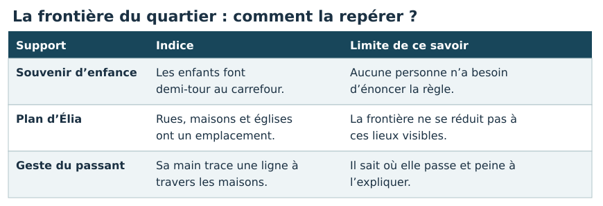

# ENS · MP-PC · Arabe (LE2) 2009 — Corrigé guidé

*Corrigé rédigé par IA, non officiel. Signalez toute erreur.*

**Rédaction** · GPT-6.2 Astra Ultra · vitesse non renseignée

**Révision** · GPT-6.2 Astra Ultra · vitesse non renseignée

**Retouches** · GPT-6.2 Astra Ultra · vitesse non renseignée

Épreuve commune aux ENS de Paris et de Cachan. Durée totale de deux heures. Version sur 15 points et réflexion en arabe sur 5 points. Le dictionnaire est autorisé. Les deux marques de coupe figurent sur la page imprimée.

## I. Version française

Il retourne dans les rues de la bourgade, essayant de se rappeler les frontières et de les tracer à nouveau.

Il écrit dans son carnet : « Les lieux sont tels qu’ils étaient, les gens aussi, les yeux des femmes, le silence des hommes. Quand nous étions petits, nous jouions et nous nous promenions dans notre quartier. Et voilà qu’aujourd’hui je le parcours en descendant vers la rivière. Pas une maison n’a changé. Les grandes personnes faisaient leurs achats dans les boutiques du quartier, priaient dans son église et faisaient moudre leur blé dans ses moulins… Nous entendions parler des quartiers de nos adversaires sans les voir. Avant mon départ pour New York, je n’avais jamais traversé leur quartier à pied. Nous ne l’avions traversé que deux fois en voiture. J’avais peur, même de passer en vitesse. J’avais peur qu’on nous barre la route, qu’on nous fasse descendre de voiture, qu’on nous aligne devant un mur et qu’on tire sur nous. Voilà ce que je pensais, alors même que je les voyais marcher dans les rues ou parler entre eux, indifférents aux voitures qui empruntaient cette route et aux passagers qu’elles transportaient. Des passagers dont les pieds ne touchaient jamais le sol de leur quartier. Lors de nos promenades, nous savions qu’une fois arrivés au carrefour nous avions franchi la limite de la zone sûre. Nous revenions donc sur nos pas sans nous concerter et sans que l’un de nous mette les autres en garde. J’irai maintenant visiter leur quartier pour établir la frontière entre les deux quartiers… Peut-être suis-je justement en train d’y marcher sans le savoir. »

Élia dessine une rose des vents en haut de la page. Il trace les rues principales et quelques-unes des rues qui s’en détachent. Il marque d’un signe l’emplacement des maisons des chefs de famille et d’une croix celui des églises. Chaque quartier a son église, chaque quartier son prêtre, son boucher et son cordonnier.

[…]

Il photographie les maisons des chefs et les églises. Il arrête un passant pour lui demander :

[…]

« Où finit le quartier d’en bas ? »

L’homme se trouble. Il sait où finit le quartier d’en bas, mais ne sait pas comment le lui indiquer. Il fait un geste de la main, trace une ligne droite qui traverse les maisons. Il avait du mal à parler et n’avait rien à dire. Ce qui s’est passé, il le connaît, il l’a vécu ou en a entendu parler, mais il ne voit sans doute aucune utilité à reprendre les détails de l’affaire. Il change de sujet.

*D’après Jabbour Douaihy, Pluie de juin, Dar al-Nahar, Beyrouth, 2006.*

> [!INDICATION]
> Le présent du narrateur encadre le « je » du carnet. Dans la première moitié de l’extrait, l’enfant se figure le danger : la succession des verbes après « j’avais peur » rapporte une crainte. Le texte ne raconte pas qu’un tel événement lui soit arrivé.

> [!INDICATION]
> Dans *الحارة التحتا*, le dernier terme est une forme usuelle pour désigner le quartier d’en bas. La répétition de *لكل حي* fait ressortir les éléments communs aux deux quartiers. Elle donne plus de force à la difficulté que le passant éprouve lorsqu’il tente d’en montrer la séparation.

## II. هل تفصل الحدود دائما بين الأعداء؟ ومتى تزول من الواقع والذاكرة؟

ليست الحدود دائما خطا يفصل الأعداء. فقد تحدد حدود بلدية ما الجهة المسؤولة عن المدرسة أو الطريق، ويعبرها الناس كل صباح من غير أن يشعروا بالغربة. لكن الحد في النص مختلف، لأن الطفل تعلم أن الطريق التي يعرفها تنتهي عند مكان يخاف أن يتجاوزه. لم يكن هناك جدار ظاهر عند المفترق، ومع ذلك كان الأطفال يعودون في الوقت نفسه من غير اتفاق. هكذا تحولت ذكرى النزاع إلى عادة ترسم حركة الأجساد.

وقد تزول الحدود من الواقع قبل أن تزول من الذاكرة. إذا فتح متجر أبوابه للجميع، أو التقى أطفال الحيين في مدرسة واحدة، فإنهم يكتسبون بالتدريج خبرة تخالف ما سمعوه من حكايات. أما من عاش الخوف فقد يبقى مترددا بعد زوال سببه، مثل الرجل الذي يعرف موضع الخط ولا يجد الكلمات المناسبة لشرحه. لذلك لا يكفي أن نطلب منه أن ينسى.

أظن أن التعايش ينجح حين يستطيع الناس تذكر الماضي والتحدث عنه من غير أن يفرض عليهم طريق المستقبل. عندئذ يمكن أن تبقى الحدود جزءا من قصة المكان، بينما تتوقف عن تحديد من نزوره ومن نثق به.

> [!INDICATION]
> Appuyez la distinction entre frontière administrative et frontière de peur sur un seul détail particulièrement parlant, le demi-tour spontané des enfants. La réponse doit aussi traiter la seconde question, celle du décalage entre changement des usages et disparition d’un souvenir.

[Cahier LE2, p. 4](https://www.ens.psl.eu/IMG/file/concours/2009/MP/2009_sujet_mp_pc_le2.pdf#page=4)
