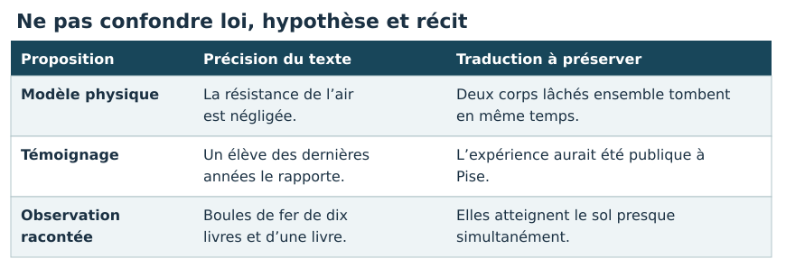

# ENS · MP-PC · Chinois (LE2) 2009 — Corrigé guidé

*Corrigé rédigé par IA, non officiel. Signalez toute erreur.*

**Rédaction** · GPT-6.2 Astra Ultra · vitesse non renseignée

Épreuve commune aux ENS de Paris et de Cachan. Durée totale de deux heures. Le dictionnaire est autorisé. La version vaut 15 points et la question en chinois 5 points. Le cahier imprime « 100 mots minimum » ; le rapport parle de 100 caractères. La réponse proposée dépasse les deux seuils.

## I. Version — Galilée

Galilée est un grand physicien et astronome italien du XVIe siècle, l’un des fondateurs de la science expérimentale moderne.

Entre 1589 et 1591, Galilée observa minutieusement le mouvement des corps en chute. Il réfuta, par l’expérience et par la théorie, la « loi du mouvement des corps en chute » d’Aristote et établit la loi correcte de la « chute libre ». Autrement dit, si l’on néglige la résistance de l’air, des boules de poids différents atteignent le sol en même temps lorsqu’elles tombent : leur vitesse de chute est indépendante de leur poids. D’après le témoignage laissé par un élève que Galilée eut vers la fin de sa vie, l’expérience de chute se serait déroulée en public, du haut de la tour penchée de Pise. Un jour de 1589, Galilée aurait lâché au même instant deux boules de fer, l’une de dix livres et l’autre d’une livre. Toutes deux auraient atteint le sol presque simultanément.

Cette démarche qui associe l’expérience à la construction d’un modèle, et dont témoigne le travail de Galilée, est devenue par la suite l’un des fondements de la recherche expérimentale actuelle.

> [!INDICATION]
> Le sujet fournit le pinyin de certains noms. La version française doit reconnaître « Galilée » et « Pise ». Dans *晚年的一名学生*, les dernières années sont celles de Galilée. Enfin, le mot *几乎* (« presque ») qualifie le résultat de l’expérience racontée, tandis que la phrase sur la loi formule un modèle idéal.

## II. 你认为所有科学理论都需要通过实验证明吗？

我认为，科学理论必须接受事实的检验，但事实并不总是来自人们能够重复安排的实验。比如，研究物体下落时，我们可以用两只质量不同的小球，让它们从同一高度落下，记录落地的时间。改变一个条件，再比较结果，就能发现原来的解释有哪些局限。不过，即使每一次测量都符合预期，也不能说一次实验已经永远证明了一个理论。

研究遥远的恒星时，情况就不同了。科学家无法把一颗恒星搬进实验室，也不能让它按照人的计划重新发光。但是，他们可以根据理论预测光谱中会出现哪些特征，再用不同望远镜的观测结果来检查预测。如果数据长期与预测不符，就要重新考虑模型，也要检查仪器是否出了问题。

因此，判断一种理论有没有科学价值，关键在于它能否提出清楚的、可能被事实否定的判断。实验是重要的检验方式，观察和比较也能提供证据。真正值得信任的理论，还应该告诉我们它在什么条件下适用，以及哪些问题仍然没有答案。

> [!INDICATION]
> La question porte sur *所有* (« toutes ») et sur le moyen de vérification. L’exemple astronomique montre comment on peut confronter un modèle à des observations alors que l’astre ne peut faire l’objet d’une expérience contrôlée.

[Cahier LE2, p. 5](https://www.ens.psl.eu/IMG/file/concours/2009/MP/2009_sujet_mp_pc_le2.pdf#page=5) · [Rapport du jury](https://www.ens.psl.eu/IMG/file/concours/2009/MP/mppc2009_ecrit_chinois_le2.pdf)
