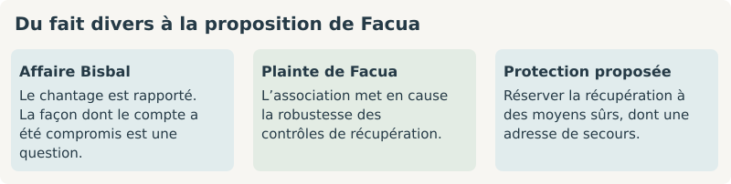

# ENS MP-PC — Espagnol (LE2) 2009 · Corrigé guidé

*Corrigé rédigé par IA, non officiel. Signalez toute erreur.*

**Rédaction** · GPT-6.2 Astra Ultra · vitesse non renseignée

Épreuve commune aux ENS de Paris et de Cachan. Le cahier accorde deux heures, sans dictionnaire pour l’espagnol. La version vaut quinze points et la réponse en espagnol, de cent mots au minimum, cinq points.

## 1. Version française

> [!INDICATION]
> Le titre formule une affirmation. Le corps du texte introduit ensuite des niveaux de certitude différents. La nouvelle de l’arrestation précède une question du journaliste. Les critiques adressées aux services de messagerie et les solutions envisagées sont, elles, attribuées à une association.

**Le service de messagerie électronique de Microsoft, Yahoo et Google n’est pas sûr**

La semaine dernière, quatre personnes ont été arrêtées pour avoir fait chanter le chanteur David Bisbal. Les malfaiteurs ont déjoué les mesures de sécurité de la messagerie du musicien, accédé à des informations confidentielles et menacé de les rendre publiques s’il ne payait pas. Comment avaient-ils pu se procurer son mot de passe ?

L’association Facua-Consommateurs en action a déposé plainte contre Microsoft, Yahoo et Google auprès de l’Agence espagnole de protection des données (AEPD). D’après la plainte de Facua, l’option de récupération du mot de passe met la messagerie d’autrui à la portée de n’importe qui. L’association dénonce la fragilité des renseignements employés pour identifier le titulaire : son lieu de résidence et la réponse à une question de sécurité, souvent très facile à deviner, qui porte généralement sur le nom d’un animal de compagnie, le chanteur préféré de l’intéressé, etc.

Les messages envoyés et reçus par la personne concernée se trouvent ainsi exposés. Il est en outre possible d’usurper son identité, aussi bien depuis sa messagerie électronique que depuis son logiciel de messagerie instantanée.

De l’avis de Facua, il serait très simple de remédier à ce grave problème : la récupération du mot de passe de la messagerie ne devrait être autorisée que par l’envoi de celui-ci à une autre adresse électronique fournie par l’utilisateur, ou par d’autres moyens sûrs.

*D’après elpais.com, 21 janvier 2009.*

> [!INDICATION]
> *El afectado* désigne la victime et *usurparse su identidad* l’usurpation de son identité. Dans la dernière phrase, *su envío* renvoie au mot de passe, objet de la proposition telle qu’elle est formulée en 2009. La question générale qui suit permet d’évaluer cette proposition sans ajouter des déclarations techniques à la version de l’article.

## 2. ¿Le parece que las «opciones seguras» que propone la asociación de consumidores para evitar los fraudes en Internet pueden funcionar?

> [!INDICATION]
> Partir de ce que l’adresse de secours change du point de vue du titulaire. Évaluer une condition de réussite et une limite du dispositif. Le texte parle de récupérer un compte ; la question élargit le débat à la fraude en général.

Sí, pueden funcionar, siempre que la dirección alternativa siga bajo el control de su titular. La ventaja consiste en que conocer algunos datos personales no equivale a tener acceso a un segundo buzón. Además, si el servicio avisa al usuario de que se ha solicitado una recuperación, este puede advertir una anomalía y pedir ayuda. Una dirección antigua que ya no consulta, en cambio, ofrece poca protección. El proveedor debería permitirle mantener al día sus datos de contacto y explicarle cómo actuar si pierde el acceso a ambas cuentas.

Tampoco conviene confundir la seguridad de una cuenta con la prevención de todos los fraudes. Un mensaje engañoso puede llegar a una persona cuya contraseña siga siendo secreta. Por eso combinaría las medidas que propone la asociación con información clara para reconocer comunicaciones dudosas y un canal fiable para denunciar el problema. El objetivo sería reducir los riesgos y facilitar la respuesta de la víctima.

[Cahier de deux heures, p. 6](https://www.ens.psl.eu/IMG/file/concours/2009/MP/2009_sujet_mp_pc_le2.pdf#page=6)
