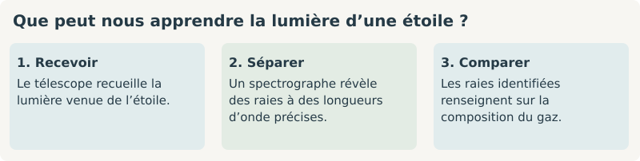

# ENS MP-PC — Espagnol (LV1) 2009 · Corrigé guidé

*Corrigé rédigé par IA, non officiel. Signalez toute erreur.*

**Rédaction** · GPT-6.2 Astra Ultra · vitesse non renseignée

L’épreuve commune aux ENS de Paris, Lyon et Cachan dure deux heures, sans dictionnaire. Le sujet accorde douze points à la version et huit aux questions. Les deux réponses proposées dépassent chacune cent mots.

## 1. Version française

> [!INDICATION]
> Dans *cientos de miles de millones*, partir de *mil millones*, un milliard, puis appliquer *cientos de*. Conserver la cascade de questions. La dernière comporte deux degrés d’incertitude : pourrons-nous un jour savoir si d’autres planètes abritent la vie ?

**Une année astronomique**

L’expansion de l’Univers s’accélère. Nous savons qu’il existe des systèmes planétaires autour d’autres étoiles. Les puissants télescopes installés sur Terre et dans l’espace nous révèlent l’existence de centaines de milliards de galaxies, qui comptent chacune des milliards d’étoiles. Presque chaque jour, de nouvelles découvertes nous font un peu mieux connaître le cosmos… et nous aident à répondre à ces questions que l’être humain se pose depuis des millénaires. À quoi ressemble l’Univers et comment est-il né ? Quel sera son destin ? Comment se sont formés le Soleil et les planètes du Système solaire ? Comment la Terre s’est-elle formée et comment la vie y est-elle apparue ? Existe-t-il des planètes semblables à la nôtre autour d’autres étoiles ?… Pourrons-nous un jour savoir si elles abritent la vie ?

Nous autres astronomes sommes des scientifiques un peu particuliers. Les chimistes ou les biologistes peuvent, en laboratoire, accéder aux échantillons qu’ils étudient, les toucher et les modifier. Nous, en revanche, nous devons faire preuve d’ingéniosité pour connaître le cosmos en analysant la lumière qui nous parvient des astéroïdes, des planètes, des comètes, des nuages de gaz interstellaire, des étoiles, des galaxies ou des amas de galaxies. Nous n’avons pu mener d’études sur place que dans de très rares cas.

L’année 2009 marque le quatrième centenaire des observations de Galilée, qui, à l’aide d’une modeste lunette astronomique, a ouvert une ère fascinante dans l’histoire de l’astronomie.

Pour célébrer cet anniversaire, l’Unesco a proclamé 2009 Année internationale de l’astronomie.

La Société espagnole d’astronomie (SEA), qui compte plus de 600 membres et réunit plus de 80 % des astronomes espagnols qui se consacrent à la recherche, s’est demandé comment toucher le grand public.

Grâce à ELPAÍS.com, nous vous présenterons ici, sous une forme attrayante et accessible, tous les domaines dans lesquels nous travaillons.

*D’après elpais.com, 20 janvier 2009.*

> [!INDICATION]
> *Los astrónomos somos* inclut l’auteur dans la profession. *Os ofreceremos* s’adresse aux lecteurs. Le texte passe ainsi d’un savoir partagé par l’humanité à la parole d’un chercheur qui invite le public à le suivre. Une traduction tout entière à la troisième personne perdrait ce mouvement.

## 2. Questions

### 1. ¿Por qué escribe el articulista que el trabajo de Galileo «abrió una era fascinante en la historia de la Astronomía»?

> [!INDICATION]
> Donner une observation concrète et dire quelle affirmation elle permet de corriger. Pour les satellites de Jupiter, la conclusion immédiate porte sur l’existence d’un autre centre de mouvement. Cette seule observation ne suffit pas à démontrer que la Terre tourne autour du Soleil.

La novedad del trabajo de Galileo estuvo tanto en lo que observó como en la manera de establecerlo. Con un anteojo relativamente modesto pudo distinguir irregularidades en la superficie lunar. La Luna dejaba de parecer aquella esfera perfectamente lisa que se podía imaginar al mirarla sin instrumentos. Al seguir durante varias noches unos puntos luminosos junto a Júpiter, comprobó además que giraban en torno al planeta. Por tanto, no todo lo que se movía en el cielo tenía como centro la Tierra. Otros observadores podían repetir esas observaciones, anotar las posiciones y discutir la interpretación. Esa posibilidad de someter una idea a una prueba pública abrió un camino que siguen recorriendo los astrónomos cuando analizan la luz de objetos que jamás podrán tocar.

### 2. ¿Cómo se puede explicar el interés del público por esta ciencia?

> [!INDICATION]
> Partir d’une expérience que le public peut faire, puis montrer ce qu’y ajoute l’astronome. Rattacher l’exemple au choix de diffuser les recherches dans un quotidien. Le lecteur doit pouvoir suivre la chaîne qui mène de la curiosité à la connaissance.

La astronomía parte de experiencias que casi todos podemos compartir. Basta con que desaparezca la Luna durante un eclipse para que una plaza se llene de personas que miran en la misma dirección. La explicación científica añade algo a ese asombro inicial: permite calcular cuándo volverá a ocurrir y desde dónde será visible. La curiosidad crece también cuando la pregunta atañe a nuestra propia historia. Preguntar si hay agua en otro planeta nos lleva a pensar en las condiciones que hicieron posible la vida en la Tierra. Sin embargo, una fotografía espectacular por sí sola explica poco. De ahí el interés de que los investigadores escriban en un periódico y cuenten cómo obtuvieron la imagen y qué dudas siguen sin resolver.

[Cahier de deux heures, p. 4](https://www.ens.psl.eu/IMG/file/concours/2009/MP/2009_sujet_mp_pc_lv1.pdf#page=4)
