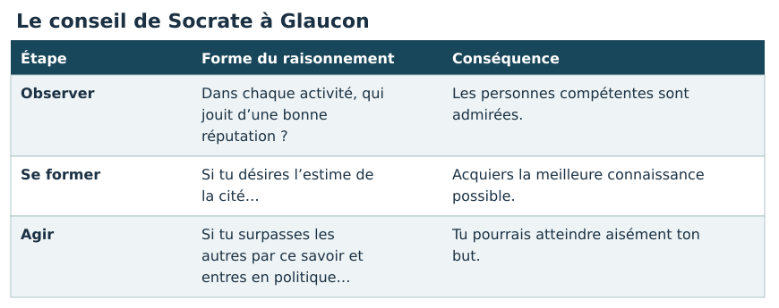

# ENS · MP-PC · Grec ancien (LE2) 2009 — Corrigé guidé

*Corrigé rédigé par IA, non officiel. Signalez toute erreur.*

**Rédaction** · GPT-6.2 Astra Ultra · vitesse non renseignée

Épreuve commune aux ENS de Paris et de Cachan. Durée totale de deux heures. Version grecque sur Xénophon. Le dictionnaire est autorisé. Le rapport correspondant à la page 11 est celui du concours MP-PC, accessible sous MPI. Le lien de la rubrique PC conduit au rapport BCPST sur un autre extrait.

## Version française — Seule l’expertise assure le renom

Songe aussi à ceux qui savent ce qu’ils disent et ce qu’ils font. Tu constateras, je crois, que, dans toutes les activités, ceux qui jouissent d’une bonne réputation et suscitent l’admiration se recrutent parmi les plus compétents, tandis que ceux qui ont mauvaise réputation et sont méprisés comptent parmi les plus ignorants. Si donc tu désires jouir d’une bonne réputation et être admiré dans la cité, efforce-toi d’acquérir la connaissance la plus approfondie possible de ce que tu veux entreprendre. Car si, après avoir surpassé les autres par ce savoir, tu essaies de prendre en main les affaires de la cité, je ne serais pas étonné que tu obtiennes fort aisément ce que tu désires.

**Le mouvement du dialogue.** Socrate part de ce que son jeune interlocuteur Glaucon peut constater dans des métiers qu’il connaît. La formule *ἐν πᾶσιν ἔργοις* donne à l’exemple sa portée générale. Le conseil politique qui suit porte sur la formation préalable de celui qui ambitionne de gouverner.

> [!INDICATION]
> *Ἐνθυμοῦ* et *πειρῶ* sont les deux impératifs signalés en note. Le génitif *τῶν εἰδότων* dépend du premier. Les deux groupes à l’accusatif introduits par *τοὺς μὲν* et *τοὺς δὲ* dépendent de « tu découvriras ». Les participes ont ici pour fonction de caractériser les personnes.

> [!INDICATION]
> Dans la deuxième phrase, *τὸ εἰδέναι ἃ βούλει πράττειν* est un infinitif substantivé : « le fait de connaître ce que tu veux entreprendre ». Il complète *κατεργάσασθαι* (« se procurer, acquérir »). La note de l’épreuve précise que le démonstratif *τούτῳ* de la dernière phrase reprend cet acquis.

> [!INDICATION]
> *διενέγκας* est un participe aoriste (« après avoir surpassé »), tandis que *ἐπιχειρῇς* porte la condition introduite par *ἐάν*. La personne change dans *οὐκ ἂν θαυμάσαιμι* : c’est Socrate qui dit « je ne serais pas étonné ». Maintenez la négation et le conditionnel jusqu’à la conclusion.

[Cahier LE2, p. 11](https://www.ens.psl.eu/IMG/file/concours/2009/MP/2009_sujet_mp_pc_le2.pdf#page=11) · [Rapport du jury](https://www.ens.psl.eu/IMG/file/concours/2009/MP/mppc2009_le2grec.pdf)
