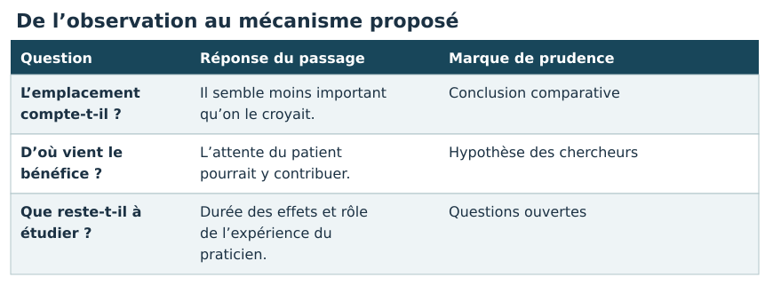

# ENS · MP-PC · Italien (LE2) 2009 — Corrigé brut

*Corrigé rédigé par IA, non officiel. Signalez toute erreur.*

**Rédaction** · GPT-6.2 Astra Ultra · vitesse non renseignée

Épreuve commune aux ENS de Paris et de Cachan. Durée totale de deux heures. Le passage est adapté d’un article d’Enrico Franceschini publié le 25 janvier 2009. Il faut traduire le texte puis répondre en italien à la question imprimée avant celui-ci. Le dictionnaire est interdit.

## Version — Une étude révèle que l’efficacité de l’acupuncture est avant tout psychologique

« Une grande partie des bénéfices cliniques de l’acupuncture semble tenir à des effets liés, non à l’emplacement des aiguilles, mais à un fort effet placebo », affirme le professeur Klaus Linde, qui a dirigé l’étude. « Par là, ajoute Linde pour préciser sa pensée, nous ne voulons pas dire que l’acupuncture est absolument dépourvue d’effet, mais que le choix de points précis du corps semble moins important que ne le pensaient jusqu’à présent nombre de ceux qui pratiquent ce traitement. »

Ce qui importerait davantage, en revanche, ce serait la conviction du patient : s’il croit que le traitement est efficace, son cerveau réagira de manière à lui en faire ressentir des bienfaits. Comme le placebo, petit comprimé de sucre qui ne contient aucun médicament mais que l’on administre lors d’essais cliniques précisément pour déterminer les différences avec de véritables médicaments, l’acupuncture aurait donc un effet de nature avant tout psychologique.

Il ne s’agit, soulignent les chercheurs allemands, que d’une hypothèse : « Il faudra sans aucun doute d’autres recherches pour comprendre exactement comment fonctionne cette thérapie avant de la prescrire aux patients », fait observer le professeur Linde. « Les médecins doivent savoir combien de temps dureront les effets bénéfiques de l’acupuncture et si des praticiens plus expérimentés peuvent réellement obtenir de meilleurs résultats que ceux qui n’ont reçu qu’une formation élémentaire. »

## Question — Come si possono valutare e considerare gli effetti di una più o meno grande consapevolezza?

Per valutare gli effetti della consapevolezza bisogna innanzitutto precisare di che cosa il paziente sia consapevole. Conoscere lo scopo di una terapia, aspettarsi di stare meglio e sapere con certezza quale trattamento si riceve sono tre cose diverse. Una persona può comprendere perfettamente le istruzioni e rimanere scettica. Un’altra può nutrire grandi speranze pur sapendo poco della cura.

In uno studio si potrebbero registrare le aspettative dei partecipanti prima del trattamento e confrontarle con le loro valutazioni successive. Sarebbe utile affiancare a queste risposte misure osservabili e un gruppo di confronto appropriato. Se chi ha aspettative positive riferisce un maggiore sollievo, il suo racconto merita attenzione. Da solo, però, non permette di stabilire quale parte del cambiamento dipenda dalla convinzione, dal trattamento o dal naturale andamento dei sintomi.

Sul piano umano, informare chiaramente una persona ha un valore anche quando non aumenta l’efficacia di una terapia: le permette di scegliere e di descrivere con maggiore precisione ciò che prova. Valutare il ruolo delle aspettative richiede quindi sia rigore nel confronto sia rispetto per l’esperienza del paziente.

[Cahier LE2, p. 7](https://www.ens.psl.eu/IMG/file/concours/2009/MP/2009_sujet_mp_pc_le2.pdf#page=7)
