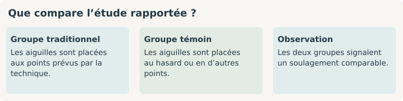

# ENS MP-PC — Italien (LV1) 2009 · Corrigé brut

*Corrigé rédigé par IA, non officiel. Signalez toute erreur.*

**Rédaction** · GPT-6.2 Astra Ultra · vitesse non renseignée

Le cahier commun aux ENS de Paris, Lyon et Cachan accorde deux heures sans dictionnaire. La page d’italien demande la traduction du texte et une réponse à la question. Elle ne précise ni barème par partie ni longueur de réponse.

## Version française

**L’acupuncture, un simple effet placebo. Les vertus de la technique chinoise revues à la baisse**

L’acupuncture fonctionne, à condition de ne pas révéler aux patients qu’en réalité elle ne fonctionne pas. Cela ressemble à un paradoxe, mais c’est, en substance, ce qui ressort de l’une des plus vastes recherches jamais menées sur cette très ancienne méthode de traitement des névralgies en tout genre et de bien d’autres maux. Employée depuis plus de cinq mille ans en Extrême-Orient, elle a depuis longtemps conquis aussi en Occident un vaste public qui y a recours comme médecine alternative.

Pourtant, ses effets thérapeutiques tiennent pour l’essentiel à ce qui se passe dans l’esprit des patients. Elle agit psychologiquement sur eux, comme un placebo. Convaincus de recevoir un traitement utile, ils y réagissent favorablement : leurs douleurs disparaissent ou s’atténuent, même si, en fait, on ne constate aucun bénéfice effectif. L’expérience en question a en effet établi que, si l’on enfonce les aiguilles aux mauvais endroits du corps, c’est-à-dire en dehors des lignes de pression sur lesquelles elles sont censées se trouver pour agir sur le système nerveux, les résultats pour le malade sont pratiquement identiques. Si ce n’est pas la disposition des aiguilles qui détermine une « guérison », commentent les scientifiques, c’est donc, selon eux, le psychisme humain qui doit produire cette sensation de bien-être.

Les recherches, dont la BBC s’est fait l’écho, ont été publiées dans la *Cochrane Library*, la revue de la Collaboration Cochrane, organisme qui se consacre à l’analyse critique des études cliniques internationales. Menée par des chercheurs du Centre de recherche sur les médecines complémentaires de l’Université technique de Munich, l’étude a examiné une série de trente-trois expériences réalisées sur un très vaste échantillon : pas moins de 6 736 patients souffrant de fortes migraines et de maux de tête.

Certains ont reçu un traitement d’acupuncture traditionnel respectant les points de pression du corps. D’autres, en revanche, ont été soumis à une forme de « fausse » acupuncture, les aiguilles étant placées au hasard ou aux mauvais endroits. À la surprise des chercheurs, tous ont tiré du traitement des bénéfices comparables à ceux qu’apportent les analgésiques ou d’autres médicaments destinés à atténuer la douleur.

*D’après Enrico Franceschini, repubblica.it, 25 janvier 2009.*

## Come possono conciliarsi credenze e scienze?

Una convinzione personale e una ricerca scientifica possono incontrarsi quando dalla prima nasce una domanda alla quale si accetta di dare anche una risposta inattesa. Se una paziente racconta che dopo una seduta di agopuntura il suo mal di testa si è attenuato, la sua esperienza merita ascolto. Da sola, tuttavia, non permette di stabilire quale parte del trattamento abbia prodotto il sollievo. Il dolore potrebbe essere cambiato nel tempo, oppure l’attenzione ricevuta potrebbe aver modificato il modo in cui la persona lo percepisce.

Il confronto descritto nell’articolo rende la domanda più precisa. Se due gruppi ottengono risultati simili pur essendo gli aghi collocati in punti diversi, diventa difficile attribuire il beneficio alla scelta di quei punti. Questo risultato non rende immaginario il dolore dei pazienti, né autorizza a estendere la conclusione a qualunque malattia. Invita a distinguere le spiegazioni che l’esperimento ha messo alla prova da quelle che restano possibili.

La conciliazione richiede dunque onestà da entrambe le parti. Il ricercatore può prendere sul serio una pratica tramandata e spiegare con chiarezza che cosa è stato misurato. Chi vi crede può conservarne il significato personale, ma dovrebbe accettare di rivedere le proprie affermazioni terapeutiche alla luce delle prove. È questo accordo sulle regole della verifica che permette di parlarsi senza chiedere al paziente di rinnegare la propria esperienza.

[Cahier de deux heures, p. 5](https://www.ens.psl.eu/IMG/file/concours/2009/MP/2009_sujet_mp_pc_lv1.pdf#page=5)
