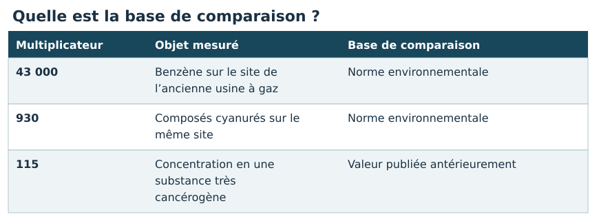

# ENS · MP-PC · Japonais (LE2) 2009 — Corrigé brut

*Corrigé rédigé par IA, non officiel. Signalez toute erreur.*

**Rédaction** · GPT-6.2 Astra Ultra · vitesse non renseignée

**Révision** · GPT-6.2 Astra Ultra · vitesse non renseignée

**Retouches** · GPT-6.2 Astra Ultra · vitesse non renseignée

Épreuve commune aux ENS de Paris et de Cachan. Durée totale de deux heures. Le dictionnaire est autorisé. La version vaut 15 points et la synthèse en japonais 5 points.

## I. Version française

Keiji Nakazawa, 46 ans, tient un restaurant de sushis réputé dans le centre de Tokyo. Selon lui, le secret pour se procurer de bons ingrédients « tient entièrement à la relation de confiance qu’on entretient avec son poissonnier ». Échaudé par des déceptions du genre « j’ai ouvert le poisson et je me suis aperçu qu’il ne valait rien », il conclut qu’« il n’y a qu’à se rendre assidûment à Tsukiji ». Le jugement est sans ambiguïté, de la part d’un cuisinier qui fréquente le marché aux poissons depuis trente ans.

Au marché de Tsukiji, à Tokyo, les amateurs affluent en nombre plusieurs fois supérieur à celui des professionnels de cette trempe. Les enchères de thon, notamment, où des sommes considérables sont en jeu, ont beaucoup de succès auprès des étrangers. Suspendues à cause de comportements déplacés, les visites ont repris et le site touristique a retrouvé son animation.

Le privilège d’avoir, aux portes de Ginza, l’un des plus grands marchés aux poissons du monde ne devrait toutefois durer « que cinq ans encore ». En effet, le gouvernement métropolitain de Tokyo, qui gère le marché, a décidé de le transférer à deux kilomètres de là, sur un terrain gagné sur les eaux. L’opération reviendrait moins cher que la reconstruction des installations vétustes.

Or, sur le site d’une ancienne usine à gaz où doit déménager le marché, on a relevé du benzène à un taux égal à 43 000 fois la norme environnementale et des composés cyanurés à 930 fois la norme. Lors de l’enquête menée l’année précédente, on avait détecté une substance fortement cancérogène à une concentration 115 fois supérieure à la valeur publiée jusque-là. Pourtant, la métropole n’en a pas fait état devant le comité d’experts.

La métropole assure que « le sol sera dépollué ». Mais dès que subsiste le moindre doute sur les informations qui concernent les aliments, ni les professionnels du poisson ni les consommateurs ne peuvent être rassurés.

De mon lieu de travail, je vois, dans le marché de 23 hectares et tout autour, quantité de commerces différents qui se serrent les uns contre les autres dans le soleil d’hiver. Tout cela repose sur près d’un siècle d’histoire et sur des milliers de liens de confiance. Déplacer la cuisine de la capitale demande autant de minutie que le maniement d’un couteau par un chef. Ici, on ne saurait se permettre de dire après coup : « J’ai ouvert, et ça n’allait pas. »

*D’après le journal Asahi.*

## II. 築地の魚市場の移転についてまとめてください。

東京都は、老朽化した施設を建て替えるより費用が少なくてすむとして、築地市場を約二キロ離れた埋め立て地に移す方針を示している。しかし、移転予定地はガス工場の跡地で、環境基準を大幅に上回るベンゼンやシアン化合物が見つかった。調査結果の一部が専門家会議に示されなかったことも、業者や消費者の不安につながる。都は土壌を浄化するとしているが、食の安全を守るには、調査の内容と対策を明らかにする必要がある。築地には、長い年月をかけて商店や料理人が築いてきた信頼関係がある。筆者は、費用だけで決めず、その関係も考えに入れて、移転を慎重に進めるよう求めている。

[Cahier LE2, p. 8](https://www.ens.psl.eu/IMG/file/concours/2009/MP/2009_sujet_mp_pc_le2.pdf#page=8)
