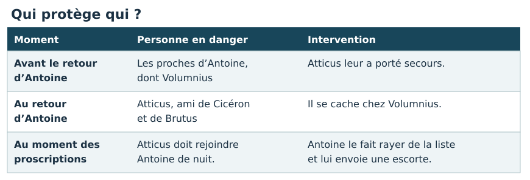

# ENS · MP-PC · Latin (LE2) 2009 — Corrigé brut

*Corrigé rédigé par IA, non officiel. Signalez toute erreur.*

**Rédaction** · GPT-6.2 Astra Ultra · vitesse non renseignée

Épreuve commune aux ENS de Paris et de Cachan. Durée totale de deux heures. Version latine de Cornelius Nepos. Le dictionnaire est autorisé. Le chapeau et les notes du sujet situent la scène à la fin de 43 avant J.-C.

## Version française — Atticus échappe aux proscriptions d’Antoine

Dès qu’Antoine fut rentré en Italie, tout le monde pensa qu’Atticus courrait un grand danger, en raison de l’étroite amitié qui le liait à Cicéron et à Brutus. Aussi s’était-il retiré du forum par crainte d’être proscrit et se cachait-il chez Publius Volumnius, à qui, comme nous l’avons montré, il avait porté secours peu auparavant. Tels étaient alors les revirements de la fortune que tantôt les uns, tantôt les autres se trouvaient au faîte de la puissance ou au comble du péril.

Or, bien qu’Antoine fût animé contre Cicéron d’une haine telle qu’il était l’ennemi de Cicéron lui-même aussi bien que de tous ses amis et voulait les proscrire, il se souvint pourtant du service que lui avait rendu Atticus. Après s’être renseigné sur l’endroit où il se trouvait, il lui écrivit de sa propre main de ne rien craindre et de venir le rejoindre sur-le-champ : il l’avait rayé du nombre des proscrits. Et pour qu’il ne courût aucun danger, puisque cela se passait de nuit, il lui envoya une escorte.

Or, si l’on décerne des éloges tout particuliers au pilote qui sauve son navire de la tempête et d’une mer semée d’écueils, pourquoi ne jugerait-on pas exceptionnelle la prudence de celui qui est sorti sain et sauf de troubles civils si nombreux et si violents ?

**L’image finale.** L’antécédent de *qui … peruenit* est Atticus. Après le récit des changements de fortune, le narrateur compare l’homme prudent à celui qui conduit un navire à bon port. Le nom technique *gubernator* appelle ici « pilote » ou « timonier ».

[Cahier LE2, p. 12](https://www.ens.psl.eu/IMG/file/concours/2009/MP/2009_sujet_mp_pc_le2.pdf#page=12)
